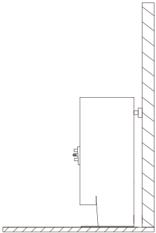
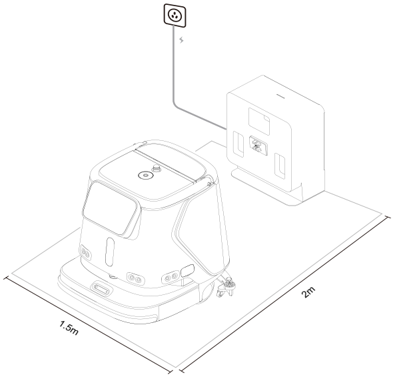
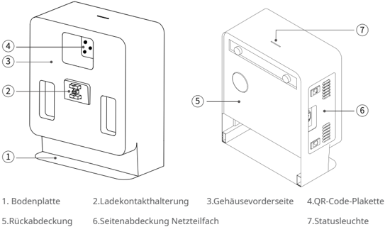
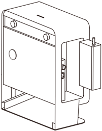
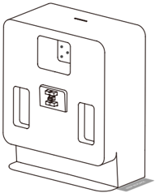
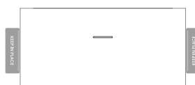

*Seite 26 (PDF-Seite 15, rechts)*

## Copyright © 2023 Shenzhen Pudu Technology Co., Ltd. Alle Rechte vorbehalten.

Keine Organisation oder Einzelperson darf den Inhalt dieses Benutzerhandbuchs teilweise oder vollständig ohne die ausdrückliche schriftliche Zustimmung von Shenzhen Pudu Technology Co., Ltd. kopieren, transkribieren oder übersetzen oder dieses Benutzerhandbuch zu kommerziellen Zwecken auf jedwede Art und Weise verteilen (elektronisch oder durch Fotokopieren, Aufzeichnen usw.). Die in diesem Benutzerhandbuch bereitgestellten technischen Daten und Angaben zum Produkt dienen nur als Referenz und können ohne vorherige Ankündigung geändert werden. Falls nicht anders angegeben, ist dieses Benutzerhandbuch nur als Orientierungshilfe gedacht und die darin enthaltenen Darstellungen sind nicht als Gewährleistung irgendwelcher Art aufzufassen.

## Sicherheitsanweisungen

## 1.1 Gebrauchshinweise

- Benutzer der Ladestation sind vom technischen Supportpersonal fachmännisch einzuweisen.
- Für den Einsatz der Ladestation können kleinere Elektrikerarbeiten erforderlich sein, die von Fachleuten auszuführen sind.
- Die Ladestation ist in Innenräumen mit Raumtemperatur aufzustellen. Die Ladestation darf nicht in einem Hochtemperaturbereich (> 40°C) eingesetzt werden.
- Wenn die Ladestation beschädigt, der Ladestrom abnormal oder der Lade-/Entleerungsvorgang abnormal ist, darf die Ladestation nicht weiter genutzt werden.
- Verwenden Sie ausschließlich das originale Netzkabel. Es ist strengstens verboten, nicht originale Netzkabel für die Stromversorgung der Ladestation zu verwenden.
- Schützen Sie das Stromkabel sorgfältig, um ein Ziehen und Verdrehen zu vermeiden.
- Die Ladestation darf auf keinen Fall durch eine Kollision mit Fremdkörpern beschädigt werden.
- Die Ladestation darf nicht in der Nähe von entflammbaren und explosiven Materialien eingesetzt werden.
- Wenn die Ladestation Rauch oder einen verbrannten Geruch abgibt, bedeutet dies, dass eine Störung vorliegt. Trennen Sie die Stromversorgung der Ladestation umgehend, und kontaktieren Sie das Purdue-Personal.
- Verschieben Sie die Ladestation nicht willkürlich während der Nutzung, und verwenden Sie die Ladestation am vorgesehenen Ort.
- Es ist strengstens verboten, das Gerät in Bereichen, die direkter Sonneneinstrahlung ausgesetzt sind, zu lagern oder zu betreiben.
- Trennen Sie, wenn an der Ladestation durch ein rotes Licht eine Störung angezeigt wird, den Roboter von der Ladestation. Warten Sie, bis das Licht der Ladestation grün wird, bevor Sie sie weiter verwenden.
- Wenden Sie sich an das technische Supportpersonal, wenn das rote Licht nach langem Warten nicht ausgeht.
- Dieses Gerät kann von Kindern ab 8 Jahren und von Personen mit eingeschränkten physischen, sensorischen oder geistigen Fähigkeiten oder mangelnder Erfahrung und Kenntnissen verwendet werden, wenn sie beaufsichtigt werden oder Anweisungen zur sicheren Verwendung des Geräts erhalten haben und die damit verbundenen Gefahren verstehen. Kinder dürfen nicht mit dem Gerät spielen. Kinder dürfen das Gerät nur unter Aufsicht reinigen und warten.
- Kinder sind zu beaufsichtigten, damit sie nicht mit dem Gerät spielen.
- Warnung vor dem Aufladen von nicht wiederaufladbaren Batterien.
- Lesen Sie vor der Verwendung des Ladegeräts alle Anweisungen und Warnhinweise auf dem Ladegerät, der Batterie und dem Produkt, das mit der Batterie betrieben wird.

---

*Seite 27 (PDF-Seite 16, links)*

- Für den Innenbereich geeignet, nicht dem Regen aussetzen.
- Verwendung nur mit dem Ladegerät für Modell AP-PF600CH02920150B.
- Verwendung nur mit dem kommerziellen Reinigungsroboter für Modell CCBC01.

## 1.2 Umgebungsbedingungen

- Temperatur der Arbeitsumgebung: 0°C bis 40°C, relative Luftfeuchtigkeit: ≤ 90 % (<40°C).
- Raumtemperatur bei Lagerung: -20°C bis 70°C, relative Luftfeuchtigkeit ≤ 85 %, Lagerung für 1 Jahr.
- Anforderungen an die Arbeitsumgebung:
    1. Die Ladestation muss mit der Rückseite gegen eine gerade Wand auf einem flachen Untergrund aufgestellt und durch seitliche Verbindungselemente an der Wand oder am Boden befestigt werden.

> *Bildbeschreibung (KI):* Die Ladestation wird mit der Rückseite an einer geraden Wand montiert. Sie steht auf einem flachen Untergrund und ist durch seitliche Verbindungselemente befestigt. Vor dem Gerät muss ein freier Bereich von 2 Metern vorhanden sein. Auf der rechten und linken Seite des Geräts sind jeweils 1,5 Meter Freiraum erforderlich.

2. Es dürfen sich keine reflektierenden oder lichtdurchlässigen Teile wie Spiegel oder Glas in der Arbeitsposition der Ladestation befinden. Wenn dies unvermeidlich ist, muss die Umgebung möglicherweise in gewissem Maße angepasst werden.
3. Es dürfen sich keine brennbaren Gegenstände in der Nähe der Ladestation befinden.
4. Sorgen Sie im Normalbetrieb für einen freien und ungehinderten Bereich im Abstand von 2 Metern vor dem Gerät und 1,5 Metern auf dessen rechter und linker Seite.

> *Bildbeschreibung (KI):* Die Abbildung zeigt die empfohlene Platzierung der Ladestation: 2 Meter vor dem Gerät und 1,5 Meter auf beiden Seiten frei halten. Die Ladestation muss mit der Rückseite an einer geraden Wand montiert werden. Es dürfen keine reflektierenden oder lichtdurchlässigen Teile (z. B. Spiegel, Glas) in der Arbeitsposition der Ladestation sein. Brennbare Gegenstände dürfen sich nicht in der Nähe der Ladestation befinden.

---

*Seite 28 (PDF-Seite 16, rechts)*

## 2.1 Packliste

Gerät × 1, Bedienungsanleitung × 1, Wasserleitung für sauberes Wasser × 1, Wasserleitung für Schmutzwasser × 1.

## 2.2 Gerät kennenlernen

> *Bildbeschreibung (KI):* Die Abbildung zeigt die verschiedenen Teile der Ladestation CC1 mit nummerierten Beschriftungen. Mit den Nummern sind spezifische Komponenten wie die Bodenplatte (1), Ladekontakthalterung (2) und Statusleuchte (7) gekennzeichnet. Die Seitenabdeckung für das Netzteilfach (6) ist an der Seite des Geräts positioniert.

*Beschriftungen:*

- **1** Bodenplatte
- **2** Ladekontakthalterung
- **3** Gehäusevorderseite
- **4** QR-Code-Plakette
- **5** Rückabdeckung
- **6** Seitenabdeckung Netzteilfach
- **7** Statusleuchte

## 2.3 Leistungsparameter

| Produkteigenschaften | Beschreibung |
|---|---|
| Produktname | Ladestation CC1 |
| Produktfunktion | Unterstützt das automatische Laden des Roboters |
| Abmessungen (L, B, H) | 404 x 234 x 497 mm |
| Gewicht | 14,3 kg |
| Eingangsspannung | 100–240 V/AC |
| Ausgangsspannung | 29,2 V/DC |
| Betriebstemperatur | 0 bis 40 ℃ |
| Betriebsfeuchtigkeit | RF: ≤ 90 % (40 ℃) |
| Lagertemperatur | -20 bis 70 ℃ |
| Übertragungsfrequenz | 2400 bis 2483,5 MHz |
| Übertragungsleistung | ≤ 10 dBm |
| Kommunikationsmethode | Bluetooth |
| Installationsanforderungen | Rückseitig an der Wand fixiert |
| Externe Abhängigkeiten | Stromversorgung |

## Produktvorstellung

---

*Seite 29 (PDF-Seite 17, links)*

## Produktverwendung

## 1.1 Gebrauchsanleitung

- Installieren Sie die Ladestation an bestimmten Orten gemäß der "1.2 Umgebungsbedingungen".
- Installieren Sie das Ladegerät des CC1-Roboters im Innern der Ladestation (wie in der Abbildung unten gezeigt), und verwenden Sie das Netzkabel des CC1-Ladegeräts um das Ladegerät an die externe Stromversorgung anzuschließen.
* Bei der Installation ist darauf zu achten, dass die Öffnung des Netzteils für die Wärmeabfuhr nach unten zeigt.

> *Bildbeschreibung (KI):* Die Abbildung zeigt die Ladestation mit dem eingebauten CC1-Ladegerät. Das Netzkabel des Ladegeräts verbindet das Gerät mit der externen Stromversorgung. Die Öffnung des Netzteils ist nach unten gerichtet, um Wärme abzuführen. Markierungsaufkleber können auf beiden Seiten der Ladestation angebracht werden.

- Sie können Markierungsaufkleber verwenden, um die Positionen auf beiden Seiten der Ladestation zu kennzeichnen (wie in der Abbildung unten gezeigt).

> *Bildbeschreibung (KI):* Die Abbildung zeigt die Ladestation mit der Position des Netzteils im Inneren. Das Netzteil ist so zu installieren, dass seine Öffnung nach unten zeigt. Auf beiden Seiten der Ladestation können Markierungsaufkleber angebracht werden.

---

*Seite 30 (PDF-Seite 17, rechts)*

## Beschreibung der Anzeigelichter

| Anzeigelicht | Beschreibung Lichtstatus |
|---|---|
| Rot blinkend | Es ist ein Fehler aufgetreten |
| Dauerhaft grün leuchtend | Normaler Standby (nicht verbunden) |
| Grün blinkend | Verbindung mit Roboter wird hergestellt |
| Grün pulsierend | Erfolgreich verbunden |

## Wartung

- Die Ladestation ist verschmutzt und staubig. Säubern Sie das Gerät mit einem weichen, sauberen, fusselfreien Tuch.
- Trennen Sie das Ladegerät von der Stromversorgung und kontaktieren Sie umgehend den Kundendienst bei Rissen, Verformungen oder wenn der Roboter nicht geladen werden kann.

---

*Seite 31 (PDF-Seite 18, links)*

## Kundendienst

## 4.1 Kostenlose Garantieleistung

Das Unternehmen verspricht, unter den folgenden Bedingungen, ab dem Datum des Produkterhalts, innerhalb der effektiven Garantiezeit des Produkts (die Garantiezeit der verschiedenen Produktteile unterscheidet sich), kostenlose Produktgarantieleistungen zu erbringen, wenn die folgenden Bedingungen erfüllt sind:

- Da das gekaufte Produkt innerhalb der angegebenen Produktgarantiezeit ordnungsgemäß verwendet wurde, bestehen keine durch Fremdeinwirkung verursachten Qualitätsprobleme;
- Es erfolgte keine unbefugte Demontage, keine Modifikation oder Installation, die nicht dem offiziellen Handbuch folgte, es handelt sich um andere, nicht durch Fremdeinwirkung verursachte Fehler;
- Die Produktseriennummer, das Firmenetikett und andere Markierungen sind nicht abgerissen oder verändert;
- Ein gültiger Kaufnachweis, Quittung und Bestellnummer werden vorgelegt;
- Die beschädigten Ersatzteile, die während der kostenlosen Garantiefrist ausgetauscht werden, sind Eigentum des Unternehmens und sind auf Anforderung an das Unternehmen zurückzuschicken.

## 4.2 Kundendienst außerhalb des Garantieumfangs

- Bei Kundendienstleistungen, die nicht im Rahmen der kostenlosen Garantie liegen (außerhalb der Garantiezeit oder die Bedingungen der kostenlosen Garantie innerhalb der Garantiezeit nicht erfüllen), bietet das Unternehmen kostenpflichtige Kundendienstleistungen an;
- Wenn nach der Diagnose des Technikers ein Hausbesuch zur Lösung des Problems für notwendig erachtet wird, wird ein professioneller Techniker beauftragt, den Service vor Ort zu erbringen;
- Für Kundendienstleistungen, die nicht im Rahmen der kostenlosen Garantie liegen, müssen Sie das "Kundendienstaufzeichnungsformular" wie erforderlich ausfüllen;
- Die Servicegebühr beinhaltet: Wartungsgebühr und Ersatzteilgebühr.

## 4.3 Beratung durch den Kundendienst

Wenden Sie sich bei Fragen bitte an die Kundendienst-Hotline von Purdue Technology: +86 755-86952935 E-Mail: techservice@pudutech.com
