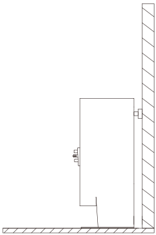
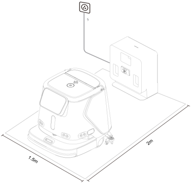
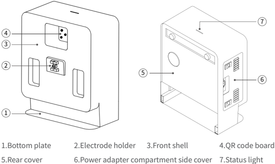
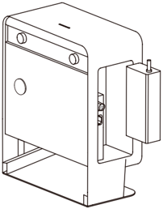
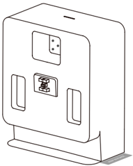
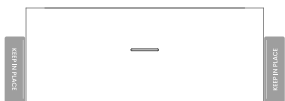

*Page 7 (PDF page 6, left)*

## Copyright © 2023 Shenzhen Pudu Technology Co., Ltd. All rights reserved.

No organization or individual shall imitate, copy, transcribe or translate the contents of this user manual, in part or in full,without the express written consent of Shenzhen Pudu Technology Co., Ltd., or distribute this user manual for profit in anyway (electronically or via photocopying, recording, etc.). The product specifications and information provided in this user manual are for reference only and are subject to change without further notice. Unless otherwise specified, this user manual is only intended as a user guide, and no representation shall be deemed as a warranty of any kind.

## Safety Instructions

## 1.1 Instructions for use

- Charging station users should receive professional training from technical support personnel.
- Deployment of charging station may involve lightweight construction of circuits, so professionals are required to implement.
- The charging station should be placed in an indoor scene with normal temperature. It is forbidden to place the charging station in a high temperature area (> 40° C) for use.
- If the charging station is damaged, the charging current is abnormal, or the charging/draining is abnormal, please stop using the charging station.
- Be sure to use the original power cord, and it is strictly forbidden to use non-original power cords to supply power to the charging station.
- Carefully protect the power cord to avoid pulling and twisting.
- It is strictly forbidden for the charging station to collide with foreign objects, causing damage to the charging station.
- Do not use the charging station near flammable and explosive objects.
- If the charging station emits smoke or burnt smell, it means that the charging station is abnormal, Please disconnect the power supply of the charging station immediately and contact Purdue staff.
- Do not move the charging station arbitrarily when in use, and use the charging station at the designated location.
- It is strictly forbidden to store or work in areas exposed to direct sunlight.
- If there is an abnormal red light on the charging station, please separate the robot from the charging station, Wait for the charging station light to turn green before it can be used again.
- If the red light does not go off for a long time, please contact technical support personnel.
- This appliance can be used by children aged from 8 years and above and persons with reduced physical, sensory or mental capabilities or lack of experience and knowledge if they have been given supervision or instruction concerning use of the appliance in a safe way and understand the hazards involved. Children shall not play with the appliance. Cleaning and user maintenance shall not be made by children without supervision.
- Children should be supervised to ensure that they do not play with the appliance.
- Do not recharge non-rechargeable batteries.
- Before using battery charger, read all instructions and cautionary markings on battery charger, battery, and product using battery.

---

*Page 8 (PDF page 6, right)*

- For indoor use, or do not expose to rain.
- Use only with battery charger for model AP-PF600CH02920150B.
- Use only with commercial cleaning robot for model CCBC01.

## 1.2 Environmental Notice

- Working environment temperature: 0° C ~40° C, relative humidity: ≤ 90% (<40° C).
- Storage ambient temperature: -20° C ~70° C, relative humidity ≤ 85%, storage for 1 year.
- Working environment requirements:
    1. The charging station needs to be placed on a flat ground for use, with its back against a flat wall, and fixed to the wall or the ground through lateral connection components.

> *Figure description (AI):* The charging station must be placed on a flat surface with its back against a wall. Keep at least 2 meters clear in front of the unit and 1.5 meters to the left and right sides. Do not place mirrors or glass near the charging station during operation. Ensure no flammable objects are stored around the device.

2. There are no reflective or light-transmitting parts such as mirrors or glass in the working position of the charging station. If it is unavoidable, the environment may need to be modified to a certain extent.
3. There should be no flammable objects around the charging station .
4. During normal operation, keep open and unobstructed within 2 meters in front and 1.5 meters in the left and right directions.

> *Figure description (AI):* The charging station requires a clear area of 2 meters in front and 1.5 meters on the left and right sides for normal operation. The robot must be placed on a flat surface with its back against a wall when docking to charge. No reflective or light-transmitting objects (like mirrors or glass) should be within the charging station’s working position. Flammable items must not be placed near the charging station during use.

---

*Page 9 (PDF page 7, left)*

## Product introduction

## 2.1 Packing list

machine × 1, instruction manual × 1, clean water pipe × 1, sewage pipe × 1.

## 2.2 Appearance introduction

> *Figure description (AI):* The labels identify parts of the CC1 Charging Station: bottom plate, electrode holder, front shell, QR code board, rear cover, power adapter compartment side cover, and status light.

*Labels:*

- **1** Bottom plate
- **2** Electrode holder
- **3** Front shell
- **4** QR code board
- **5** Rear cover
- **6** Power adapter compartment side cover
- **7** Status light

## 2.3 Performance parameters

| Product Characteristics | Description |
|---|---|
| Product Name | CC1 Charging Station |
| Product function | Support robot automatic charging |
| Body size (L, W, H) | 404 x 234 x 497 mm |
| Body weight | 14.3 kg |
| Input voltage | 100 ~ 240 Vac |
| Output voltage | 29.2 Vdc |
| Working temperature | 0 ~ 40℃ |
| Working humidity | RH: ≤ 90 %（40℃） |
| Storage temperature | -20 ~ 70 ℃ |
| Transmit frequency | 2400 - 2483.5 MHz |
| Transmit power | ≤ 10 dBm |
| Communication method | Bluetooth |
| Installation requirements | Back against the wall fixed |
| External dependencies | Power supply |

---

*Page 10 (PDF page 7, right)*

oduct us
 Product use

## 3.1 Instructions for use

- Deploy charging station at specific locations according to the "1.2 Environmental Notice" .
- Install the battery charger of the CC1 robot into the charging station internal (as shown in the figure below), and please use the power cord of the CC1 battery charger for the external power connection of the charging station.
* When installing, pay attention to the heat dissipation hole of the power adapter facing down.

> *Figure description (AI):* The figure shows the internal structure of a charging station. It illustrates how to install the battery charger inside the charging station. The power cord connection point is visible on the side of the device.

- You can use identification stickers to mark the positions on both sides of the charging station (as shown in the figure below).

> *Figure description (AI):* The figure shows a charging station with two vertical slots on its front face. A central panel displays a logo or brand mark. An upper rectangular area contains indicator lights or status symbols. The bottom section includes a base for stability and possibly ventilation.

---

*Page 11 (PDF page 8, left)*

## Indicator light description

| Indicator Light | Description Light Status |
|---|---|
| Flashing red | Fault occurred |
| Steady green | Formal standby (not connected) |
| Flashing green | Connecting with the robot |
| Breath green | Successfully connected |

## Maintenance

- The charging station is dirty and dusty, please use a soft, clean, lint-free cloth to wipe it clean.
- In case of cracks, deformation, inability to charge the charging station, etc., please disconnect the power supply and contact the after-sales service in time.

---

*Page 12 (PDF page 8, right)*

## After sales service

## 4.1 Free warranty service

The company promises to meet the following conditions, from the date of product receipt, within the effective warranty period of the product (the warranty period of different parts of the product is different),Free product warranty service will be provided if the following conditions are met:

- Since the purchased product is used normally within the specified product warranty period, there are non-artificial quality problems;
- No unauthorized disassembly, no modification or installation not guided by the official manual, and other non-human failures;
- The product serial number, factory label and other marks are not torn or altered;
- Provide valid proof of purchase, receipt and order number;
- Damaged spare parts replaced during the free warranty period belong to the company and should be sent back as required by the company.

## 4.2 After-sales service beyond the scope of warranty

- For after-sales service that is not within the scope of free warranty (beyond the warranty period or does not meet the terms of free warranty within the warranty period), the company provides paid after-sales service;
- If it is necessary to come to the door to solve the problem after the diagnosis of the technical engineer, assign a professional technician to provide the door-to-door service;
- For after-sales service that is not within the scope of free warranty, you need to fill in the "After-sales Service Record Form" as required;
- Service fee includes: after-sales maintenance fee and spare parts fee.

## 4.3 After-sales service consultation

If you have any questions,

please contact Purdue Technology customer service hotline: +86 755-86952935.

Email: techservice@pudutech.com

---

*Page 13 (PDF page 9, left)*

# 5. Compliance information

## 5.1 Disposal and recycling information

The Waste Electrical and Electronic Equipment (WEEE) Directive aims to minimize the impact of electrical and electronic goods on the environment, by increasing re-use and recycling and by reducing the amount of WEEE going to landfill. The symbol on this product or its packaging signifies that this product must be disposed separately from ordinary household wastes at its end of life. Be aware that this is your responsibility to dispose of electronic equipment at recycling centers in order to conserve natural resources. Each country should have its collection centers for electrical and electronic equipment recycling. For information about your recycling drop off area, please contact your related electrical and electronic equipment waste management authority, your local city office, or your house hold waste disposal service.

## 5.2 Federal Communications Commission compliance statement

The following information applies to Pudu robotic.

This equipment has been tested and found to comply with the limits for a Class B digital device, pursuant to part 15 of the FCC Rules. These limits are designed to provide reasonable protection against harmful interference in a residential installation. This equipment generates, uses and can radiate radio frequency energy and, if not installed and used in accordance with the instructions, may cause harmful interference to radio communications. However, there is no guarantee that interference will not occur in a particular installation. If this equipment does cause harmful interference to radio or television reception, which can be determined by turning the equipment off and on, the user is encouraged to try to correct the interference by one or more of the following measures:

- Reorient or relocate the receiving antenna.
- Increase the separation between the equipment and receiver.
- Connect the equipment into an outlet on a circuit different from that to which the receiver is connected.
- Consult the dealer or an experienced radio/TV technician for help.

This device complies with Part 15 of the FCC rules. Operation is subject to the following two conditions:

- This device may not cause harmful interference.
- This device must accept any interference received, including interference that may cause undesired operation.

## 5.3 Industry Canada compliance statement

This device complies with Industry Canada licence-exempt RSS standard(s). Operation is subject to the following two conditions:

- This device may not cause interference.
- This device must accept any interference, including interference that may cause undesired operation of the device.

L'émetteur/récepteur exempt de licence contenu dans le présent appareil est conforme aux CNR d'Innovation, Sciences et Développement économique Canada applicables aux appareils radio exempts de licence. L'exploitation est autorisée aux deux conditions suivantes :

- L'appareil ne doit pas produire de brouillage;
- L'appareil doit accepter tout brouillage radioélectrique subi, même si le brouillage est susceptible d'en compromettre le fonctionnement.
