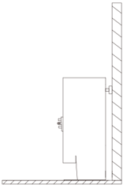
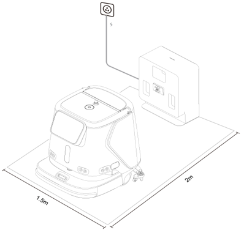
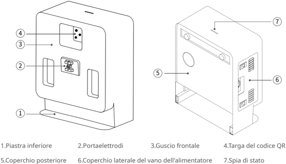
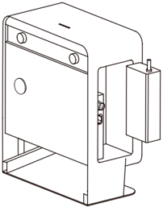
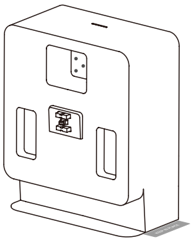
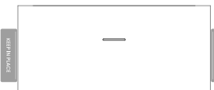

*Pagina 50 (pagina PDF 27, destra)*

## Copyright © 2023 Shenzhen Pudu Technology Co., Ltd. Tutti i diritti riservati.

Nessuna organizzazione o individuo può imitare, copiare, trascrivere o tradurre i contenuti di questo manuale utente, in parte o in toto, senza il consenso scritto di Shenzhen Pudu Technology Co., Ltd., o distribuire questo manuale utente a scopo di lucro in qualsiasi modo (elettronicamente o tramite fotocopiatura, registrazione, ecc.). Le specifiche del prodotto e le informazioni fornite nel presente manuale dell'utente hanno solo scopo di riferimento e sono soggette a variazione senza ulteriore preavviso. Salvo diversa indicazione, questo manuale dell'utente è destinato solo come guida per l'utente, e nessuna affermazione dovrà essere considerata come una garanzia di qualsiasi tipo.

## Istruzioni per la sicurezza

## 1.1 Istruzioni per l'uso

- Gli utenti della stazione di ricarica devono ricevere una formazione professionale dal personale di supporto tecnico.
- L'installazione della stazione di ricarica può coinvolgere la costruzione leggera di circuiti, quindi per l'implementazione sono richiesti professionisti.
- La stazione di ricarica deve essere collocata in un ambiente interno con temperatura normale. È vietato posizionare e utilizzare la stazione di ricarica in un'area ad alta temperatura (> 40 °C).
- Se la stazione di ricarica è danneggiata, la corrente di carica è anomala, o la carica/scarica è anomala, interrompere l'utilizzo della stazione di ricarica.
- Assicurarsi di utilizzare il cavo di alimentazione originale; è severamente vietato utilizzare cavi di alimentazione non originali per alimentare stazione di ricarica.
- Proteggere attentamente il cavo di alimentazione per evitare di tirarlo o di torcerlo.
- È severamente vietato urtare la stazione di ricarica con oggetti estranei, il che potrebbe causare danni alla stazione.
- Non utilizzare la stazione di ricarica in vicinanza di oggetti infiammabili o esplosivi.
- Se la stazione di ricarica emette fumo o odore di bruciato, questo significa che la stazione di ricarica è in stato anomalo. Scollegare immediatamente l'alimentazione della stazione di ricarica e contattare il personale di Purdue.
- Non spostare arbitrariamente la stazione di ricarica durante l'uso, e utilizzarla nella posizione designata.
- È severamente vietato conservare o lavorare in aree esposte alla luce diretta del sole.
- Qualora sulla stazione di ricarica compaia una luce rossa anomala, separare il robot dalla stazione e attendere che la luce diventi verde prima di utilizzarla di nuovo.
- Se la luce rossa non si spegne per molto tempo, contattare il personale di supporto tecnico.
- Questo apparecchio può essere utilizzato da bambini di età superiore a 8 anni e da persone con ridotte capacità fisiche, sensoriali o mentali o mancanza di esperienza e conoscenza se hanno ricevuto supervisione o istruzioni sull'uso dell'apparecchio in modo sicuro e comprendono i rischi coinvolti. I bambini non devono giocare con l'apparecchio. La pulizia e la manutenzione dell'utente non devono essere effettuate da bambini senza supervisione.
- I bambini devono essere sorvegliati per garantire che non giochino con l'apparecchio.
- Avvertenza contro la ricarica di batterie non ricaricabili.
- Prima di utilizzare il caricabatteria, leggere tutte le istruzioni e le indicazioni di cautela sul caricabatteria, sulla batteria e sul prodotto che utilizza la batteria.

---

*Pagina 51 (pagina PDF 28, sinistra)*

- Per uso interno, o non esporre alla pioggia.
- Usare solo con caricabatteria per modello AP-PF600CH02920150B.
- Usare solo con robot di pulizia commerciale per modello CCBC01.

## 1.2 Avviso ambientale

- Temperatura dell'ambiente di lavoro: 0 °C - 40 °C, umidità relativa: ≤ 90% (<40 °C).
- Temperatura dell'ambiente di stoccaggio: -20 °C - 70 °C, umidità relativa ≤ 85%, stoccaggio per 1 anno.
-
- Requisiti ambientali di lavoro:
    1. La stazione di ricarica deve essere posizionata su un terreno piatto, con la parte posteriore appoggiata a una parete piatta e fissata alla parete o al pavimento mediante componenti di connessione laterali.

> *Descrizione della figura (IA):* La figura mostra la posizione corretta per installare la stazione di ricarica: parete posteriore appoggiata a una superficie piana e fissata con componenti laterali. Lo spazio libero davanti alla stazione deve essere di almeno 2 metri, mentre ai lati sono richiesti 1,5 metri ciascuno. Non devono esserci oggetti infiammabili nelle vicinanze della stazione durante il funzionamento. La figura illustra come posizionare la stazione in un ambiente privo di superfici riflettenti o trasparenti (come specchi o vetri).

2. Non vi sono parti riflettenti o trasparenti come specchi o vetri nella posizione di lavoro della stazione di ricarica. Se è inevitabile, l'ambiente potrebbe dover essere parzialmente modificato.
3. Non devono esserci oggetti infiammabili intorno alla stazione di ricarica .
4. Durante il normale funzionamento, mantenere aperto e sgombro uno spazio di 2 metri davanti e
- 1,5 metri nelle direzioni sinistra e destra.

> *Descrizione della figura (IA):* La figura mostra le dimensioni minime dello spazio libero richiesto davanti (2 m) e ai lati (1,5 m) della stazione di ricarica. Le linee tratteggiate indicano l'area da mantenere sgombra durante il funzionamento normale del robot e della stazione. Il simbolo sopra la linea verticale rappresenta un punto di connessione o alimentazione per la stazione di ricarica.

---

*Pagina 52 (pagina PDF 28, destra)*

## Introduzione al prodotto

## 2.1 Contenuto della confezione

macchina × 1, manuale di istruzioni × 1, tubo dell'acqua pulita × 1, tubo delle acque reflue × 1.

## 2.2 Introduzione all'aspetto

> *Descrizione della figura (IA):* La figura mostra le parti principali della Stazione di ricarica CC1 con i relativi numeri identificativi. Il numero 1 indica la piastra inferiore del dispositivo. Il numero 2 indica il portaelettrodi sul guscio frontale. Il numero 7 indica la spia di stato presente sulla parte superiore del coperchio posteriore.

*Etichette:*

- **1** Piastra inferiore
- **2** Portaelettrodi
- **3** Guscio frontale
- **4** Targa del codice QR
- **5** Coperchio posteriore
- **6** Coperchio laterale del vano dell'alimentatore
- **7** Spia di stato

## 2.3 Parametri prestazionali

| Caratteristiche del prodotto | Descrizione |
|---|---|
| Nome del prodotto | Stazione di ricarica CC1 |
| Funzione del prodotto | Supporto alla ricarica automatica del robot |
| Dimensioni del corpo (L, W, H) | 404 x 234 x 497 mm |
| Peso del corpo | 14,3 kg |
| Tensione di ingresso | 100 - 240 Vac |
| Tensione di uscita | 29,2 Vcc |
| Temperatura di lavoro | 0-40 ℃ |
| Umidità di lavoro | Umidità relativa: ≤ 90 % (40 ℃) |
| Temperatura di conservazione | -20-70 ℃ |
| Frequenza di trasmissione | 2400 - 2483,5 MHz |
| Potenza di trasmissione | ≤ 10 dBm |
| Metodo di comunicazione | Bluetooth |
| Requisiti di installazione | Fissata contro la parete |
| Dipendenze esterne | Alimentazione |

---

*Pagina 53 (pagina PDF 29, sinistra)*

o del pro
 Utilizzo del prodotto

## 3.1 Istruzioni per l'uso

- Posizionare la stazione di ricarica in posizioni specifiche secondo il "1.2 Avviso ambientale" .
- Installare il caricabatteria del robot CC1 all'interno della stazione di ricarica (come mostrato nella figura in basso), e utilizzare il cavo di alimentazione del caricabatteria CC1 per il collegamento esterno alla stazione di ricarica.
* Durante l'installazione, prestare attenzione al foro di dissipazione del calore dell'alimentatore, rivolto verso il basso.

> *Descrizione della figura (IA):* La figura mostra la posizione del caricabatterie del robot CC1 all'interno della stazione di ricarica. È visibile il cavo di alimentazione collegato alla stazione di ricarica. Il foro di dissipazione del calore dell'alimentatore è rivolto verso il basso, come indicato nella descrizione.

- È possibile utilizzare adesivi di identificazione per contrassegnare le posizioni su entrambi i lati della stazione di ricarica (come mostrato nella figura in basso).

> *Descrizione della figura (IA):* La figura mostra la posizione del caricabatterie del robot CC1 all'interno della stazione di ricarica. È visibile il foro di dissipazione del calore dell'alimentatore, che deve essere rivolto verso il basso durante l'installazione. Sono indicati i punti per applicare adesivi di identificazione su entrambi i lati della stazione di ricarica. La figura illustra come collegare il cavo di alimentazione del caricabatterie CC1 alla stazione di ricarica.

---

*Pagina 54 (pagina PDF 29, destra)*

## Descrizione dell'indicatore luminoso

| Indicatore luminoso | Descrizione dello stato della luce |
|---|---|
| Lampeggiante rosso | Si è verificato un guasto |
| Verde fisso | Standby normale (non collegato) |
| Verde lampeggiante | In connessione con il robot |
| Verde lampeggiante lentamente | Connesso con successo |

## Manutenzione

- Qualora stazione di ricarica sia sporca o polverosa, utilizzare un panno morbido, pulito e privo di lanugine per pulirla.
- In caso di crepe, deformazioni, impossibilità di caricare la stazione di ricarica, ecc., scollegare l'alimentazione e contattare immediatamente il servizio post-vendita.

---

*Pagina 55 (pagina PDF 30, sinistra)*

## Assistenza post-vendita

## 4.1 Servizio di garanzia gratuito

L'azienda si impegna a rispettare le seguenti condizioni: dalla data di ricezione del prodotto, durante il periodo di garanzia effettivo del prodotto (il periodo di garanzia di diverse parti del prodotto è diverso), verrà fornito un servizio di garanzia del prodotto gratuito se sono soddisfatte le seguenti condizioni:

- Il prodotto acquistato viene utilizzato normalmente durante il periodo di garanzia specificato e non ci sono problemi di qualità causati dall'utente;
- Nessuno smontaggio non autorizzato, nessuna modifica o installazione non descritta dal manuale ufficiale, e altri guasti non umani;
- Il numero di serie del prodotto, l'etichetta di fabbrica e altri segni non sono strappati o alterati;
- Fornire una prova valida di acquisto, ricevuta e numero d'ordine;
- I pezzi di ricambio danneggiati sostituiti durante il periodo di garanzia gratuita sono di proprietà dell'azienda e verranno restituiti secondo quanto richiesto dall'azienda.

## 4.2 Assistenza post-vendita al di fuori della portata della garanzia

- Per l'assistenza post-vendita che non rientra nell'ambito della garanzia gratuita (oltre il periodo di garanzia o non soddisfacente i termini della garanzia gratuita durante il periodo di garanzia), l'azienda fornisce un'assistenza post-vendita a pagamento;
- Qualora sia necessario recarsi in loco per risolvere il problema dopo la diagnosi del tecnico, verrà assegnato un professionista per fornire il servizio presso la sede del cliente.
- Per il servizio post-vendita che non rientra nell'ambito della garanzia gratuita, è necessario compilare il "Modulo di registrazione del servizio post-vendita".
- La tariffa del servizio include il costo di manutenzione post-vendita e il costo dei pezzi di ricambio.

## 4.3 Consulenza per il servizio post-vendita

Per ogni eventuale domanda,

contattare la hotline del servizio clienti di Purdue Technology: +86 755-86952935.

E-mail: techservice@pudutech.com
