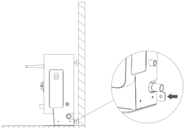
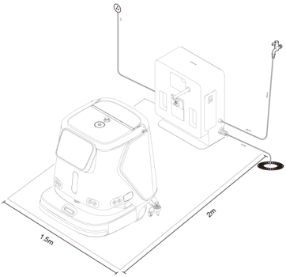
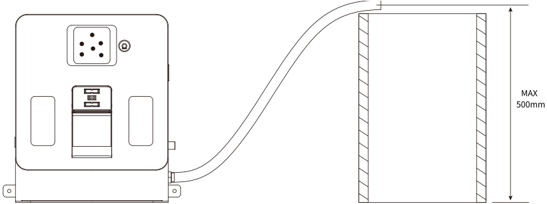
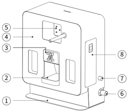
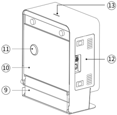
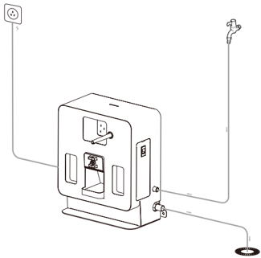
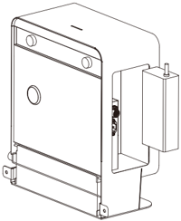
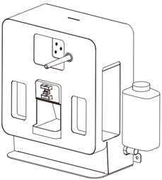
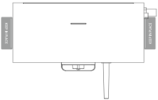
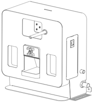

*Seite 29 (PDF-Seite 17, links)*

## Copyright © 2023 Shenzhen Pudu Technology Co., Ltd. Alle Rechte vorbehalten.

Keine Organisation oder Einzelperson darf den Inhalt dieses Benutzerhandbuchs teilweise oder vollständig ohne die ausdrückliche schriftliche Zustimmung von Shenzhen Pudu Technology Co., Ltd. kopieren, transkribieren oder übersetzen oder dieses Benutzerhandbuch zu kommerziellen Zwecken auf jedwede Art und Weise verteilen (elektronisch oder durch Fotokopieren, Aufzeichnen usw.). Die in diesem Benutzerhandbuch bereitgestellten technischen Daten und Angaben zum Produkt dienen nur als Referenz und können ohne vorherige Ankündigung geändert werden. Falls nicht anders angegeben, ist dieses Benutzerhandbuch nur als Orientierungshilfe gedacht und die darin enthaltenen Darstellungen sind nicht als Gewährleistung irgendwelcher Art aufzufassen.

## Sicherheitsanweisungen

## 1.1 Gebrauchshinweise

- Benutzer der Docking Station sind vom technischen Supportpersonal fachmännisch einzuweisen.
- Für die Installation der Docking Station können kleinere Installateur- oder Elektrikerarbeiten erforderlich sein, die von Fachleuten auszuführen sind.
- Die Docking Station ist in Innenräumen mit Raumtemperatur aufzustellen. Die Docking Station darf nicht in einem Hochtemperaturbereich (> 40°C) eingesetzt werden.
- Wenn die Docking Station beschädigt, der Ladestrom abnormal oder der Lade-/Entleerungsvorgang abnormal ist, darf die Docking Station nicht weiter genutzt werden.
- Verwenden Sie ausschließlich das originale Netzkabel. Es ist strengstens verboten, nicht originale Netzkabel für die Stromversorgung der Docking Station zu verwenden.
- Schützen Sie das Stromkabel sorgfältig, um ein Ziehen und Verdrehen zu vermeiden.
- Die Docking Station darf auf keinen Fall durch eine Kollision mit Fremdkörpern beschädigt werden.
- Die Docking Station darf nicht in der Nähe von entflammbaren und explosiven Materialien eingesetzt werden.
- Wenn die Docking Station Rauch oder einen verbrannten Geruch abgibt, bedeutet dies, dass eine Störung vorliegt. Trennen Sie die Stromversorgung der Docking Station umgehend, und kontaktieren Sie das Purdue-Personal.
- Verschieben Sie die Docking Station nicht willkürlich während der Nutzung, und verwenden Sie die Docking Station am vorgesehenen Ort.
- Es ist strengstens verboten, das Gerät in Bereichen, die direkter Sonneneinstrahlung ausgesetzt sind, zu lagern oder zu betreiben.
- Trennen Sie, wenn an der Docking Station durch ein rotes Licht eine Störung angezeigt wird, den Roboter von der Docking Station. Warten Sie, bis das Licht der Docking Station grün wird, bevor Sie sie weiter verwenden.
- Wenden Sie sich an das technische Supportpersonal, wenn das rote Licht nach langem Warten nicht ausgeht.
- Verwenden Sie, wenn Sie die Funktion zum automatischen Hinzufügen von Reinigungsmittel nutzen möchten, ein nicht schäumendes Reinigungsmittel. Die Verwendung von stark korrosiven Reinigungsmitteln wie starker Säure und starker Lauge ist verboten. Stellen Sie sicher, dass der Anschluss der Wasserleitung fest angezogen ist.
- Dieses Gerät kann von Kindern ab 8 Jahren und von Personen mit eingeschränkten physischen, sensorischen oder geistigen Fähigkeiten oder mangelnder Erfahrung und Kenntnissen verwendet werden, wenn sie beaufsichtigt werden oder Anweisungen zur sicheren Verwendung des Geräts erhalten haben und die damit verbundenen Gefahren verstehen. Kinder dürfen nicht mit dem Gerät spielen. Kinder dürfen das Gerät nur unter Aufsicht reinigen und warten.

---

*Seite 30 (PDF-Seite 17, rechts)*

- Kinder sind zu beaufsichtigten, damit sie nicht mit dem Gerät spielen.
- Warnung vor dem Aufladen von nicht wiederaufladbaren Batterien.
- Lesen Sie vor der Verwendung des Ladegeräts alle Anweisungen und Warnhinweise auf dem Ladegerät, der Batterie und dem Produkt, das mit der Batterie betrieben wird.
- Für den Innenbereich geeignet, nicht dem Regen aussetzen.
- Verwendung nur mit dem Ladegerät für Modell AP-PF600CH02920150B.
- Verwendung nur mit dem kommerziellen Reinigungsroboter für Modell CCBC01.

## 1.2 Umgebungsbedingungen

- Temperatur der Arbeitsumgebung: 0°C bis 40°C, relative Luftfeuchtigkeit: ≤ 90 % (<40°C).
- Raumtemperatur bei Lagerung: -20°C bis 70°C, relative Luftfeuchtigkeit ≤ 85 %, Lagerung für 1 Jahr.
- Anforderungen an die Arbeitsumgebung:
    1. Die Docking Station muss mit der Rückseite gegen eine gerade Wand auf einem flachen Untergrund aufgestellt und durch seitliche Verbindungselemente an der Wand oder am Boden befestigt werden.

> *Bildbeschreibung (KI):* Die Docking Station muss mit der Rückseite an eine gerade Wand montiert werden. Das Gerät ist für den Innenbereich bestimmt und darf nicht dem Regen ausgesetzt werden. Es dürfen keine reflektierenden oder lichtdurchlässigen Teile wie Spiegel oder Glas in der Nähe der Docking Station sein. Im Normalbetrieb muss ein freier Bereich von 2 Metern vor dem Gerät und 1,5 Meter auf den Seiten gewährleistet sein.

2. Es dürfen sich keine reflektierenden oder lichtdurchlässigen Teile wie Spiegel oder Glas in der Arbeitsposition der Docking Station befinden. Wenn dies unvermeidlich ist, muss die Umgebung möglicherweise in gewissem Maße angepasst werden.
3. Es dürfen sich keine brennbaren Gegenstände in der Nähe der Docking Station befinden.
4. Sorgen Sie im Normalbetrieb für einen freien und ungehinderten Bereich im Abstand von 2 Metern vor dem Gerät und 1,5 Metern auf dessen rechter und linker Seite.

> *Bildbeschreibung (KI):* Die Abbildung zeigt die empfohlene Platzierung der Docking Station mit einem Mindestabstand von 2 Metern vor dem Gerät und 1,5 Metern auf den Seiten. Der Bereich vor der Docking Station muss frei bleiben, um eine ungestörte Funktion zu gewährleisten. Die seitlichen Abstände von jeweils 1,5 Meter müssen eingehalten werden, um ausreichende Luftzirkulation und Sicherheit zu gewährleisten. Die Abbildung verdeutlicht die räumliche Anordnung der Docking Station im Verhältnis zur Wand und zum Boden.

---

*Seite 31 (PDF-Seite 18, links)*

5. Der Druck des sauberen Wassers beträgt 0,1-0,6 MPa.
6. Der Schmutzwasserauslauf darf nicht mehr als 0,5 m über dem Boden befinden.

> *Bildbeschreibung (KI):* Die maximale Höhe des Schmutzwasserauslaufs beträgt 500 mm über dem Boden. Der Schlauch verbindet das Gerät mit einem externen Behälter oder Abfluss.
## Produktvorstellung

## 2.1 Packliste

Gerät × 1, Bedienungsanleitung × 1, Wasserleitung für sauberes Wasser × 1, Wasserleitung für Schmutzwasser × 1.

## 2.2 Gerät kennenlernen

> *Bildbeschreibung (KI):* Die Statusleuchte (4) und der QR-Code (5) sind auf der Vorderseite des Gehäuses positioniert. Die Abdeckung für das Reinigungsmittelfach (8) ist rechts oben am Gerät angebracht.

> *Bildbeschreibung (KI):* Die Nummer 13 zeigt die Statusleuchte am oberen Teil des Geräts. Die Nummer 12 weist auf das Fach für das Netzteil an der Seitenabdeckung hin. Die Nummer 9 kennzeichnet den Schmutzwasserbehälter im unteren Bereich. Die Nummer 10 markiert die Rückabdeckung des Gehäuses.

*Beschriftungen:*

- **1** Bodenplatte
- **2** Schmutzwasserausguss
- **3** Ladekontakthalterung
- **4** Gehäusevorderseite
- **5** QR-Code-Plakette
- **6** Schmutzwasserleitung
- **7** Wasserzulauf
- **8** Abdeckung Reinigungsmittelfach
- **9** Schmutzwasserbehälter
- **10** Rückabdeckung
- **11** Druckventilabdeckung
- **12** Seitenabedeckung Netzteilfach
- **13** Statusleuchte

---

*Seite 32 (PDF-Seite 18, rechts)*

## 2.3 Leistungsparameter

| Produkteigenschaften | Beschreibung |
|---|---|
| Produktname | CC1 Docking Station |
| Produktfunktion | Unterstützt automatisches Hinzufügen und Entleeren, automatisches Laden, automatisches Einspritzen von Reinigungsmittel |
| Abmessungen (L, B, H) | 404 x 274 x 497 mm |
| Gewicht | 20 kg |
| Eingangsspannung | 100–240 V/AC |
| Ausgangsspannung | 29,2 V/DC |
| Betriebstemperatur | 0 bis 40℃ |
| Betriebsfeuchtigkeit | RF: ≤ 90 % (40 ℃) |
| Lagertemperatur | -20 bis 70 ℃ |
| Übertragungsfrequenz | 2400 bis 2483,5 MHz |
| Übertragungsleistung | ≤ 10 dBm |
| Kommunikationsmethode | Bluetooth |
| Installationsanforderungen | Am Boden oder rückseitig an der Wand befestigt |
| Externe Abhängigkeiten | Wasserquelle, Bodenablauf, Stromversorgung |

## Produktverwendung

## 1.1 Gebrauchsanleitung

- Verbinden Sie ein Ende der Wasserleitung mit dem Wasserzulauf der Docking Station und das andere Ende mit der Wasserquelle;
- Verbinden Sie ein Ende der Schmutzwasserleitung mit dem Wasserablauf der Docking Station und führen Sie das andere Ende (wie unten gezeigt) in den Bodenablauf ein.

> *Bildbeschreibung (KI):* Die Abbildung zeigt die Anschlusspunkte für Wasserzufuhr und Abwasserabfluss an der Docking Station. Der Stromanschluss befindet sich oben links am Gerät. Ein Schlauch führt vom oberen rechten Anschluss zur Wasserquelle (z. B. Wasserhahn). Ein weiterer Schlauch führt vom unteren rechten Anschluss zum Bodenablauf.

---

*Seite 33 (PDF-Seite 19, links)*

- Installieren Sie das Ladegerät des CC1-Roboters in die Docking Station (wie in der Abbildung unten gezeigt), und verwenden Sie das Stromkabel des CC1-Ladegeräts, um die Docking Station an die externe Stromversorgung anzuschließen.
* Bei der Installation ist darauf zu achten, dass die Öffnung des Netzteils für die Wärmeabfuhr nach unten zeigt.

> *Bildbeschreibung (KI):* Die Abbildung zeigt die Docking Station mit dem eingebauten Ladegerät des CC1-Roboters. Das Stromkabel des Ladegeräts ist an der Docking Station befestigt und führt zur externen Stromversorgung. Der Reinigungsmittelbehälter ist in seiner Position innerhalb der Docking Station dargestellt. Die Wärmeabfuhröffnung des Netzteils zeigt nach unten, wie im Bild sichtbar.
- Nehmen Sie den Reinigungsmittelbehälter zum Befüllen heraus, gießen Sie das Reinigungsmittel hinein und stellen Sie ihn (wie unten gezeigt) wieder in die Docking Station.

> *Bildbeschreibung (KI):* Die Abbildung zeigt die Docking Station mit dem eingebauten Ladegerät des CC1-Roboters. Der Reinigungsmittelbehälter ist rechts an der Docking Station montiert und kann entnommen werden. Auf der Frontseite sind zwei vertikale Öffnungen sichtbar, möglicherweise für Belüftung oder Montage. Ein kleiner Schalter oder Anschluss befindet sich oben auf der Frontplatte.
> ⚠️ Unbedingt beachten: Diese Docking Station ist nur für die Verwendung von nicht schäumenden Reinigungsmitteln geeignet. Stark säurehaltige und stark alkalische Reinigungsmittel sind verboten. Entleeren Sie den Reinigungsmittelbehälter, wenn das Gerät an einen anderen Ort verlegt wird.

- Sie können Markierungsaufkleber verwenden, um die Positionen auf beiden Seiten der Docking Station zu kennzeichnen (wie in der Abbildung unten gezeigt).

> *Bildbeschreibung (KI):* Die Abbildung zeigt die Docking Station mit dem CC1-Roboter darin. Der Reinigungsmittelbehälter ist herausgenommen und kann wieder eingesetzt werden.

> *Bildbeschreibung (KI):* Die Abbildung zeigt die Docking Station mit dem CC1-Roboter darin. Der Reinigungsmittelbehälter ist herausnehmbar und kann zur Befüllung entnommen werden. Das Stromkabel des Ladegeräts wird an die Docking Station angeschlossen. Die Öffnung des Netzteils muss nach unten zeigen, um Wärme abzuführen.

---

*Seite 34 (PDF-Seite 19, rechts)*

## Beschreibung der Anzeigelichter

| Anzeigelicht | Beschreibung Lichtstatus |
|---|---|
| Rot blinkend | Es ist ein Fehler aufgetreten |
| Dauerhaft grün leuchtend | Normaler Standby (nicht verbunden) |
| Grün blinkend | Verbindung mit Roboter wird hergestellt |
| Grün pulsierend | Erfolgreich verbunden |

## Wartung

- Die Docking Station ist verschmutzt und staubig. Säubern Sie das Gerät mit einem weichen, sauberen, fusselfreien Tuch.
- Reinigen Sie den Schmutzauffangbehälter der Docking Station regelmäßig.
- Trennen Sie das Gerät von der Stromversorgung und kontaktieren Sie umgehend den Kundendienst bei Rissen, Verformungen, Wasseraustritt, oder wenn die Docking Station nicht befüllt, entleert oder der Roboter nicht geladen werden kann.

## Kundendienst

## 4.1 Kostenlose Garantieleistung

Das Unternehmen verspricht, unter den folgenden Bedingungen, ab dem Datum des Produkterhalts, innerhalb der effektiven Garantiezeit des Produkts (die Garantiezeit der verschiedenen Produktteile unterscheidet sich), kostenlose Produktgarantieleistungen zu erbringen, wenn die folgenden Bedingungen erfüllt sind:

- Da das gekaufte Produkt innerhalb der angegebenen Produktgarantiezeit ordnungsgemäß verwendet wurde, bestehen keine durch Fremdeinwirkung verursachten Qualitätsprobleme;
- Es erfolgte keine unbefugte Demontage, keine Modifikation oder Installation, die nicht dem offiziellen Handbuch folgte, es handelt sich um andere, nicht durch Fremdeinwirkung verursachte Fehler;
- Die Produktseriennummer, das Firmenetikett und andere Markierungen sind nicht abgerissen oder verändert;
- Ein gültiger Kaufnachweis, Quittung und Bestellnummer werden vorgelegt;
- Die beschädigten Ersatzteile, die während der kostenlosen Garantiefrist ausgetauscht werden, sind Eigentum des Unternehmens und sind auf Anforderung an das Unternehmen zurückzuschicken.

## 4.2 Kundendienst außerhalb des Garantieumfangs

- Bei Kundendienstleistungen, die nicht im Rahmen der kostenlosen Garantie liegen (außerhalb der Garantiezeit oder die Bedingungen der kostenlosen Garantie innerhalb der Garantiezeit nicht erfüllen), bietet das Unternehmen kostenpflichtige Kundendienstleistungen an;

---

*Seite 35 (PDF-Seite 20, links)*

- Wenn nach der Diagnose des Technikers ein Hausbesuch zur Lösung des Problems für notwendig erachtet wird, wird ein professioneller Techniker beauftragt, den Service vor Ort zu erbringen;
- Für Kundendienstleistungen, die nicht im Rahmen der kostenlosen Garantie liegen, müssen Sie das "Kundendienstaufzeichnungsformular" wie erforderlich ausfüllen;
- Die Servicegebühr beinhaltet: Wartungsgebühr und Ersatzteilgebühr.

## 4.3 Beratung durch den Kundendienst

Wenden Sie sich bei Fragen

bitte an die Kundendienst-Hotline von Purdue Technology: +86 755-86952935 E-Mail: techservice@pudutech.com
