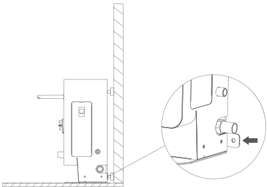
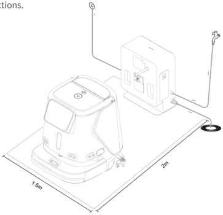
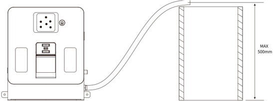
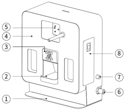
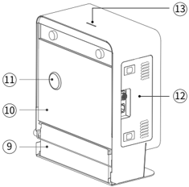
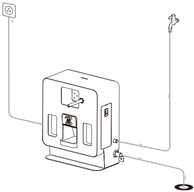
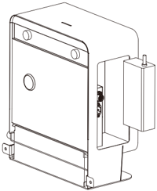
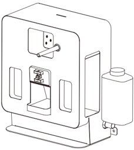
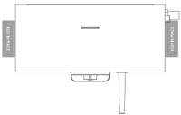
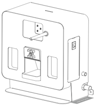

*Page 7 (PDF page 6, left)*

## Copyright © 2023 Shenzhen Pudu Technology Co., Ltd. All rights reserved.

No organization or individual shall imitate, copy, transcribe or translate the contents of this user manual, in part or in full,without the express written consent of Shenzhen Pudu Technology Co., Ltd., or distribute this user manual for profit in anyway (electronically or via photocopying, recording, etc.). The product specifications and information provided in this user manual are for reference only and are subject to change without further notice. Unless otherwise specified, this user manual is only intended as a user guide, and no representation shall be deemed as a warranty of any kind.

## Safety Instructions

## 1.1 Instructions for use

- Docking station users should receive professional training from technical support personnel.
- Deployment of docking station may involve lightweight construction of waterways or circuits, so professionals are required to implement.
- The docking station should be placed in an indoor scene with normal temperature. It is forbidden to place the docking station in a high temperature area (> 40° C) for use.
- If the docking station is damaged, the charging current is abnormal, or the charging/draining is abnormal, please stop using the docking station.
- Be sure to use the original power cord, and it is strictly forbidden to use non-original power cords to supply power to the docking station.
- Carefully protect the power cord to avoid pulling and twisting.
- It is strictly forbidden for the docking station to collide with foreign objects, causing damage to the docking station.
- Do not use the docking station near flammable and explosive objects.
- If the docking station emits smoke or burnt smell, it means that the docking station is abnormal. Please disconnect the power supply of the docking station immediately and contact Purdue staff.
- Do not move the docking station arbitrarily when in use, and use the docking station at the designated location.
- It is strictly forbidden to store or work in areas exposed to direct sunlight.
- If there is an abnormal red light on the docking station, please separate the robot from the docking station, wait for the docking station light to turn green before it can be used again.
- If the red light does not go off for a long time, please contact technical support personnel.
- If you need to use the function of automatically adding cleaning solution, please use non-foaming cleaning agent, Prohibit the use of strong corrosive cleaning agents such as strong acid and strong alkali. Be sure to tighten the water pipe joint.
- This appliance can be used by children aged from 8 years and above and persons with reduced physical, sensory or mental capabilities or lack of experience and knowledge if they have been given supervision or instruction concerning use of the appliance in a safe way and understand the hazards involved. Children shall not play with the appliance. Cleaning and user maintenance shall not be made by children without supervision.

---

*Page 8 (PDF page 6, right)*

- Children should be supervised to ensure that they do not play with the appliance.
- Do not recharge non-rechargeable batteries.
- Before using battery charger, read all instructions and cautionary markings on battery charger, battery, and product using battery.
- For indoor use, or do not expose to rain.
- Use only with battery charger for model AP-PF600CH02920150B.
- Use only with commercial cleaning robot for model CCBC01.

## 1.2 Environmental Notice

- Working environment temperature: 0° C ~40° C, relative humidity: ≤ 90% (<40° C).
- Storage ambient temperature: -20° C ~70° C, relative humidity ≤ 85%, storage for 1 year.
-
- Working environment requirements:
    1. The docking station needs to be placed on a flat ground for use, with its back against a flat wall, and fixed to the wall or the ground through lateral connection components.

> *Figure description (AI):* The figure shows the docking station mounted against a wall with its back flush to the surface. A close-up view highlights the connection port on the side of the unit for attaching lateral components. The diagram indicates that the device must be fixed to the wall or ground using these lateral connection points. No reflective surfaces like mirrors or glass should be placed in front of the docking station as shown.

2. There are no reflective or light-transmitting parts such as mirrors or glass in the working position of the docking station. If it is unavoidable, the environment may need to be modified to a certain extent.
3. There should be no flammable objects around the docking station .
4. During normal operation, keep open and unobstructed within 2 meters in front and 1.5 meters in the left and right directions.

> *Figure description (AI):* The figure shows the required clearance zones around the docking station: 2 meters in front and 1.5 meters on each side. It illustrates the recommended placement of the docking station against a flat wall with no reflective surfaces nearby. A circular object (possibly a cable or connector) is shown near the right-side boundary, indicating an item to be kept clear or positioned as indicated. The layout demonstrates how to arrange the robot and docking station within the specified spatial constraints for safe operation.

---

*Page 9 (PDF page 7, left)*

5. The pressure of clean water is 0.1-0.6mpa.
6. The height of the sewage outlet is not more than 0.5m from the ground.

> *Figure description (AI):* The figure shows the maximum height for the sewage outlet pipe is 500mm from the ground. A tube connects the docking station to a vertical container, indicating the path for liquid drainage.
## Product introduction

## 2.1 Packing list

machine × 1, instruction manual × 1, clean water pipe × 1, sewage pipe × 1.

## 2.2 Appearance introduction

> *Figure description (AI):* The figure shows a docking station with numbered parts including bottom plate (1), sink (2), electrode holder (3), front shell (4), QR code board (5), sewage pipe (6), inlet pipe (7), detergent cover (8). Labels 6 and 7 indicate the sewage pipe and inlet pipe respectively, which are part of the docking station's plumbing system. Label 8 points to the detergent cover on the side of the device. The figure provides a visual reference for identifying components like the sink (2) and electrode holder (3) that are not fully described in the text.

> *Figure description (AI):* The figure shows a docking station with numbered parts labeled for identification. Labels point to specific components such as the status light (13), power adapter compartment side cover (12), pressure valve cover (11), rear cover (10), sewage transfer box (9), and bottom plate (1). The visual layout helps users locate physical ports, covers, and structural elements of the device. This diagram complements the packing list and appearance introduction by visually mapping each part to its corresponding number in the manual.

*Labels:*

- **1** Bottom plate
- **2** Sink
- **3** Electrode holder
- **4** Front shell
- **5** QR code board
- **6** Sewage pipe
- **7** Inlet pipe
- **8** Detergent cover
- **9** Sewage transfer box
- **10** Rear cover
- **11** Pressure valve cover
- **12** Power adapter compartment side cover
- **13** Status light

---

*Page 10 (PDF page 7, right)*

## 2.3 Performance parameters

| Product Characteristics | Description |
|---|---|
| Product Name | CC1 Docking Station |
| Product function | Support robot automatic adding and draining, automatic charging, automatic injection of cleaning agent |
| Body size (L, W, H) | 404 x 274 x 497 mm |
| Body weight | 20 kg |
| Input voltage | 100 ~ 240 Vac |
| Output voltage | 29.2 Vdc |
| Working temperature | 0 to 40℃ |
| Working humidity | RH: ≤ 90 %（40℃） |
| Storage temperature | -20 to 70 ℃ |
| Transmit frequency | 2400 - 2483.5 MHz |
| Transmit power | ≤ 10 dBm |
| Communication method | Bluetooth |
| Installation requirements | Ground fixed or back against the wall fixed |
| External dependencies | Water source, floor drain, power supply |

## Product use

## 3.1 Instructions for use

- Connect one end of the water inlet pipe to the water inlet of the docking station, and the other end to the clean water source;

Connect one end of the sewage pipe to the drainage outlet of the docking station, and place the other end at the sewage discharge place.（as shown below)

> *Figure description (AI):* The figure shows the CC1 Docking Station with its external connections. A power cable connects the station to a wall outlet on the left. A water supply line connects to an inlet port on the right side of the unit. A drain hose exits from the bottom right and terminates in a floor drain.

---

*Page 11 (PDF page 8, left)*

- Install the battery charger of the CC1 robot into the docking station internal (as shown in the figure below), and please use the power cord of the CC1 battery charger for the external power connection of the docking station.
* When installing, pay attention to the heat dissipation hole of the power adapter facing down.

> *Figure description (AI):* The figure shows the internal structure of the docking station. It illustrates where to install the battery charger inside the docking station. The heat dissipation hole on the power adapter should face downward during installation.

- If you need to add cleaning solution, please take out the cleaning solution container, pour the cleaning solution and put it back into the docking station .(as shown below)

> *Figure description (AI):* The figure shows the docking station with its internal components visible. It illustrates where to install the battery charger inside the docking station. The position of the cleaning solution container is shown on the right side. Identification sticker placement areas are indicated on both sides of the unit.
Attention: This docking station only supports the use of non-foaming cleaners, and strong acid and strong alkaline cleaners are prohibited.

When the equipment is transferred, please empty the cleaning agent in the container.

- You can use identification stickers to mark the positions on both sides of the docking station (as shown in the figure below).

> *Figure description (AI):* The figure shows the docking station with its front panel facing up. A small rectangular area is visible on the front panel, likely indicating a sensor or indicator light.

> *Figure description (AI):* The figure shows the docking station with a battery charger installed inside. It illustrates the position of the cleaning solution container within the docking station. The image displays identification stickers placed on both sides of the docking station. A power cord is shown connected to the external power source for the docking station.

---

*Page 12 (PDF page 8, right)*

## Indicator light description

| Indicator Light | Description Light Status |
|---|---|
| Flashing red | Fault occurred |
| Steady green | Formal standby (not connected) |
| Flashing green | Connecting with the robot |
| Breath green | Successfully connected |

## Maintenance

- The docking station is dirty and dusty, please use a soft, clean, lint-free cloth to wipe it clean.
- Regularly clean the dirt in the dirt tray of the docking station.
- In case of cracks, deformation, water leakage, inability to add drainage, inability to charge the docking station, etc., please disconnect the power supply and contact the after-sales service in time.

## After sales service

## 4.1 Free warranty service

The company promises to meet the following conditions, from the date of product receipt, within the effective warranty period of the product (the warranty period of different parts of the product is different),Free product warranty service will be provided if the following conditions are met:

- Since the purchased product is used normally within the specified product warranty period, there are non-artificial quality problems;
- No unauthorized disassembly, no modification or installation not guided by the official manual, and other non-human failures;
- The product serial number, factory label and other marks are not torn or altered;
- Provide valid proof of purchase, receipt and order number;
- Damaged spare parts replaced during the free warranty period belong to the company and should be sent back as required by the company.

## 4.2 After-sales service beyond the scope of warranty

- For after-sales service that is not within the scope of free warranty (beyond the warranty period or does not meet the terms of free warranty within the warranty period), the company provides paid after-sales service;

---

*Page 13 (PDF page 9, left)*

- If it is necessary to come to the door to solve the problem after the diagnosis of the technical engineer, assign a professional technician to provide the door-to-door service;
- For after-sales service that is not within the scope of free warranty, you need to fill in the "After-sales Service Record Form" as required;
- Service fee includes: after-sales maintenance fee and spare parts fee.

## 4.3 After-sales service consultation

If you have any questions,

please contact Purdue Technology customer service hotline: +86 755-86952935.

Email: techservice@pudutech.com

---

*Page 14 (PDF page 9, right)*

# 5. Compliance information

## 5.1 Disposal and recycling information

The Waste Electrical and Electronic Equipment (WEEE) Directive aims to minimize the impact of electrical and electronic goods on the environment, by increasing re-use and recycling and by reducing the amount of WEEE going to landfill. The symbol on this product or its packaging signifies that this product must be disposed separately from ordinary household wastes at its end of life. Be aware that this is your responsibility to dispose of electronic equipment at recycling centers in order to conserve natural resources. Each country should have its collection centers for electrical and electronic equipment recycling. For information about your recycling drop off area, please contact your related electrical and electronic equipment waste management authority, your local city office, or your house hold waste disposal service.

## 5.2 Federal Communications Commission compliance statement

The following information applies to Pudu robotic.

This equipment has been tested and found to comply with the limits for a Class B digital device, pursuant to part 15 of the FCC Rules. These limits are designed to provide reasonable protection against harmful interference in a residential installation. This equipment generates, uses and can radiate radio frequency energy and, if not installed and used in accordance with the instructions, may cause harmful interference to radio communications. However, there is no guarantee that interference will not occur in a particular installation. If this equipment does cause harmful interference to radio or television reception, which can be determined by turning the equipment off and on, the user is encouraged to try to correct the interference by one or more of the following measures:

- Reorient or relocate the receiving antenna.
- Increase the separation between the equipment and receiver.
- Connect the equipment into an outlet on a circuit different from that to which the receiver is connected.
- Consult the dealer or an experienced radio/TV technician for help.

This device complies with Part 15 of the FCC rules. Operation is subject to the following two conditions:

- This device may not cause harmful interference.
- This device must accept any interference received, including interference that may cause undesired operation.

## 5.3 Industry Canada compliance statement

This device complies with Industry Canada licence-exempt RSS standard(s). Operation is subject to the following two conditions:

- This device may not cause interference.
- This device must accept any interference, including interference that may cause undesired operation of the device.

L'émetteur/récepteur exempt de licence contenu dans le présent appareil est conforme aux CNR d'Innovation, Sciences et Développement économique Canada applicables aux appareils radio exempts de licence. L'exploitation est autorisée aux deux conditions suivantes :

- L'appareil ne doit pas produire de brouillage;
- L'appareil doit accepter tout brouillage radioélectrique subi, même si le brouillage est susceptible d'en compromettre le fonctionnement.
