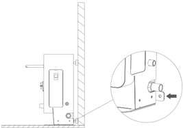
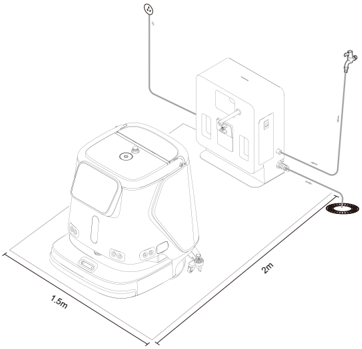
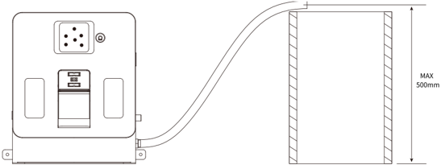
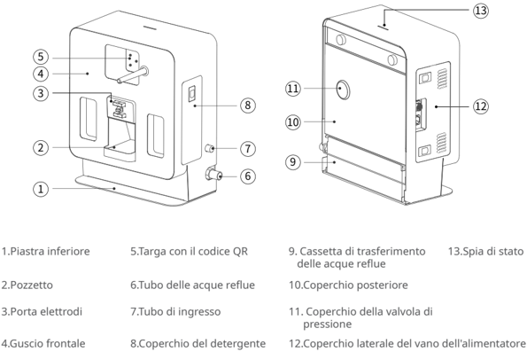
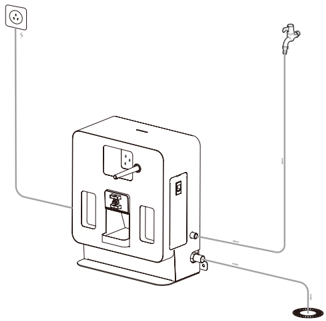
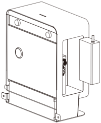
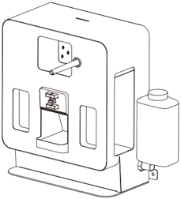
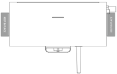
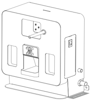

*Pagina 57 (pagina PDF 31, sinistra)*

## Copyright © 2023 Shenzhen Pudu Technology Co., Ltd. Tutti i diritti riservati.

Nessuna organizzazione o individuo può imitare, copiare, trascrivere o tradurre i contenuti di questo manuale utente, in parte o in toto, senza il consenso scritto di Shenzhen Pudu Technology Co., Ltd., o distribuire questo manuale utente a scopo di lucro in qualsiasi modo (elettronicamente o tramite fotocopiatura, registrazione, ecc.). Le specifiche del prodotto e le informazioni fornite nel presente manuale dell'utente hanno solo scopo di riferimento e sono soggette a variazione senza ulteriore preavviso. Salvo diversa indicazione, questo manuale dell'utente è destinato solo come guida per l'utente, e nessuna affermazione dovrà essere considerata come una garanzia di qualsiasi tipo.

## Istruzioni per la sicurezza

## 1.1 Istruzioni per l'uso

- Gli utenti della docking station devono ricevere una formazione professionale dal personale di supporto tecnico.
- L'installazione della docking station può richiedere la costruzione leggera di condutture idriche o circuiti, quindi per l'implementazione sono necessari professionisti.
- La docking station deve essere posizionata in un ambiente interno con temperatura normale. È vietato posizionare e utilizzare la docking station in un'area ad alta temperatura (> 40 °C).
- Se la docking station è danneggiata, la corrente di carica è anomala, o la carica/scarica è anomala, interrompere l'utilizzo della docking station.
- Assicurarsi di utilizzare il cavo di alimentazione originale; è severamente vietato utilizzare cavi di alimentazione non originali per alimentare la docking station.
- Proteggere attentamente il cavo di alimentazione per evitare di tirarlo o di torcerlo.
- È severamente vietato urtare la docking station con oggetti estranei, il che potrebbe causare danni alla docking station.
- Non utilizzare la docking station in vicinanza di oggetti infiammabili o esplosivi.
- Se la docking station emette fumo o odore di bruciato, questo significa che la docking station è in stato anomalo. Scollegare immediatamente l'alimentazione della docking station e contattare il personale di Purdue.
- Non spostare arbitrariamente la docking station durante l'uso, e utilizzarla nella posizione designata.
- È severamente vietato conservare o lavorare in aree esposte alla luce diretta del sole.
- Qualora sulla docking station compaia una luce rossa anomala, separare il robot dalla docking station e attendere che la luce diventi verde prima di utilizzarla di nuovo.
- Se la luce rossa non si spegne per molto tempo, contattare il personale di supporto tecnico.
- Qualora sia necessario utilizzare la funzione di aggiunta automatica di soluzione detergente, utilizzare un agente detergente non schiumoso. Non utilizzare agenti detergenti corrosivi forti come acidi forti e alcali forti. Assicurarsi di stringere il giunto del tubo dell'acqua.
- Questo apparecchio può essere utilizzato da bambini di età superiore a 8 anni e da persone con ridotte capacità fisiche, sensoriali o mentali o mancanza di esperienza e conoscenza se hanno ricevuto supervisione o istruzioni sull'uso dell'apparecchio in modo sicuro e comprendono i rischi coinvolti. I bambini non devono giocare con l'apparecchio. La pulizia e la manutenzione dell'utente non devono essere effettuate da bambini senza supervisione.

---

*Pagina 58 (pagina PDF 31, destra)*

- I bambini devono essere sorvegliati per garantire che non giochino con l'apparecchio.
- Avvertenza contro la ricarica di batterie non ricaricabili.
- Prima di utilizzare il caricabatteria, leggere tutte le istruzioni e le indicazioni di cautela sul caricabatteria, sulla batteria e sul prodotto che utilizza la batteria.
- Per uso interno, o non esporre alla pioggia.
- Usare solo con caricabatteria per modello AP-PF600CH02920150B.
- Usare solo con robot di pulizia commerciale per modello CCBC01.

## 1.2 Avviso ambientale

- Temperatura dell'ambiente di lavoro: 0 °C - 40 °C, umidità relativa: ≤ 90% (<40 °C).
- Temperatura dell'ambiente di stoccaggio: -20 °C - 70 °C, umidità relativa ≤ 85%, stoccaggio per 1 anno.
-
- Requisiti ambientali di lavoro: componenti di connessione laterali.
1. Per essere utilizzata, la docking station deve essere posizionata su una superficie piatta, con la parte posteriore appoggiata contro una parete piatta e fissata alla parete o al pavimento mediante

> *Descrizione della figura (IA):* La docking station deve essere fissata alla parete o al pavimento. Non posizionare specchi o vetri nella posizione di lavoro della docking station. Mantenere uno spazio libero davanti e ai lati della docking station durante il funzionamento.

2. Non vi sono parti riflettenti o trasparenti come specchi o vetri nella posizione di lavoro della docking station. Se è inevitabile, l'ambiente potrebbe dover essere parzialmente modificato.
3. Non devono essere presenti oggetti infiammabili intorno alla docking station .
4. Durante il normale funzionamento, mantenere aperto e sgombro uno spazio di 2 metri davanti e 1,5 metri nelle direzioni sinistra e destra.

> *Descrizione della figura (IA):* La figura mostra la posizione corretta della docking station rispetto al robot di pulizia. Le dimensioni indicate (1,5m e 2m) definiscono lo spazio libero necessario intorno alla docking station durante il funzionamento. Il cavo di alimentazione è collegato alla presa a muro e passa attraverso un tubo protettivo fissato alla parete. La base della docking station deve essere posizionata su una superficie piana, con la parte posteriore appoggiata contro una parete.

---

*Pagina 59 (pagina PDF 32, sinistra)*

5. La pressione dell'acqua pulita è 0,1-0,6 MPa.
6. L'altezza dell'uscita delle acque reflue non è superiore a 0,5 metri dal pavimento.

> *Descrizione della figura (IA):* Il tubo dell'acqua pulita e il tubo delle acque reflue devono essere collegati rispettivamente alle prese indicate sul retro della macchina. L'altezza massima consentita per l'uscita delle acque reflue è di 500 mm dal pavimento, come indicato nella figura. La piastra inferiore (1) e il pozzetto (2) sono componenti visibili sulla parte bassa dell'apparecchio. Il coperchio posteriore (10) e i coperchi laterali del vano alimentatore (12) mostrano le posizioni dei connettori per i tubi.
## Introduzione al prodotto

## 2.1 Contenuto della confezione

macchina × 1, manuale di istruzioni × 1, tubo dell'acqua pulita × 1, tubo delle acque reflue × 1.

## 2.2 Introduzione all'aspetto

> *Descrizione della figura (IA):* La figura mostra le parti principali della stazione di docking con i relativi numeri identificativi. I numeri indicano componenti come piastra inferiore (1), pozzetto (2), porta elettrodi (3) e coperchio del detergente (8). Sulla parte posteriore sono indicati il coperchio posteriore (10), la valvola di pressione (11) e il vano dell'alimentatore (12). La spia di stato (13) è posizionata in alto sul retro per monitorare lo stato operativo.

*Etichette:*

- **1** Piastra inferiore
- **2** Pozzetto
- **3** Porta elettrodi
- **4** Guscio frontale
- **5** Targa con il codice QR
- **6** Tubo delle acque reflue
- **7** Tubo di ingresso
- **8** Coperchio del detergente
- **9** Cassetta di trasferimento delle acque reflue
- **10** Coperchio posteriore
- **11** Coperchio della valvola di pressione
- **12** Coperchio laterale del vano dell'alimentatore
- **13** Spia di stato

---

*Pagina 60 (pagina PDF 32, destra)*

## 2.3 Parametri prestazionali

| Caratteristiche del prodotto | Descrizione |
|---|---|
| Nome del prodotto | Docking station CC1 |
| Funzione del prodotto | Supporto per l'aggiunta e lo scarico automatico del robot, carica automatica, iniezione automatica di agente detergente |
| Dimensioni del corpo (L, W, H) | 404 x 274 x 497 mm |
| Peso del corpo | 20 kg |
| Tensione di ingresso | 100 - 240 Vac |
| Tensione di uscita | 29,2 Vcc |
| Temperatura di lavoro | 0-40 ℃ |
| Umidità di lavoro | Umidità relativa: ≤ 90 % (40 ℃) |
| Temperatura di conservazione | -20-70 ℃ |
| Frequenza di trasmissione | 2400 - 2483,5 MHz |
| Potenza di trasmissione | ≤ 10 dBm |
| Metodo di comunicazione | Bluetooth |
| Requisiti di installazione | Fissata al pavimento o alla parete posteriore |
| Dipendenze esterne | fonte d'acqua, scarico a pavimento, alimentazione |

## Utilizzo del prodotto

## 3.1 Istruzioni per l'uso

- Collegare un'estremità del tubo di ingresso dell'acqua all'ingresso dell'acqua della docking station e l'altra estremità alla fonte di acqua pulita.
- Collegare un'estremità del tubo delle acque reflue all'uscita di scarico della docking station e posizionare l'altra estremità nel luogo di scarico delle acque reflue (come mostrato in basso)

> *Descrizione della figura (IA):* Il tubo collegato all'ingresso dell'acqua deve essere connesso alla fonte di acqua pulita. Il tubo collegato all'uscita di scarico deve essere posizionato nel luogo di scarico delle acque reflue. La docking station CC1 richiede un collegamento elettrico a una presa di corrente. Il dispositivo può essere fissato al pavimento o alla parete posteriore.

---

*Pagina 61 (pagina PDF 33, sinistra)*

- Installare il caricabatteria del robot CC1 all'interno della docking station (come mostrato nella figura in basso), e utilizzare il cavo di alimentazione del caricabatteria CC1 per il collegamento esterno di alimentazione della docking station.
* Durante l'installazione, prestare attenzione al foro di dissipazione del calore dell'alimentatore, rivolto verso il basso.

> *Descrizione della figura (IA):* La figura mostra la posizione del caricabatteria del robot CC1 all'interno della docking station. È visibile il foro di dissipazione del calore dell'alimentatore, che deve essere rivolto verso il basso durante l'installazione. La figura illustra come inserire e rimuovere il contenitore della soluzione detergente dalla docking station. Sono indicati i punti su entrambi i lati della docking station dove possono essere applicati adesivi di identificazione.

- Qualora sia necessario aggiungere soluzione detergente, estrarre il contenitore della soluzione detergente, versare la soluzione e rimettere il contenitore nella docking station (come mostrato in basso)

> *Descrizione della figura (IA):* La figura mostra la posizione del caricabatteria del robot CC1 all'interno della docking station. È visibile il foro di dissipazione del calore dell'alimentatore, che deve essere rivolto verso il basso durante l'installazione. Vengono indicate le aperture laterali per l'inserimento o l'estrazione del contenitore della soluzione detergente. La figura illustra come posizionare adesivi di identificazione sui lati della docking station.
Attenzione: questa docking station supporta solo l'uso di detergenti non schiumogeni, e sono proibiti detergenti fortemente acidi e alcalini.

Quando l'apparecchiatura debba essere spostata, svuotare il contenitore dell'agente detergente.

- È possibile utilizzare adesivi di identificazione per contrassegnare le posizioni su entrambi i lati della docking station (come mostrato nella figura in basso).

> *Descrizione della figura (IA):* La figura mostra la posizione del caricabatteria all'interno della docking station. È visibile il foro di dissipazione del calore dell'alimentatore, che deve essere rivolto verso il basso durante l'installazione. Vengono indicate le posizioni per applicare adesivi di identificazione su entrambi i lati della docking station.

> *Descrizione della figura (IA):* La figura mostra la posizione del caricabatteria CC1 all'interno della docking station. È visibile il foro di dissipazione del calore dell'alimentatore, che deve essere rivolto verso il basso durante l'installazione. Vengono indicate le posizioni dei contenitori per la soluzione detergente e per eventuali adesivi identificativi sui lati della docking station. Il cavo di alimentazione esterno si collega alla presa indicata sul lato destro della docking station.

---

*Pagina 62 (pagina PDF 33, destra)*

## Descrizione dell'indicatore luminoso

| Indicatore luminoso | Descrizione dello stato della luce |
|---|---|
| Lampeggiante rosso | Si è verificato un guasto |
| Verde fisso | Standby normale (non collegato) |
| Verde lampeggiante | In connessione con il robot |
| Verde lampeggiante lentamente | Connesso con successo |

## Manutenzione

- Qualora la docking station sia sporca o polverosa, utilizzare un panno morbido, pulito e privo di lanugine per pulirla.
- Pulire regolarmente il vassoio dello sporco della docking station.
- In caso di crepe, deformazioni, perdite d'acqua, impossibilità di aggiungere acqua pulita o scaricare, impossibilità di caricare il robot, ecc., scollegare l'alimentazione e contattare immediatamente il servizio post-vendita.

## Assistenza post-vendita

## 4.1 Servizio di garanzia gratuito

L'azienda si impegna a rispettare le seguenti condizioni: dalla data di ricezione del prodotto, durante il periodo di garanzia effettivo del prodotto (il periodo di garanzia di diverse parti del prodotto è diverso), verrà fornito un servizio di garanzia del prodotto gratuito se sono soddisfatte le seguenti condizioni:

- Il prodotto acquistato viene utilizzato normalmente durante il periodo di garanzia specificato e non ci sono problemi di qualità causati dall'utente;
- Nessuno smontaggio non autorizzato, nessuna modifica o installazione non descritta dal manuale ufficiale, e altri guasti non umani;
- Il numero di serie del prodotto, l'etichetta di fabbrica e altri segni non sono strappati o alterati;
- Fornire una prova valida di acquisto, ricevuta e numero d'ordine;
- I pezzi di ricambio danneggiati sostituiti durante il periodo di garanzia gratuita sono di proprietà dell'azienda e verranno restituiti secondo quanto richiesto dall'azienda.

## 4.2 Assistenza post-vendita al di fuori della portata della garanzia

- Per l'assistenza post-vendita che non rientra nell'ambito della garanzia gratuita (oltre il periodo di garanzia o non soddisfacente i termini della garanzia gratuita durante il periodo di garanzia), l'azienda fornisce un'assistenza post-vendita a pagamento;

---

*Pagina 63 (pagina PDF 34, sinistra)*

- Qualora sia necessario recarsi in loco per risolvere il problema dopo la diagnosi del tecnico, verrà assegnato un professionista per fornire il servizio presso la sede del cliente.
- Per il servizio post-vendita che non rientra nell'ambito della garanzia gratuita, è necessario compilare il "Modulo di registrazione del servizio post-vendita".
- La tariffa del servizio include il costo di manutenzione post-vendita e il costo dei pezzi di ricambio.

## 4.3 Consulenza per il servizio post-vendita

Per ogni eventuale domanda, contattare la hotline del servizio clienti di Purdue Technology: +86 755-86952935. E-mail: techservice@pudutech.com
