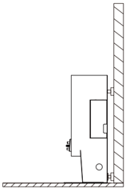
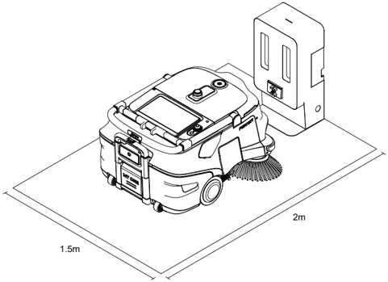
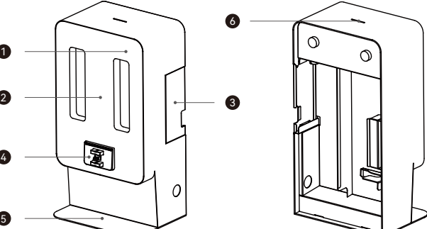
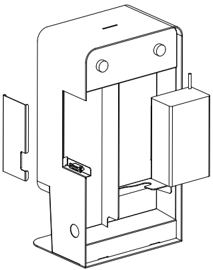
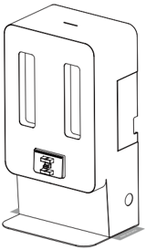
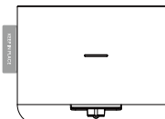

*Seite 19 (PDF-Seite 23)*

## Copyright © 2024 Shenzhen Pudu Technology Co., Ltd. Alle Rechte vorbehalten.

Keine Organisation oder Einzelperson darf den Inhalt dieses Benutzerhandbuchs teilweise oder vollständig ohne die ausdrückliche schriftliche Zustimmung von Shenzhen Pudu Technology Co., Ltd. kopieren, transkribieren oder übersetzen oder dieses Benutzerhandbuch zu kommerziellen Zwecken auf beliebige Weise verteilen (elektronisch oder durch Fotokopieren, Aufzeichnen usw.). Die in diesem Benutzerhandbuch bereitgestellten technischen Daten und Angaben zum Produkt dienen nur als Referenz und können ohne vorherige Ankündigung geändert werden. Falls nicht anders angegeben, ist dieses Benutzerhandbuch nur als Orientierungshilfe gedacht und die darin enthaltenen Darstellungen sind nicht als Gewährleistung irgendwelcher Art aufzufassen.

## Sicherheitsanweisungen

## 1.1 Gebrauchshinweise

- Benutzer der Ladestation sind vom technischen Supportpersonal fachmännisch einzuweisen.
- Für den Einsatz der Ladestation können kleinere Elektrikerarbeiten erforderlich sein, die von Fachleuten auszuführen sind.
- Die Ladestation ist in Innenräumen mit Raumtemperatur aufzustellen. Die Ladestation darf nicht in einem Hochtemperaturbereich (> 40 °C) eingesetzt werden.
- Wenn die Ladestation beschädigt oder der Ladestrom abnormal ist, darf die Ladestation nicht weiter genutzt werden.
- Verwenden Sie ausschließlich das originale Netzkabel. Es ist strengstens verboten, nicht originale Netzkabel für die Stromversorgung der Ladestation zu verwenden.
- Schützen Sie das Stromkabel sorgfältig, um ein Ziehen und Verdrehen zu vermeiden.
- Die Ladestation darf auf keinen Fall durch eine Kollision mit Fremdkörpern beschädigt werden.
- Die Ladestation darf nicht in der Nähe von entflammbaren und explosiven Materialien eingesetzt werden.
- Wenn die Ladestation Rauch oder einen verbrannten Geruch abgibt, bedeutet dies, dass eine Störung vorliegt. Trennen Sie die Stromversorgung der Ladestation umgehend, und kontaktieren Sie das Pudu-Personal.
- Verschieben Sie die Ladestation nicht willkürlich während der Nutzung, und verwenden Sie die Ladestation am vorgesehenen Ort.
- Es ist strengstens verboten, das Gerät in Bereichen, die direkter Sonneneinstrahlung ausgesetzt sind, zu lagern oder zu betreiben.
- Trennen Sie, wenn an der Ladestation durch ein rotes Licht eine Störung angezeigt wird, den Roboter von der Ladestation. Warten Sie, bis das Licht der Ladestation blau wird, bevor Sie sie weiter verwenden.
- Wenden Sie sich an das technische Supportpersonal, wenn das rote Licht nach langem Warten nicht ausgeht.
- Dieses Gerät kann von Kindern ab 8 Jahren und von Personen mit eingeschränkten physischen, sensorischen oder geistigen Fähigkeiten oder mangelnder Erfahrung und Kenntnissen verwendet werden, wenn sie beaufsichtigt werden oder Anweisungen zur sicheren Verwendung des Geräts erhalten haben und die damit verbundenen Gefahren verstehen. Kinder dürfen nicht mit dem Gerät spielen. Kinder dürfen das Gerät nur unter Aufsicht reinigen und warten.
- Kinder sind zu beaufsichtigten, damit sie nicht mit dem Gerät spielen.
- Warnung vor dem Aufladen von nicht wiederaufladbaren Batterien.

---

*Seite 20 (PDF-Seite 24)*

- Lesen Sie vor der Verwendung des Ladegeräts alle Anweisungen und Warnhinweise auf dem Ladegerät, der Batterie und dem Produkt, das mit der Batterie betrieben wird.
- Für den Innenbereich geeignet, nicht dem Regen aussetzen.
- Verwendung nur mit dem Ladegerät für Modell AP-PF600CH02920150B.
- Verwendung nur mit dem kommerziellen Reinigungsroboter für Modell MTBC01.

## 1.2 Umgebungsbedingungen

- Temperatur der Arbeitsumgebung: 0 ℃ bis 40 ℃, relative Luftfeuchtigkeit: 0 % bis 90 %RH.
- Raumtemperatur bei Lagerung: -20 ℃ bis 70 ℃, relative Luftfeuchtigkeit: 0 % bis 90 %RH, Lagerung für 1 Jahr.
- Anforderungen an die Arbeitsumgebung:
    1. Die Ladesäule muss mit der Rückseite gegen eine gerade Wand auf einem flachen Untergrund aufgestellt und durch seitliche Verbindungselemente an der Wand oder am Boden befestigt werden.

> *Bildbeschreibung (KI):* Die Abbildung zeigt die korrekte Montageposition der Ladesäule: Rückseite an einer geraden Wand, auf einem flachen Untergrund. Seitliche Verbindungselemente (Sicherungen) sind an der rechten Seite und am Boden sichtbar – sie dienen zur Befestigung an Wand oder Boden. Der freie Bereich vor dem Gerät beträgt 2 Meter; seitlich jeweils 1,5 Meter müssen frei bleiben (wie im Text angegeben). Keine reflektierenden oder transparenten Teile (z. B. Spiegel, Glas) dürfen sich in der Arbeitsposition befinden – dies wird durch die Darstellung einer einfachen Wand impliziert.

2. Es dürfen sich keine reflektierenden oder transparenten Teile wie Spiegel oder Glas in der Arbeitsposition der Ladestation befinden. Wenn dies unvermeidlich ist, muss die Umgebung möglicherweise in gewissem Maße angepasst werden.
3. Es dürfen sich keine brennbaren Gegenstände in der Nähe der Ladestation befinden.
4. Sorgen Sie im Normalbetrieb für einen freien und ungehinderten Bereich im Abstand von 2 Metern vor dem Gerät und 1,5 Metern auf dessen rechter und linker Seite.

> *Bildbeschreibung (KI):* Die Abbildung zeigt die erforderlichen Abstände um die Ladestation: 2 Meter vor dem Gerät und 1,5 Meter auf der rechten und linken Seite. Der Bereich vor der Ladestation muss frei von Hindernissen sein, wie im Bild durch die Dimensionierung verdeutlicht.

---

*Seite 21 (PDF-Seite 25)*

# Produktvorstellung

## 2.1 Packliste

Gerät x 1, Benutzerhandbuch x 1, Qualitätszertifikat x 1, Warnband x 1

## 2.2 Gerät kennenlernen

> *Bildbeschreibung (KI):* Die Nummer 1 zeigt die Gehäusevorderseite des Ladegeräts. Die Nummer 3 markiert die Seitenabdeckung für das Netzteilfach. Die Nummer 4 deutet auf den Ladekontakthalter hin.

*Beschriftungen:*

- **1** Gehäusevorderseite
- **2** QR-Code-Plakette
- **3** Seitenabdeckung Netzteilfach
- **4** Ladekontakthalterung
- **5** Bodenplatte
- **6** Anzeigelicht

## 2.3 Leistungsparameter

| Merkmale | Beschreibung |
|---|---|
| Produktname | Ladestation MT1 |
| Produktfunktion | Unterstützt das automatische Laden des Roboters |
| Maße des Geräts (L×B×H) | 32*24,15*60 cm |
| Eingangsspannung | 90 bis 264 V AC, 50 bis 60 Hz |
| Ausgangsspannung | Max.: 29,2 V, 20 A |
| Betriebstemperatur | 0 ℃ bis 40 ℃ |
| Lagertemperatur | -20 ℃ bis 70 ℃ |
| Betriebsluftfeuchtigkeit | 0 % bis 90 %RH |
| Luftfeuchtigkeit bei Lagerung | 0 % bis 90 %RH |
| Kommunikationsmethode | Bluetooth |
| Übertragungsfrequenz | 2400 bis 2483,5 MHz |
| Übertragungsleistung | ≤ 10 dbm |
| Installationsanforderungen | Rückseitig an der Wand fixiert |
| Externe Abhängigkeiten | Stromversorgung |

---

*Seite 22 (PDF-Seite 26)*

## Produktverwendung

## 3.1 Gebrauchsanleitung

- Installieren Sie die Ladestation an bestimmten Orten gemäß der „1.2 Umgebungsbedingungen".
- Installieren Sie das Ladegerät des MT1-Roboters im Innern der Ladestation (wie in der Abbildung unten gezeigt), und verwenden Sie das Netzkabel des MT1-Ladegeräts um das Ladegerät an die externe Stromversorgung anzuschließen.
* Bei der Installation ist darauf zu achten, dass die Öffnung des Netzteils für die Wärmeabfuhr nach unten zeigt.

> *Bildbeschreibung (KI):* Die Abbildung zeigt die korrekte Positionierung des MT1-Ladegeräts innerhalb der Ladestation. Das Netzkabel des Ladegeräts wird an den externen Stromanschluss angeschlossen. Die Öffnung des Netzteils muss nach unten zeigen, um Wärmeabfuhr zu ermöglichen. Markierungsaufkleber können verwendet werden, um die Positionen auf beiden Seiten der Ladestation zu kennzeichnen.

- Sie können Markierungsaufkleber verwenden, um die Positionen auf beiden Seiten der Ladestation zu kennzeichnen (wie in der Abbildung unten gezeigt).

> *Bildbeschreibung (KI):* Die Abbildung zeigt die Ladestation mit der Öffnung für das MT1-Ladegerät. Das Netzkabel des MT1-Ladegeräts wird an den Anschluss auf der Rückseite der Ladestation angeschlossen. Die Positionen für Markierungsaufkleber sind auf beiden Seiten der Ladestation eingezeichnet.

---

*Seite 23 (PDF-Seite 27)*

## Beschreibung der Anzeigelichter

| Status | Beschreibung |
|---|---|
| Dauerhaft blau | Normaler Standby (nicht mit dem Roboter verbunden) |
| Grün blinkend | Verbindung mit Roboter wird hergestellt |
| Dauerhaft grün | Verbindung aufgebaut |
| Rot | Es ist ein Fehler aufgetreten |

## Wartung

- Wenn die Ladestation verschmutzt und staubig ist, säubern Sie das Gerät mit einem weichen, sauberen, fusselfreien Tuch.
- Trennen Sie das Ladegerät von der Stromversorgung und kontaktieren Sie umgehend den Kundendienst bei Rissen, Verformungen oder wenn die Roboter nicht geladen werden kann.

## Kundendienst

Shenzhen Pudu Technology Co., Ltd. bietet einen kostenlosen Garantiedienst innerhalb der geltenden Garantiezeit (diese kann bei verschiedenen Bestandteilen variieren). Die für den Kundendienst anfallenden Gebühren werden von Pudu übernommen. Außerhalb der Garantiezeit oder unter Umständen, die nicht durch die kostenlose Garantie abgedeckt sind, ist eine reguläre Gebühr zu entrichten. Näheres zur Servicerichtlinie und zu den Reparaturleistungen erfahren Sie bei einem Anruf bei der Kundendienst-Hotline.

E-Mail: techservice@pudutech.com

## Angaben zur Richtlinienerfüllung

## 4.1 Informationen über Entsorgung und Recycling

Die Richtlinie über Elektro- und Elektronik-Altgeräte (WEEE) zielt darauf ab, Umwelteinflüsse durch Elektro- und Elektronikgeräte zu minimieren, indem Wiederverwendung und Recycling erhöht und Deponieabfall verringert werden. Das Symbol auf diesem Produkt oder seiner Verpackung bedeutet, dass es nach seiner Nutzungszeit getrennt vom normalen Hausmüll entsorgt werden sollte. Es liegt in Ihrer Verantwortung, Elektronikgeräte in Recycling-Zentren zu entsorgen, um die natürlichen Ressourcen zu schonen. Jedes Land sollte seine eigenen Sammelstellen für das Recycling von elektrischen und elektronischen Geräten haben. Wo Sie Elektro- und Elektronikgeräte abgeben können, erfahren Sie vom zuständigen Amt, der Stadtverwaltung oder dem Entsorgungsdienst.

---

*Seite 24 (PDF-Seite 28)*

## 4.2 FCC-Konformitätserklärung

Die folgenden Informationen treffen auf Pudu Robotics zu.

Dieses Gerät wurde getestet und entspricht den Grenzwerten für ein digitales Gerät der Klasse B gemäß Teil 15 der FCC-Bestimmungen. Diese Grenzen sollen einen angemessenen Schutz gegen Funkstörungen in einer Wohnanlage ermöglichen. Dieses Gerät generiert, nutzt Hochfrequenzenergie und kann Hochfrequenzenergie abstrahlen und bei nicht anweisungsgemäßem Aufbau und Betrieb Funkstörungen verursachen. Es besteht jedoch keine Garantie, dass in einer gegebenen Installation keine Störungen auftreten. Wenn dieser Roboter Radio- oder Fernsehempfangsstörungen verursacht, was durch Aus- und Einschalten festgestellt werden kann, sollten Sie Abhilfe durch mindestens eine der folgenden Maßnahmen zu schaffen versuchen:

- Richten Sie die Empfangsantenne neu aus, oder stellen Sie sie an einem anderen Ort auf.
- Vergrößern Sie den Abstand zwischen Gerät und Empfänger.
- Schließen Sie das Gerät an eine Steckdose an, die nicht von demselben Stromkreis wie die Steckdose des Empfängers versorgt wird.
- Wenden Sie sich an den Händler oder an erfahrenen Radio-/Fernsehtechniker.

Dieses Gerät entspricht den Bestimmungen von Abschnitt 15 der Richtlinien der amerikanischen Bundesbehörde für das Fernmeldewesen FCC (Federal Communications Commission). Für den Betrieb gelten die folgenden zwei Bedingungen:

- Dieses Gerät darf keine schädlichen Störungen verursachen.
- Dieses Gerät muss empfangene Störsignale tolerieren können. Hierzu gehören auch Interferenzen, die zu nicht gewünschten Funktionen führen können.

## 4.3 Konformitätserklärung Industry Canada

Dieses Gerät entspricht den lizenzfreien RSS-Standards gemäß Industry Canada. Für den Betrieb gelten die folgenden zwei Bedingungen:

- Dieses Gerät darf keine Interferenzen erzeugen.
- Dieses Gerät muss Interferenzen verkraften können einschließlich Interferenzen, die zu Fehlern im Betrieb führen können.

L'émetteur/récepteur exempt de licence contenu dans le présent appareil est conforme aux CNR d'Innovation, Sciences et Développement économique Canada applicables aux appareils radio exempts de licence. L'exploitation est autorisée aux deux conditions suivantes :

- L'appareil ne doit pas produire de brouillage;
- L'appareil doit accepter tout brouillage radioélectrique subi, même si le brouillage est susceptible d'en compromettre le fonctionnement.
