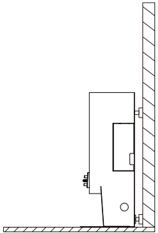
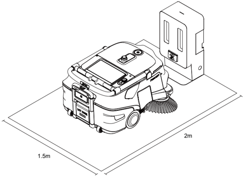
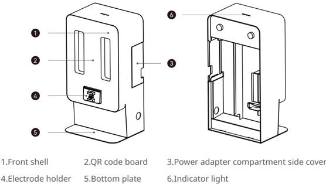
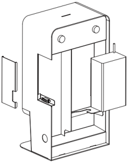
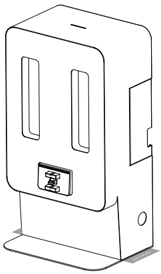
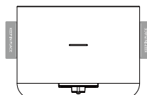

*Page 1 (PDF page 5)*

## Copyright © 2024 Shenzhen Pudu Technology Co., Ltd. All rights reserved.

No organization or individual shall imitate, copy, transcribe or translate the contents of this user manual, in part or in full, without the express written consent of Shenzhen Pudu Technology Co., Ltd., or distribute this user manual for profit in anyway (electronically or via photocopying, recording, etc.). The product specifications and information provided in this user manual are for reference only and are subject to change without further notice. Unless otherwise specified, this user manual is only intended as instructions for use, and no representation shall be deemed as a warranty of any kind.

## Safety Instructions

## 1.1 Instructions for use

- Charging station users should receive professional training from technical support personnel.
- Deployment of charging station may involve lightweight construction of circuits, so professionals are required to implement.
- The charging station should be placed in an indoor scene with normal temperature. It is forbidden to place the charging station in a high temperature area ( > 40℃/104℉) for use.
- If the charging station is damaged, or the charging current is abnormal, please stop using the charging station.
- Be sure to use the original power cord, and it is strictly forbidden to use non-original power cords to supply power to the charging station.
- Carefully protect the power cord to avoid pulling and twisting.
- It is strictly forbidden for the charging station to collide with foreign objects, causing damage to the charging station.
- Do not use the charging station near flammable and explosive objects.
- If the charging station emits smoke or burnt smell, it means that the charging station is abnormal, please disconnect the power supply of the charging station immediately and contact Pudu staff.
- Do not move the charging station arbitrarily when in use, and use the charging station at the designated location.
- It is strictly forbidden to store or work in areas exposed to direct sunlight.
- If there is an abnormal red light on the charging station, please separate the robot from the charging station. Wait for the charging station light to turn blue before it can be used again.
- If the red light does not go off for a long time, please contact technical support personnel.
- This appliance can be used by children aged from 8 years and above and persons with reduced physical, sensory or mental capabilities or lack of experience and knowledge if they have been given supervision or instruction concerning use of the appliance in a safe way and understand the hazards involved. Children shall not play with the appliance. Cleaning and user maintenance shall not be made by children without supervision.
- Children should be supervised to ensure that they do not play with the appliance.
- Warning against recharging non-rechargeable batteries.
- Before using battery charger, read all instructions and cautionary markings on battery charger, battery, and product using battery.

---

*Page 2 (PDF page 6)*

- For indoor use, or do not expose to rain.
- Use only with battery charger for model AP-PF600CH02920150B.
- Use only with commercial cleaning robot for model MTBC01.

## 1.2 Environment Notice

- Working environment temperature: 0℃–40℃ (32℉–104℉), relative humidity: 0%–90%RH.
- Storage ambient temperature: -20℃–70℃ (-4℉–158℉), relative humidity: 0%–90%RH, storage for 1 year.
- Working environment requirements:
    1. The charging station needs to be placed on a flat ground for use, with its back against a flat wall, and fixed to the wall or the ground through lateral connection components.

> *Figure description (AI):* The diagram shows the charging station mounted against a wall. A small circular indicator light is visible on the front panel of the unit. The device includes a cable that connects to the wall outlet or power source.

2. No reflective or transparent parts such as mirrors or glass are allowed near the working charging pile. If unavoidable, some adjustments to the working environment are necessary.
3. No flammables are allowed near the charging pile.
4. During normal operation, keep open and unobstructed within 2 m (6.56 ft） in front and 1.5 m (4.92 ft) in the left and right directions.

> *Figure description (AI):* The diagram shows the required clearance space around the charging station. A 1.5-meter zone must be kept clear to the left and right sides. This visual guide complements the text instructions for safe operation.

---

*Page 3 (PDF page 7)*

## Product introduction

## 2.1 Packing list

Machine x 1, User Manual x 1, Certificate of Compliance x 1, Warning tape x 1

## 2.2 Appearance Introduction

> *Figure description (AI):* The figure shows the external appearance of the MT1 charging station. It identifies key components such as the front shell, QR code board, electrode holder, bottom plate, indicator light, and power adapter compartment side cover. The diagram illustrates how these parts are positioned on the device. This visual guide helps users locate specific features for operation or maintenance.

*Labels:*

- **1** Front shell
- **2** QR code board
- **3** Power adapter compartment side cover
- **4** Electrode holder
- **5** Bottom plate
- **6** Indicator light

## 2.3 Performance parameters

| Feature | Description |
|---|---|
| Product Name | MT1 charging station |
| Product function | Support automatic charging for robot |
| Dimensions (L×W×H) | 32*24.15*60 cm |
| Input voltage | AC 90–264 V, 50–60 Hz |
| Output voltage | Max.: 29.2 V, 20 A |
| Working temperature | 0℃–40℃ |
| Storage temperature | -20℃–70℃ |
| Working humidity | 0–90%RH |
| Storage humidity | 0–90%RH |
| Communication method | Bluetooth |
| Transmit frequency | 2400–2483.5 MHz |
| Transmit power | ≤ 10 dbm |
| Installation requirements | Back against the wall fixed |
| External dependencies | Power supply |

---

*Page 4 (PDF page 8)*

g the Pro
 Using the Product

## 3.1 Instructions for Use

- Deploy charging station at specific locations according to the "1.2 Environmental Notice".
- Install the battery charger of the MT1 robot inside the charging station (as shown in the figure below), and please use the power cord of the MT1 battery charger for the external power connection of the charging station.
* When installing, pay attention to the heat dissipation hole of the power adapter facing down.

> *Figure description (AI):* The figure shows the internal structure of a charging station. It illustrates how to install the battery charger inside the charging station. The power cord connection point is visible on the right side. Heat dissipation holes are located at the bottom of the unit.

- You can use identification stickers to mark the positions on both sides of the charging station (as shown in the figure below).

> *Figure description (AI):* The figure shows the front view of a charging station with two vertical slots and a central connector port. A small circular indicator light is visible on the lower right side of the device. The bottom section includes a flat base for stable placement. Side panels are shown with cutouts or mounting features.

---

*Page 5 (PDF page 9)*

## Indicator Light Description

| Status | Description |
|---|---|
| Steady Blue | Normal standby (not connected to the robot) |
| Flashing Green | Connecting with the robot |
| Steady Green | Connection succeeded |
| Red | Fault occurred |

## Maintenance

- If the charging station is dirty or dusty, use a soft, clean cloth to wipe it clean.
- In case of cracks, deformation, or inability to charge, etc., please disconnect the power and contact the after-sales service promptly.

## After-sales Service

Shenzhen Pudu Technology Co., Ltd provides free warranty service within the effective warranty period (the warranty period may vary for different components). The fees incurred by the after-sales service will be covered by Pudu. Beyond the warranty period or in any circumstances not covered by the free warranty, a certain fee will be charged according to the normal price. Please call the aftersales hotline for detailed after-sales service policy and repair services.

Email: techservice@pudutech.com

## Compliance Information

## 4.1 Disposal and recycling information

The Waste Electrical and Electronic Equipment (WEEE) Directive aims to minimize the impact of electrical and electronic goods on the environment, by increasing re-use and recycling and by reducing the amount of WEEE going to landfill. The symbol on this product or its packaging signifies that this product must be disposed separately from ordinary household wastes at its end of life. Be aware that this is your responsibility to dispose of electronic equipment at recycling centers in order to conserve natural resources. Each country should have its collection centers for electrical and electronic equipment recycling. For information about your recycling drop off area, please contact your related electrical and electronic equipment waste management authority, your local city office, or your household waste disposal service.

---

*Page 6 (PDF page 10)*

## 4.2 Federal Communications Commission compliance statement

The following information applies to Pudu Robotics.

This equipment has been tested and found to comply with the limits for a Class B digital device, pursuant to part 15 of the FCC Rules. These limits are designed to provide reasonable protection against harmful interference in a residential installation. This equipment generates, uses and can radiate radio frequency energy and, if not installed and used in accordance with the instructions, may cause harmful interference to radio communications. However, there is no guarantee that interference will not occur in a particular installation. If this equipment does cause harmful interference to radio or television reception, which can be determined by turning the equipment off and on, the user is encouraged to try to correct the interference by one or more of the following measures:

- Reorient or relocate the receiving antenna.
- Increase the separation between the equipment and receiver.
- Connect the equipment into an outlet on a circuit different from that to which the receiver is connected.
- Consult the dealer or an experienced radio/TV technician for help.

This device complies with Part 15 of the FCC rules. Operation is subject to the following two conditions:

- This device may not cause harmful interference.
- This device must accept any interference received, including interference that may cause undesired operation.

## 4.3 Industry Canada compliance statement

This device complies with Industry Canada licence-exempt RSS standard(s). Operation is subject to the following two conditions:

- This device may not cause interference.
- This device must accept any interference, including interference that may cause undesired operation of the device.

L'émetteur/récepteur exempt de licence contenu dans le présent appareil est conforme aux CNR d'Innovation, Sciences et Développement économique Canada applicables aux appareils radio exempts de licence. L'exploitation est autorisée aux deux conditions suivantes :

- L'appareil ne doit pas produire de brouillage;
- L'appareil doit accepter tout brouillage radioélectrique subi, même si le brouillage est susceptible d'en compromettre le fonctionnement.
