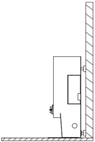
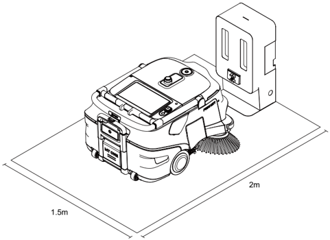
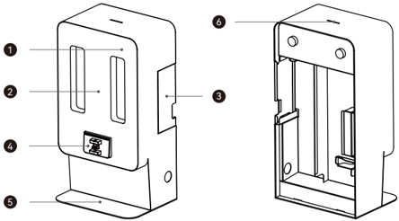
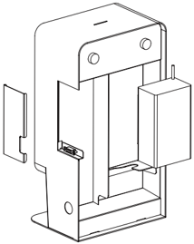
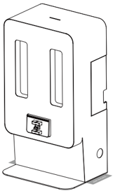
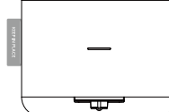

*Pagina 62 (pagina PDF 66)*

## Copyright © 2024 Shenzhen Pudu Technology Co., Ltd. Tutti i diritti riservati.

Nessuna organizzazione o individuo può imitare, copiare, trascrivere o tradurre i contenuti di questo manuale utente, in parte o per intero, senza il consenso scritto esplicito di Shenzhen Pudu Technology Co., Ltd., o distribuire questo manuale utente a scopo di lucro in qualsiasi modo (elettronicamente o tramite fotocopiatura, registrazione, ecc.). Le specifiche del prodotto e le informazioni fornite nel presente manuale dell'utente hanno solo scopo di riferimento e sono soggette a variazione senza ulteriore preavviso. Salvo diversa indicazione, questo manuale utente è destinato unicamente a fornire istruzioni per l'utilizzo, e nessuna affermazione in esso contenuta dovrà essere considerata come una garanzia di qualsiasi tipo.

## Istruzioni per la sicurezza

## 1.1 Istruzioni per l'uso

- Gli utenti della stazione di ricarica devono ricevere una formazione professionale dal personale di supporto tecnico.
- L'installazione della stazione di ricarica può coinvolgere la costruzione leggera di circuiti, quindi per l'implementazione sono richiesti professionisti.
- La stazione di ricarica deve essere collocata in un ambiente interno con temperatura normale. È vietato posizionare e utilizzare la stazione di ricarica in un'area ad alta temperatura (> 40 °C/104 °F).
- Se la stazione di ricarica è danneggiata o la corrente di carica è anomala, interrompere l'utilizzo della stazione di ricarica.
- Assicurarsi di utilizzare il cavo di alimentazione originale; è severamente vietato utilizzare cavi di alimentazione non originali per alimentare stazione di ricarica.
- Proteggere attentamente il cavo di alimentazione per evitare di tirarlo o di torcerlo.
- È severamente vietato urtare la stazione di ricarica con oggetti estranei, il che potrebbe causare danni alla stazione.
- Non utilizzare la stazione di ricarica in vicinanza di oggetti infiammabili o esplosivi.
- Se la stazione di ricarica emette fumo o odore di bruciato, questo significa che la stazione di ricarica è in stato anomalo. Scollegare immediatamente l'alimentazione della stazione di ricarica e contattare il personale di Pudu.
- Non spostare arbitrariamente la stazione di ricarica durante l'uso, e utilizzarla nella posizione designata.
- È severamente vietato conservare o lavorare in aree esposte alla luce diretta del sole.
- Se sulla stazione di ricarica si accende una luce rossa per anomalie, separare il robot dalla stazione di ricarica. Attendere che la luce della stazione di ricarica diventi blu prima di poterla utilizzare nuovamente.
- Se la luce rossa non si spegne per molto tempo, contattare il personale di supporto tecnico.
- Questo apparecchio può essere utilizzato da bambini di età superiore a 8 anni e da persone con ridotte capacità fisiche, sensoriali o mentali o mancanza di esperienza e conoscenza se hanno ricevuto supervisione o istruzioni sull'uso dell'apparecchio in modo sicuro e comprendono i rischi coinvolti. I bambini non devono giocare con l'apparecchio. La pulizia e la manutenzione dell'utente non devono essere effettuate da bambini senza supervisione.
- I bambini devono essere sorvegliati per garantire che non giochino con l'apparecchio.
- Avvertenza contro la ricarica di batterie non ricaricabili.
- Prima di utilizzare il caricabatterie, leggere tutte le istruzioni e le indicazioni di cautela sul caricabatterie, sulla batteria e sul prodotto che utilizza la batteria.

---

*Pagina 63 (pagina PDF 67)*

- Per uso interno, o non esporre alla pioggia.
- Usare solo con caricabatterie per modello AP-PF600CH02920150B.
- Usare solo con robot di pulizia commerciale per modello MTBC01.

## 1.2 Avviso ambientale

- Temperatura dell'ambiente di lavoro: 0 ℃ - 40 ℃ (32 ℉ - 104 ℉), umidità relativa: 0% - 90% UR.
- Temperatura dell'ambiente di stoccaggio: -20 ℃ - 70 ℃ (-4 ℉ - 158 ℉), umidità relativa: 0% - 90% UR, conservazione per 1 anno.
- Requisiti dell'ambiente di lavoro:
    1. La stazione di ricarica deve essere posizionata su un terreno piatto, con la parte posteriore appoggiata a una parete piatta e fissata alla parete o al pavimento mediante componenti di connessione laterali.

> *Descrizione della figura (IA):* La figura mostra la posizione corretta per installare la stazione di ricarica: parete posteriore e pavimento piatto. Lo spazio libero davanti alla stazione deve essere di almeno 2 metri (indicato con '2m'). Gli spazi laterali sinistro e destro devono essere liberi per almeno 1,5 metri ciascuno (indicati con '1.5m'). Non posizionare specchi, vetri o materiali infiammabili vicino alla stazione durante il funzionamento.

2. Non sono ammesse parti riflettenti o trasparenti, come specchi o vetri, in prossimità della colonnina di ricarica in funzione. Qualora sia inevitabile, è necessario apportare alcuni adattamenti all'ambiente di lavoro.
3. Non sono ammessi materiali infiammabili in prossimità della colonnina di ricarica.
4. Durante il normale funzionamento, mantenere aperto e sgombro uno spazio di 2 metri (6,56 piedi) davanti e 1,5 metri (4,92 piedi) nelle direzioni sinistra e destra.

> *Descrizione della figura (IA):* La figura mostra la posizione corretta della stazione di ricarica rispetto al robot di pulizia. Lo spazio davanti alla stazione deve essere libero per almeno 2 metri. Gli spazi laterali sinistro e destro devono essere sgombri per almeno 1,5 metri ciascuno. Il robot è posizionato in modo da non ostruire l'accesso alla stazione durante il funzionamento.

---

*Pagina 64 (pagina PDF 68)*

## Introduzione al prodotto

## 2.1 Contenuto della confezione

Macchina x 1, Manuale utente x 1, Certificato di conformità x 1, Nastro di avvertenza x 1

## 2.2 Introduzione all'aspetto del prodotto

> *Descrizione della figura (IA):* Il numero 1 indica il guscio anteriore della stazione di ricarica. Il numero 2 punta alla targa con il codice QR. Il numero 3 identifica il coperchio laterale del vano dell'alimentatore. Il numero 4 segna la posizione del portaelettrodo.

*Etichette:*

- **1** Guscio anteriore
- **2** Targa con il codice QR
- **3** Coperchio laterale del vano dell'alimentatore
- **4** Portaelettrodo
- **5** Piatto inferiore
- **6** Spia

## 2.3 Parametri prestazionali

| Funzionalità | Descrizione |
|---|---|
| Nome del prodotto | Stazione di ricarica MT1 |
| Funzione del prodotto | Supporta la ricarica automatica per robot |
| Dimensioni (Lunghezza×Larghezza×Altezza) | 32*24,15*60 cm |
| Tensione di ingresso | 90 - 264 VCA, 50 - 60 Hz |
| Tensione di uscita | Massima: 29,2 V, 20 A |
| Temperatura di lavoro | 0 ℃ - 40 ℃ |
| Temperatura di conservazione | -20 ℃ - 70 ℃ |
| Umidità di lavoro | 0 - 90% UR |
| Umidità di stoccaggio | 0 - 90% UR |
| Metodo di comunicazione | Bluetooth |
| Frequenza di trasmissione | 2400 - 2483,5 MHz |
| Potenza di trasmissione | ≤ 10 dbm |
| Requisiti di installazione | Fissata contro la parete |
| Dipendenze esterne | Alimentazione |

---

*Pagina 65 (pagina PDF 69)*

## Utilizzo del prodotto

## 3.1 Istruzioni per l'uso

- Installare la stazione di ricarica in posizioni specifiche secondo la sezione "1.2 Avviso ambientale".
- Installare il caricabatterie del robot MT1 all'interno della stazione di ricarica (come mostrato nella figura in basso) e utilizzare il cavo di alimentazione del caricabatterie dell'MT1 per il collegamento alla stazione di ricarica dell'alimentazione esterna.
* Durante l'installazione, prestare attenzione al foro di dissipazione del calore dell'alimentatore, rivolto verso il basso.

> *Descrizione della figura (IA):* La figura mostra la posizione corretta per installare il caricabatterie del robot MT1 all'interno della stazione di ricarica. È visibile il punto di connessione dove inserire il cavo di alimentazione del caricabatterie dell'MT1 nella stazione di ricarica. La figura illustra come posizionare gli adesivi di identificazione su entrambi i lati della stazione di ricarica.

- È possibile utilizzare adesivi di identificazione per contrassegnare le posizioni su entrambi i lati della stazione di ricarica (come mostrato nella figura in basso).

> *Descrizione della figura (IA):* La figura mostra la posizione del caricabatterie del robot MT1 all'interno della stazione di ricarica. È visibile il foro di dissipazione del calore dell'alimentatore, che deve essere rivolto verso il basso durante l'installazione. Sono indicati i punti su entrambi i lati della stazione dove possono essere applicati adesivi di identificazione.

---

*Pagina 66 (pagina PDF 70)*

## Descrizione della spia

| Stato | Descrizione |
|---|---|
| Blu fisso | Standby normale (non connesso al robot) |
| Verde lampeggiante | In connessione con il robot |
| Verde fisso | Connessione effettuata correttamente |
| Rosso | Si è verificato un guasto |

## Manutenzione

- Qualora stazione di ricarica sia sporca o polverosa, utilizzare un panno morbido e pulito per pulirla.
- In caso di crepe, deformazioni, impossibilità di ricaricare, ecc., scollegare l'alimentazione e contattare immediatamente il servizio post-vendita.

## Assistenza post-vendita

Shenzhen Pudu Technology Co., Ltd fornisce un servizio di garanzia gratuito entro il periodo di garanzia efficace (il periodo di garanzia può essere diverso per i componenti diversi). I costi sostenuti per il servizio post-vendita saranno a carico di Pudu. Trascorso il periodo di garanzia o in qualunque circostanza non coperta dalla garanzia gratuita, verrà addebitato un certo costo in base al normale prezzo. Chiamare la hotline post-vendita per informazioni dettagliate sulla politica del servizio postvendita e sui servizi di riparazione.

E-mail: techservice@pudutech.com

## Informazioni sulla conformità

## 4.1 Informazioni su smaltimento e riciclaggio

La direttiva sui rifiuti di apparecchiature elettriche ed elettroniche (RAEE) mira a ridurre al minimo l'impatto dei prodotti elettrici ed elettronici sull'ambiente, aumentando il riutilizzo e il riciclo e riducendo la quantità di RAEE destinati alla discarica. Il simbolo su questo prodotto o sulla sua confezione indica che questo prodotto deve essere smaltito separatamente dai normali rifiuti domestici al termine del suo ciclo di vita. È responsabilità del cliente smaltire le apparecchiature elettroniche presso i centri di riciclo al fine di preservare le risorse naturali. Ogni paese deve avere i propri centri di raccolta per il riciclo delle apparecchiature elettriche ed elettroniche. Per informazioni sull'area di raccolta per il riciclo, contattare l'autorità competente per la gestione dei rifiuti di apparecchiature elettriche ed elettroniche, l'ufficio comunale locale o il servizio di smaltimento dei rifiuti domestici.

---

*Pagina 67 (pagina PDF 71)*

## 4.2 Dichiarazione di conformità della Federal Communications Commission

Le seguenti informazioni si applicano a Pudu Robotics.

Questa apparecchiatura è stata collaudata e trovata conforme ai limiti per un dispositivo digitale di Classe B, secondo la Parte 15 delle regole FCC. Tali limiti sono definiti per garantire una ragionevole protezione nei confronti di interferenze pericolose in una installazione residenziale. Questa apparecchiatura genera, utilizza e può irradiare energia a radiofrequenza e, se non installata secondo le istruzioni, potrebbe causare interferenze pericolose alle comunicazioni radio. Tuttavia, non vi è garanzia che non si verifichino interferenze in una particolare installazione. Se questa apparecchiatura dovesse causare interferenze dannose alla ricezione radio o televisiva, che possono essere determinate spegnendo e accendendo l'apparecchiatura, si consiglia di cercare di correggere le interferenze utilizzando una o più delle seguenti misure:

- Riorientare o spostare l'antenna ricevente.
- Aumentare la distanza tra l'apparecchiatura e il ricevitore.
- Collegare l'apparecchiatura a una presa su un circuito diverso da quello a cui è collegato il ricevitore.
- Consultare il rivenditore o un tecnico radio/TV esperto per avere aiuto.

Questo dispositivo è conforme alla Parte 15 delle regole FCC. L'uso è soggetto alle seguenti due condizioni:

- Questo dispositivo non può causare interferenze dannose.
- Questo dispositivo deve accettare qualsiasi interferenza ricevuta, comprese le interferenze che possono causare un funzionamento indesiderato.

## 4.3 Dichiarazione di conformità di Industry Canada

Questo dispositivo è conforme allo standard RSS esente da licenza di Industry Canada. L'uso è soggetto alle seguenti due condizioni:

- Questo dispositivo non può causare interferenze.
- Questo dispositivo deve accettare qualsiasi interferenza, comprese le interferenze che possono causare un funzionamento indesiderato del dispositivo.

L'émetteur/récepteur exempt de licence contenu dans le présent appareil est conforme aux CNR d'Innovation, Sciences et Développement économique Canada applicables aux appareils radio exempts de licence. L'exploitation est autorisée aux deux conditions suivantes :

- L'appareil ne doit pas produire de brouillage;
- L'appareil doit accepter tout brouillage radioélectrique subi, même si le brouillage est susceptible d'en compromettre le fonctionnement.
