*Seite 20 (PDF-Seite 12, rechts)*

## Copyright © 2025 Shenzhen Pudu Technology Co., Ltd. Alle Rechte vorbehalten.

Keine Organisation oder Einzelperson darf den Inhalt dieses Benutzerhandbuchs teilweise oder vollständig ohne die ausdrückliche schriftliche Zustimmung von Shenzhen Pudu Technology Co., Ltd. kopieren, transkribieren oder übersetzen oder dieses Benutzerhandbuch zu kommerziellen Zwecken auf beliebige Weise verteilen (elektronisch oder durch Fotokopieren, Aufzeichnen usw.). Die in diesem Benutzerhandbuch bereitgestellten technischen Daten und Angaben zum Produkt dienen nur als Referenz und können ohne vorherige Ankündigung geändert werden. Falls nicht anders angegeben, ist dieses Benutzerhandbuch nur als Orientierungshilfe gedacht und die darin enthaltenen Darstellungen sind nicht als Gewährleistung irgendwelcher Art aufzufassen.

## Sicherheitsanweisungen

## 1.1 Gebrauchsanweisung

- Dieses Produkt enthält nur die selbstreinigende Dockingstation (Sockel), die in Kombination mit der selbstreinigenden Dockingstation (Haupteinheit) verwendet werden kann. Die selbstreinigende Dockingstation (Haupteinheit) muss separat erworben werden.
- Benutzer der selbstreinigenden Dockingstation sollten eine professionelle Schulung von unserem technischen Support erhalten.
- Die Installation der selbstreinigenden Dockingstation kann kleinere Sanitär- oder Elektroarbeiten erfordern, die von qualifiziertem Personal durchgeführt werden sollten.
- Die selbstreinigende Dockingstation sollte in Innenräumen bei Zimmertemperatur aufgestellt werden und darf nicht in Umgebungen verwendet werden, in denen die Temperatur 40℃ übersteigt.
- Die selbstreinigende Dockingstation sollte nicht verwendet werden, wenn eines der folgenden Probleme beobachtet wird: Beschädigung der Dockingstation, anormale elektrische Spannung oder Fehlfunktion des Reinigungstanks.
- Das Netzkabel sollte gut vor Zug und Verdrehen geschützt werden.
- Die selbstreinigende Dockingstation sollte vor Beschädigungen durch Kollisionen mit anderen Objekten geschützt werden.
- Die selbstreinigende Dockingstation sollte nicht in der Nähe von brennbaren oder explosiven Stoffen verwendet werden.
- Sollte die selbstreinigende Dockingstation Rauch absondern oder verbrannt riechen, trennen Sie sofort die Stromversorgung und kontaktieren Sie unser Personal.
- Die selbstreinigende Dockingstation sollte während des Gebrauchs nicht vom vorgesehenen Platz bewegt werden.
- Die selbstreinigende Dockingstation kann nur mit Produkten der CC1-Serie verwendet werden. Verwenden Sie sie nicht mit Produkten anderer Hersteller.
- Die Lagerung oder der Betrieb in Bereichen mit direkter Sonneneinstrahlung ist strengstens verboten.

## 1.2 Umgebungsbedingungen

- Betriebstemperatur: 0 ℃ - 40 ℃, relative Luftfeuchtigkeit: ≤ 90 % (40 ℃).
- Lagertemperatur: -20 ℃ - 70 ℃, relative Luftfeuchtigkeit: ≤ 85 %, Lagerung: 1 Jahr.
- Anforderungen an die Arbeitsumgebung:
    1. Die selbstreinigende Dockingstation (Sockel) benötigt die selbstreinigende Dockingstation (Haupteinheit), um als vollständiges System zu funktionieren. Die Robotereinheit wird separat verkauft.
    2. Das Produkt muss auf einer ebenen Fläche (mit einem Neigungswinkel ≤2°) platziert, an eine flache Wand angelehnt und an der Wand oder am Boden befestigt werden (wie in der Abbildung unten gezeigt).

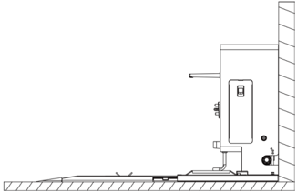
> *Bildbeschreibung (KI):* Die Abbildung zeigt die Montageposition der selbstreinigenden Dockingstation (Sockel) an einer Wand. Der Sockel ist mit einem Netzkabel und einer Wasserleitung verbunden, was auf eine feste Installation hinweist. Ein kleiner Auslass oder Sensor ragt seitlich aus dem Gerät heraus – möglicherweise für Reinigungswasser oder Luftstrom. Das Gerät steht auf einer ebenen Fläche und ist nicht beweglich während des Betriebs.

---

*Seite 21 (PDF-Seite 13, links)*

3. Es dürfen sich keine reflektierenden oder transparenten Teile wie Spiegel oder Glas in der Nähe der Arbeitsposition der selbstreinigenden Dockingstation befinden. Wenn dies unvermeidlich ist, muss die Umgebung möglicherweise in gewissem Maße angepasst werden.
4. In der Nähe der selbstreinigenden Dockingstation sind keine brennbaren Stoffe erlaubt.
5. Die selbstreinigende Dockingstation sollte in einem offenen, freien Raum arbeiten mit 2,7 m Freiraum nach vorne und 1,5 m Freiraum auf beiden Seiten . (Wenn der Sockel für die Bürstenselbstreinigung nicht installiert ist, sollte die selbstreinigende Dockingstation in einem offenen, freien Raum arbeiten mit 2,1 m Freiraum nach vorne und 1,5 m Freiraum auf beiden Seiten)

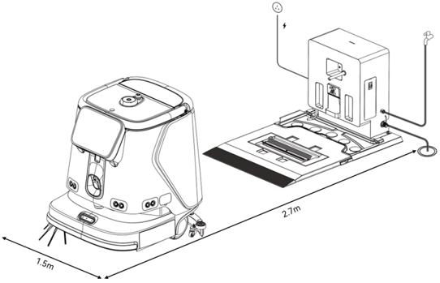
> *Bildbeschreibung (KI):* Die Abbildung zeigt die erforderlichen Freiräume um die selbstreinigende Dockingstation: 2,7 m nach vorne und 1,5 m auf beiden Seiten. Der Sockel für die Bürstenselbstreinigung ist optional; wenn nicht installiert, sind nur 2,1 m Freiraum nach vorne nötig (nicht im Bild dargestellt). Die Wasserauslasshöhe sollte maximal 0,5 m über dem Boden liegen – dies wird durch die Position des Wasseranschlusses angedeutet. Der Frischwasserdruck muss zwischen 0,1 und 0,6 MPa betragen – dieser Wert ist im Bild nicht direkt markiert, aber als Bedingung für den Betrieb relevant.

6. Der Frischwasserdruck sollte 0,1–0,6 mpa betragen.
7. Der Wasserauslass sollte nicht höher als 0,5 m über dem Boden liegen (wie in der Abbildung unten gezeigt).

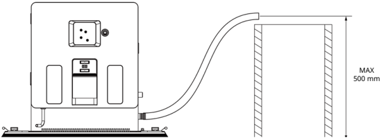
> *Bildbeschreibung (KI):* Der Wasserauslass muss nicht höher als 500 mm über dem Boden liegen. Die maximale Höhe des Wasserauslasses beträgt 500 mm.

---

*Seite 22 (PDF-Seite 13, rechts)*

# Produktbestandteile

## 2.1 Packliste

Sockel für Abstreiferselbstreinigung ×1, Ultraschall-Reinigungstank für Abstreifer (Schnelldemontage) x1, Sockel für Bürstenselbstreinigung (Schnelldemontage) x1, Bürstenreinigungstank (Schnelldemontage) x1, Rutschfeste Matte x1, Wassererhitzungstank x1, Ultraschalltreiber x1, Wasseransaugrohr x1, Aufbewahrungsbox für Wasseransaugrohr x1, Benutzerhandbuch für selbstreinigende Dockingstation der CC1-Serie (Sockel) ×1, Konformitätsbescheinigung x1

## 2.2 Aussehen

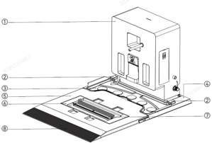
> *Bildbeschreibung (KI):* Die Nummer 1 zeigt die Haupteinheit der selbstreinigenden Dockingstation. Die Nummer 7 verweist auf austauschbare Reinigungsborsten für die Walzenbürste. Die Nummer 8 zeigt die rutschfeste Matte, die Teil des Sockels ist.

*Beschriftungen:*

- **1** Selbstreinigende Dockingstation (Haupteinheit)
- **2** Wasserstandsensor
- **3** Ultraschall-Reinigungstank für Abstreifer (Schnelldemontage)
- **4** Sockel für Abstreiferselbstreinigung
- **5** Sockel für Bürstenselbstreinigung (Schnelldemontage)
- **6** Bürstenreinigungstank (Schnelldemontage)
- **7** Reinigungsborsten für Walzenbürste (Austauschbar)
- **8** Rutschfeste Matte

## 2.3 Technische Daten

| Merkmale | Beschreibung |
|---|---|
| Produktname | Selbstreinigende Dockingstation der CC1-Serie (Sockel) |
| Produktfunktionen | Die selbstreinigende Dockingstation (Sockel) kann mit der selbstreinigenden Dockingstation (Haupteinheit) der CC1-Serie kombiniert werden, um eine selbstreinigende Dockingstation zu bilden. Sie ermöglicht automatische Wasserzufuhr und -abführung, automatische Reinigungsmittelzugabe und Selbstreinigung der Bürste und des Abstreifers bei der Rückkehr des Roboters zur Dockingstation |
| Maße | 1013 mm x 715 mm x 571 mm |
| Abmessungen (Ohne Sockel für Bürstenselbstreinigung) | 632 mm x 715 mm x 571 mm |
| Gewicht | 41 kg |
| Gewicht (Ohne Sockel für Bürstenselbstreinigung) | 33 kg |
| Eingangsspannung | 29,2 V/DC |
| Betriebstemperatur | 0–40 ℃ |
| Betriebsluftfeuchtigkeit | ≤90 % (40 ℃) |
| Lagertemperatur | -20 ℃–70 ℃ |
| Kommunikationsprotokoll | Kabelverbindung |
| Installationsanforderungen | Mit der Rückseite fest an der Wand montiert |
| Externe Anforderungen | Stromversorgung, Wasserversorgung, Bodenablauf, mobiler Wassertank (optional) |

---

*Seite 23 (PDF-Seite 14, links)*

# Benutzung

## 3.1 Bedienungsanleitung

- Installieren Sie die selbstreinigende Dockingstation (Haupteinheit) auf dem Sockel für Abstreiferselbstreinigung und befestigen Sie sie mit vier Schrauben. Montieren Sie dann den Abstreiferreinigungstank, den Sockel für die Bürstenselbstreinigung, den Bürstenreinigungstank und die rutschfeste Matte wie in der Abbildung unten gezeigt, um die selbstreinigende Dockingstation in der Pro-Konfiguration zu bilden. Alternativ können Sie nur den Wischerreinigungstank und die rutschfeste Matte installieren, um die selbstreinigende Dockingstation in der Basiskonfiguration zu bilden. Zwischen diesen beiden Konfigurationen kann manuell gewechselt werden.

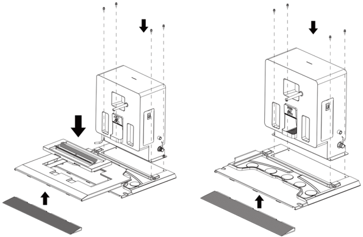
> *Bildbeschreibung (KI):* Die Abbildung zeigt die Montage der selbstreinigenden Dockingstation in zwei Konfigurationen: Pro (mit Abstreiferreinigungstank und Bürstenreinigungstank) und Basis (nur Wischerreinigungstank). Pfeile deuten an, welche Teile in welcher Reihenfolge montiert werden: zuerst der Sockel für Abstreiferselbstreinigung, dann die Haupteinheit, gefolgt von den Reinigungstanks und der rutschfesten Matte. Die Position des Netzadapters innerhalb der Station ist dargestellt – er wird zwischen den beiden Konfigurationen gleich installiert. Die Abbildung verdeutlicht, dass zwischen Pro- und Basiskonfiguration manuell gewechselt werden kann, indem bestimmte Komponenten entfernt oder hinzugefügt werden.
- Installieren Sie den Netzadapter für den Roboter der CC1-Serie innerhalb der Station (wie in der Abbildung unten dargestellt). Bitte verwenden Sie das Netzkabel des Netzadapters der CC1-Serie für den externen Stromanschluss der Station. Befestigen Sie danach die Abdeckplatte mit Schrauben;

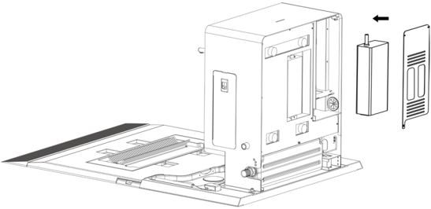
> *Bildbeschreibung (KI):* Die Abbildung zeigt die Montage der selbstreinigenden Dockingstation in der Pro-Konfiguration. Der Wischerreinigungstank und die rutschfeste Matte sind separat dargestellt und müssen wie gezeigt montiert werden. Der Netzadapter für den Roboter wird innerhalb der Station installiert, wie im Bild angedeutet. Die Abdeckplatte wird nach dem Einbau des Netzadapters mit Schrauben befestigt.

---

*Seite 24 (PDF-Seite 14, rechts)*

- Installieren Sie den Ultraschalltreiber innerhalb der Station (wie in der Abbildung unten dargestellt), schließen Sie die Stromeingangs- und das Stromausgangskabel an, führen Sie das Ausgangskabel durch den seitlichen Auslass der Station und befestigen Sie die Abdeckplatte mit Schrauben. Verbinden Sie dann das Stromausgangskabel mit dem Abstreiferreinigungstank und das Wassersensorkabel mit dem Sockel für Abstreiferselbstreinigung;

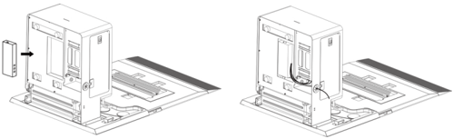
> *Bildbeschreibung (KI):* Die Abbildung zeigt die Positionierung des Ultraschalltreibers innerhalb der Station. Es wird dargestellt, wie das Ausgangskabel durch den seitlichen Auslass geführt und mit Schrauben befestigt wird. Die Abbildung veranschaulicht die Installation des Heizwassertanks innerhalb der Station. Es ist gezeigt, wie die Abdeckplatte nach dem Einbau von Komponenten wieder montiert wird.

- Installieren Sie den Heizwassertank innerhalb der Station (wie in der Abbildung unten dargestellt), schließen Sie das Netzkabel, den Überlaufschlauch, den Wassereinlassschlauch und den Wasserauslassschlauch wie erforderlich an, und befestigen Sie dann die Abdeckplatte;

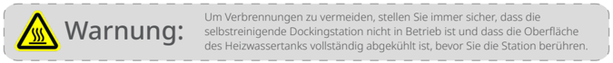
> *Bildbeschreibung (KI):* Die Warnung zeigt ein Symbol für Hitze und Verbrennungsgefahr. Der Text warnt davor, die Dockingstation zu berühren, wenn sie in Betrieb ist oder der Heizwassertank heiß ist.

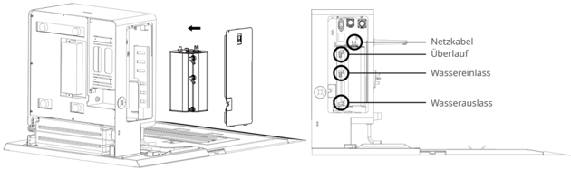
> *Bildbeschreibung (KI):* Die Abbildung zeigt die Anschlusspunkte für Netzkabel, Überlaufschlauch, Wassereinlass und Wasserauslass am Heizwassertank. Der Pfeil deutet an, dass die Abdeckplatte nach links geschoben wird, um den Tank zu montieren. Die vier kreisförmigen Markierungen auf dem Tank entsprechen den Anschlüssen für Strom- und Wasserleitungen.

- Verbinden Sie ein Ende des Wassereinlassschlauchs mit dem Wasserzulauf der selbstreinigenden Dockingstation und das andere Ende mit der Wasserversorgung;
- Verbinden Sie ein Ende des Wasserauslassschlauchs mit dem Wasserauslass der selbstreinigenden Dockingstation und platzieren Sie das andere Ende am Bodenablauf

Um Verbrennungen zu vermeiden, stellen Sie immer sicher, dass die selbstreinigende Dockingstation nicht in Betrieb ist und dass die Oberfläche des Heizwassertanks vollständig abgekühlt ist, bevor Sie die Station berühren.

## Warnung:

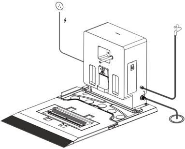
> *Bildbeschreibung (KI):* Die Abbildung zeigt die Positionierung des Ultraschalltreibers innerhalb der Station. Sie veranschaulicht den Anschluss der Strom- und Wasserkabel an die entsprechenden Anschlüsse. Es wird dargestellt, wie das Ausgangskabel durch den seitlichen Auslass geführt wird. Die Abbildung zeigt die Befestigung der Abdeckplatte mit Schrauben.

---

*Seite 25 (PDF-Seite 15, links)*

- Identifikationsaufkleber können verwendet werden, um die Positionen auf beiden Seiten der selbstreinigenden Dockingstation zu markieren(wie in der Abbildung unten dargestellt) .

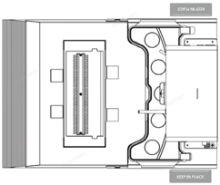
> *Bildbeschreibung (KI):* Die Abbildung zeigt die Positionen für Aufkleber auf der Vorder- und Rückseite der selbstreinigenden Dockingstation. Auf der Rückseite sind zwei runde Bereiche markiert, die wahrscheinlich für Identifikationsaufkleber oder Seriennummern vorgesehen sind. Auf der Vorderseite ist ein rechteckiger Bereich mit einer vertikalen Struktur eingezeichnet, der möglicherweise für einen Produktetikett oder eine QR-Code-Aufkleber dient. Die Beschriftungen 'CIEPINPACE' und 'KESP INHACI' deuten auf die deutschen Übersetzungen von 'KEEP IN PLACE' hin, was darauf hindeutet, dass diese Bereiche beschriftet werden sollen.
## Wartung und Pflege

- Wenn die selbstreinigende Dockingstation verschmutzt und staubig ist, reinigen Sie das Gerät mit einem weichen, sauberen Tuch.
- Entfernen und spülen Sie regelmäßig die Bürsten- und Abstreiferreinigungstanks und reinigen Sie regelmäßig die Abfallsammelschale.
- Wenn die selbstreinigende Dockingstation Anzeichen von Rissen, Verformung, Wasserleckage oder Fehlfunktionen beim Befüllen/Entleeren/Aufladen aufweist, trennen Sie bitte die Stromversorgung und kontaktieren Sie umgehend unseren Kundendienst.

## Kundendienst

## 4.1 Kostenlose Garantie

Wenn die Roboter unter Garantie stehen (unterschiedliche Garantiezeiten für verschiedene Bauteile, die Garantiezeiten werden ab Auslieferung des Roboters berechnet), leistet Pudu eine kostenlose Garantie, wenn:

- Defekte auftreten, die bei normalen Gebrauch innerhalb der angegebenen Garantiefrist nicht durch menschliches Versagen verursacht werden;
- Keine ungenehmigte Demontage, Modifikation oder Nachrüstung vorliegt, die nicht von der Bedienungsanleitung vorgegeben ist, oder andere Fehler auftreten, die nicht durch menschliches Versagen verursacht werden;
- Der Aufkleber mit der Artikelnummer des Roboters und andere Etiketten nicht entfernt oder verändert wurden;
- Kaufbeleg, Lieferbestätigung und Bestellnummer vorliegen;
- Beschädigte Komponenten, die im Rahmen der Garantie ersetzt werden, sind Eigentum von Pudu und sollten auf Anforderung an Pudu zurückgeschickt werden.

## 4.2 Kostenpflichtiger Kundendienst

- Pudu erbringt kostenpflichtige Kundendienstleistungen für Anfragen, die nicht von der kostenlosen Garantie abgedeckt sind (außerhalb der Garantiezeit oder nicht im Einklang mit den geltenden Bedingungen während der kostenlosen Garantiezeit);
- Die Techniker bieten bei Bedarf Arbeiten am Einsatzort an;
- Das „Kundendienstformular" sollte wie erforderlich ausgefüllt werden, wenn die Kriterien der kostenfreien Garantie nicht zutreffen;
- Kunden müssen dann sowohl für Wartung als auch für Ersatzteile zahlen.

## 4.3 Kundendienst kontaktieren

Wenn Sie Fragen haben, wenden Sie sich bitte an unsere Kundendienst-Hotline: +86-400-0826-660. E-Mail: techservice@pudutech.com

Der technische Kundendienst von Pudu Technology hat die folgenden Geschäftszeiten: 9:30–12:00, 13:30–18:30, Montag bis Samstag (GMT+8).

---

*Seite 26 (PDF-Seite 15, rechts)*

## Angaben zur Richtlinienerfüllung

## 5.1 Informationen über Entsorgung und Recycling

Die Richtlinie über Elektro- und Elektronik-Altgeräte (WEEE) zielt darauf ab, Umwelteinflüsse durch Elektro- und Elektronikgeräte zu minimieren, indem Wiederverwendung und Recycling erhöht und Deponieabfall verringert werden. Das Symbol auf diesem Produkt oder seiner Verpackung bedeutet, dass es nach seiner Nutzungszeit getrennt vom normalen Hausmüll entsorgt werden sollte. Es liegt in Ihrer Verantwortung, Elektronikgeräte in Recycling-Zentren zu entsorgen, um die natürlichen Ressourcen zu schonen. Jedes Land sollte seine eigenen Sammelstellen für das Recycling von elektrischen und elektronischen Geräten haben. Wo Sie Elektro- und Elektronikgeräte abgeben können, erfahren Sie vom zuständigen Amt, der Stadtverwaltung oder dem Entsorgungsdienst.

Vor dem Einbringen von Elektro- und Elektronikgeräten in die Abfallsammlung oder in Abfallsammelstellen sollten Batterien und Akkus zur getrennten Sammlung entfernt werden.

## 5.2 FCC-Konformitätserklärung

Die folgenden Informationen treffen auf Pudu Robotics zu.

Dieses Gerät wurde getestet und entspricht den Grenzwerten für ein digitales Gerät der Klasse B gemäß Teil 15 der FCC-Bestimmungen. Diese Grenzen sollen einen angemessenen Schutz gegen Funkstörungen in einer Wohnanlage ermöglichen. Dieses Gerät generiert, nutzt Hochfrequenzenergie und kann Hochfrequenzenergie abstrahlen und bei nicht anweisungsgemäßem Aufbau und Betrieb Funkstörungen verursachen. Es besteht jedoch keine Garantie, dass in einer gegebenen Installation keine Störungen auftreten. Wenn dieser Roboter Radio- oder Fernsehempfangsstörungen verursacht, was durch Aus- und Einschalten festgestellt werden kann, sollten Sie Abhilfe durch mindestens eine der folgenden Maßnahmen zu schaffen versuchen:

- Richten Sie die Empfangsantenne neu aus, oder stellen Sie sie an einem anderen Ort auf.
- Vergrößern Sie den Abstand zwischen Gerät und Empfänger.
- Schließen Sie das Gerät an eine Steckdose an, die nicht von demselben Stromkreis wie die Steckdose des Empfängers versorgt wird.
- Wenden Sie sich an den Händler oder an erfahrenen Radio-/Fernsehtechniker.

Dieses Gerät entspricht den Bestimmungen von Abschnitt 15 der Richtlinien der amerikanischen Bundesbehörde für das Fernmeldewesen FCC (Federal Communications Commission). Für den Betrieb gelten die folgenden zwei Bedingungen:

- Dieses Gerät darf keine schädlichen Störungen verursachen.
- Dieses Gerät muss empfangene Störsignale tolerieren können. Hierzu gehören auch Interferenzen, die zu nicht gewünschten Funktionen führen können.

## 5.3 Konformitätserklärung Industry Canada

Dieses Gerät entspricht den lizenzfreien RSS-Standards gemäß Industry Canada. Für den Betrieb gelten die folgenden zwei Bedingungen:

- Dieses Gerät darf keine Interferenzen erzeugen.
- Dieses Gerät muss Interferenzen verkraften können einschließlich Interferenzen, die zu Fehlern im Betrieb führen können.

L'émetteur/récepteur exempt de licence contenu dans le présent appareil est conforme aux CNR d'Innovation, Sciences et Développement économique Canada applicables aux appareils radio exempts de licence. L'exploitation est autorisée aux deux conditions suivantes :

- L'appareil ne doit pas produire de brouillage;
- L'appareil doit accepter tout brouillage radioélectrique subi, même si le brouillage est susceptible d'en compromettre le fonctionnement.
