*Page 7 (PDF page 6, left)*

## Copyright © 2025 Shenzhen Pudu Technology Co., Ltd. All rights reserved.

No organization or individual shall imitate, copy, transcribe or translate the contents of this user manual, in part or in full, without the express written consent of Shenzhen Pudu Technology Co., Ltd., or distribute this user manual for profit in any way (electronically or via photocopying, recording, etc.). The product specifications and information provided in this user manual are for reference only and are subject to change without further notice. Unless otherwise specified, this user manual is only intended as a user guide, and no representation shall be deemed as a warranty of any kind.

## Safety Instructions

## 1.1 Instructions for Use

- This product only includes the Self-Cleaning Docking Station (Base), which can be used in combination with the Self-Cleaning Docking Station (Main). The Self-Cleaning Docking Station (Main) should be purchased separately.
- Users of the Self-Cleaning Docking Station should receive professional training from our technical support.
- The deployment of the Self-Cleaning Docking Station may involve minor plumbing or electrical work, which should be performed by qualified personnel.
- The Self-Cleaning Docking Station should be placed indoors at room temperature and must not be used in environments where the temperature exceeds 40℃.
- The Self-Cleaning Docking Station should not be used if any of the following is observed: damage to the docking station, abnormal electrical current, or malfunction of the cleaning tank.
- The power cord should be well protected from being pulled and twisted.
- The Self-Cleaning Docking Station should be protected from damage caused by collisions with other objects.
- The Self-Cleaning Docking Station should not be used near flammables or explosives.
- If the Self-Cleaning Docking Station smokes or smells burnt, disconnect the power immediately and contact our staff.
- The Self-Cleaning Docking Station should not be moved from the designated place during use.
- The Self-Cleaning Docking Station can only be used with CC1 series products. Do not use it with products from other companies.
- Storage or operation in areas exposed to direct sunlight is strictly prohibited.

## 1.2 Environmental Instructions

- Working temperature: 0℃ - 40℃, relative humidity: ≤ 90% (<40℃).
- Storage temperature: -20℃ - 70℃, relative humidity: ≤ 85%, storage: 1 year.
- Working Environment Requirements:
    1. The Self-Cleaning Docking Station (Base) requires the Self-Cleaning Docking Station (Main) to function as a complete system. The robot unit is sold separately.
    2. The product must be placed on a level surface (with a tilt angle ≤2°), backed against a flat wall, and fixed to the wall or floor (as shown in the figure below).

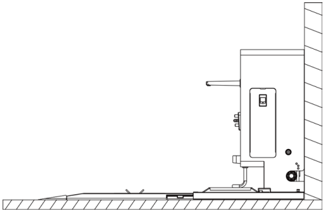
> *Figure description (AI):* The figure shows the Self-Cleaning Docking Station (Base) installed against a wall. It illustrates the required mounting position: backed against a flat wall on a level surface. The diagram indicates that the unit should be fixed to the wall or floor as shown. This visual guide complements the text requirement for installation with tilt angle ≤2°.

---

*Page 8 (PDF page 6, right)*

3. No reflective or transparent parts such as mirrors or glass are allowed near the working place of the Self-Cleaning Docking Station. If unavoidable, some adjustments to the working environment are necessary.
4. No flammables are allowed near the Self-Cleaning Docking Station.
5. The Self-Cleaning Docking Station should work in an open, unobstructed space with 2.7 m clearance in front and 1.5 m clearance on both sides . (When the brush self-cleaning base is not installed, the Self-Cleaning Docking Station should work in an open, unobstructed space with 2.1 m clearance in front and 1.5 m clearance on both sides)

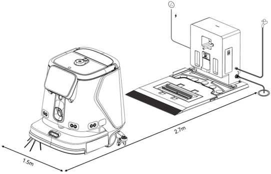
> *Figure description (AI):* The Self-Cleaning Docking Station requires a minimum clearance of 2.7 m in front and 1.5 m on both sides for proper operation. When the brush self-cleaning base is not installed, the required front clearance reduces to 2.1 m while side clearance remains 1.5 m. The water outlet must be positioned no higher than 0.5 m from the ground as illustrated in the diagram. Clean water pressure should be maintained between 0.1 and 0.6 MPa during operation.

6. Clean water pressure should be between 0.1 - 0.6 mpa.
7. The water outlet should not be higher than 0.5 m from the ground (as shown in the figure below).

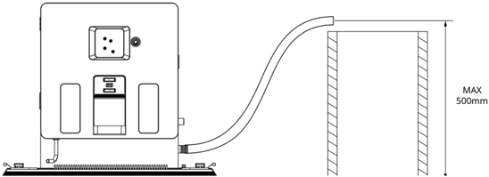
> *Figure description (AI):* The water outlet must be positioned no higher than 500 mm from the ground. This height limit applies to the connection point where the hose attaches to the docking station.

---

*Page 9 (PDF page 7, left)*

# Product Components

## 2.1 Packing List

Squeegee Self-Cleaning Base ×1, Squeegee Ultrasonic Cleaning Tank (Quick Disassembly) x1, Brush Self-Cleaning Base (Quick Disassembly) x1, Brush Cleaning Tank (Quick Disassembly)x1, Non-Slip Mat x1, Heating Water Tank x1, Ultrasonic Driver x1, Water Suction Pipe x1, Water Suction Pipe Storage Box x1, CC1Series Self-Cleaning Docking Station (Base) User Manual ×1, Certificate of Conformity x1

## 2.2 Appearance

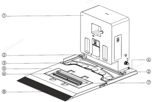
> *Figure description (AI):* The figure shows a labeled diagram of the CC1 Series Self-Cleaning Docking Station (Base) with numbered parts. Labels ② through ⑧ identify components such as water level sensors, cleaning tanks, brush bases, roller brushes, and non-slip mats. The diagram illustrates how the base connects to the main unit and where optional or replaceable parts are located.

*Labels:*

- **1** Self-Cleaning Docking Station (Main)
- **2** Water Level Sensor
- **3** Squeegee Ultrasonic Cleaning Tank (Quick Disassembly)
- **4** Squeegee Self-Cleaning Base
- **5** Brush Self-Cleaning Base (Quick Disassembly)
- **6** Brush Cleaning Tank (Quick Disassembly)
- **7** Roller Brush Cleaning Bristle (Replaceable)
- **8** Non-Slip Mat

## 2.3 Technical Specifications

| Feature | Description |
|---|---|
| Product Name | CC1 Series Self-Cleaning Docking Station (Base) |
| Product Features | The Self-Cleaning Docking Station (Base) can be combined with the CC1 Series Self-Cleaning Docking Station (Main) to form a Self-Cleaning Docking Station. It supports automatic water replenishment and drainage, automatic detergent injection, and self-cleaning of the brush and squeegee upon the robot's return to the docking station |
| Dimensions | 1013 x 715 x 571 mm &nbsp;&nbsp;&nbsp;&nbsp; |
| Dimensions (Without Brush Self-Cleaning Base) | 632 x 715 x 571 mm &nbsp;&nbsp;&nbsp;&nbsp; |
| Weight | 41 kg &nbsp;&nbsp;&nbsp;&nbsp; |
| Weight (Without Brush Self-Cleaning Base) | 33 kg &nbsp;&nbsp;&nbsp;&nbsp; |
| Input Voltage | 29.2 Vdc |
| Working Temperature | 0-40℃ |
| Working humidity | ≤90%(40℃) |
| Storage temperature | -20℃ - 70℃ |
| Communication Protocol | Cable Connection |
| Installation Requirements | Fixed with back against the wall |
| External Requirements | Power, water supply, floor drain, mobile water tank (optional) |

---

*Page 10 (PDF page 7, right)*

# How to Use

## 3.1 Operation Instructions

- Install the Self-Cleaning Docking Station (Main) onto the squeegee self-cleaning base and secure it with four screws. Then, assemble the squeegee cleaning tank, brush self-cleaning base, brush cleaning tank, and anti-slip mat as shown in the figure below to form the Self-cleaning Stocking Station (Pro configuration).Alternatively, you can install only the squeegee cleaning tank and anti-slip mat to form the Self-cleaning Stocking Station (Basic configuration). These two configurations can be switched manually.

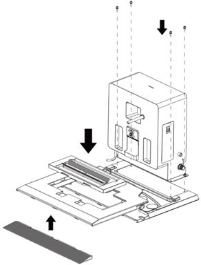
> *Figure description (AI):* The arrows indicate the assembly order: first place the anti-slip mat (bottom arrow), then install the squeegee cleaning tank onto the base (middle arrow), and finally secure the main station unit on top (top arrows). Four screws are shown being inserted from above to fasten the main station to the underlying components. The figure illustrates how to assemble the Self-Cleaning Docking Station in Pro configuration by stacking multiple parts vertically. A separate anti-slip mat is shown at the bottom, indicating it is placed first during assembly.
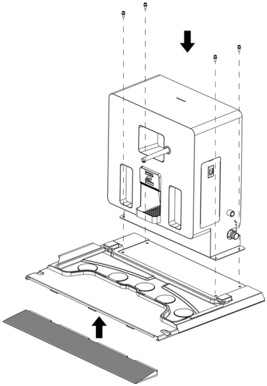
> *Figure description (AI):* The figure shows how to assemble the Self-Cleaning Docking Station by stacking components in a specific order. An arrow indicates that the bottom component (anti-slip mat) should be placed first. Another arrow points downward, showing that the main station body is lowered onto the assembled base. The illustration clarifies the physical arrangement of parts for both Basic and Pro configurations.
- Install the power adapter for CC1 series robot inside the station (as shown in the figure below). Please utilize the power cord of the CC1 series power adapter for the station's external power connection.After that, secure the cover plate with screws;

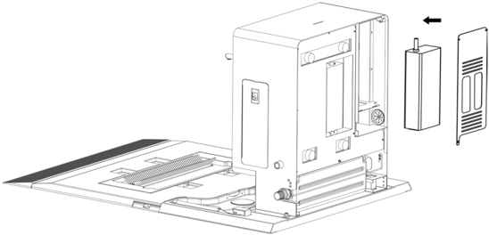
> *Figure description (AI):* The arrow indicates where to insert the power adapter into the docking station. The rectangular component with a protruding pin is the power adapter for the CC1 series robot. The flat panel with vents on the right is likely a cover plate or ventilation panel to be secured after installing the power adapter. The figure shows how to assemble the Self-Cleaning Docking Station (Pro configuration) by combining multiple components.

---

*Page 11 (PDF page 8, left)*

- Install the ultrasonic driver inside the station (as shown in the figure below), connect the power input and output cords, route the output cord through the side outlet of the station, and secure the cover plate with screws. Then, connect the power output cord to the squeegee cleaning tank and connect the water level sensor cord to the squeegee self-cleaning base;

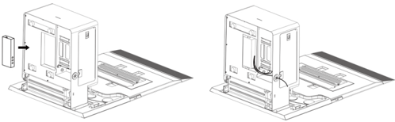
> *Figure description (AI):* The left diagram shows a component being inserted into the side of the station. The right diagram illustrates internal wiring connections inside the station's chassis. Arrows indicate the direction for inserting or routing components within the device.

- Install the heating water tank inside the station (as shown in the figure below), connect the power cord, overflow hose, and water inlet & outlet hoses as required, and then secure the cover plate;

## Warning:

To prevent burns, always ensure that the Self-Cleaning Docking Station is not in operation and that the surface of the heating water tank has completely cooled down before touching it.

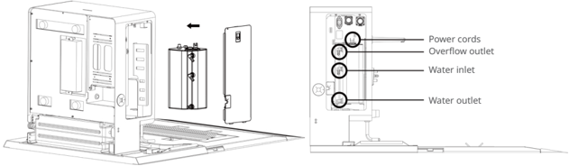
> *Figure description (AI):* The figure shows the internal components of the Self-Cleaning Docking Station with labels for Power cords, Overflow outlet, Water inlet, and Water outlet. It illustrates how to install the ultrasonic driver and heating water tank inside the station. The diagram indicates where to connect power input/output cords and route the output cord through the side outlet. It shows the positions of ports and connectors for water hoses and electrical cords within the station.

- Connect one end of the water inlet hose to the water inlet of the Self-Cleaning Docking Station and the other end to the clean water supply;
- Connect one end of the water outlet hose to the water outlet of the Self-Cleaning Docking Station and place the other end at the floor drain

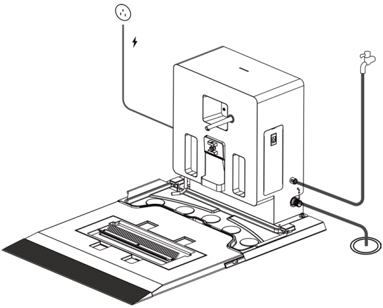
> *Figure description (AI):* The figure shows the internal layout of the Self-Cleaning Docking Station with key components labeled. It indicates where to install the ultrasonic driver and heating water tank inside the station. The diagram illustrates how to route power input/output cords and connect water inlet/outlet hoses. It visually guides users on securing cover plates and connecting external devices like the squeegee cleaning tank.

---

*Page 12 (PDF page 8, right)*

- Identification stickers can be used to mark the positions on both sides of the Self-Cleaning Docking Station(as shown in the figure below) .

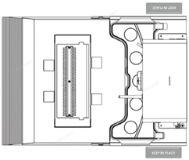
> *Figure description (AI):* The figure shows identification sticker positions on both sides of the Self-Cleaning Docking Station. Stickers should be placed at the marked locations to identify the unit. Keep these stickers intact as removal or alteration may void warranty coverage. These labels help verify authenticity and support after-sales service claims.
## Maintenance and Care

- If the Self-Cleaning Docking Station is dirty or dusty, use a soft, clean cloth to wipe it clean.
- Regularly remove and rinse the brush & squeegee cleaning tanks, and regularly clean the waste collection tray.
- If the Self-Cleaning Docking Station shows signs of cracks, deformation, water leakage, or failure to fill/drain/ charge, please disconnect the power and contact our after-sales service promptly.

## After-Sales Service

## 4.1 Free Warranty

When the robots are under warranty (warranty periods may vary for different components, calculated from the receipt of the robot),

Pudu offers a free warranty if:

- Defects are caused by non-human factors during normal use within the specified warranty period;
- There are no unauthorized disassembly, modification, or addition guided by unofficial instructions, or other faults caused by non-human factors;
- The S/N stickers, factory labels, and other labels are not removed or altered;
- Effective purchase certificate, receipt, and order number are provided;
- Damaged components replaced under warranty are properties of Pudu and should be sent back to Pudu as required.

## 4.2 Paid After-Sale Service

- Pudu provides paid after-sales services for requests not covered by the free warranty (beyond the warranty period or not in compliance with applicable terms during the free warranty period);
- Technicians will offer on-site service when necessary;
- The After-sales Service Form should be filled as required when the policy of free warranty is not applicable.
- Customers should pay for both maintenance and spare parts.

## 4.3 Contact Us

If you have any questions, please contact our customer service hotline: 400-0826-660. Email: techservice@pudutech.com Our technical support staff are available Monday through Saturday from 9:30 a.m. to 12:00 p.m. and 1:30 p.m. to 6:30 p.m. (GMT+8).

---

*Page 13 (PDF page 9, left)*

## Compliance Information

## 5.1 Disposal and recycling information

The Waste Electrical and Electronic Equipment (WEEE) Directive aims to minimize the impact of electrical and electronic goods on the environment, by increasing re-use and recycling and by reducing the amount of WEEE going to landfill. The symbol on this product or its packaging signifies that this product must be disposed separately from ordinary household wastes at its end of life. Be aware that this is your responsibility to dispose of electronic equipment at recycling centers in order to conserve natural resources. Each country should have its collection centers for electrical and electronic equipment recycling. For information about your recycling drop off area, please contact your related electrical and electronic equipment waste management authority, your local city office, or your household waste disposal service.

Before placing electrical and electronic equipment (EEE) in the waste collection stream or in waste collection facilities, the end user of equipment containing batteries and/or accumulators must remove those batteries and accumulators for separate collection.

## 5.2 Federal Communications Commission compliance statement

The following information applies to Pudu Robotics.

This equipment has been tested and found to comply with the limits for a Class B digital device, pursuant to part 15 of the FCC Rules. These limits are designed to provide reasonable protection against harmful interference in a residential installation. This equipment generates, uses and can radiate radio frequency energy and, if not installed and used in accordance with the instructions, may cause harmful interference to radio communications. However, there is no guarantee that interference will not occur in a particular installation. If this equipment does cause harmful interference to radio or television reception, which can be determined by turning the equipment off and on, the user is encouraged to try to correct the interference by one or more of the following measures:

- Reorient or relocate the receiving antenna.
- Increase the separation between the equipment and receiver.
- Connect the equipment into an outlet on a circuit different from that to which the receiver is connected.
- Consult the dealer or an experienced radio/TV technician for help.

This device complies with Part 15 of the FCC rules. Operation is subject to the following two conditions:

- This device may not cause harmful interference.
- This device must accept any interference received, including interference that may cause undesired operation.

## 5.3 Industry Canada compliance statement

This device complies with Industry Canada licence-exempt RSS standard(s). Operation is subject to the following two conditions:

- This device may not cause interference.
- This device must accept any interference, including interference that may cause undesired operation of the device. L'émetteur/récepteur exempt de licence contenu dans le présent appareil est conforme aux CNR d'Innovation, Sciences et Développement économique Canada applicables aux appareils radio exempts de licence. L'exploitation est autorisée aux deux conditions suivantes :
- L'appareil ne doit pas produire de brouillage;
- L'appareil doit accepter tout brouillage radioélectrique subi, même si le brouillage est susceptible d'en compromettre le fonctionnement.
