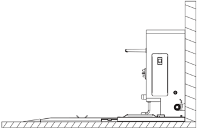
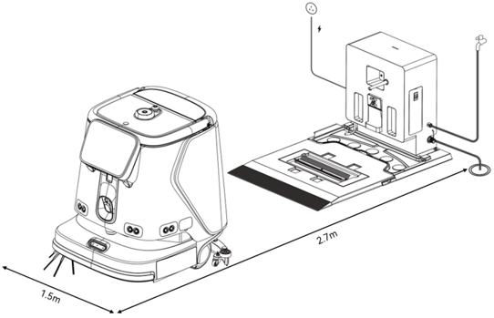
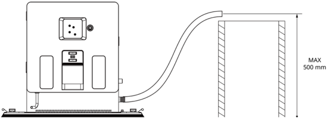
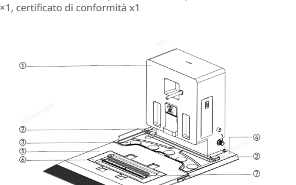
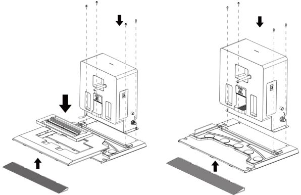
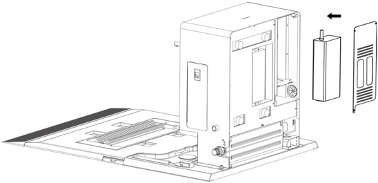
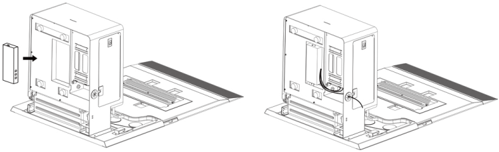
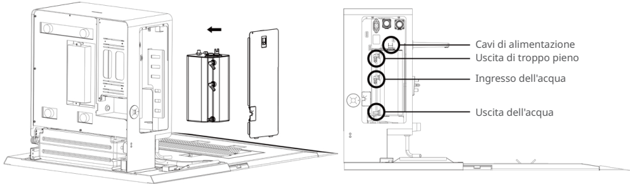
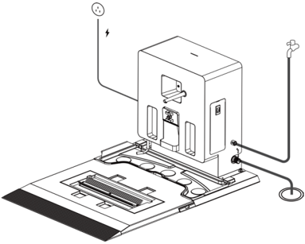
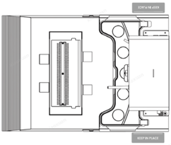

*Pagina 70 (pagina PDF 37, destra)*

## Copyright © 2025 Shenzhen Pudu Technology Co., Ltd. Tutti i diritti riservati.

Nessuna organizzazione o individuo può imitare, copiare, trascrivere o tradurre i contenuti di questo manuale dell'utente, in parte o per intero, senza il consenso scritto esplicito di Shenzhen Pudu Technology Co., Ltd., o distribuire questo manuale dell'utente a scopo di lucro in qualsiasi modo (elettronicamente o tramite fotocopiatura, registrazione, ecc.). Le specifiche del prodotto e le informazioni fornite nel presente manuale dell'utente hanno solo scopo di riferimento e sono soggette a variazione senza ulteriore preavviso. Salvo diversa indicazione, questo manuale dell'utente è destinato solo come guida per l'utente, e nessuna affermazione dovrà essere considerata come una garanzia di qualsiasi tipo.

## Istruzioni per la sicurezza

## 1.1 Istruzioni per l'uso

- Questo prodotto include solo la docking station autopulente (base), che può essere utilizzata in combinazione con la docking station autopulente (principale). La docking station autopulente (principale) deve essere acquistata separatamente.
- Gli utilizzatori della docking station autopulente devono ricevere una formazione professionale dal nostro supporto tecnico.
- L'installazione della docking station autopulente può comportare piccoli interventi idraulici o elettrici, che devono essere eseguiti da personale qualificato.
- La docking station autopulente deve essere collocata all'interno a temperatura ambiente e non deve essere utilizzata in ambienti in cui la temperatura superi i 40 ℃.
- La docking station autopulente non deve essere utilizzata se si osserva una delle seguenti condizioni: danni alla docking station, corrente elettrica anomala o malfunzionamento del serbatoio di pulizia.
- Il cavo di alimentazione deve essere ben protetto da trazioni e torsioni.
- La docking station autopulente deve essere protetta da danni causati da collisioni con altri oggetti.
- La docking station autopulente non deve essere utilizzata vicino a materiali infiammabili o esplosivi.
- Se dalla docking station autopulente esce fumo o si avverte odore di bruciato, scollegare immediatamente l'alimentazione e contattare il nostro personale.
- Durante l'uso, la docking station autopulente non deve essere spostata dal luogo designato.
- La docking station autopulente può essere utilizzata solo con prodotti della serie CC1. Non utilizzarla con prodotti di altre aziende.
- La conservazione o l'utilizzo in aree esposte alla luce solare diretta sono severamente vietati.

## 1.2 Istruzioni ambientali

- Temperatura di lavoro: 0 ℃ - 40 ℃, umidità relativa: ≤90% (<40 ℃).
- Temperatura di conservazione: -20 ℃ - 70 ℃, umidità relativa: ≤85%, conservazione: 1 anno.
- Requisiti ambientali di lavoro:
    1. La docking station autopulente (base) richiede la docking station autopulente (principale) per funzionare come sistema completo. L'unità robot è venduta separatamente.
    2. Il prodotto deve essere posizionato su una superficie piana (con un angolo di inclinazione ≤2°), appoggiato contro una parete piatta e fissato alla parete o al pavimento (come mostrato nella figura seguente).

> *Descrizione della figura (IA):* La figura mostra la posizione di installazione della docking station autopulente (base) rispetto a una parete. È visibile il punto di fissaggio o appoggio della base sul pavimento e sulla parete laterale. Si nota un cavo elettrico collegato alla parte inferiore dell'unità, indicando il punto di alimentazione. La figura illustra l'orientamento corretto del dispositivo durante l'installazione.

---

*Pagina 71 (pagina PDF 38, sinistra)*

3. Non sono ammesse parti riflettenti o trasparenti come specchi o vetri in prossimità del luogo di funzionamento della docking station autopulente. Se inevitabile, è necessario apportare alcuni adattamenti all'ambiente di lavoro.
4. Non sono ammessi materiali infiammabili vicino alla docking station autopulente.
5. La docking station autopulente deve funzionare in uno spazio aperto e privo di ostacoli con 2,7 m di spazio libero davanti e 1,5 m di spazio libero su entrambi i lati . (Quando la base autopulente delle spazzole non è installata, la docking station autopulente deve funzionare in uno spazio aperto e privo di ostacoli con 2,1 m di spazio libero davanti e 1,5 m di spazio libero su entrambi i lati)

> *Descrizione della figura (IA):* La figura mostra le dimensioni minime dello spazio libero richiesto davanti (2,7 m) e ai lati (1,5 m) della docking station autopulente. Le frecce indicano la direzione e l'estensione dello spazio di movimento necessario per il funzionamento sicuro del dispositivo. Il disegno illustra la posizione relativa tra il robot aspirapolvere e la base di ricarica durante il processo di pulizia o ricarica. Non sono presenti indicatori luminosi, colori specifici o etichette aggiuntive oltre alle misure indicate.

6. La pressione dell'acqua pulita deve essere compresa tra 0,1 e 0,6 mpa.
7. L'uscita dell'acqua non deve essere più alta di 0,5 m dal suolo (come mostrato nella figura seguente).

> *Descrizione della figura (IA):* L'uscita dell'acqua non deve superare un'altezza massima di 500 mm dal suolo. La figura illustra la posizione corretta del getto d'acqua rispetto al pavimento durante il funzionamento della docking station.

---

*Pagina 72 (pagina PDF 38, destra)*

# Componenti del prodotto

## 2.1 Contenuto della confezione
Base autopulente per tergipavimenti ×1, serbatoio di pulizia a ultrasuoni per tergipavimenti (smontaggio rapido) x1, base autopulente delle spazzole (smontaggio rapido) x1, serbatoio di pulizia delle spazzole (smontaggio rapido) x1, tappetino antiscivolo x1, serbatoio dell'acqua di riscaldamento x1, driver a ultrasuoni x1, tubo di aspirazione dell'acqua x1, scatola di conservazione del tubo di aspirazione dell'acqua x1, manuale dell'utente della docking station autopulente (base) serie CC1 ×1, certificato di conformità x1 Componenti del prodotto 1.

## 2.2 Aspetto

> *Descrizione della figura (IA):* Il numero 1 indica la docking station autopulente principale. Il numero 2 identifica il sensore di livello dell'acqua e la base autopulente per tergipavimenti. Il numero 3 punta al serbatoio di pulizia a ultrasuoni per tergipavimenti (smontaggio rapido). Il numero 4 indica la base autopulente delle spazzole (smontaggio rapido).

*Etichette:*

- **1** Docking station autopulente (principale)
- **2** Sensore di livello dell'acqua
- **3** Serbatoio di pulizia a ultrasuoni per tergipavimenti (smontaggio rapido)
- **4** Base autopulente per tergipavimenti
- **5** Base autopulente delle spazzole (smontaggio rapido)
- **6** Serbatoio di pulizia delle spazzole (smontaggio rapido)
- **7** Setole di pulizia per spazzola a rullo (sostituibili)
- **8** Tappetino antiscivolo

## 2.3 Specifiche tecniche
| Funzionalità | Descrizione |
|---|---|
| Nome del prodotto | Docking station autopulente (base) serie CC1 |
| Funzionalità del prodotto | La docking station autopulente (base) può essere combinata con la docking station autopulente (principale) serie CC1 per formare una docking station autopulente completa. Supporta il riempimento e lo scarico automatico dell'acqua, l'iniezione automatica di detergente e la pulizia automatica della spazzola e del tergipavimenti al rientro del robot alla docking station |
| Dimensioni | 1013 x 715 x 571 mm |
| Dimensioni (senza base autopulente delle spazzole) | 632 x 715 x 571 mm |
| Peso | 41 kg |
| Peso (senza base autopulente delle spazzole) | 33 kg |
| Tensione di ingresso | 29,2 Vcc |
| Temperatura di lavoro | 0-40 ℃ |
| Umidità di lavoro | ≤90% (40 ℃) |
| Temperatura di conservazione | -20 ℃ - 70 ℃ |
| Protocollo di comunicazione | Connessione via cavo |
| Requisiti di installazione | Fissata con il retro contro la parete |
| Requisiti esterni | Alimentazione, fornitura d'acqua, scarico a pavimento, serbatoio d'acqua mobile (opzionale) |

---

*Pagina 73 (pagina PDF 39, sinistra)*

## Modalità d'uso

## 3.1 Istruzioni per il funzionamento

- Installare la docking station autopulente (principale) sulla base autopulente del tergipavimenti e fissarla con quattro viti. Quindi, assemblare il serbatoio di pulizia del tergipavimenti, la base autopulente delle spazzole, il serbatoio di pulizia delle spazzole e il tappetino antiscivolo, come mostrato nella figura seguente, per formare la docking station autopulente (configurazione Pro). In alternativa è possibile installare solo il serbatoio di pulizia del tergipavimenti e il tappetino antiscivolo per formare la docking station autopulente (configurazione Base). Queste due configurazioni possono essere scambiate manualmente.

> *Descrizione della figura (IA):* La figura mostra come assemblare la docking station autopulente in due configurazioni: Pro (con tutti i componenti) e Base (solo serbatoio principale e tappetino). Le frecce nere indicano l'ordine di montaggio: inserire prima il tappetino antiscivolo, poi il serbatoio di pulizia del tergipavimenti, quindi la base autopulente delle spazzole e infine il serbatoio delle spazzole. Il pannello superiore della docking station deve essere fissato con quattro viti, come indicato dalle linee tratteggiate verticali che puntano verso i fori di montaggio. L'alimentatore per il robot serie CC1 va installato all'interno della stazione prima di chiudere la piastra di copertura.

- Installare l'alimentatore per il robot serie CC1 all'interno della stazione (come mostrato nella figura seguente). Utilizzare il cavo di alimentazione dell'alimentatore della serie CC1 per la connessione di alimentazione esterna della stazione. Successivamente, fissare la piastra di copertura con le viti;

> *Descrizione della figura (IA):* La figura mostra come assemblare la docking station autopulente (configurazione Pro) con tutti i componenti: serbatoio di pulizia del tergipavimenti, base delle spazzole, serbatoio delle spazzole e tappetino antiscivolo. È possibile installare solo il serbatoio di pulizia del tergipavimenti e il tappetino antiscivolo per la configurazione Base, come indicato dal testo. L'alimentatore per il robot serie CC1 deve essere installato all'interno della stazione, come mostrato nella figura. La freccia nera indica la direzione di inserimento o posizionamento del componente separato (probabilmente l'alimentatore) nel vano della docking station.

---

*Pagina 74 (pagina PDF 39, destra)*

• Installare il driver ultrasonico all'interno della stazione (come mostrato nella figura seguente), collegare i cavi di ingresso e uscita dell'alimentazione, far passare il cavo di uscita attraverso l'apertura laterale della stazione e fissare la piastra di copertura con le viti. Quindi, collegare il cavo di alimentazione in uscita al serbatoio di pulizia del tergipavimenti e collegare il cavo del sensore di livello dell'acqua alla base autopulente del tergipavimenti;

> *Descrizione della figura (IA):* La figura mostra come installare il driver ultrasonico all'interno della stazione di docking. Il cavo di uscita dell'alimentazione deve essere fatto passare attraverso l'apertura laterale della stazione. La piastra di copertura deve essere fissata con le viti dopo aver inserito i componenti interni. I cavi devono essere collegati al serbatoio di pulizia e alla base autopulente come indicato.
• Installare il serbatoio dell'acqua di riscaldamento all'interno della stazione (come mostrato nella figura seguente), collegare il cavo di alimentazione, il tubo di troppo pieno e i tubi di ingresso e uscita dell'acqua come richiesto, quindi fissare la piastra di copertura;

## Avvertenza:

Per prevenire ustioni, assicurarsi sempre che la docking station autopulente non sia in funzione e che la superficie del serbatoio dell'acqua di riscaldamento si sia completamente raffreddata prima di toccarla.

> *Descrizione della figura (IA):* La figura mostra i punti di connessione sul retro della stazione di ricarica autopulente. I cavi di alimentazione si collegano ai terminali superiori contrassegnati come 'Cavi di alimentazione'. Il tubo di troppo pieno si collega al punto etichettato 'Uscita di troppo pieno'. I tubi dell'acqua si collegano rispettivamente all'ingresso e all'uscita indicati dalle etichette corrispondenti.
• Collegare un'estremità del tubo di ingresso dell'acqua all'ingresso dell'acqua della docking station autopulente e l'altra estremità alla fonte di acqua pulita;

• Collegare un'estremità del tubo di uscita dell'acqua all'uscita dell'acqua della docking station autopulente e posizionare l'altra estremità allo scarico a pavimento

> *Descrizione della figura (IA):* La figura mostra la posizione del driver ultrasonico all'interno della stazione di docking. Il cavo di alimentazione in uscita deve essere collegato al serbatoio di pulizia del tergipavimenti. Il cavo del sensore di livello dell'acqua va collegato alla base autopulente del tergipavimenti. I tubi di ingresso e uscita dell'acqua sono collegati rispettivamente all'ingresso e all'uscita della docking station.

---

*Pagina 75 (pagina PDF 40, sinistra)*

- Per contrassegnare le posizioni su entrambi i lati della docking station autopulente (come mostrato nella figura seguente) è possibile utilizzare gli adesivi di identificazione .

> *Descrizione della figura (IA):* La figura mostra la vista superiore della docking station autopulente. Sono visibili le posizioni dei serbatoi di pulizia e del vassoio di raccolta rifiuti. L'adesivo 'KEEP IN PLACE' indica una zona da non rimuovere o alterare. Il layout aiuta a identificare i componenti per la manutenzione e l'installazione.
## Manutenzione e cura

- Qualora la docking station autopulente sia sporca o polverosa, utilizzare un panno morbido e pulito per pulirla.
- Rimuovere e risciacquare regolarmente i serbatoi di pulizia delle spazzole e del tergipavimenti, e pulire regolarmente il vassoio di raccolta dei rifiuti.
- Se la docking station autopulente mostra segni di crepe, deformazioni, perdite d'acqua o problemi di riempimento/ scarico/ricarica, scollegare l'alimentazione e contattare tempestivamente il nostro servizio post-vendita.

## Assistenza post-vendita

## 4.1. Garanzia gratuita

Quando i robot sono in garanzia (periodi di garanzia diversi per componenti diversi, calcolati dal ricevimento del robot),

Pudu offre una garanzia gratuita se:

- I difetti sono causati da fattori non umani durante il normale utilizzo entro il periodo di garanzia specificato;
- Non vi sono smontaggi, modifiche o aggiunte non autorizzate effettuate sulla base di istruzioni non ufficiali, o altri guasti causati da fattori non umani;
- Gli adesivi S/N, le etichette di fabbrica e altre etichette non sono stati rimossi o alterati;
- Vengono forniti un certificato di acquisto, una ricevuta e un numero d'ordine validi;
- I componenti danneggiati sostituiti in garanzia sono di proprietà di Pudu e devono essere restituiti a Pudu come richiesto.

## 4.2 Assistenza post-vendita a pagamento

- Pudu fornisce un'assistenza post-vendita a pagamento per richieste non coperte dalla garanzia gratuita (oltre il periodo di garanzia o non conformi ai termini applicabili durante il periodo di garanzia gratuita);
- I tecnici offriranno assistenza in loco quando necessario.
- Il modulo di assistenza post-vendita deve essere compilato come richiesto quando la politica di garanzia gratuita non è applicabile.
- Il cliente dovrà pagare sia la manutenzione che le parti di ricambio.

## 4.3 Contattateci

In caso di dubbi, contattare la hotline del servizio clienti: 400-0826-660. E-mail: techservice@pudutech.com Il nostro personale di assistenza tecnica è disponibile dal lunedì al sabato dalle 9:30 alle 12:00 e dalle 13:30 alle 18:30 (GMT+8).

---

*Pagina 76 (pagina PDF 40, destra)*

## Informazioni sulla conformità

## 5.1 Informazioni su smaltimento e riciclaggio

La direttiva sui rifiuti di apparecchiature elettriche ed elettroniche (RAEE) mira a ridurre al minimo l'impatto dei prodotti elettrici ed elettronici sull'ambiente, aumentando il riutilizzo e il riciclo e riducendo la quantità di RAEE destinati alla discarica. Il simbolo su questo prodotto o sulla sua confezione indica che questo prodotto deve essere smaltito separatamente dai normali rifiuti domestici al termine del suo ciclo di vita. È responsabilità del cliente smaltire le apparecchiature elettroniche presso i centri di riciclo al fine di preservare le risorse naturali. Ogni paese deve avere i propri centri di raccolta per il riciclo delle apparecchiature elettriche ed elettroniche. Per informazioni sull'area di raccolta per il riciclo, contattare l'autorità competente per la gestione dei rifiuti di apparecchiature elettriche ed elettroniche, l'ufficio comunale locale o il servizio di smaltimento dei rifiuti domestici.

Prima di immettere apparecchiature elettriche ed elettroniche (AEE) nel flusso di raccolta dei rifiuti o negli impianti di raccolta dei rifiuti, l'utente finale di apparecchiature contenenti batterie e/o accumulatori deve rimuovere tali batterie e accumulatori per la raccolta differenziata.

## 5.2 Dichiarazione di conformità della Federal Communications Commission

Le seguenti informazioni si applicano a Pudu Robotics.

Questa apparecchiatura è stata collaudata e trovata conforme ai limiti per un dispositivo digitale di Classe B, secondo la Parte 15 delle regole FCC. Tali limiti sono definiti per garantire una ragionevole protezione nei confronti di interferenze pericolose in una installazione residenziale. Questa apparecchiatura genera, utilizza e può irradiare energia a radiofrequenza e, se non installata secondo le istruzioni, potrebbe causare interferenze pericolose alle comunicazioni radio. Tuttavia, non vi è garanzia che non si verifichino interferenze in una particolare installazione. Se questa apparecchiatura dovesse causare interferenze dannose alla ricezione radio o televisiva, che possono essere determinate spegnendo e accendendo l'apparecchiatura, si consiglia di cercare di correggere le interferenze

utilizzando una o più delle seguenti misure:

- Riorientare o spostare l'antenna ricevente.
- Aumentare la distanza tra l'apparecchiatura e il ricevitore.
- Collegare l'apparecchiatura a una presa su un circuito diverso da quello a cui è collegato il ricevitore.
- Consultare il rivenditore o un tecnico radio/TV esperto per avere aiuto.

Questo dispositivo è conforme alla Parte 15 delle regole FCC. L'uso è soggetto alle seguenti due condizioni:

- Questo dispositivo non può causare interferenze dannose.
- Questo dispositivo deve accettare qualsiasi interferenza ricevuta, comprese le interferenze che possono causare un funzionamento indesiderato.

## 5.3 Dichiarazione di conformità di Industry Canada

Questo dispositivo è conforme allo standard RSS esente da licenza di Industry Canada. L'uso è soggetto alle seguenti due condizioni:

- Questo dispositivo non può causare interferenze.
- Questo dispositivo deve accettare qualsiasi interferenza, comprese le interferenze che possono causare un funzionamento indesiderato del dispositivo.

L'émetteur/récepteur exempt de licence contenu dans le présent appareil est conforme aux CNR d'Innovation, Sciences et Développement économique Canada applicables aux appareils radio exempts de licence. L'exploitation est autorisée aux deux conditions suivantes :

- L'appareil ne doit pas produire de brouillage;
- L'appareil doit accepter tout brouillage radioélectrique subi, même si le brouillage est susceptible d'en compromettre le fonctionnement.
