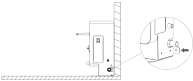
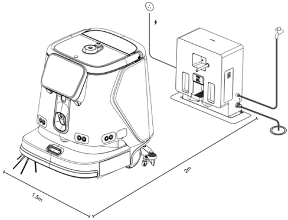
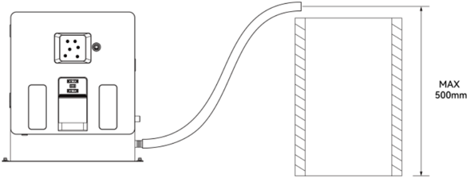
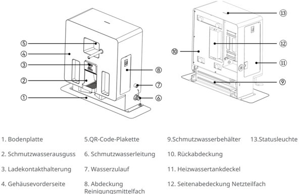
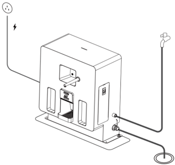
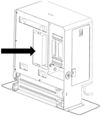
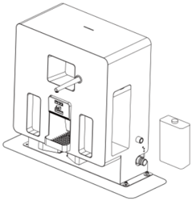
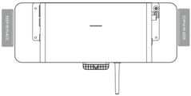
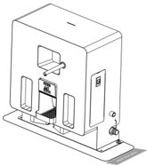

*Seite 29 (PDF-Seite 17, links)*

## Copyright © 2025 Shenzhen Pudu Technology Co., Ltd. Alle Rechte vorbehalten.

Keine Organisation oder Einzelperson darf den Inhalt dieses Benutzerhandbuchs teilweise oder vollständig ohne die ausdrückliche schriftliche Zustimmung von Shenzhen Pudu Technology Co., Ltd. kopieren, transkribieren oder übersetzen oder dieses Benutzerhandbuch zu kommerziellen Zwecken auf jedwede Art und Weise verteilen (elektronisch oder durch Fotokopieren, Aufzeichnen usw.). Die in diesem Benutzerhandbuch bereitgestellten technischen Daten und Angaben zum Produkt dienen nur als Referenz und können ohne vorherige Ankündigung geändert werden. Falls nicht anders angegeben, ist dieses Benutzerhandbuch nur als Orientierungshilfe gedacht und die darin enthaltenen Darstellungen sind nicht als Gewährleistung irgendwelcher Art aufzufassen.

## Sicherheitsanweisungen

## 1.1 Gebrauchshinweise

- Benutzer der Docking Station sind vom technischen Supportpersonal fachmännisch einzuweisen.
- Für die Installation der Docking Station können kleinere Installateur- oder Elektrikerarbeiten erforderlich sein, die von Fachleuten auszuführen sind.
- Die Docking Station ist in Innenräumen mit Raumtemperatur aufzustellen. Die Docking Station darf nicht in einem Hochtemperaturbereich (> 40°C) eingesetzt werden.
- Wenn die Docking Station beschädigt, der Ladestrom abnormal oder der Lade-/Entleerungsvorgang abnormal ist, darf die Docking Station nicht weiter genutzt werden.
- Verwenden Sie ausschließlich das originale Netzkabel. Es ist strengstens verboten, nicht originale Netzkabel für die Stromversorgung der Docking Station zu verwenden.
- Schützen Sie das Stromkabel sorgfältig, um ein Ziehen und Verdrehen zu vermeiden.
- Die Docking Station darf auf keinen Fall durch eine Kollision mit Fremdkörpern beschädigt werden.
- Die Docking Station darf nicht in der Nähe von entflammbaren und explosiven Materialien eingesetzt werden.
- Wenn die Docking Station Rauch oder einen verbrannten Geruch abgibt, bedeutet dies, dass eine Störung vorliegt. Trennen Sie die Stromversorgung der Docking Station umgehend, und kontaktieren Sie das Purdue-Personal.
- Verschieben Sie die Docking Station nicht willkürlich während der Nutzung, und verwenden Sie die Docking Station am vorgesehenen Ort.
- Es ist strengstens verboten, das Gerät in Bereichen, die direkter Sonneneinstrahlung ausgesetzt sind, zu lagern oder zu betreiben.
- Wenn an der Workstation ein ungewöhnliches rotes Licht aufleuchtet, trennen Sie bitte den Roboter vom Ladestapel und warten Sie, bis das Licht des Ladestapels blau wird, bevor Sie ihn wieder verwenden können.
- Wenden Sie sich an das technische Supportpersonal, wenn das rote Licht nach langem Warten nicht ausgeht.
- Wenn Sie die Funktion der automatischen Zugabe von Reinigungslösung verwenden müssen, verwenden Sie bitte ein nicht schäumendes, neutrales Reinigungsmittel mit einem pH-Wert von 6 bis 8 (die Verwendung von starken Säuren, starken Laugen und Reinigungsmitteln mit Wirkstoffen ist verboten).
- Dieses Gerät kann von Kindern ab 8 Jahren und von Personen mit eingeschränkten physischen, sensorischen oder geistigen Fähigkeiten oder mangelnder Erfahrung und Kenntnissen verwendet werden, wenn sie beaufsichtigt werden oder Anweisungen zur sicheren Verwendung des Geräts erhalten haben und die damit verbundenen Gefahren verstehen. Kinder dürfen nicht mit dem Gerät spielen. Kinder dürfen das Gerät nur unter Aufsicht reinigen und warten.

---

*Seite 30 (PDF-Seite 17, rechts)*

- Kinder sind zu beaufsichtigten, damit sie nicht mit dem Gerät spielen.
- Warnung vor dem Aufladen von nicht wiederaufladbaren Batterien.
- Lesen Sie vor der Verwendung des Ladegeräts alle Anweisungen und Warnhinweise auf dem Ladegerät, der Batterie und dem Produkt, das mit der Batterie betrieben wird.
- Für den Innenbereich geeignet, nicht dem Regen aussetzen.
- Verwendung nur mit dem Ladegerät für Modell AP-PF600CH02920150B.
- Verwendung nur mit dem kommerziellen Reinigungsroboter für Modell CCBC01.

## 1.2 Umgebungsbedingungen

- Temperatur der Arbeitsumgebung: 0°C bis 40°C, relative Luftfeuchtigkeit: ≤ 90 % (<40°C).
- Raumtemperatur bei Lagerung: -20°C bis 70°C, relative Luftfeuchtigkeit ≤ 85 %, Lagerung für 1 Jahr.
- Anforderungen an die Arbeitsumgebung:
    1. Die Docking Station muss mit der Rückseite gegen eine gerade Wand auf einem flachen Untergrund aufgestellt und durch seitliche Verbindungselemente an der Wand oder am Boden befestigt werden.

> *Bildbeschreibung (KI):* Die Abbildung zeigt die Montage der Docking Station an einer Wand mit seitlichen Befestigungselementen. Der vergrößerte Ausschnitt zeigt den Anschluss für das Netzteil oder eine externe Stromversorgung am Gerät. Ein Pfeil weist auf einen Steckplatz oder eine Buchse hin, die zur Verbindung mit einem Kabel dient. Die Darstellung verdeutlicht die korrekte Positionierung des Geräts an der Wand und am Boden.

2. Es dürfen sich keine reflektierenden oder lichtdurchlässigen Teile wie Spiegel oder Glas in der Arbeitsposition der Docking Station befinden. Wenn dies unvermeidlich ist, muss die Umgebung möglicherweise in gewissem Maße angepasst werden.
3. Es dürfen sich keine brennbaren Gegenstände in der Nähe der Docking Station befinden.
4. Sorgen Sie im Normalbetrieb für einen freien und ungehinderten Bereich im Abstand von 2 Metern vor dem Gerät und 1,5 Metern auf dessen rechter und linker Seite.

> *Bildbeschreibung (KI):* Die Abbildung zeigt die erforderlichen Abstände von 2 Metern vor der Docking Station und 1,5 Meter auf ihren Seiten. Der Roboter ist mit einem Kabel an die Docking Station angeschlossen, die wiederum an eine Wasserquelle (mit Hahn) und Stromversorgung angebunden ist. Die Docking Station steht auf einer Basisplatte und hat seitliche Befestigungspunkte für Wand- oder Bodenmontage. Der Roboter verfügt über vordere Bürsten und Sensoren am unteren Bereich, die in der Darstellung sichtbar sind.

---

*Seite 31 (PDF-Seite 18, links)*

5. Der Druck des sauberen Wassers beträgt 0,1-0,6 MPa.
6. Der Schmutzwasserauslauf darf nicht mehr als 0,5 m über dem Boden befinden.

> *Bildbeschreibung (KI):* Die maximale Höhe des Schmutzwasserauslaufs beträgt 500 mm über dem Boden. Der Schlauch verbindet den Docking-Station mit einem externen Behälter oder Abfluss.
## Produktvorstellung

## 2.1 Packliste

Gerät × 1, Bedienungsanleitung × 1, Wasserleitung für sauberes Wasser × 1, Wasserleitung für Schmutzwasser × 1.

## 2.2 Gerät kennenlernen

> *Bildbeschreibung (KI):* Die Abbildung zeigt die verschiedenen Teile der Docking-Station mit Nummern und deren Bezeichnungen. Sie veranschaulicht die Positionen von Anschlüssen wie dem Wasserzulauf (7) und Schmutzwasserausguss (2). Die Statusleuchte (13) ist oben am Gerät positioniert und dient zur Anzeige des Betriebszustands. Der QR-Code auf der Plakette (5) befindet sich an der Vorderseite für einfache Identifikation.

*Beschriftungen:*

- **1** Bodenplatte
- **2** Schmutzwasserausguss
- **3** Ladekontakthalterung
- **4** Gehäusevorderseite
- **5** QR-Code-Plakette
- **6** Schmutzwasserleitung
- **7** Wasserzulauf
- **8** Abdeckung Reinigungsmittelfach
- **9** Schmutzwasserbehälter
- **10** Rückabdeckung
- **11** Heizwassertankdeckel
- **12** Seitenabedeckung Netzteilfach
- **13** Statusleuchte

4. Gehäusevorderseite 8. Abdeckung

---

*Seite 32 (PDF-Seite 18, rechts)*

## 2.3 Leistungsparameter

| Produkteigenschaften Beschreibung |  |
|---|---|
|  | Produktname Selbstreinigende Docking Station der CC1-Serie (Haupteinheit) |
|  | Produktfunktion Unterstützt automatisches Hinzufügen und Entleeren, automatisches Laden, automatisches Einspritzen von Reinigungsmittel |
| Abmessungen )L, B, H( | 618 x 374 x 546 mm |
| Gewicht 23 kg |  |
| Eingangsspannung 100–240 V/AC |  |
| Ausgangsspannung 29,2 V/DC |  |
| Betriebstemperatur | 0 bis 40℃ |
| Betriebsfeuchtigkeit | RF: ≤ 90 % (40 ℃ ) |
| Lagertemperatur | -20 bis 70 ℃ |
| Übertragungsfrequenz 2400 bis 2483,5 MHz |  |
| Übertragungsleistung | ≤ 10 dBm |
| Kommunikationsmethode | Bluetooth |
| Kommunikationsmethode | Installationsanforderungen Am Boden oder rückseitig an der Wand befestigt |
| Kommunikationsmethode | Externe Abhängigkeiten Externe Abhängigkeiten Wasserquelle, Bodenablauf, Stromversorgung |

## Produktverwendung

## 1.1 Gebrauchsanleitung

- Verbinden Sie ein Ende der Wasserleitung mit dem Wasserzulauf der Docking Station und das andere Ende mit der Wasserquelle;
- Verbinden Sie ein Ende der Schmutzwasserleitung mit dem Wasserablauf der Docking Station und führen Sie das andere Ende (wie unten gezeigt) in den Bodenablauf ein.

> *Bildbeschreibung (KI):* Die Abbildung zeigt die Anschlüsse der Docking Station: Stromversorgung (Steckdose), Wasserzufuhr (Hahn) und Abwasserabfluss (Abfluss).

---

*Seite 33 (PDF-Seite 19, links)*

- Installieren Sie das Ladegerät des CC1-Roboters in die Docking Station (wie in der Abbildung unten gezeigt), und verwenden Sie das Stromkabel des CC1-Ladegeräts, um die Docking Station an die externe Stromversorgung anzuschließen.
* Bei der Installation ist darauf zu achten, dass die Öffnung des Netzteils für die Wärmeabfuhr nach unten zeigt.

> *Bildbeschreibung (KI):* Der Pfeil zeigt auf den Steckplatz für das Ladegerät des CC1-Roboters in der Docking Station. Die Position des Reinigungsmittelbehälters zur Befüllung und Wiedereinsetzung ist durch die gezeigte Öffnung definiert.

- Nehmen Sie den Reinigungsmittelbehälter zum Befüllen heraus, gießen Sie das Reinigungsmittel hinein und stellen Sie ihn (wie unten gezeigt) wieder in die Docking Station.

> *Bildbeschreibung (KI):* Die Abbildung zeigt die Docking Station mit dem eingebauten Ladegerät des CC1-Roboters. Der Reinigungsmittelbehälter ist herausgenommen und separat dargestellt, um das Befüllen zu veranschaulichen. Auf der Basisplatte sind zwei Markierungsaufkleber (mit Kreisen markiert) sichtbar, die zur Positionierung dienen. Ein Stromkabel führt vom Ladegerät zur externen Stromversorgung.
Dieser Arbeitsplatz unterstützt ausschließlich die Verwendung von nicht schäumenden, neutralen Reinigungsmitteln mit einem pH-Wert von 6 bis 8 (Zusatz von Entschäumungsmitteln möglich). Die Verwendung von starken Säuren, starken Laugen und wirkstoffhaltigen Reinigungsmitteln ist verboten.

Wenn Sie das Gerät bewegen, entleeren Sie bitte den Reinigungsmittelbehälter.

- Sie können Markierungsaufkleber verwenden, um die Positionen auf beiden Seiten der Docking Station zu kennzeichnen (wie in der Abbildung unten gezeigt).

> *Bildbeschreibung (KI):* Die Abbildung zeigt die Docking Station mit den Positionen für das Ladegerät und den Reinigungsmittelbehälter. Auf der linken Seite ist ein Bereich markiert, in dem das Ladegerät des CC1-Roboters installiert wird. Auf der rechten Seite befindet sich der Platz für den Reinigungsmittelbehälter zum Befüllen. Am unteren Rand sind Anschlüsse oder eine Lüftungsschlitze sichtbar, die zur Wärmeabfuhr dienen.

> *Bildbeschreibung (KI):* Die Abbildung zeigt die Docking Station mit dem eingebauten Ladegerät des CC1-Roboters. Der Reinigungsmittelbehälter ist herausgenommen und wird wieder in die Docking Station eingesetzt. Auf der rechten Seite der Docking Station befindet sich ein Anschluss für das Stromkabel. Die Markierungsaufkleber auf beiden Seiten der Docking Station dienen zur Positionskennzeichnung.

---

*Seite 34 (PDF-Seite 19, rechts)*

## Beschreibung der Anzeigelichter

| Anzeigelicht | Beschreibung Lichtstatus |
|---|---|
| Stetig blau | Normaler Standby (nicht verbundener Zustand) |
| blinkt grün | Verbindung zu CC1 herstellen |
| Stetig grün | Verbindung erfolgreich |
| Blau blinkend | Zwangsladung (nicht angeschlossen) |
| Rot blinkend | Es tritt ein Fehler auf |

## Wartung

- Die Docking Station ist verschmutzt und staubig. Säubern Sie das Gerät mit einem weichen, sauberen, fusselfreien Tuch.
- Reinigen Sie den Schmutzauffangbehälter der Docking Station regelmäßig.
- Trennen Sie das Gerät von der Stromversorgung und kontaktieren Sie umgehend den Kundendienst bei Rissen, Verformungen, Wasseraustritt, oder wenn die Docking Station nicht befüllt, entleert oder der Roboter nicht geladen werden kann.

## Kundendienst

## 4.1 Kostenlose Garantieleistung

Das Unternehmen verspricht, unter den folgenden Bedingungen, ab dem Datum des Produkterhalts, innerhalb der effektiven Garantiezeit des Produkts (die Garantiezeit der verschiedenen Produktteile unterscheidet sich), kostenlose Produktgarantieleistungen zu erbringen, wenn die folgenden Bedingungen erfüllt sind:

- Da das gekaufte Produkt innerhalb der angegebenen Produktgarantiezeit ordnungsgemäß verwendet wurde, bestehen keine durch Fremdeinwirkung verursachten Qualitätsprobleme;
- Es erfolgte keine unbefugte Demontage, keine Modifikation oder Installation, die nicht dem offiziellen Handbuch folgte, es handelt sich um andere, nicht durch Fremdeinwirkung verursachte Fehler;
- Die Produktseriennummer, das Firmenetikett und andere Markierungen sind nicht abgerissen oder verändert;
- Ein gültiger Kaufnachweis, Quittung und Bestellnummer werden vorgelegt;
- Die beschädigten Ersatzteile, die während der kostenlosen Garantiefrist ausgetauscht werden, sind Eigentum des Unternehmens und sind auf Anforderung an das Unternehmen zurückzuschicken.

## 4.2 Kundendienst außerhalb des Garantieumfangs

- Bei Kundendienstleistungen, die nicht im Rahmen der kostenlosen Garantie liegen (außerhalb der Garantiezeit oder die Bedingungen der kostenlosen Garantie innerhalb der Garantiezeit nicht erfüllen), bietet das Unternehmen kostenpflichtige Kundendienstleistungen an;

---

*Seite 35 (PDF-Seite 20, links)*

- Wenn nach der Diagnose des Technikers ein Hausbesuch zur Lösung des Problems für notwendig erachtet wird, wird ein professioneller Techniker beauftragt, den Service vor Ort zu erbringen;
- Für Kundendienstleistungen, die nicht im Rahmen der kostenlosen Garantie liegen, müssen Sie das "Kundendienstaufzeichnungsformular" wie erforderlich ausfüllen;
- Die Servicegebühr beinhaltet: Wartungsgebühr und Ersatzteilgebühr.

## 4.3 Beratung durch den Kundendienst

Wenden Sie sich bei Fragen

bitte an die Kundendienst-Hotline von Purdue Technology: +86 755-86952935 E-Mail: techservice@pudutech.com
