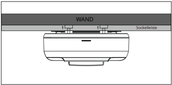
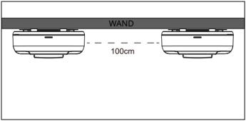
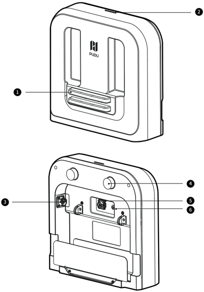
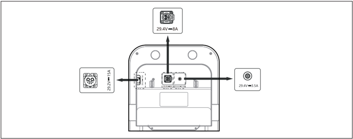
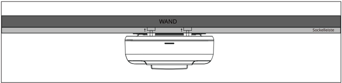
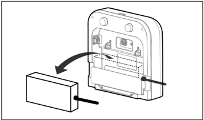
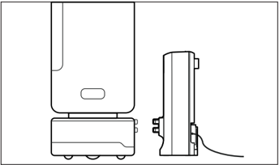

*Seite 20 (PDF-Seite 23)*

## Copyright © 2024 Shenzhen Pudu Technology Co., Ltd. Alle Rechte vorbehalten.

Keine Organisation oder Einzelperson darf den Inhalt dieses Benutzerhandbuchs teilweise oder vollständig ohne die ausdrückliche schriftliche Zustimmung von Shenzhen Pudu Technology Co., Ltd. kopieren, transkribieren oder übersetzen oder dieses Benutzerhandbuch zu kommerziellen Zwecken auf beliebige Weise verteilen (elektronisch oder durch Fotokopieren, Aufzeichnen usw.). Die in diesem Benutzerhandbuch bereitgestellten technischen Daten und Angaben zum Produkt dienen nur als Referenz und können ohne vorherige Ankündigung geändert werden. Falls nicht anders angegeben, ist dieses Benutzerhandbuch nur als Orientierungshilfe gedacht und die darin enthaltenen Darstellungen sind nicht als Gewährleistung irgendwelcher Art aufzufassen.

# 1. Sicherheitsanweisungen

## 1.1 Gebrauchshinweise

- Benutzer der Ladestation sind vom Pudu-Mitarbeiter oder Pudu autorisierten Personal fachmännisch einzuweisen.
- Die Ladestation ist in trockenen Innenräumen mit Raumtemperatur aufzustellen. Die Ladestation darf nicht in einem Hochtemperaturbereich (> 40 °C) eingesetzt werden. Es ist verboten, die Ladestation Wasser jeglicher Art auszusetzen oder in Wasser einzutauchen.
- Außer dem Personal von Pudu ist es niemandem erlaubt, die Ladestation zu demontieren.
- Wenn die Ladestation beschädigt oder der Ladestrom abnormal ist, darf die Ladestation nicht weiter genutzt werden.
- Verwenden Sie ausschließlich das originale Netzteil. Es ist strengstens verboten, nicht originale Netzteile für die Stromversorgung der Ladestation zu verwenden.
- Wenn Sie das Netzteil eines anderen Pudu-Modells an die Ladestation anschließen, achten Sie bitte darauf, dass Sie das Netzteil an die gekennzeichnete Schnittstelle der Ladestation anschließen, die dem jeweiligen Modell entspricht. Schließen Sie immer nur ein Netzteil gleichzeitig an. Schließen Sie nicht zwei oder mehr Netzteile gleichzeitig an.
- Schützen Sie das Stromkabel sorgfältig, um ein Ziehen und Verdrehen zu vermeiden.
- Die Ladestation darf auf keinen Fall durch eine Kollision mit Fremdkörpern beschädigt werden.
- Die Ladestation darf nicht in der Nähe von entflammbaren und explosiven Materialien eingesetzt werden.
- Wenn die Ladestation Rauch oder einen verbrannten Geruch abgibt, bedeutet dies, dass eine Störung vorliegt. Trennen Sie die Stromversorgung der Ladestation umgehend, und kontaktieren Sie das Pudu-Personal.
- Verschieben Sie die Ladestation nicht willkürlich während der Nutzung, und verwenden Sie die Ladestation am vorgesehenen Ladeort.
- Die Verwendung dieser Ladestation ist ausschließlich auf Lieferroboter der Marke Pudu Robotics beschränkt. Eine Verwendung mit Produkten anderer Hersteller ist untersagt.
- Es ist strengstens verboten, das Gerät in Bereichen, die direkter Sonneneinstrahlung ausgesetzt sind, zu lagern oder zu betreiben.
- Trennen Sie, wenn an der Ladestation durch ein rotes Licht eine Störung angezeigt wird, den Roboter von der Ladestation. Warten Sie, bis das Licht der Ladestation blau wird, bevor Sie sie weiter verwenden. Wenn das rote Licht an der Ladestation weiterhin leuchtet, trennen Sie bitte die Stromversorgung der Ladestation und wenden Sie sich an das Pudu-Personal.

## 1.2 Umgebungsbedingungen

- Temperatur der Arbeitsumgebung: 0 ℃ bis 40 ℃, relative Luftfeuchtigkeit: ≤ 85 % (40 °C)
- Raumtemperatur bei Lagerung: -20 ℃ bis 60 ℃, relative Luftfeuchtigkeit: ≤ 85 %, Lagerung für 1 Jahr.
- Anforderungen an die Arbeitsumgebung:
    1. Die Ladestation muss mit der Rückseite gegen eine gerade Wand auf einem flachen und trockenen Untergrund aufgestellt und durch seitliche Verbindungselemente an der Wand oder am Boden befestigt werden.
    2. Es dürfen sich keine reflektierenden oder transparenten Teile wie Spiegel oder Glas in der Arbeitsposition der Ladestation befinden. Wenn dies unvermeidlich ist, muss die Umgebung möglicherweise in gewissem Maße angepasst werden.
    3. Es dürfen sich keine offene Flamme oder brennbaren Gegenstände in der Nähe der Ladestation befinden.
    4. Sorgen Sie im Normalbetrieb für einen freien und ungehinderten Bereich im Abstand von 100 cm vor dem Gerät und 50 cm auf dessen rechter und linker Seite. (siehe Abb. 1)
    5. Werden mehrere Ladestationen gleichzeitig genutzt, empfiehlt es sich, diese in einem Abstand von mindestens 100 cm aufzustellen. (siehe Abb. 2)

---

*Seite 21 (PDF-Seite 24)*

> *Bildbeschreibung (KI):* Die Abbildung zeigt die korrekte Montageposition des Geräts an einer Wand oder Sockelleiste. Der Bereich 'WAND' kennzeichnet die Befestigungsoption an einer vertikalen Fläche. Der Bereich 'Sockelleiste' kennzeichnet die alternative Befestigungsoption an einer horizontalen Unterseite. Die Darstellung verdeutlicht, dass das Gerät sowohl an Wänden als auch an Sockelleisten montiert werden kann.

> *Bildbeschreibung (KI):* Die Abbildung zeigt die empfohlene Mindestabstand von 100 cm zwischen zwei Wandmontagen des Geräts. Der Abstand wird durch eine gestrichelte Linie zwischen den beiden Geräten visualisiert. Das Wort 'WAND' kennzeichnet die Montagefläche an der Wand. Die Darstellung dient zur Veranschaulichung der räumlichen Anordnung bei Mehrfachinstallation.

# 2. Produktvorstellung

## 2.1 Packliste

Gerät × 1, Benutzerhandbuch × 1, Qualitätszertifikat × 1.

## 2.2 Gerät kennenlernen

- Elektrodenplatte aus Metall
- Anzeigelicht
- Netzanschluss, DC 29,2 V / 15 A
- Positionierungsknopf
- Netzanschluss, DC 29,4 V / 8 A
- Netzanschluss, DC 29,4 V / 3,5 A

---

*Seite 22 (PDF-Seite 25)*

## 2.3 Leistungsparameter

| Merkmale | Beschreibung | Beschreibung | Beschreibung |
|---|---|---|---|
| Leistungsabgabe des entsprechenden Netzteils | DC 29,4 V / 3,5 A | DC 29,4 V, 8 A | DC 29,2 V, 15 A |
| Gewicht | 3 kg | 3 kg | 3 kg |
| Maße des Geräts (L×B×H) | 39,1*15,9*37,3 cm | 39,1*15,9*37,3 cm | 39,1*15,9*37,3 cm |
| Schutzklasse | IP20 | IP20 | IP20 |
| Betriebstemperatur | 0 ℃ bis 40 ℃ | 0 ℃ bis 40 ℃ | 0 ℃ bis 40 ℃ |
| Lagertemperatur | -20 °C bis 60 °C | -20 °C bis 60 °C | -20 °C bis 60 °C |
| Kommunikationsmethode | Bluetooth | Bluetooth | Bluetooth |
| Übertragungsfrequenz | 2400 bis 2483,5 MHz | 2400 bis 2483,5 MHz | 2400 bis 2483,5 MHz |

# 3. Produktverwendung

## 3.1 Gebrauchshinweise

1. Bitte schließen Sie das Netzteil an die entsprechend Ihrem Modell gekennzeichnete Schnittstelle der Ladestation an (siehe Abb. 1). Schließen Sie immer nur ein Netzteil gleichzeitig an. Schließen Sie nicht zwei oder mehr Netzteile gleichzeitig an.

> *Bildbeschreibung (KI):* Die Abbildung zeigt die Anschlüsse der Ladestation mit den zugehörigen Netzteilen. Das Netzteil mit 29,4 V und 8 A wird an den oberen Anschluss angeschlossen. Das Netzteil mit 29,2 V und 15 A wird an den linken Anschluss angeschlossen. Das Netzteil mit 29,4 V und 3,5 A wird an den rechten Anschluss angeschlossen.

2. Nachdem Sie das Netzteil an der Ladestation angeschlossen haben, können Sie das Netzteil in den dafür vorgesehenen Steckplatz (siehe Abb. 3) einstecken.
3. Auf der Rückseite der Ladestation befinden sich zwei Knöpfe, die dabei helfen, die Ladestation an der Wand zu positionieren (siehe Abb. 2). Passen Sie diese Knöpfe der Wandoberfläche entsprechend an, um sicherzustellen, dass die Ladestation parallel zur Wand steht und einen sicheren Stand hat. Achten Sie nach der richtigen Platzierung darauf, dass die Vorderseite der Ladestation nach vorne zeigt, und schließen Sie sie an die Stromquelle an.

> *Bildbeschreibung (KI):* Die Abbildung zeigt die Ladestation an der Wand montiert. Zwei Knöpfe auf der Rückseite dienen zur Positionierung der Ladestation an der Wandoberfläche. Die Vorderseite der Ladestation muss nach vorne zeigen. Das Netzteil wird in den dafür vorgesehenen Steckplatz eingesteckt.

---

*Seite 23 (PDF-Seite 26)*

4. Nachdem Sie das Netzteil mit der Ladestation verbunden haben, achten Sie auf einen sicheren Stand der Ladestation.
Sobald der Roboter an der Ladestation angedockt ist, kann der Ladevorgang beginnen (siehe Abb. 3).

> *Bildbeschreibung (KI):* Die Abbildung zeigt die korrekte Positionierung des Roboters an der Ladestation. Der Pfeil deutet darauf hin, dass der Roboter in den vorgezeichneten Bereich auf der Ladestation geschoben werden muss.

> *Bildbeschreibung (KI):* Die Abbildung zeigt die korrekte Positionierung des Roboters an der Ladestation. Der Roboter ist mit dem Netzteil verbunden, das in den Steckplatz der Ladestation eingesteckt ist.
Abb. 3:

## 3.2 Liste kompatibler Produkte

| Produkt | Netzteil - 3,5 A | Netzteil - 8 A | Netzteil - 15 A |
|---|---|---|---|
| FlashBot Neu | Empfohlen | Nicht empfohlen | Nicht empfohlen |
| T300 | Kompatibel | Kompatibel | Empfohlen |
| KettyBot | Kompatibel | Empfohlen | Empfohlen |
| KettyBot Pro | Kompatibel | Empfohlen | Empfohlen |
| PuduBot 2 | Kompatibel | Empfohlen | Empfohlen |
| SwiftBot | Kompatibel | Empfohlen | Empfohlen |

* Empfohlen – Das Netzteil ist das Standardnetzteil für das Produkt. Es kann das Produkt perfekt aufladen.
* Kompatibel – Das Netzteil ist nicht das Standardnetzteil für das Produkt. Es kann zwar zum Aufladen des Produkts verwendet werden, das vollständige Aufladen dauert jedoch länger.
* Nicht empfohlen – Das Netzteil ist nicht mit dem Produkt kompatibel. Es kann das Produkt nicht aufladen.

> Es wird empfohlen, für den Anschluss an die Ladestation zum Aufladen das mit dem Roboter
mitgelieferten Standardnetzteil zu verwenden. Bitte schließen Sie keine nicht unterstützten Produkte oder Netzteile an, da dies zu Schäden am Produkt führen kann.

## 3.3 Beschreibung der Anzeigelichter

| Status | Beschreibung |
|---|---|
| Dauerhaft blau | Ladestation normaler Standby, lädt nicht (nicht mit dem Roboter verbunden) |
| Grün blinkend | Roboter wird an der Ladestation angedockt. |
| Dauerhaft grün | Ladestation arbeitet, Ladevorgang läuft |
| Dauerhaft rot | Ladestation abnormal |
| Gelb blinkend | Es sind mehrere Netzteile gleichzeitig an der Ladestation angeschlossen. |
Kann nicht aufladen. Das Netzteil ist nicht mit dem Produkt kompatibel. |
| Dauerhaft gelb | Verlängerte Ladedauer. Das Netzteil ist nicht das Standardnetzteil für das Produkt. |
| Blau blinkend – schnelles Blinken | OTA-Update läuft |
| Rot blinkend | OTA-Update abnormal |
| Blau blinkend – langsames Blinken | Bluetoothverbindung aufgebaut |

* Empfohlen – Das Netzteil ist das Standardnetzteil für das Produkt. Es kann das Produkt perfekt aufladen.
* Kompatibel – Das Netzteil ist nicht das Standardnetzteil für das Produkt. Es kann zwar zum Aufladen des Produkts verwendet werden, das vollständige Aufladen dauert jedoch länger.
* Nicht empfohlen – Das Netzteil ist nicht mit dem Produkt kompatibel. Es kann das Produkt nicht aufladen.

---

*Seite 24 (PDF-Seite 27)*

## 3.4 Fehlerbehebung

| Fehlersymptom | Lösung |
|---|---|
| Das Licht an der Ladestation geht nicht an. | Überprüfen Sie, ob die Ladestation fest mit dem Netzteil verbunden ist, um eine ordnungsgemäße Stromverbindung sicherzustellen. Überprüfen Sie die Schnittstelle des Netzteils auf Staub oder Schmutz, der es möglicherweise blockiert. Wischen Sie die Stromschnittstelle der Ladestation mit einem sauberen Tuch ab oder verwenden Sie eine Druckluftflasche, um Staub, Fett oder Fremdkörper wegzublasen. |
| Das Anzeigelicht leuchtet konstant blau, aber der Ladevorgang kann nicht durchgeführt werden. | Bitte stellen Sie sicher, dass der Roboter, der aufgeladen werden muss, in der im Abschnitt „3.2 Liste kompatibler Produkte“ aufgeführten Produktliste enthalten ist. Die Ladestation kann keine nicht standardmäßigen Roboter oder Roboter von Drittanbietern erkennen. |
| Das Anzeigelicht blinkt gelb, der Ladevorgang kann nicht durchgeführt werden. | Prüfen Sie, ob mehrere Netzteile gleichzeitig an der Ladestation angeschlossen sind. Wenn ja, behalten Sie nur den, den Sie benötigen, und entfernen Sie die anderen. Das Netzteil ist nicht mit dem Produkt kompatibel. Das empfohlene Netzteil für Ihr Produkt finden Sie im Abschnitt „3.2 Liste kompatibler Produkte“ und schließen Sie es zum ordnungsgemäßen Laden an die Ladestation an. |
| Das Anzeigelicht leuchtet konstant gelb, der Ladevorgang verläuft langsam. | Das Netzteil ist nicht das Standardnetzteil, das mit dem Roboter geliefert wird. Das empfohlene Netzteil für Ihr Produkt finden Sie im Abschnitt „3.2 Liste kompatibler Produkte“ und schließen Sie es zum ordnungsgemäßen Laden an die Ladestation an. |
| Das Anzeigelicht leuchtet konstant rot. Die Ladestation ist nicht normal und kann nicht aufgeladen werden. | Überprüfen Sie den Zustand der Elektrodenplatten aus Metall der Ladestation. Stellen Sie sicher, dass sich auf den Elektrodenplatten aus Metall keine Fremdkörper, Flüssigkeiten oder Verstopfungen befinden. |
| Das Anzeigelicht blinkt rot, der Ladevorgang kann nicht durchgeführt werden. | Die Ladestation stellt automatisch eine erneute Bluetooth-Verbindung her und setzt den Aktualisierungsvorgang fort. Nachdem die Aktualisierung erfolgreich abgeschlossen ist, kann die Ladestation normal laden. Wenn das Anzeigelicht jedoch über einen längeren Zeitraum hinweg weiterhin rot blinkt und der Ladevorgang fehlschlägt, wenden Sie sich für weitere Unterstützung bitte an unseren Kundendienst. |

# 4. Wartung

- Wenn die Ladestation verschmutzt und staubig ist, säubern Sie das Gerät mit einem weichen, sauberen, fusselfreien Tuch.
- Bitte verwenden Sie zum Reinigen der Ladestation keine Reinigungsmittel, Sprays oder andere chemische Produkte.
- Trennen Sie das Ladegerät von der Stromversorgung und kontaktieren Sie umgehend den Kundendienst bei Rissen, Verformungen usw.

---

*Seite 25 (PDF-Seite 28)*

# 5. Kundendienst

Shenzhen Pudu Technology Co., Ltd (nachfolgend „Pudu Robotics" genannt) bietet unter den folgenden Bedingungen, ab dem Datum des Produkterhalts, innerhalb der effektiven Garantiezeit des Produkts (die Garantiezeit der verschiedenen Produktteile unterscheidet sich) kostenlose Produktgarantieleistungen. Die für den Kundendienst anfallenden Gebühren werden von Pudu übernommen. Außerhalb der Garantiezeit oder unter Umständen, die nicht durch die kostenlose Garantie abgedeckt sind, ist eine reguläre Gebühr zu entrichten. Näheres zu den Reparaturleistungen erfahren Sie bei einem Anruf bei der Kundendienst-Hotline auf der offiziellen Website von Pudu Robotics.

## 5.1 Kostenlose Garantieleistung

Die Händler sind für die Wartung der Endbenutzer verantwortlich. Pudu Robotics stellt kostenlose Ersatzteile für die Wartung und den technischen Support bereit.

Pudu Robotics bietet unter den folgenden Bedingungen Produktgarantieleistungen:

- a. Die Produkte angegebene Garantiezeit ist noch nicht abgelaufen.
- b. Es gibt nicht vom Menschen verursachten Qualitätsproblemen unter normalen Nutzungsbedingungen.
- c. Das Produkt wurde nicht unbefugt manipuliert oder repariert, es wurden weder Wasser noch Fremdstoffen ausgesetzt und es traten keine Stöße oder Stürze auf.
- d. Die Seriennummer, Fabriketiketten und andere Markierungen des Produkts sind unbeschädigt und unverändert.
- e. Es müssen ein gültiger Kaufbeleg, Quittungen und Bestellnummern vorgelegt werden.
- f. Alle während der Garantiezeit ersetzten beschädigten Teile gehören Pudu Robotics.

## 5.2 Kostenpflichtiger Kundendienst

Die Händler zahlen für die Wartungsersatzteile und sind für die Wartung des Endbenutzers verantwortlich. PUDU bietet kostenlosen technischen Support.

Pudu Robotics bietet unter folgenden Bedingungen kostenpflichtige Reparaturdienste außerhalb der Garantie an:

- a. Die Garantiezeit des Produkts ist abgelaufen.
- b. Die Seriennummer, Fabriketiketten oder andere Identifikationszeichen des Produkts wurden beschädigt oder verändert, sodass eine ordnungsgemäße Identifizierung nicht mehr möglich ist.
- c. Vorfälle, die Schäden verursachen, wie Kollisionen, Verbrennungen oder das Eindringen von Fremdstoffen (wie Wasser, Öl oder Sand), die nicht auf inhärente Produktqualitätsprobleme zurückzuführen sind.
- d. Schäden, die durch nicht autorisierte Änderungen, Demontage, Öffnen der Produktgehäuse oder Selbstreparaturen ohne offizielle Anleitung entstehen.
- e. Schäden, die durch falsche Installation, Verwendung, Aufladung oder Lagerung entstehen, die von den Anweisungen im Benutzerhandbuch und Installationshandbuch des Produkts abweichen.
- f. Produktschäden am Lieferroboter, die durch die Nutzung über die angegebene Gewichtskapazität hinaus entstehen.
- g. Produktschäden am Reinigungsroboter, die durch die Verwendung nicht offiziell empfohlener Reinigungsmittel entstehen.
- h. Ausfälle oder Schäden an Zubehör oder Komponenten, die nicht den Hauptgarantieteilen unterliegen.
- i. Ausfälle oder Schäden, die durch höhere Gewalt (z. B. Erdbeben, Feuer, Kriege usw.) entstehen.

## 5.3 Kundendienst kontaktieren

Wenn Sie Fragen haben, wenden Sie sich bitte an die Zentrale von Pudu Robotics. E-Mail: techservice@pudutech.com

---

*Seite 26 (PDF-Seite 29)*

# 6. Angaben zur Richtlinienerfüllung

## 6.1 Informationen über Entsorgung und Recycling

Die Richtlinie über Elektro- und Elektronik-Altgeräte (WEEE) zielt darauf ab, Umwelteinflüsse durch Elektro- und Elektronikgeräte zu minimieren, indem Wiederverwendung und Recycling erhöht und Deponieabfall verringert werden. Das Symbol auf diesem Produkt oder seiner Verpackung bedeutet, dass es nach seiner Nutzungszeit getrennt vom normalen Hausmüll entsorgt werden sollte. Es liegt in Ihrer Verantwortung, Elektronikgeräte in Recycling-Zentren zu entsorgen, um die natürlichen Ressourcen zu schonen. Jedes Land sollte seine eigenen Sammelstellen für das Recycling von elektrischen und elektronischen Geräten haben. Wo Sie Elektro- und Elektronikgeräte abgeben können, erfahren Sie vom zuständigen Amt, der Stadtverwaltung oder dem Entsorgungsdienst.

## 6.2 FCC-Konformitätserklärung

Die folgenden Informationen treffen auf Pudu Robotics zu.

Dieses Gerät wurde getestet und entspricht den Grenzwerten für ein digitales Gerät der Klasse B gemäß Teil 15 der FCC-Bestimmungen. Diese Grenzen sollen einen angemessenen Schutz gegen Funkstörungen in einer Wohnanlage ermöglichen. Dieses Gerät generiert, nutzt Hochfrequenzenergie und kann Hochfrequenzenergie abstrahlen und bei nicht anweisungsgemäßem Aufbau und Betrieb Funkstörungen verursachen. Es besteht jedoch keine Garantie, dass in einer gegebenen Installation keine Störungen auftreten. Wenn dieser Roboter Radio- oder Fernsehempfangsstörungen verursacht, was durch Aus- und Einschalten festgestellt werden kann, sollten Sie Abhilfe durch mindestens eine der folgenden Maßnahmen zu schaffen versuchen:

- Richten Sie die Empfangsantenne neu aus oder stellen Sie sie um.
- Erhöhen Sie den Abstand zwischen Roboter und Empfänger.
- Schließen Sie den Roboter an einen Stromkreis an, an dem nicht auch der Empfänger angeschlossen ist.
- Wenden Sie sich an den Händler oder einen erfahrenen Radio-/Fernsehtechniker.

Das Gerät entspricht Teil 15 der FCC-Bestimmungen. Für den Betrieb gelten die folgenden zwei Bedingungen:

- Das Gerät darf keine schädlichen Störungen verursachen.
- Das Gerät toleriert sämtliche empfangenen Interferenzen, einschließlich Interferenzen, die seinen Betrieb stören können.

## 6.3 Konformitätserklärung Industry Canada

Dieses Gerät entspricht den lizenzfreien RSS-Standards gemäß Industry Canada. Für den Betrieb gelten die folgenden zwei Bedingungen:

- Das Gerät darf keine Störungen verursachen.
- Das Gerät muss sämtliche Interferenzen tolerieren, einschließlich Interferenzen, die seinen Betrieb stören können.

L'émetteur/récepteur exempt de licence contenu dans le présent appareil est conforme aux CNR d'Innovation, Sciences et Développement économique Canada applicables aux appareils radio exempts de licence. L'exploitation est autorisée aux deux conditions suivantes :

- L'appareil ne doit pas produire de brouillage;
- L'appareil doit accepter tout brouillage radioélectrique subi, même si le brouillage est susceptible d'en compromettre le fonctionnement.
