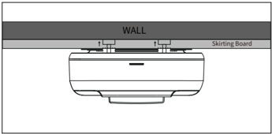
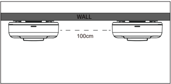
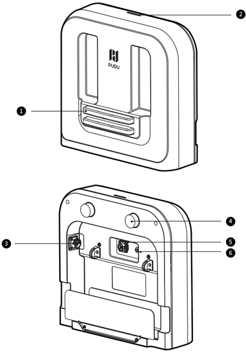
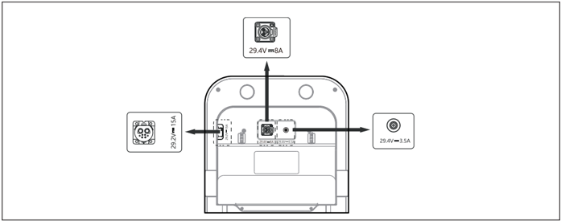
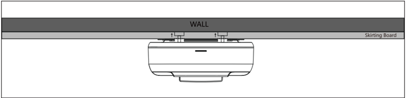
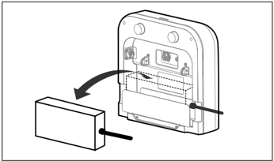
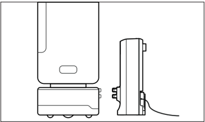

*Page 1 (PDF page 4)*

## Copyright © 2024 Shenzhen Pudu Technology Co., Ltd. All rights reserved.

No organization or individual shall imitate, copy, transcribe or translate the contents of this user manual, in part or in full, without the express written consent of Shenzhen Pudu Technology Co., Ltd., or distribute this user manual for profit in any way (electronically or via photocopying, recording, etc.). The product specifications and information provided in this user manual are for reference only and are subject to change without further notice. Unless otherwise specified, this user manual is only intended as instructions for use, and no representation shall be deemed as a warranty of any kind.

# 1. Safety Instructions

## 1.1 Instructions for use

- Charging station users should receive professional training from Pudu staff or personnel authorized by Pudu.
- The charging station should be placed in a dry indoor scene with normal temperature. It is forbidden to place the charging station in a high temperature area ( ＞ 40℃ /104 ℉ ) for use. It is forbidden for charging station to be exposed to any form of water or to be submerged in water.
- No one other than Pudu staff is authorized to disassemble the charging station.
- If the charging station is damaged, or the charging current is abnormal, please stop using the charging station.
- Be sure to use the original power adapter, and it is strictly forbidden to use non-original power adapter to supply power to the charging station.
- When connecting the different model Pudu power adapter to the charging station, please ensure that you connect the power adapter to the labeled interface on the charging station that matches its specific model. Only connect one adapter at a time. Do not connect two or more adapters at the same time.
- Carefully protect the power cord to avoid pulling and twisting.
- It is strictly forbidden for the charging station to collide with foreign objects, causing damage to the charging station.
- Do not use the charging station near flammable and explosive objects.
- If the charging station emits smoke or burnt smell, it means that the charging station is abnormal, Please disconnect the power supply of the charging station immediately and contact Pudu staff.
- Do not move the charging station arbitrarily when in use, and use the charging station at the designated charging location.
- Use of this charging station is strictly limited to delivery robots manufactured by Pudu Robotics. Use with products from other companies is prohibited.
- It is strictly forbidden to store or work in areas exposed to direct sunlight.
- If there is an abnormal red light on the charging station. please separate the robot from the charging station. Wait for the charging station light to turn blue before using it again. If the abnormal red light on the charging station persists, please disconnect the power supply of the charging station and contact Pudu staff.

## 1.2 Environmental instructions

- Working environment temperature: 0℃ –40℃ (32 ℉ –104 ℉ ), relative humidity: ≤ 85% (40℃ /104 ℉ )
- Storage ambient temperature: -20℃ –60℃ (-4 ℉ –140 ℉ ), relative humidity: ≤ 85%, storage for 1 year.
- Working environment requirements:
    1. The charging station needs to be placed on a flat and dry ground for use, with its back against a flat wall, and fixed to the wall or the ground through lateral connection components.
    2. No reflective or transparent parts such as mirrors or glass are allowed near the working charging station. If unavoidable, some adjustments to the working environment are necessary.
    3. No open flames or flammables are allowed near the charging station.
    4. During normal operation, keep open and unobstructed within 100 cm (3.28 ft) in front and 50 cm (1.64 ft) in the left and right directions. (refer to Figure 1)
    5. If more than one charging station is being used at the same time, it is recommended that they be placed at least 100 cm (3.28 ft) apart. (refer to Figure 2)

---

*Page 2 (PDF page 5)*

> *Figure description (AI):* The figure shows the charging station mounted on a wall. It illustrates the device's position relative to a skirting board. This visual helps users understand the correct installation height and clearance from floor trim.

> *Figure description (AI):* The figure shows two charging stations mounted on a wall. A dashed line indicates that the horizontal distance between the two units should be 100cm. This diagram illustrates the recommended installation spacing for multiple units.

# 2. Product Introduction

## 2.1 Packing list

Machine×1, User Manual×1, Certificate of Compliance×1.

## 2.2 Appearance introduction

> *Figure description (AI):* The bottom view displays the rear connections including power interfaces and positioning knobs.
- Metal electrode plates
- Indicator light
- Power interface, DC 29.2 V / 15 A
- Positioning knob
- Power interface, DC 29.4 V / 8 A
- Power interface, DC 29.4 V / 3.5 A

---

*Page 3 (PDF page 6)*

## 2.3 Performance parameters

| Feature | Description | Description | Description |
|---|---|---|---|
| Applicable adapter's power output | DC 29.4 V / 3.5 A | DC 29.4 V / 8 A | DC 29.2 V / 15 A |
| Weight | 3 kg | 3 kg | 3 kg |
| Dimensions (L×W×H) | 39.1*15.9*37.3 cm | 39.1*15.9*37.3 cm | 39.1*15.9*37.3 cm |
| IP rating | IP20 | IP20 | IP20 |
| Working temperature | 0℃ – 40℃ | 0℃ – 40℃ | 0℃ – 40℃ |
| Storage temperature | -20℃ – 60℃ | -20℃ – 60℃ | -20℃ – 60℃ |
| Communication method | Bluetooth | Bluetooth | Bluetooth |
| Transmit frequency | 2400–2483.5 MHz | 2400–2483.5 MHz | 2400–2483.5 MHz |

# 3. Using the Product

## 3.1 Instructions for use

1. Please connect the power adapter to the labeled interface on the charging station that matches its specific model (refer to Figure 1). Only connect one adapter at a time. Do not connect two or more adapters at the same time.

> *Figure description (AI):* The figure shows three different power adapter interfaces that can be connected to the charging station. Each adapter interface is labeled with its specific voltage and current output (e.g., 29.4V/3.5A, 29.4V/8A, 29.2V/15A). Arrows indicate which adapter port on the device corresponds to each type of power adapter. The figure helps users identify the correct port for their specific power adapter before connecting it.

2. After connecting the power adapter interface to the charging station, you can insert the adapter into the designated slot (refer to Figure 3).
3. At the back of the charging station, you will find two knobs that assist in positioning the charging station against the wall (refer to Figure 2). Adjust these knobs according to the wall surface to ensure that the charging station is parallel to the wall and securely positioned. Once properly placed, make sure the front of the charging station is facing forward and connect it to the power source.

> *Figure description (AI):* The figure shows the charging station mounted against a wall. It indicates that two knobs are used to adjust the position of the charging station. The labels 'WALL' and 'Skirting Board' identify the mounting surfaces. Arrows point to the adjustment knobs for securing the device.

---

*Page 4 (PDF page 7)*

4. After connecting the power adapter to the charging station, ensure that the charging station is placed securely. Once the robot is docked with the charging station, it can begin charging (refer to Figure 3).

> *Figure description (AI):* The figure shows how to insert a power adapter into the charging station. An arrow indicates the direction to push the power adapter into its slot on the back of the charging station.

> *Figure description (AI):* The figure shows a robot vacuum cleaner docked with its charging station. A power adapter is connected to the charging station. The robot is positioned on top of the charging base for charging.
## 3.2 Compatible products list

| Product | Power adapter - 3.5 A | Power adapter - 8 A | Power adapter - 15 A |
|---|---|---|---|
| FlashBot New | Recommended | Not recommended | Not recommended |
| T300 | Compatible | Compatible | Recommended |
| KettyBot | Compatible | Recommended | Recommended |
| KettyBot Pro | Compatible | Recommended | Recommended |
| PuduBot 2 | Compatible | Recommended | Recommended |
| SwiftBot | Compatible | Recommended | Recommended |

* Recommended—The power adapter is the standard power adapter for the product. It can charge the product perfectly.
* Compatible—The power adapter is not the standard power adapter for the product. However, it can be used to charge the product, but it will take more time to fully charge.
* Not recommended—The power adapter is not compatible with the product. It cannot charge the product.

> It is recommended to use the standard power adapter that comes with the robot product to connect to the charging station for charging. Please do not connect unsupported products or power adapters, as it may result in damage to the product.

## 3.3 Indicator light description

| Status | Description |
|---|---|
| Steady Blue | Charging station normal standby, not charging (not connected to the robot) |
| Flashing Green | Robot docking at the charging station. |
| Steady Green | Charging station working, charging in progress |
| Steady Red | Charging station abnormal |
| Flashing Yellow | More than one power adapter is being connected to the charging station at the same time. Cannot charge. The power adapter is not compatible with the product. |
| Steady Yellow | Prolonged charging duration. The power adapter is not the standard power adapter for the product. |
| Flashing Blue - quick flash | OTA in progress |
| Flashing Red | OTA upgrade abnormal |
| Flashing Blue - slow flash | Bluetooth connection successful |

---

*Page 5 (PDF page 8)*

## 3.4 Troubleshooting

| Fault Symptom | Solution |
|---|---|
| The light on the charging station does not turn on | Check the charging station is securely connected to the power adapter to ensure a proper power connection. Inspect the power adapter interface for any dust or debris that may be blocking it. Use a clean cloth to wipe the charging station's power interface or use an air canister to blow away any dust, grease, or foreign objects. |
| Indicator light shows steady blue, but cannot charge | Please ensure that the robot product requesting charging is included in the products listed in section “3.2 Compatible Products List”. The charging station cannot recognize non-standard or third-party robots. |
| Indicator light shows flashing yellow, cannot charge | Check if more than one power adapter is connected to the charging station at the same time. If so, keep only the one you need and remove the others. The power adapter is not compatible with the product. Please refer to the section “3.2 Compatible Products List” for the recommended power adapter for your product, and connect it to the charging station for proper charging. |
| Indicator light shows steady yellow, charging progress is slow | The power adapter is not the standard power adapter that comes with the robot product. Please refer to the section “3.2 Compatible Products List” for the recommended power adapter for your product, and connect it to the charging station for proper charging. |
| Indicator light shows steady red, charging station abnormal, cannot charge | Inspect the condition of the charging station's metal electrode plates. Ensure that the metal electrode plates are free from any foreign object, liquids, or obstructions. |
| Indicator light shows flashing red, cannot charge | The charging station will automatically initiate a Bluetooth reconnection and resume the upgrade process. After the upgrade is successfully completed, the charging station will be able to charge normally. However, if the indicator light continues to show flashing red for an extended period and fails charging, please reach out to our customer service team for further assistance. |

# 4. Maintenance

- If the charging station is dirty or dusty, use a soft, clean cloth to wipe it clean.
- Please do not use detergents, sprays, or any other chemical products to clean the charging station unit.
- In case of cracks, deformation etc., please disconnect the power and contact the after-sales service promptly.

---

*Page 6 (PDF page 9)*

# 5. After-sales Service

Shenzhen Pudu Technology Co., Ltd (hereinafter refered to as Pudu Robotics) provides free warranty service within the effective warranty period (the warranty period may vary for different components) for products under the following circumstances from the date of product activation. The fees incurred by the after-sales service will be covered by Pudu. Beyond the warranty period or in any circumstances not covered by the free warranty, a certain fee will be charged according to the normal price. Please call the after-sales hotline on Pudu Robotics official website for repair services.

## 5.1 Free warranty service

Distributors are responsible for the maintenance for end-users, Pudu Robotics provides free maintenance spare parts and technical support.

Pudu Robotics provides warranty under the following circumstances:

- a. The products are within the specified warranty period.
- b. The occurrence of non-human-induced quality issues under normal usage conditions.
- c. The product has not undergone unauthorized tampering, repair, exposure to water or foreign substances, or experienced collisions or drops.
- d. The product's serial number, factory labels, and other markings are undamaged and unaltered.
- e. Valid proof of purchase, receipts, and order numbers are provided.
- f. Any damaged parts replaced during the warranty period belong to Pudu Robotics.

## 5.2 Paid after-sales service

The distributors shall pay for the maintenance spare parts and are responsible for the maintenance of end-user, PUDU provides free technical support.

Pudu Robotics will provide paid repair services outside the warranty in the following circumstances:

- a. The product has exceeded the warranty period.
- b. The product's serial number, factory labels, or other identifying marks have been torn or altered, preventing proper identification.
- c. Incidents causing damages, such as collisions, burns, or the entry of foreign substances (such as water, oil, or sand), that are not attributed to inherent product quality issues.
- d. Damages resulting from unauthorized modifications, disassembly, opening of the product shell, or self-repairs conducted without official guidance.
- e. Damages caused by incorrect installation, usage, charging, or storage that deviate from the instructions provided in the product user manual and installation guide.
- f. Delivery robot product damages resulting from using it beyond its designated weight capacity.
- g. Cleaning robot product damages caused by using non-officially recommended cleaning agents.
- h. Failures or damages to accessories or components other than the main warranty parts.
- i. Failures or damages arising from force majeure events (e.g., earthquakes, fires, wars, etc.).

## 5.3 Contact After-sales Service

If you have any questions, please contact Pudu Robotics headquarter:

Email: techservice@pudutech.com

---

*Page 7 (PDF page 10)*

# 6. Compliance information

## 6.1 Disposal and recycling information

The Waste Electrical and Electronic Equipment (WEEE) Directive aims to minimize the impact of electrical and electronic goods on the environment, by increasing re-use and recycling and by reducing the amount of WEEE going to landfill. The symbol on this product or its packaging signifies that this product must be disposed separately from ordinary household wastes at its end of life. Be aware that this is your responsibility to dispose of electronic equipment at recycling centers in order to conserve natural resources. Each country should have its collection centers for electrical and electronic equipment recycling. For information about your recycling drop off area, please contact your related electrical and electronic equipment waste management authority, your local city office, or your household waste disposal service.

## 6.2 Federal Communications Commission compliance statement

The following information applies to Pudu Robotics.

This equipment has been tested and found to comply with the limits for a Class B digital device, pursuant to part 15 of the FCC Rules. These limits are designed to provide reasonable protection against harmful interference in a residential installation. This equipment generates, uses and can radiate radio frequency energy and, if not installed and used in accordance with the instructions, may cause harmful interference to radio communications. However, there is no guarantee that interference will not occur in a particular installation. If this equipment does cause harmful interference to radio or television reception, which can be determined by turning the equipment off and on, the user is encouraged to try to correct the interference by one or more of the following measures:

- Reorient or relocate the receiving antenna.
- Increase the separation between the equipment and receiver.
- Connect the equipment into an outlet on a circuit different from that to which the receiver is connected.
- Consult the dealer or an experienced radio/TV technician for help.

This device complies with Part 15 of the FCC rules. Operation is subject to the following two conditions:

- This device may not cause harmful interference.
- This device must accept any interference received, including interference that may cause undesired operation.

## 6.3 Industry Canada compliance statement

This device complies with Industry Canada licence-exempt RSS standard(s). Operation is subject to the following two conditions:

- This device may not cause interference.
- This device must accept any interference, including interference that may cause undesired operation of the device.
- L'émetteur/récepteur exempt de licence contenu dans le présent appareil est conforme aux CNR d'Innovation, Sciences et Développement économique Canada applicables aux appareils radio exempts de licence. L'exploitation est autorisée aux deux conditions suivantes :
- L'appareil ne doit pas produire de brouillage;
- L'appareil doit accepter tout brouillage radioélectrique subi, même si le brouillage est susceptible d'en compromettre le fonctionnement.
