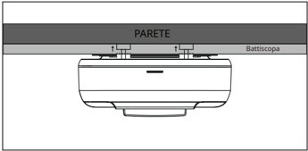
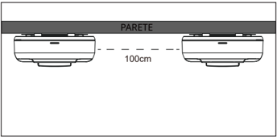
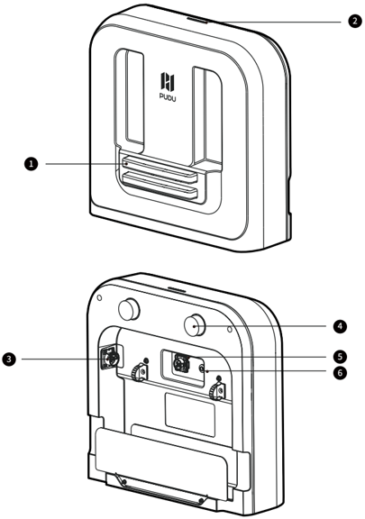
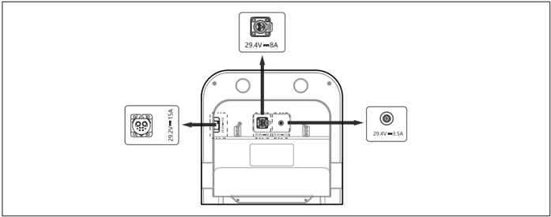
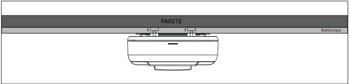
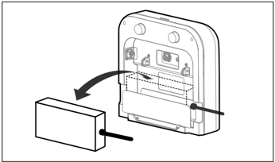
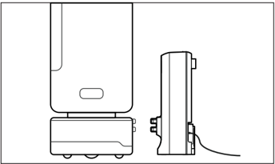

*Pagina 70 (pagina PDF 73)*

## Copyright © 2024 Shenzhen Pudu Technology Co., Ltd. Tutti i diritti riservati.

Nessuna organizzazione o individuo può imitare, copiare, trascrivere o tradurre i contenuti di questo manuale dell'utente, in parte o per intero, senza il consenso scritto esplicito di Shenzhen Pudu Technology Co., Ltd., o distribuire questo manuale dell'utente a scopo di lucro in qualsiasi modo (elettronicamente o tramite fotocopiatura, registrazione, ecc.). Le specifiche del prodotto e le informazioni fornite nel presente manuale dell'utente hanno solo scopo di riferimento e sono soggette a variazione senza ulteriore preavviso. Salvo diversa indicazione, questo manuale utente è destinato unicamente a fornire istruzioni per l'utilizzo, e nessuna affermazione in esso contenuta dovrà essere considerata come una garanzia di qualsiasi tipo.

# 1. Istruzioni per la sicurezza

## 1.1 Istruzioni per l'uso

- Gli utenti della stazione di ricarica devono ricevere una formazione professionale dal personale Pudu o dal personale autorizzato da Pudu.
- La stazione di ricarica deve essere collocata in un ambiente interno asciutto con temperatura normale. È vietato posizionare e utilizzare la stazione di ricarica in un'area ad alta temperatura (>40 ℃/104 ℉). È vietato esporre la stazione di ricarica a qualsiasi forma di acqua o immergerla in acqua.
- Nessuno, a parte il personale Pudu, è autorizzato a smontare la stazione di ricarica.
- Qualora la stazione di ricarica sia danneggiata o la corrente di carica sia anomala, interrompere l'utilizzo della stazione.
- Assicurarsi di utilizzare l'alimentatore originale; è severamente vietato utilizzare alimentatori non originali per alimentare stazione di ricarica.
- Quando si utilizza un diverso modello di alimentatore Pudu per alimentare la stazione di ricarica, assicurarsi di collegare l'alimentatore all'interfaccia etichettata sulla stazione di ricarica che corrisponde al modello specifico. Collegare un solo alimentatore alla volta. Non collegare due o più alimentatori contemporaneamente.
- Proteggere attentamente il cavo di alimentazione per evitare di tirarlo o di torcerlo.
- È severamente vietato urtare la stazione di ricarica con oggetti estranei, il che potrebbe causare danni alla stazione.
- Non utilizzare la stazione di ricarica in vicinanza di oggetti infiammabili o esplosivi.
- Se la stazione di ricarica emette fumo o odore di bruciato, questo significa che la stazione è in stato anomalo. Scollegare immediatamente l'alimentazione della stazione di ricarica e contattare il personale Pudu.
- Non spostare arbitrariamente la stazione di ricarica durante l'uso, e utilizzarla nella posizione di carica designata.
- L'uso di questa stazione di ricarica è strettamente limitato ai robot per le consegne prodotti da Pudu Robotics. È vietato l'uso con prodotti di altre aziende.
- È severamente vietato conservare o lavorare in aree esposte alla luce diretta del sole.
- Se sulla stazione di ricarica si accende una luce rossa di anomalia, staccare il robot dalla stazione. Attendere che la luce della stazione di ricarica diventi blu prima di utilizzarla nuovamente. Se la luce rossa di anomalia sulla stazione di ricarica persiste, scollegare l'alimentazione della stazione e contattare il personale Pudu.

## 1.2 Istruzioni ambientali

- Temperatura dell'ambiente di lavoro: 0 ℃ - 40 ℃ (32 ℉ - 104 ℉), umidità relativa: ≤ 85% (40 ℃/104 ℉)
- Temperatura dell'ambiente di stoccaggio: -20 ℃ - 60 ℃ (-4 ℉ - 140 ℉), umidità relativa: ≤ 85%, conservazione per 1 anno.
- Requisiti ambientali di lavoro:
    1. La stazione di ricarica deve essere posizionata su un terreno piatto e asciutto, con la parte posteriore appoggiata a una parete piatta e fissata alla parete o al pavimento mediante componenti di connessione laterali.
    2. Non sono ammesse parti riflettenti o trasparenti come specchi o vetri in prossimità della stazione di ricarica in funzione. Se inevitabile, è necessario apportare alcuni adattamenti all'ambiente di lavoro.
    3. Non sono ammesse fiamme libere o materiali infiammabili in prossimità della stazione di ricarica.
    4. Durante il normale funzionamento, mantenere aperto e sgombro uno spazio di 100 cm (3,28 piedi) di fronte e 50 cm (1,64 piedi) nelle direzioni sinistra e destra. (fare riferimento alla Figura 1)
    5. Se si utilizzano più stazioni di ricarica contemporaneamente, si consiglia di posizionarle ad almeno 100 cm (3,28 piedi) di distanza l'una dall'altra. (fare riferimento alla Figura 2)

---

*Pagina 71 (pagina PDF 74)*

> *Descrizione della figura (IA):* La figura mostra come montare la stazione di ricarica sulla parete e sul battiscopa. Le etichette 'PARETE' e 'Battiscopa' indicano le superfici di installazione. Il dispositivo è posizionato tra la parete e il battiscopa per un fissaggio sicuro.

> *Descrizione della figura (IA):* La figura mostra la posizione corretta per installare due stazioni di ricarica a muro. Le stazioni devono essere montate con una distanza orizzontale di 100 cm tra i loro centri. Il testo 'PARETE' indica che l'apparecchio deve essere fissato su una superficie verticale. La vista laterale dell'apparecchio mostra la forma e le dimensioni relative per il montaggio.

# 2. Introduzione al prodotto

## 2.1 Contenuto della confezione

Macchina × 1, Manuale utente × 1, Certificato di conformità × 1.

## 2.2 Introduzione all'aspetto del prodotto

- Elettrodi a piastra metallica
- Spia
- Interfaccia di alimentazione, 29,2 V CC / 15 A
- Manopola di posizionamento
- Interfaccia di alimentazione, 29,4 V CC / 8 A
- Interfaccia di alimentazione, 29,4 V CC / 3,5 A

---

*Pagina 72 (pagina PDF 75)*

## 2.3 Parametri prestazionali

| Funzionalità | Descrizione | Descrizione | Descrizione |
|---|---|---|---|
| Potenza di uscita dell'alimentatore utilizzabile | 29,4 V CC / 3,5 A | 29,4 V CC / 8 A | 29,2 V CC / 15 A |
| Peso | 3 kg | 3 kg | 3 kg |
| Dimensione (Lunghezza×Larghezza×Altezza) | 39,1*15,9*37,3 cm | 39,1*15,9*37,3 cm | 39,1*15,9*37,3 cm |
| Grado di protezione IP | IP20 | IP20 | IP20 |
| Temperatura di lavoro | 0 ℃ - 40 ℃ | 0 ℃ - 40 ℃ | 0 ℃ - 40 ℃ |
| Temperatura di conservazione | -20 ℃ - 60 ℃ | -20 ℃ - 60 ℃ | -20 ℃ - 60 ℃ |
| Metodo di comunicazione | Bluetooth | Bluetooth | Bluetooth |
| Frequenza di trasmissione | 2400 - 2483,5 MHz | 2400 - 2483,5 MHz | 2400 - 2483,5 MHz |

# 3. Utilizzo del prodotto

## 3.1 Istruzioni per l'uso

1. Collegare l'alimentatore all'interfaccia etichettata sulla stazione di ricarica che corrisponde al modello specifico (fare riferimento alla Figura 1). Collegare un solo alimentatore alla volta. Non collegare due o più alimentatori contemporaneamente.

> *Descrizione della figura (IA):* La figura mostra i tre connettori posteriori della stazione di ricarica con le relative specifiche elettriche. Il connettore centrale fornisce un'uscita da 29,4 V e 8 A. Il connettore a sinistra offre un'uscita da 29,2 V e 15 A. Il connettore a destra fornisce un'uscita da 29,4 V e 3,5 A.

2. Dopo aver collegato l'interfaccia dell'alimentatore alla stazione di ricarica, è possibile inserire l'alimentatore nello slot designato (fare riferimento alla Figura 3).
3. Sul retro della stazione di ricarica sono presenti due manopole che aiutano a posizionare la stazione di ricarica contro la parete (fare riferimento alla Figura 2). Regolare queste manopole in base alla superficie della parete per garantire che la stazione di ricarica sia parallela alla parete e posizionata in modo sicuro. Una volta posizionata correttamente, accertarsi che la parte anteriore della stazione di ricarica sia rivolta in avanti e collegarla alla fonte di alimentazione.

> *Descrizione della figura (IA):* La figura mostra la posizione della stazione di ricarica rispetto alla parete e al battiscopa. Le due manopole sul retro della stazione aiutano a regolarne l'inclinazione per adattarla alla superficie della parete. Una volta regolata, la stazione deve essere posizionata in modo che la parte anteriore sia rivolta in avanti. Il testo 'PARETE' indica la superficie verticale su cui appoggiare la stazione.

---

*Pagina 73 (pagina PDF 76)*

4. Dopo aver collegato l'alimentatore alla stazione di ricarica, assicurarsi che la stazione sia posizionata saldamente. Una volta agganciato il robot alla stazione di ricarica, può iniziare la ricarica (vedere Figura 3).

> *Descrizione della figura (IA):* La freccia curva indica come inserire il robot nella stazione di ricarica. Il punto nero sulla destra della stazione mostra dove posizionare il robot per agganciarlo correttamente.

> *Descrizione della figura (IA):* La figura mostra la posizione corretta del robot rispetto alla stazione di ricarica per l'aggancio. È visibile il connettore dell'alimentatore collegato alla stazione di ricarica. Il design della stazione di ricarica include indicatori o punti di aggancio sul lato inferiore.
## 3.2 Elenco dei prodotti compatibili

| Prodotto | Alimentatore - 3,5 A | Alimentatore - 8 A | Alimentatore - 15 A |
|---|---|---|---|
| FlashBot New | Consigliato | Non consigliato | Non consigliato |
| T300 | Compatibile | Compatibile | Consigliato |
| KettyBot | Compatibile | Consigliato | Consigliato |
| KettyBot Pro | Compatibile | Consigliato | Consigliato |
| PuduBot 2 | Compatibile | Consigliato | Consigliato |
| SwiftBot | Compatibile | Consigliato | Consigliato |

* Consigliato: l'alimentatore è quello standard per il prodotto. Può ricaricare il prodotto perfettamente.
* Compatibile: l'alimentatore non è quello standard per il prodotto. Tuttavia, può essere utilizzato per ricaricare il prodotto, ma la ricarica completa richiederà più tempo.
* Non consigliato: l'alimentatore non è compatibile con il prodotto. Non è possibile ricaricare il prodotto.

> Si consiglia di collegare alla stazione di ricarica l'alimentatore standard fornito con il robot. Non collegare prodotti o alimentatori non supportati, poiché ciò potrebbe danneggiare il prodotto.

## 3.3 Descrizione della spia

| Stato | Descrizione |
|---|---|
| Blu fisso | Stazione di ricarica in standby normale, non in ricarica (non collegata al robot) |
| Verde lampeggiante | Robot in fase di aggancio alla stazione di ricarica. |
| Verde fisso | Stazione di ricarica funzionante, ricarica in corso |
| Rosso fisso | Stazione di ricarica anomala |
| Giallo lampeggiante | Più di un alimentatore è collegato contemporaneamente alla stazione di ricarica. Impossibile ricaricare. L'alimentatore non è compatibile con il prodotto. |
| Giallo fisso | Durata di ricarica prolungata. L'alimentatore non è quello standard per il prodotto. |
| Blu lampeggiante - lampeggio rapido | OTA in corso |
| Rosso lampeggiante | Aggiornamento OTA anomalo |
| Blu lampeggiante - lampeggio lento | Connessione Bluetooth effettuata correttamente |

---

*Pagina 74 (pagina PDF 77)*

## 3.4 Risoluzione dei problemi

| Sintomo di guasto | Soluzione |
|---|---|
| La luce sulla stazione di ricarica non si accende | Verificare che la stazione di ricarica sia collegata saldamente all'alimentatore per garantire un corretto collegamento elettrico. Ispezionare l'interfaccia dell'alimentatore per verificare che non vi siano polvere o detriti che potrebbero bloccarla. Utilizzare un panno pulito per pulire l'interfaccia di alimentazione della stazione di ricarica oppure utilizzare una bomboletta d'aria compressa per soffiare via polvere, grasso o corpi estranei. |
| La spia è blu fissa, ma non si verifica ricarica | Assicurarsi che il prodotto robot che richiede la ricarica sia incluso nei prodotti elencati nella sezione "3.2 Elenco dei prodotti compatibili". La stazione di ricarica non è in grado di riconoscere robot non standard o di terze parti. |
| La spia lampeggia in giallo, non si verifica ricarica | Controllare se alla stazione di ricarica è collegato contemporaneamente più di un alimentatore. In tal caso, tenere solo quello che serve e rimuovere gli altri. L'alimentatore non è compatibile con il prodotto. Fare riferimento alla sezione "3.2 Elenco dei prodotti compatibili" per conoscere l'alimentatore consigliato per il prodotto e collegarlo alla stazione di ricarica per una ricarica corretta. |
| La spia è fissa in giallo, il processo di ricarica è lento | L'alimentatore non è quello standard fornito con il robot. Fare riferimento alla sezione "3.2 Elenco dei prodotti compatibili" per conoscere l'alimentatore consigliato per il prodotto e collegarlo alla stazione di ricarica per una ricarica corretta. |
| La spia è rossa fissa, la stazione di ricarica è anomala, non si verifica ricarica | Controllare le condizioni degli elettrodi a piastra metallica della stazione di ricarica. Assicurarsi che gli elettrodi a piastra metallica siano liberi da corpi estranei, liquidi o ostruzioni. |
| La spia lampeggia in rosso, non si verifica ricarica | La stazione di ricarica avvierà automaticamente una riconnessione Bluetooth e riprenderà il processo di aggiornamento. Una volta completato correttamente l'aggiornamento, la stazione di ricarica sarà in grado di ricaricare normalmente. Tuttavia, se la spia continua a lampeggiare in rosso per un periodo prolungato e la ricarica non riesce, contattare il nostro servizio clienti per ulteriore assistenza. |

# 4. Manutenzione

- Qualora la stazione di ricarica sia sporca o polverosa, utilizzare un panno morbido e pulito per pulirla.
- Non utilizzare detergenti, spray o altri prodotti chimici per pulire la stazione di ricarica.
- In caso di crepe, deformazioni, ecc., scollegare l'alimentazione e contattare immediatamente il servizio post-vendita.

---

*Pagina 75 (pagina PDF 78)*

# 5. Assistenza post-vendita

Shenzhen Pudu Technology Co., Ltd (di seguito denominata Pudu Robotics) fornisce un servizio di garanzia gratuito entro il periodo di garanzia effettivo (il periodo di garanzia può variare per diversi componenti) per i prodotti nelle seguenti circostanze a partire dalla data di attivazione del prodotto. I costi sostenuti per il servizio post-vendita saranno a carico di Pudu. Trascorso il periodo di garanzia o in qualunque circostanza non coperta dalla garanzia gratuita, verrà addebitato un certo costo in base al normale prezzo. Per i servizi di riparazione, chiamare la hotline post-vendita sul sito web ufficiale di Pudu Robotics.

## 5.1 Servizio di garanzia gratuito

I distributori sono responsabili della manutenzione per gli utenti finali; Pudu Robotics fornisce pezzi di ricambio e supporto tecnico gratuiti per la manutenzione.

Pudu Robotics fornisce la garanzia nelle seguenti circostanze:

- a. I prodotti rientrano nel periodo di garanzia specificato.
- b. Si tratta di problemi di qualità in normali condizioni di utilizzo e non causati dall'uomo.
- c. Il prodotto non ha subito manomissioni non autorizzate, riparazioni, esposizione all'acqua o a sostanze estranee, né ha subito collisioni o cadute.
- d. Il numero di serie del prodotto, le etichette di fabbrica e gli altri contrassegni siano integri e inalterati.
- e. Vengono fornite una prova d'acquisto valida, la ricevuta e il numero di tracciabilità.
- f. Tutte le parti danneggiate sostituite in garanzia sono di proprietà di Pudu Robotics.

## 5.2 Servizio post-vendita a pagamento

I distributori pagheranno per la manutenzione dei pezzi di ricambio e sono responsabili della manutenzione per gli utenti finali; PUDU fornisce supporto tecnico gratuito.

Pudu Robotics fornirà servizi di riparazione a pagamento fuori garanzia nelle seguenti circostanze:

- a. Il prodotto ha superato il periodo di garanzia.
- b. Il numero di serie del prodotto, le etichette di fabbrica o altri segni identificativi sono stati strappati o alterati, impedendone la corretta identificazione.
- c. Danni causati da incidenti, quali collisioni, ustioni o l'ingresso di sostanze estranee (come acqua, olio o sabbia), che non sono attribuibili a problemi intrinseci di qualità del prodotto.
- d. Danni derivanti da modifiche non autorizzate, smontaggio, apertura della struttura del prodotto o riparazioni eseguite autonomamente senza indicazioni ufficiali.
- e. Danni causati da installazione, utilizzo, ricarica o conservazione non corretti che si discostano dalle istruzioni fornite nel manuale utente del prodotto e nella guida all'installazione.
- f. Danni al prodotto robot per la consegna derivanti dall'utilizzo dello stesso oltre la sua capacità di peso designata.
- g. Danni al prodotto robot causati dall'utilizzo di detergenti non raccomandati ufficialmente.
- h. Guasti o danni ad accessori o componenti diversi dalle parti principali in garanzia.
- i. Guasti o danni derivanti da eventi di forza maggiore (ad esempio terremoti, incendi, guerre, ecc.).

## 5.3 Contattare il servizio post-vendita

In caso di dubbi, contattare la sede centrale di Pudu Robotics:

E-mail: techservice@pudutech.com

---

*Pagina 76 (pagina PDF 79)*

# 6. Informazioni sulla conformità

## 6.1 Informazioni su smaltimento e riciclo

La direttiva sui rifiuti di apparecchiature elettriche ed elettroniche (RAEE) mira a ridurre al minimo l'impatto dei prodotti elettrici ed elettronici sull'ambiente, aumentando il riutilizzo e il riciclo e riducendo la quantità di RAEE destinati alla discarica. Il simbolo su questo prodotto o sulla sua confezione indica che questo prodotto deve essere smaltito separatamente dai normali rifiuti domestici al termine del suo ciclo di vita. È responsabilità del cliente smaltire le apparecchiature elettroniche presso i centri di riciclo al fine di preservare le risorse naturali. Ogni paese deve avere i propri centri di raccolta per il riciclo delle apparecchiature elettriche ed elettroniche. Per informazioni sui punti di raccolta per il riciclo, contattare l'autorità competente per la gestione dei rifiuti di apparecchiature elettriche ed elettroniche, l'ufficio comunale locale o il servizio di smaltimento dei rifiuti domestici.

## 6.2 Dichiarazione di conformità della Federal Communications Commission

Le seguenti informazioni si applicano a Pudu Robotics.

Questa apparecchiatura è stata collaudata e trovata conforme ai limiti per un dispositivo digitale di Classe B, secondo la Parte 15 delle regole FCC. Tali limiti sono definiti per garantire una ragionevole protezione nei confronti di interferenze pericolose in una installazione residenziale. Questa apparecchiatura genera, utilizza e può irradiare energia a radiofrequenza e, se non installata secondo le istruzioni, potrebbe causare interferenze pericolose alle comunicazioni radio. Tuttavia, non vi è garanzia che non si verifichino interferenze in una particolare installazione. Se questa apparecchiatura dovesse causare interferenze dannose alla ricezione radio o televisiva, che possono essere determinate spegnendo e accendendo l'apparecchiatura, si consiglia di cercare di correggere le interferenze utilizzando una o più delle seguenti misure:

- Riorientare o spostare l'antenna ricevente.
- Aumentare la distanza tra l'apparecchiatura e il ricevitore.
- Collegare l'apparecchiatura a una presa su un circuito diverso da quello a cui è collegato il ricevitore.
- Consultare il rivenditore o un tecnico esperto di radio/TV per avere aiuto.

Questo dispositivo è conforme alla Parte 15 delle regole FCC. L'uso è soggetto alle seguenti due condizioni:

- Questo dispositivo non può causare interferenze dannose.
- Questo dispositivo deve accettare qualsiasi interferenza ricevuta, comprese le interferenze che possono causare un funzionamento indesiderato.

## 6.3 Dichiarazione di conformità di Industry Canada

Questo dispositivo è conforme allo standard RSS esente da licenza di Industry Canada. L'uso è soggetto alle seguenti due condizioni:

- Questo dispositivo non può causare interferenze.
- Questo dispositivo deve accettare qualsiasi interferenza, compresa l'interferenza che può causare un funzionamento indesiderato del dispositivo.

L'émetteur/récepteur exempt de licence contenu dans le présent appareil est conforme aux CNR d'Innovation, Sciences et Développement économique Canada applicables aux appareils radio exempts de licence. L'exploitation est autorisée aux deux conditions suivantes :

- L'appareil ne doit pas produire de brouillage;
- L'appareil doit accepter tout brouillage radioélectrique subi, même si le brouillage est susceptible d'en compromettre le fonctionnement.
