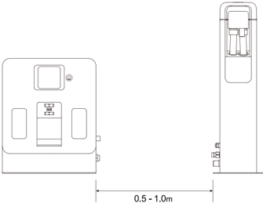
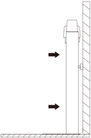
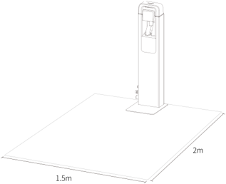
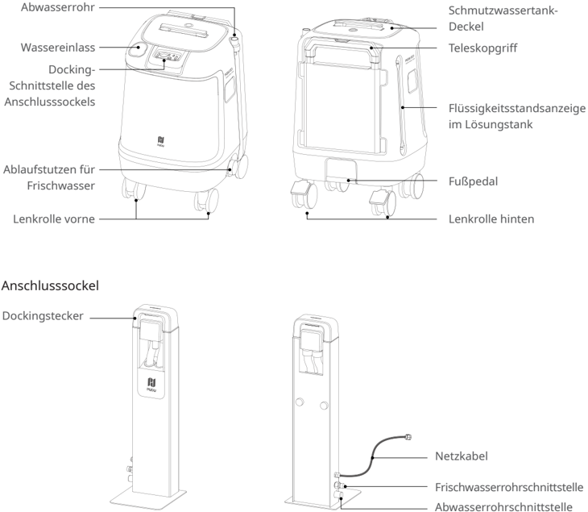
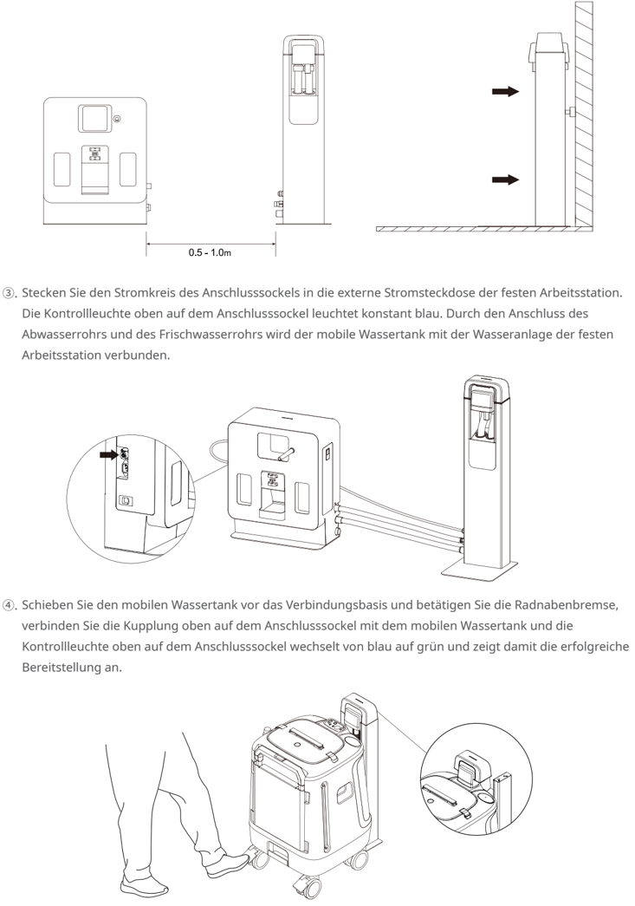
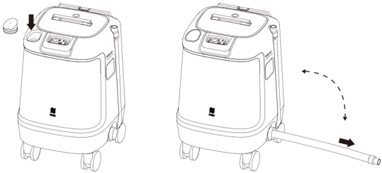

*Seite 22 (PDF-Seite 13, rechts)*

Copyright © 2024 Shenzhen Pudu Technology Co., Ltd. Alle Rechte vorbehalten.

Keine Organisation oder Einzelperson darf den Inhalt dieses Benutzerhandbuchs teilweise oder vollständig ohne die ausdrückliche schriftliche Zustimmung von Shenzhen Pudu Technology Co., Ltd. kopieren, transkribieren oder übersetzen oder dieses Benutzerhandbuch zu kommerziellen Zwecken auf beliebige Weise verteilen (elektronisch oder durch Fotokopieren, Aufzeichnen usw.). Die in diesem Benutzerhandbuch bereitgestellten Spezifikationen und Angaben zum Produkt dienen nur als Referenz und können ohne vorherige Ankündigung geändert werden. Falls nicht anders angegeben, ist dieses Benutzerhandbuch nur als Orientierungshilfe gedacht und die darin enthaltenen Darstellungen sind nicht als Gewährleistung irgendwelcher Art aufzufassen.

# 1. Sicherheitshinweise

## 1.1 Gebrauchsanweisung

- Die Benutzer der mobilen Wasserstation sollten eine professionelle Schulung durch das technische Supportpersonal absolvieren.
- Die mobile Wasserstation muss in Verbindung mit einer festen Arbeitsstation genutzt werden.
- Die mobile Wasserstation ist in Innenräumen mit Raumtemperatur aufzustellen. Stellen Sie die mobile Wasserstation nicht in Räumen mit Temperaturen über 40°C oder unter 0°C auf.
- Bei Beschädigungen der mobilen Wasserstation ist die Nutzung einzustellen.
- Gehen Sie vorsichtig mit dem Netzkabel und dem Wasserschlauch um, um ein Ziehen oder Verdrehen zu vermeiden.
- Vermeiden Sie Kollisionen mit Fremdkörpern, um eine Beschädigung der mobilen Wasserstation zu verhindern.
- Die mobile Wasserstation darf nicht in der Nähe von entflammbaren oder explosiven Materialien eingesetzt werden.
- Sollte die mobile Wasserstation Rauch oder einen Brandgeruch abgeben, deutet das auf eine Anomalie hin. Bitte trennen Sie sofort die Stromversorgung und wenden Sie sich an das Pudu-Personal.
- Stellen Sie sicher, dass die Wasserschlauchverbindungen fest angezogen sind.
- Geben Sie keine Reinigungsmittel direkt in den mobilen Wassertank. Füllen Sie Reinigungsmittel in den Reinigungsmittelbehälter seitlich an der festen Arbeitsstation ein.

---

*Seite 23 (PDF-Seite 14, links)*

## 1.2 Umfeld

- Betriebstemperatur: 0 °C bis 40 °C, relative Luftfeuchtigkeit: ≤ 90 % (<40 °C).
- Lagertemperatur: -20 °C ~ 60 °C, relative Luftfeuchtigkeit: ≤ 85 %, bis zu 1 Jahr lang.
- Anforderungen an die Arbeitsumgebung:
    1. Platzieren Sie den Anschlusssockel der mobilen Wasserstation im Umkreis von 1 m auf der rechten Seite der festen Arbeitsstation.

> *Bildbeschreibung (KI):* Die mobile Wasserstation soll auf der rechten Seite der festen Arbeitsstation platziert werden. Der Abstand zwischen der mobilen Wasserstation und der festen Arbeitsstation beträgt 0,5 bis 1,0 Meter.

2. Der Anschlusssockel der mobilen Wasserstation muss auf einer ebenen Fläche aufgestellt und mit seitlichen Anschlusselementen am Boden oder an einer ebenen Wand befestigt werden.

> *Bildbeschreibung (KI):* Die Pfeile zeigen die Richtung an, in der sich das Gerät zur Montage an die Wand bewegen soll. Das Gerät wird mit seitlichen Anschlusselementen am Boden oder an einer ebenen Wand befestigt. Der Anschlusssockel muss auf einer ebenen Fläche aufgestellt werden.

3. Stellen Sie sicher, dass sich in der Nähe der mobilen Wasserstation keine brennbaren Materialien befinden.
4. Halten Sie vor der festen Arbeitsstation einen Freiraum von 2 Metern und links und rechts von 1,5 Metern ein.

> *Bildbeschreibung (KI):* Die Abbildung zeigt die erforderlichen Abstände um die mobile Wasserstation herum. Ein Freiraum von 2 Metern vor der festen Arbeitsstation ist einzuhalten. Links und rechts sind jeweils 1,5 Meter Platz für den sicheren Betrieb vorgesehen. Der Anschlusssockel muss auf einer ebenen Fläche positioniert werden.

---

*Seite 24 (PDF-Seite 14, rechts)*

# 2. Produktvorstellung

## 2.1 Packliste

Mobiler Wassertank x1, Anschlusssockel x1, Netzkabel x1, Abwasserrohr x1, Frischwasserrohr x1, Benutzerhandbuch x1.

## 2.2 Gerät kennenlernen

## Mobiler Wassertank

> *Bildbeschreibung (KI):* Die Abbildung zeigt die verschiedenen Anschlüsse und Bedienelemente des mobilen Wassertanks sowie des Anschlusssockels. Am mobilen Wassertank sind der Wassereinlass, das Abwasserrohr, der Docking-Anschluss für den Sockel und die Ablaufstutzen für Frischwasser positioniert. Am Anschlusssockel befinden sich der Dockingstecker, die Schnittstellen für das Netzkabel, das Frischwasserrohr und das Abwasserrohr. Die Abbildung verdeutlicht die Lage von Lenkrollen vorne und hinten sowie dem Fußpedal am mobilen Wassertank.
## Anschlusssockel

*Beschriftungen:*

- Deckel
- Teleskopgriff
- Flüssigkeitsstandsanzeige im Lösungstank
- Fußpedal
- Lenkrolle hinten

*Beschriftungen:*

- Dockingstecker
- Netzkabel
- Frischwasserrohrschnittstelle
- Abwasserrohrschnittstelle

---

*Seite 25 (PDF-Seite 15, links)*

## 2.3 Technische Parameter

| Produkteigenschaften | Beschreibung |
|---|---|
| Produktname | Mobile Wasserstation |
| Produktfunktion | In Verbindung mit einer festen Arbeitsstation sind keine Änderungen an den Wasserleitungen im Arbeitsbereich erforderlich, und das automatische Befüllen und Entleeren von Wasser durch Roboter ist möglich. |
| Abmessungen (L, B, H) | Anschlusssockel: 262 x 230 x 787 mm |
| Abmessungen (L, B, H) | Mobiler Wassertank: 480 x 470 x 740 mm |
| Gewicht | Anschlusssockel: 9 kg |
| Gewicht | Mobiler Wassertank: 20 kg |
| Kapazität des mobilen Wassertanks | Frischwassertank: 30 l |
| Kapazität des mobilen Wassertanks | Abwassertank 30 l |
| Verbindungsmethode | Strom- und Wasseranschlüsse bei der festen Arbeitsstation |
| Eingangsspannung | 29,2 V DC, 2,5 A |
| Betriebsumgebung | Temperatur: 0 bis 40 °C; Luftfeuchtigkeit: ≤ 90 % relative Luftfeuchtigkeit (40 °C) |
| Lagertemperatur | -20 °C~60 °C |
| Installationsanforderungen | Der Anschlusssockel muss am Boden oder an einer Wand befestigt werden. |
| Externe Abhängigkeiten | Feste Arbeitsstation |

# 3. Produktverwendung

## 3.1 Gebrauchsanleitung

- ①.	Die mobile Wasserstation besteht aus zwei Teilen: dem Anschlusssockel und dem mobilen Wassertank, die zusammen mit der festen Arbeitsstation verwendet werden müssen. Stellen Sie vor dem Einsatz sicher, dass die feste Arbeitsstation am richtigen Ort aufgestellt ist (Netzkabel anschließen).
- ②.	Platzieren Sie den Anschlusssockel auf der rechten Seite der festen Arbeitsstation und befestigen Sie den Anschlusssockel am Boden oder an einer Wand. Stellen Sie sicher, dass den Anschlusssockel stabil ist und sich nicht leicht bewegt.

---

*Seite 26 (PDF-Seite 15, rechts)*

> *Bildbeschreibung (KI):* Die Abbildung zeigt die korrekte Montageposition des Anschlusssockels an der festen Arbeitsstation mit einem Abstand von 0,5 bis 1,0 m zur Wand. Der Stromkreis des Anschlusssockels wird in die externe Steckdose der Arbeitsstation eingesteckt; die blaue Kontrollleuchte oben am Sockel bestätigt den korrekten Anschluss. Die Kupplung oben am Anschlusssockel verbindet sich mit dem mobilen Wassertank, sobald dieser vor das Verbindungsbasis geschoben und die Radnabenbremse betätigt wurde. Nach erfolgreicher Verbindung wechselt die Kontrollleuchte von blau auf grün.
- ③.	Stecken Sie den Stromkreis des Anschlusssockels in die externe Stromsteckdose der festen Arbeitsstation. Die Kontrollleuchte oben auf dem Anschlusssockel leuchtet konstant blau. Durch den Anschluss des Abwasserrohrs und des Frischwasserrohrs wird der mobile Wassertank mit der Wasseranlage der festen Arbeitsstation verbunden.

- ④.	Schieben Sie den mobilen Wassertank vor das Verbindungsbasis und betätigen Sie die Radnabenbremse, verbinden Sie die Kupplung oben auf dem Anschlusssockel mit dem mobilen Wassertank und die Kontrollleuchte oben auf dem Anschlusssockel wechselt von blau auf grün und zeigt damit die erfolgreiche Bereitstellung an.

---

*Seite 27 (PDF-Seite 16, links)*

- ⑤.	Schieben Sie den mobilen Wassertank beim täglichen Gebrauch zum Befüllen und Entleeren an einen geeigneten Ort. Füllen Sie den mobilen Wassertank mit Frischwasser und entleeren Sie ihn von Abwässern.

> *Bildbeschreibung (KI):* Der Pfeil zeigt auf den Deckel des mobilen Wassertanks, der geöffnet werden muss. Die gestrichelte Linie und der Pfeil zeigen die Richtung an, in der der Schlauch aus dem Anschlusssockel herausgezogen wird. Die Abbildung veranschaulicht die Schritte zum Befüllen und Entleeren des mobilen Wassertanks.

- ⑥.	Nachdem Sie den wasserreichen mobilen Wassertank mit dem Anschlusssockel verbunden haben (wie in Schritt ④ beschrieben), stellen Sie sicher, dass innerhalb des Kartenbereichs eine feste Arbeitsstation bereitgestellt wird, und stellen Sie den Nutzungsmodus dieser Arbeitsstation auf „Mobile Wasserstation verwenden" ein.
- ⑦.	Die Bereitstellung ist abgeschlossen und der Roboter kann nun automatisch Wasser einfüllen und ablassen.
- ⑧.	Sollte während der Nutzung der Wasserstand im mobilen Wassertank niedrig oder der Abwassertank voll sein, stoppt der Roboter den Wasserbefüll- und Entleerungsvorgang sofort. Sofortige Erinnerungen werden in der mobilen App (Pudulink) und auf der Startseite des Roboters verfügbar sein. Nehmen Sie die Kupplung vom mobilen Wasserbehälter von der Verbindungsbasis ab und setzen Sie sie nach dem Platzieren des mobilen Wasserbehälters auf der Verbindungsbasis wieder ein. Befolgen Sie die Anweisungen in Schritt ⑤ zum Wasserwechsel.

## 3.2 Kontrollleuchtenanzeige

| Kontrollleuchte | Zustand |
|---|---|
| Dauerhaft blau | Die Stromkreise des Anschlusssockels und der festen Arbeitsstation sind ordnungsgemäß angeschlossen, aber der mobile Wassertank ist nicht mit dem Anschlusssockel verbunden. |
| Dauerhaft grün | Mobiler Wassertank erfolgreich angeschlossen und der Wasserstand ist ausreichend für das automatische Befüllen und Entleeren durch den Roboter. |
| Dauerhaft rot | Abwassertank im mobilen Wassertank ist voll. |
| Rot blinkend | Abnormale Verbindung oder Fehlfunktion zwischen dem Anschlusssockel und der festen Arbeitsstation. |

---

*Seite 28 (PDF-Seite 16, rechts)*

## 3.3 Wartung und Pflege

- Wischen Sie den Anschlusssockel und den mobilen Wassertank bei Schmutz- oder Staubablagerungen mit einem weichen, sauberen und staubfreien Tuch ab.
- Reinigen Sie regelmäßig die Innenwände des Abwassertanks im mobilen Wassertank.
- Bei Rissen, Verformungen, Undichtigkeiten oder Problemen mit der Wasserbefüllung/-ableitung am Anschlusssockel oder am mobilen Wassertank trennen Sie die Strom- und Wasseranschlüsse von der festen Arbeitsstation und kontaktieren Sie umgehend den Kundendienst.

# 4. Kundendienst

## 4.1 Kostenlose Garantieleistung

Das Unternehmen verspricht, unter den folgenden Bedingungen, ab dem Datum des Produkterhalts, innerhalb der effektiven Garantiezeit des Produkts (die Garantiezeit der verschiedenen Produktteile unterscheidet sich), kostenlose Produktgarantieleistungen zu erbringen, wenn die folgenden Bedingungen erfüllt sind:

- Da das gekaufte Produkt innerhalb der angegebenen Produktgarantiezeit ordnungsgemäß verwendet wurde, bestehen keine durch Fremdeinwirkung verursachten Qualitätsprobleme;
- Es erfolgte keine unbefugte Demontage, keine Modifikation oder Installation, die nicht dem offiziellen Handbuch folgte, es handelt sich um andere, nicht durch Fremdeinwirkung verursachte Fehler;
- Die Produktseriennummer, das Firmenetikett und andere Markierungen sind nicht abgerissen oder verändert;
- Ein gültiger Kaufnachweis, Quittung und Bestellnummer werden vorgelegt;
- Die beschädigten Ersatzteile, die während der kostenlosen Garantiefrist ausgetauscht werden, sind Eigentum des Unternehmens und sind auf Anforderung an das Unternehmen zurückzuschicken.

## 4.2 Kundendienst außerhalb des Garantieumfangs

- Bei Kundendienstleistungen, die nicht im Rahmen der kostenlosen Garantie liegen (außerhalb der Garantiezeit oder die Bedingungen der kostenlosen Garantie innerhalb der Garantiezeit nicht erfüllen), bietet das Unternehmen kostenpflichtige Kundendienstleistungen an;
- Wenn nach der Diagnose des Technikers ein Hausbesuch zur Lösung des Problems für notwendig erachtet wird, wird ein professioneller Techniker beauftragt, den Service vor Ort zu erbringen;
- Für Kundendienstleistungen, die nicht im Rahmen der kostenlosen Garantie liegen, müssen Sie das „ Kunde ndienstaufzeichnungsformular " wie erforderlich ausfüllen;
- Die Servicegebühr beinhaltet: Wartungsgebühr und Ersatzteilgebühr.

## 4.3 Beratung durch den Kundendienst

Wenden Sie sich bei Fragen

bitte an die Kundendienst-Hotline von Purdue Technology: +86 755-86952935

E-Mail: techservice@pudutech.com
