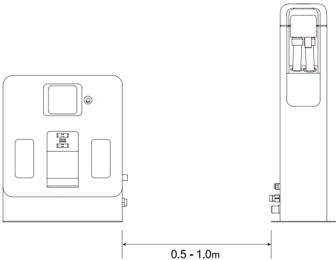
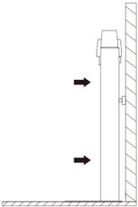
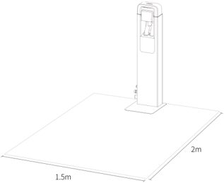
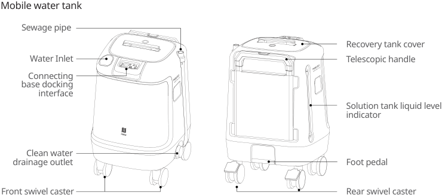
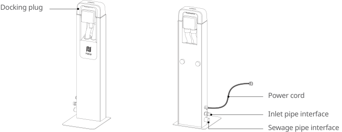
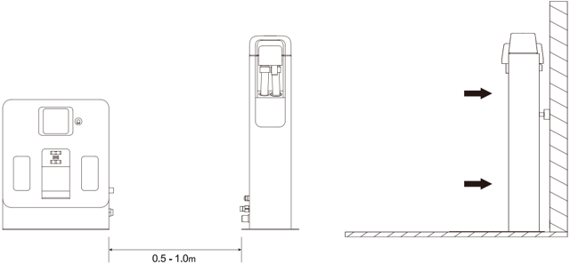
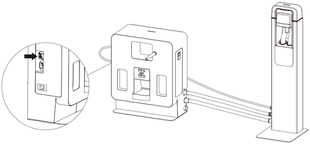
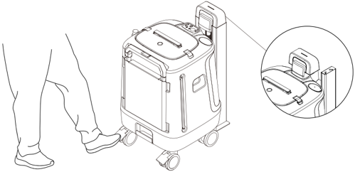
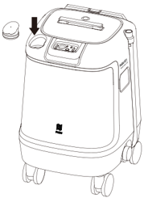
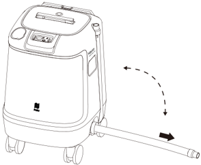

*Page 1 (PDF page 3, left)*

Copyright © 2024 Shenzhen Pudu Technology Co., Ltd. All rights reserved.

No organization or individual shall imitate, copy, transcribe or translate the contents of this user guide, in part or in full, without the express written consent of Shenzhen Pudu Technology Co., Ltd., or distribute this user guide for profit in any way (electronically or via photocopying, recording, etc.). The product specifications and information provided in this user guide are for reference only and are subject to change without further notice. Unless otherwise specified, this user guide is only intended as instructions for use, and no representation shall be deemed as a warranty of any kind.

# 1. Safety Instructions

## 1.1 Instructions for Use

- Users of the mobile water station should undergo professional training provided by technical support personnel.
- The mobile water station must be used in conjunction with a fixed workstation.
- The mobile water station should be placed in an indoor area at room temperature. Do not place the mobile water station in areas above 40°C or below 0°C.
- Cease use if the mobile water station is damaged.
- Handle the power cord and water hose with care to avoid pulling or twisting.
- Avoid collisions with external objects to prevent damage to the mobile water station.
- Do not use the mobile water station near flammable or explosive materials.
- If the mobile water station emits smoke or a burnt odor, it indicates an abnormality. Please disconnect the power supply immediately and contact Purdue personnel.
- Ensure that the water hose connections are securely tightened.
- Do not add cleaning agents directly into the mobile water tank. Add cleaning agents to the cleaning agent container on the side of the fixed workstation.

## 1.2 Environment instruction

- Operating temperature: 0°C ~ 40°C, relative humidity: ≤ 90% (<40°C).
- Storage temperature: -20°C ~ 60°C, relative humidity: ≤ 85%, for up to 1 year.
- Operating environment requirements:
    1. Place the connecting base of the mobile water station within 1m on the right side of the fixed workstation.

> *Figure description (AI):* The figure shows the recommended placement distance between the mobile water station and the fixed workstation. The connecting base of the mobile water station should be placed within 0.5 - 1.0m on the right side of the fixed workstation.

---

*Page 2 (PDF page 3, right)*

2. The connecting base of the mobile water station must be placed on a flat surface and secured to the ground or against a flat wall using side connection components.

> *Figure description (AI):* The arrows indicate the direction to push or align the mobile water station against the wall. The figure shows how to position the unit vertically along a flat wall surface.

3. Ensure there are no flammable materials around the mobile water station.
4. Maintain a clear space of 2 meters in front and 1.5 meters on the left and right sides of the fixed workstation.

> *Figure description (AI):* The figure shows a mobile water station with dimensions labeled. A 2m space is required in front of the unit. 1.5m clearance is needed on both left and right sides.

---

*Page 3 (PDF page 4, left)*

# 2. Product introduction

## 2.1 Packing list

Mobile water tank x1, connecting base x1, power connection cable x1, sewage pipe x1, clean water pipe x1, user manual x1.

## 2.2 Appearance introduction

> *Figure description (AI):* The figure shows a mobile water tank with labeled parts including the sewage pipe, water inlet, recovery tank cover, telescopic handle, solution tank liquid level indicator, clean water drainage outlet, foot pedal, front swivel caster, and rear swivel caster. Labels point to specific components such as the connecting base docking interface on the front and the recovery tank cover on the top of the unit. The diagram illustrates both front and side views of the mobile water tank to show port locations like the clean water drainage outlet and sewage pipe connection points. Viewers can identify physical features like the telescopic handle for transport, foot pedal for operation, and caster wheels for mobility directly from the labeled illustration.

### Connecting base

> *Figure description (AI):* The docking plug connects to the connecting base. The power cord plugs into the connecting base for electricity. The inlet pipe interface connects to the clean water pipe. The sewage pipe interface connects to the sewage pipe.

---

*Page 4 (PDF page 4, right)*

## 2.3 Technical Parameters

| Product Characteristics | Description |
|---|---|
| Product Name | Mobile Water Station |
| Product Function | Used in conjunction with a fixed workstation, eliminates the need for water pipeline modifications in the workspace, supports automatic water filling and draining by robots. |
| Dimensions(L,W,H) | Connecting base: 262 x 230 x 787 mm |
| Dimensions(L,W,H) | Mobile water tank: 480 x 470 x 740 mm |
| Weight | Connecting base: 9kg |
| Weight | Mobile water tank: 20kg |
| Mobile Water Tank Capacity | Clean water tank: 30L |
| Mobile Water Tank Capacity | Sewage tank: 30L |
| Connection Method | Electrical and water connections with the fixed workstation |
| Input vlotage | 29.2 Vdc, 2.5 A |
| Working Environment | Temperature: 0 to 40°C; Humidity:≤ 90%RH (40°C) |
| Storage Temperature | -20℃ ~60 ℃ |
| Installation Requirements | The connecting base must be fixed to the ground or against a wall |
| External Dependencies | Fixed workstation |

# 3. Product Use

## 3.1 Instructions for Use

- ①.	The mobile water station consists of two parts: the connecting base and the mobile water tank, which must be used together with the fixed workstation. Before use, ensure that the fixed workstation is deployed in the appropriate location (plug in the power).
- ②.	Place the connecting base on the right side of the fixed workstation and secure the connecting base to the ground or against a wall. Ensure the connecting base is stable and not easily moveable.

> *Figure description (AI):* The figure shows the recommended installation distance between the mobile water station and a fixed workstation. Arrows indicate that the mobile unit should be positioned to allow for automatic water filling and draining operations.

---

*Page 5 (PDF page 5, left)*

- ③.	Insert the connecting base's electrical circuit into the external power socket of the fixed workstation. The indicator light on top of the connecting base will show a steady blue light. Connect the sewage pipe and clean water pipe to link the mobile water tank with the fixed workstation's water system.

> *Figure description (AI):* The figure shows a close-up view of the connecting base's electrical circuit port. An arrow points to the specific location where the external power socket should be inserted. The diagram illustrates the connection between the mobile water tank and the fixed workstation. It visually represents the deployment process involving the connecting base and mobile water tank.

- ④.	Push the mobile water tank to the front of the connecting base and press the wheel hub brake, connect the coupling on top of the connecting base to the mobile water tank, and the indicator light on top of the connecting base will change from blue to green, indicating successful deployment.

> *Figure description (AI):* The figure shows a person pushing the mobile water tank to align it with the connecting base. A close-up view highlights how the coupling on top of the connecting base connects to the mobile water tank. The indicator light on the connecting base changes from blue to green when successfully connected. The wheel hub brake is pressed to secure the mobile water tank in place during connection.

- ⑤.	During daily use, push the mobile water tank to a convenient location for water filling and draining. Fill the mobile water tank with clean water and empty the sewage tank.

> *Figure description (AI):* The arrow points to a circular port on the top surface of the mobile water tank. A separate circular component is shown detached from the main unit near the arrow. The figure illustrates how to connect or detach a component (likely a cap or connector) from the mobile water tank. The image shows the mobile water tank with its wheels, handle, and top interface panel.

> *Figure description (AI):* The figure shows a mobile water station with wheels and a handle for manual movement. A dashed arrow indicates the direction to push or rotate the unit during deployment. A solid black arrow points along the extended hose, showing its orientation when connected. The device includes visible ports and connectors on top and side for linking to a fixed workstation.

- ⑥.	After connecting the water-sufficient mobile water tank to the connecting base (as described in step ④), ensure that a fixed workstation is deployed within the map area and set the usage mode of this workstation to "Use Mobile Water Station."
- ⑦.	The deployment is completed, and the robot can now automatically fill and drain water.

---

*Page 6 (PDF page 5, right)*

- ⑧.	If the water level in the mobile water tank is low or the sewage tank is full during use, the robot will immediately stop the water filling and draining process. Prompt reminders will be available on the mobile app (Pudulink) and the robot's homepage. Remove the coupling above the mobile water tank from the connecting base and put it back after placing the mobile water tank on the connecting base. Follow the instructions in Step ⑤ to replace the water.

## 3.2 Indicator Light Display

| Indicator light | State |
|---|---|
| Steady Blue | Connecting base and fixed workstation electrical circuits are properly connected, but the mobile water tank is not connected to the connecting base. |
| Steady Green | Mobile water tank successfully connected, and water levels are sufficient for automatic filling and draining by the robot. |
| Steady Red | Sewage tank in the mobile water tank is full. |
| Flashing Red | Abnormal connection or malfunction between the connecting base and fixed workstation. |

## 3.3 Maintenance and Care

- Use a soft, clean, dust-free cloth to wipe down the connecting base and mobile water tank if dirty or dusty.
- Regularly clean the interior walls of the sewage tank in the mobile water tank.
- In case of cracks, deformation, leaks, or water filling/drainage issues with the connecting base or mobile water tank, disconnect the power and water connections from the fixed workstation and promptly contact customer service.

# 4. After Sales Service

## 4.1 Free warranty service

The company promises to meet the following conditions, from the date of product receipt, within the effective warranty period of the product (the warranty period of different parts of the product is different),Free product warranty service will be provided if the following conditions are met:

- Since the purchased product is used normally within the specified product warranty period, there are nonartificial quality problems;
- No unauthorized disassembly, no modification or installation not guided by the official manual, and other non-human failures;
- The product serial number, factory label and other marks are not torn or altered;
- Provide valid proof of purchase, receipt and order number;
- Damaged spare parts replaced during the free warranty period belong to the company and should be sent back as required by the company.

---

*Page 7 (PDF page 6, left)*

## 4.1 Free warranty service

The company promises to meet the following conditions, from the date of product receipt, within the effective warranty period of the product (the warranty period of different parts of the product is different),Free product warranty service will be provided if the following conditions are met:

- Since the purchased product is used normally within the specified product warranty period, there are nonartificial quality problems;
- No unauthorized disassembly, no modification or installation not guided by the official manual, and other non-human failures;
- The product serial number, factory label and other marks are not torn or altered;
- Provide valid proof of purchase, receipt and order number;
- Damaged spare parts replaced during the free warranty period belong to the company and should be sent back as required by the company.

## 4.2 After-sales service beyond the scope of warranty

- For after-sales service that is not within the scope of free warranty (beyond the warranty period or does not meet the terms of free warranty within the warranty period), the company provides paid after-sales service;
- If it is necessary to come to the door to solve the problem after the diagnosis of the technical engineer, assign a professional technician to provide the door-to-door service;
- For after-sales service that is not within the scope of free warranty, you need to fill in the "After-sales Service Record Form" as required;
- Service fee includes: after-sales maintenance fee and spare parts fee.

## 4.3 After-sales service consultation

If you have any questions,

please contact Purdue Technology customer service hotline: +86 755-86952935.

Email: techservice@pudutech.com

---

*Page 8 (PDF page 6, right)*

# 5. Compliance information

## 5.1 Disposal and recycling information

The Waste Electrical and Electronic Equipment (WEEE) Directive aims to minimize the impact of electrical and electronic goods on the environment, by increasing re-use and recycling and by reducing the amount of WEEE going to landfill. The symbol on this product or its packaging signifies that this product must be disposed separately from ordinary household wastes at its end of life. Be aware that this is your responsibility to dispose of electronic equipment at recycling centers in order to conserve natural resources. Each country should have its collection centers for electrical and electronic equipment recycling. For information about your recycling drop off area, please contact your related electrical and electronic equipment waste management authority, your local city office, or your house hold waste disposal service.

## 5.2 Federal Communications Commission compliance statement

The following information applies to Pudu robotic.

This equipment has been tested and found to comply with the limits for a Class B digital device, pursuant to part 15 of the FCC Rules. These limits are designed to provide reasonable protection against harmful interference in a residential installation. This equipment generates, uses and can radiate radio frequency energy and, if not installed and used in accordance with the instructions, may cause harmful interference to radio communications. However, there is no guarantee that interference will not occur in a particular installation. If this equipment does cause harmful interference to radio or television reception, which can be determined by turning the equipment off and on, the user is encouraged to try to correct the interference by one or more of the following measures:

- Reorient or relocate the receiving antenna.
- Increase the separation between the equipment and receiver.
- Connect the equipment into an outlet on a circuit different from that to which the receiver is connected.
- Consult the dealer or an experienced radio/TV technician for help.

This device complies with Part 15 of the FCC rules. Operation is subject to the following two conditions:

- This device may not cause harmful interference.
- This device must accept any interference received, including interference that may cause undesired operation.
