*Pagina 77 (pagina PDF 41, sinistra)*

Copyright © 2024 Shenzhen Pudu Technology Co., Ltd. Tutti i diritti riservati.

Non è consentito ad alcuna azienda o individuo di imitare, copiare, trascrivere o tradurre i contenuti di queste istruzioni per l'uso, in tutto o in parte, senza il consenso scritto esplicito di Shenzhen Pudu Technology Co., Ltd., né di distribuirla a scopo di lucro in qualsivoglia modo (elettronicamente o tramite fotocopiatura, registrazione, ecc.). Le specifiche del prodotto e le informazioni fornite nelle presenti istruzioni per l'uso hanno solo scopo di riferimento e sono soggette a variazione senza ulteriore preavviso. Salvo diversa indicazione, queste istruzioni per l'uso sono destinate unicamente a fornire istruzioni per l'utilizzo, e nessuna affermazione in esse contenuta dovrà essere considerata come una garanzia di qualsiasi tipo.

# 1. Istruzioni per la sicurezza

## 1.1 Istruzioni per l'uso

- Gli utilizzatori della stazione idrica mobile devono seguire una formazione professionale fornita dal personale di assistenza tecnico.
- La stazione idrica mobile deve essere utilizzata insieme a una stazione di lavoro fissa.
- La stazione idrica mobile deve essere collocata in un ambiente interno con temperatura ambiente. Non posizionare la stazione idrica mobile in aree con temperatura superiore a 40 °C o inferiore a 0 °C.
- Interrompere l'uso se la stazione idrica mobile è danneggiata.
- Maneggiare il cavo di alimentazione e il tubo dell'acqua con cura evitando di tirarli o torcerli.
- Evitare collisioni con oggetti esterni per evitare danni alla stazione idrica mobile.
- Non utilizzare la stazione idrica mobile in vicinanza di oggetti infiammabili o esplosivi.
- L'emissione di fumo o l'odore di bruciato provenienti dalla stazione idrica mobile indicano un'anomalia. Scollegare immediatamente l'alimentazione e contattare il personale di Pudu.
- Assicurarsi che i collegamenti del tubo dell'acqua siano serrati saldamente.
- Non aggiungere detergenti direttamente nel serbatoio dell'acqua mobile. Aggiungere il detergente nel contenitore apposito sul lato della stazione di lavoro fissa.

## 1.2 Istruzioni ambientali

- Temperatura di esercizio: 0 °C - 40 °C, umidità relativa: ≤ 90% (<40 °C).
- Temperatura di immagazzinamento: -20 °C - 60 °C, umidità relativa: ≤ 85%, fino a 1 anno.
- Requisiti ambientali di funzionamento:
    1. Posizionare la base di collegamento della stazione idrica mobile entro 1 m sul lato destro della stazione di lavoro fissa.

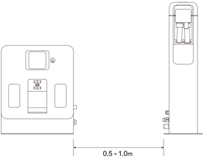
> *Descrizione della figura (IA):* La figura mostra la posizione corretta per il posizionamento della stazione idrica mobile rispetto alla stazione di lavoro fissa. La distanza tra le due stazioni deve essere compresa tra 0.5 e 1.0 metri. Il lato destro della stazione di lavoro fissa è indicato come punto di riferimento per l'installazione della base di collegamento. Le dimensioni indicate (0.5 - 1.0m) si riferiscono alla distanza orizzontale tra le due unità.

---

*Pagina 78 (pagina PDF 41, destra)*

2. La base di collegamento della stazione idrica mobile deve essere posizionata su una superficie piana e fissata al suolo o contro una parete piana mediante elementi di collegamento laterali.

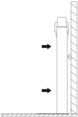
> *Descrizione della figura (IA):* Le frecce nere indicano la direzione del flusso d'acqua o dell'aria verso la stazione idrica mobile. La figura mostra il posizionamento della stazione idrica mobile contro una parete piana. Gli elementi di collegamento laterali sono visibili per fissare la base alla parete.

3. Assicurarsi che non vi siano materiali infiammabili intorno alla stazione idrica mobile.
4. Mantenere uno spazio libero di 2 metri davanti e di 1,5 metri sui lati sinistro e destro della stazione di lavoro fissa.

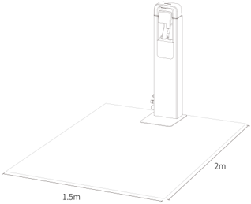
> *Descrizione della figura (IA):* La figura mostra le dimensioni minime dello spazio libero richiesto attorno alla stazione idrica mobile. Lo spazio davanti alla stazione deve essere di almeno 2 metri. Gli spazi laterali sinistro e destro devono essere di almeno 1,5 metri ciascuno. Le dimensioni sono indicate con linee e etichette direttamente sul disegno della base.

---

*Pagina 79 (pagina PDF 42, sinistra)*

# 2. Introduzione al prodotto

## 2.1 Contenuto della confezione

Serbatoio dell'acqua mobile x1, base di collegamento x1, cavo di collegamento elettrico x1, tubo di scarico x1, tubo dell'acqua pulita x1, manuale utente x1.

## 2.2 Introduzione all'aspetto del prodotto

## Serbatoio dell'acqua mobile

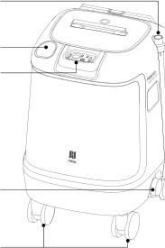
> *Descrizione della figura (IA):* La figura mostra le parti principali del serbatoio dell'acqua mobile con linee di riferimento che indicano componenti specifici. Le etichette puntano a elementi come il coperchio del serbatoio di recupero, il manico telescopico, le ruote anteriori e posteriori girevoli, la base di collegamento e i punti di ingresso/scarico acqua. È visibile il logo 'PUDU' sulla parte inferiore anteriore del dispositivo. La figura aiuta a identificare fisicamente i componenti menzionati nel testo, come il pedale, l'interfaccia docking e le spine di aggancio.

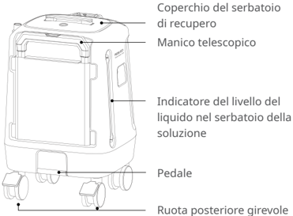
> *Descrizione della figura (IA):* La figura mostra le parti principali del serbatoio dell'acqua mobile con i relativi nomi in italiano. Il coperchio del serbatoio di recupero è posizionato sulla parte superiore del dispositivo. L'indicatore del livello del liquido nel serbatoio della soluzione permette di monitorare la quantità di soluzione presente. Le ruote posteriori girevoli e il pedale sono visibili nella parte inferiore per facilitare il movimento e l'uso pratico.

## Base di collegamento

aggancio Cavo di alimentazione Interfaccia del tubo di ingresso Interfaccia del tubo di scarico

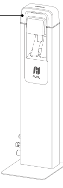
> *Descrizione della figura (IA):* La freccia indica il punto di connessione del tubo dell'acqua pulita al serbatoio. Il logo 'pupu' è visibile sulla parte frontale del serbatoio mobile.

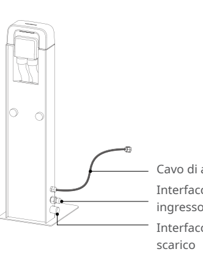
> *Descrizione della figura (IA):* Il cavo di alimentazione si collega all'interfaccia del tubo di ingresso. L'interfaccia del tubo di scarico è collegata al tubo di scarico.

*Etichette:*

- Spina di aggancio
- Cavo di alimentazione
- Interfaccia del tubo di ingresso
- Interfaccia del tubo di

---

*Pagina 80 (pagina PDF 42, destra)*

## 2.3 Parametri tecnici

| Caratteristiche del prodotto | Descrizione |
|---|---|
| Nome del prodotto | Stazione idrica mobile |
| Funzione del prodotto | Utilizzata insieme a una stazione di lavoro fissa, elimina la necessità di modifiche alle tubazioni dell'acqua nell'area di lavoro e permette ai robot di attingere e scaricare acqua automaticamente. |
| Dimensioni (P, L, A) | Base di collegamento: 262 x 230 x 787 mm |
| Dimensioni (P, L, A) | Serbatoio dell'acqua mobile: 480 x 470 x 740 mm |
| Peso | Base di collegamento: 9 kg |
| Peso | Serbatoio dell'acqua mobile: 20 kg |
| Capacità del serbatoio dell'acqua mobile | Serbatoio di acqua pulita: 30 l |
| Capacità del serbatoio dell'acqua mobile | Serbatoio delle acque di scarico: 30 l |
| Metodo di collegamento | Collegamenti elettrici ed idraulici con la stazione fissa |
| Tensione in ingresso | 29,2 V CC; 2,5 A |
| Ambiente di lavoro | Temperatura: da 0 a 40 °C; Umidità: ≤ 90%RH (40 °C) |
| Temperatura di immagazzinamento | -20 °C - 60 °C |
| Requisiti di installazione | La base di collegamento deve essere fissata a terra o contro una parete |
| Dipendenze esterne | Stazione di lavoro fissa |

# 3. Utilizzo del prodotto

## 3.1 Istruzioni per l'uso

- ①.	La stazione idrica mobile è composta da due parti: la base di collegamento e il serbatoio dell'acqua mobile, che deve essere utilizzato insieme alla stazione di lavoro fissa. Prima dell'uso, assicurarsi che la stazione di lavoro fissa sia nella posizione adatta (collegata all'alimentazione).
- ②.	Posizionare la base di collegamento sul lato destro della stazione di lavoro fissa, poi fissarla a terra o contro una parete. Assicurarsi che la base di collegamento sia stabile e che non si sposti facilmente.

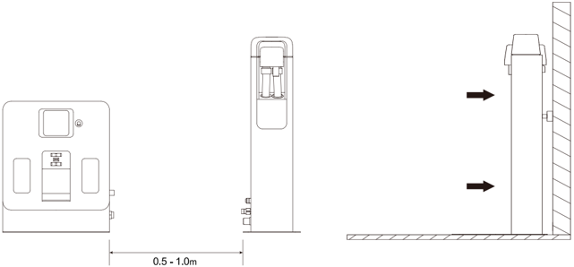
> *Descrizione della figura (IA):* La distanza minima tra la stazione mobile e la stazione fissa deve essere compresa tra 0,5 e 1,0 m. Le frecce indicano che la stazione mobile deve essere posizionata con il lato posteriore rivolto verso la stazione fissa. Il lato frontale della stazione mobile presenta due aperture laterali e un pannello centrale con display o interfaccia.

---

*Pagina 81 (pagina PDF 43, sinistra)*

- ③.	Inserire il collegamento elettrico della base di collegamento nella presa di alimentazione esterna della stazione di lavoro fissa. La spia luminosa sulla parte superiore della base di collegamento mostrerà una luce blu fissa. Collegare il tubo delle acque di scarico e il tubo dell'acqua pulita per collegare il serbatoio dell'acqua mobile con il sistema idrico della stazione di lavoro fissa.

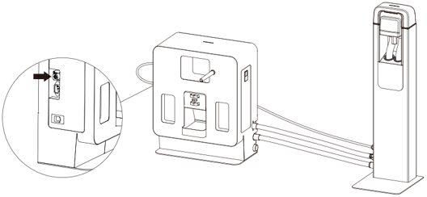
> *Descrizione della figura (IA):* La freccia nera indica la posizione del connettore elettrico sulla base di collegamento. Le linee tratteggiate mostrano come collegare i tubi dell'acqua pulita e delle acque di scarico tra il serbatoio mobile e la stazione fissa. Il cerchio ingrandito evidenzia il punto esatto dove inserire il cavo di alimentazione nella presa esterna. La figura illustra la posizione fisica della base di collegamento rispetto alla stazione di lavoro fissa.

- ④.	Sposta il serbatoio d'acqua mobile di fronte alla base di connessione e premi il freno del mozzo della ruota. Collegare al serbatoio dell'acqua mobile il giunto sulla parte superiore della base di collegamento: la spia luminoso sulla parte superiore della base di collegamento cambierà da blu a verde, indicando che l'operazione è riuscita.

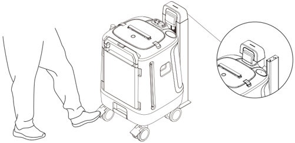
> *Descrizione della figura (IA):* La figura mostra come collegare il serbatoio dell'acqua mobile alla base di connessione della stazione fissa. Il freno del mozzo della ruota deve essere premuto per bloccare il serbatoio durante il collegamento. La spia luminosa sulla base cambia da blu a verde quando il collegamento è riuscito. Il giunto superiore della base si inserisce nel connettore sul coperchio del serbatoio.

- ⑤.	Durante l'uso quotidiano, spingere il serbatoio dell'acqua mobile in una posizione comoda per il riempimento e lo scarico dell'acqua. Riempire il serbatoio dell'acqua mobile con acqua pulita e svuotare il serbatoio di scarico.

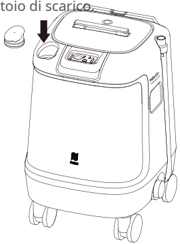
> *Descrizione della figura (IA):* La freccia nera indica la posizione del tappo di scarico. Il testo 'toio di scarice' (probabilmente 'tappo di scarico') identifica il componente mostrato a sinistra. L'immagine mostra un serbatoio dell'acqua mobile con ruote e maniglia, pronto per essere collegato o svuotato. Non sono presenti indicatori luminosi, pulsanti o connettori visibili nell'illustrazione.

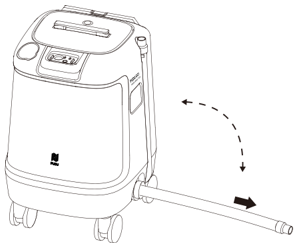
> *Descrizione della figura (IA):* La figura mostra come collegare il tubo dell'acqua pulita alla base di connessione della stazione fissa. Il tubo deve essere inserito nella presa esterna e poi ruotato verso l'alto per agganciarlo correttamente. Una volta collegato, la spia luminosa sulla base cambia da blu a verde, indicando che il collegamento è riuscito. La freccia curva indica la direzione di rotazione del tubo durante il collegamento.

---

*Pagina 82 (pagina PDF 43, destra)*

- ⑥.	Dopo aver collegato il serbatoio dell'acqua mobile alla base di collegamento (come descritto nel passaggio ④), assicurarsi che una stazione di lavoro fissa sia posizionata all'interno dell'area della mappa e impostarne la modalità di utilizzo su "Utilizzo con stazione idrica mobile".
- ⑦.	A questo punto il collegamento è completato e il robot può riempire e scaricare automaticamente l'acqua.
- ⑧.	Se il livello dell'acqua nel serbatoio dell'acqua mobile è basso o il serbatoio di scarico è pieno durante l'uso, il robot interromperà immediatamente il riempimento e lo scarico dell'acqua. Sull'app mobile (Pudulink) e sulla home page del robot saranno disponibili dei promemoria. Rimuovere la giunzione sopra il serbatoio d'acqua mobile dalla base di collegamento e riporla nuovamente dopo aver posizionato il serbatoio d'acqua mobile sulla base di collegamento. Seguire le istruzioni nel passaggio ⑤ per sostituire l'acqua.

## 3.2 Spia luminosa

| Spia luminosa | Stato |
|---|---|
| Blu fisso | I circuiti elettrici della base di collegamento e della stazione di lavoro fissa sono collegati correttamente, ma il serbatoio dell'acqua mobile non è collegato alla base di collegamento. |
| Verde fisso | Il serbatoio dell'acqua mobile è stato collegato correttamente e i livelli dell'acqua sono sufficienti per il riempimento e lo scarico automatici da parte del robot. |
| Rosso fisso | Il serbatoio di scarico nel serbatoio dell'acqua mobile è pieno. |
| Rosso lampeggiante | Collegamento anomalo o malfunzionamento tra la base di collegamento e la stazione di lavoro fissa. |

## 3.3 Manutenzione e cura

- Se la base di collegamento e il serbatoio dell'acqua mobile sono sporchi o impolverati, pulirli con un panno morbido, pulito e privo di polvere.
- Pulire regolarmente le pareti interne del serbatoio di scarico nel serbatoio dell'acqua mobile.
- In caso di crepe, deformazioni, perdite o problemi di riempimento/drenaggio dell'acqua nella base di collegamento o nel serbatoio dell'acqua mobile, scollegare i collegamenti elettrici e idrici dalla stazione di lavoro fissa e contattare tempestivamente il servizio clienti.

---

*Pagina 83 (pagina PDF 44, sinistra)*

# 4. Assistenza post-vendita

## 4.1 Servizio di garanzia gratuito

L'azienda si impegna a rispettare le seguenti condizioni: dalla data di ricezione del prodotto, durante il periodo di garanzia effettivo del prodotto (diverso da quello delle varie parti del prodotto), verrà fornito un servizio di garanzia del prodotto gratuito se sono soddisfatte le seguenti condizioni:

- Il prodotto acquistato viene utilizzato normalmente durante il periodo di garanzia specificato e non ci sono problemi di qualità causati dall'utente;
- Non è stato eseguito alcuno smontaggio non autorizzato, alcuna modifica o installazione non descritta dal manuale ufficiale, e non vi sono altri guasti non causati da umani;
- Il numero di serie del prodotto, l'etichetta di fabbrica e altri segni non sono strappati o alterati;
- È fornita una prova di acquisto, una ricevuta e un numero d'ordine validi;
- I pezzi di ricambio danneggiati sostituiti durante il periodo di garanzia gratuita sono di proprietà dell'azienda e verranno restituiti secondo quanto richiesto dall'azienda.

## 4.2 Assistenza post-vendita fuori garanzia

- Per l'assistenza post-vendita che non rientra nell'ambito della garanzia gratuita (ovvero se è superato il periodo di garanzia o se non sono soddisfatti i termini della garanzia gratuita durante il periodo di garanzia), l'azienda fornisce un'assistenza post-vendita a pagamento;
- Qualora sia necessario recarsi in loco per risolvere il problema dopo la diagnosi del tecnico, verrà assegnato un professionista per fornire il servizio presso la sede del cliente.
- Per il servizio post-vendita che non rientra nell'ambito della garanzia gratuita, è necessario compilare il "Modulo di registrazione del servizio post-vendita".
- La tariffa del servizio include il costo di manutenzione post-vendita e il costo dei pezzi di ricambio.

## 4.3 Consulenza per il servizio post-vendita

Per ogni eventuale domanda,

contattare il servizio clienti di Purdue Technology: +86 755-86952935.

E-mail: techservice@pudutech.com
