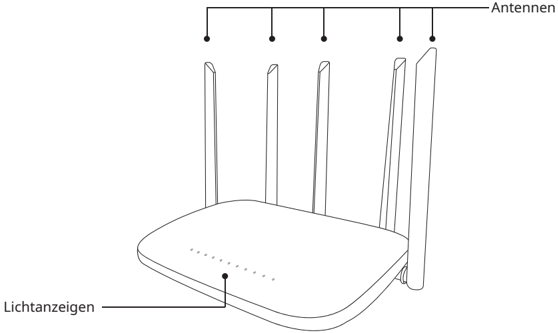

*Seite 11 (PDF-Seite 7, links)*

## Copyright © 2023 Shenzhen Pudu Technology Co., Ltd. Alle Rechte vorbehalten.

Kein Teil dieser Publikation darf ohne vorherige schriftliche Zustimmung von Shenzhen Pudu Technology Co., Ltd. analog oder digital vervielfältigt, transkribiert, übersetzt oder zum Zwecke der Gewinnerzielung übertragen werden. Technische Daten und Angaben in dieser Publikation dienen nur zu Informationszwecken und können ohne vorherige Mitteilung geändert werden. Diese Anleitung ist nur als Orientierungshilfe gedacht und bietet, sofern nicht anders angegeben, keinerlei Garantie.

# 1. Sicherheitsanweisungen

- Stellen Sie das Gateway nicht in die Nähe von Wärmequellen oder offenen Flammen, wie Mikrowellen, Öfen, Herden, Kerzen oder anderen Orten, an denen hohe Temperaturen entstehen können, um Fehlfunktionen oder eine Explosion des Gateways zu vermeiden.
- Verwenden Sie das Gateway nicht in feuchter Umgebung oder in der Nähe eines Magnetfeldes, um Störungen des internen Schaltkreises zu vermeiden.
- Spülen oder tauchen Sie das Gateway nicht in Wasser, um Beschädigungen der Komponenten zu vermeiden.
- Stellen Sie das Gateway nicht an einen Ort, der direktem Sonnenlicht ausgesetzt ist.
- Lagern oder transportieren Sie das Gateway nicht im selben Behälter wie brennbare und explosive Gegenstände.
- Schützen Sie das Gateway vor heftigen Stößen oder Erschütterungen, um Fehlfunktionen zu vermeiden.
- Entsorgen Sie das Gateway und dessen Zubehör nicht über den Hausmüll. Entsorgen Sie das Produkt und dessen Zubehör vorschriftsgemäß. Führen Sie es, wo möglich, dem Recycling zu.
- Reinigen Sie das Gateway nicht mit ätzenden Chemikalien, Reinigungsmitteln oder Waschmitteln. Reinigen Sie das Gateway immer, indem Sie es mit einem sauberen und trockenen Tuch abwischen.
- Zerlegen oder modifizieren Sie das Gateway und dessen Zubehör nicht selbst, weil dadurch sonst Ihre Garantie erlischt. Wenden Sie sich bei Fehlfunktionen an den technischen Support von Shenzhen Pudu Technology Co.
- Das Gateway wurde getestet und weist in bestimmten Umgebungen wasserdichte und staubdichte Eigenschaften auf. Es handelt sich jedoch nicht um ein professionelles wasserdichtes Gerät.
- Verwenden Sie das Gateway nicht an Orten, an denen die Verwendung von drahtlosen Geräten ausdrücklich verboten ist. Andernfalls kann dies Funkstörungen bei anderen elektronischen Geräten verursachen oder zu anderen Gefahren führen.
- Halten Sie sich in Gesundheitseinrichtungen, in denen die Verwendung von drahtlosen Geräten ausdrücklich verboten ist, an die Vorschriften.
- Die vom Gateway erzeugten Radiowellen können das ordnungsgemäße Funktionieren von implantierten medizinischen Geräten oder persönlichen medizinischen Geräten wie Herzschrittmachern, Cochlea-Implantaten und Hörgeräten beeinträchtigen. Halten Sie bei der Verwendung des Gateways gegenüber solchen Geräten einen Mindestabstand von 15 cm ein.

# 2. Lieferumfang

## 2.1 Produktübersicht

Das Rufsender-Gateway PGCG01 (im Folgenden als "Gateway" bezeichnet) ist ein Relais-Gateway, welches das LoRaKommunikationsprotokoll unterstützt. Es ist zur Verwendung mit Tasten-Rufsendern und LoRa-unterstützten Robotern von PuduTech ausgelegt. Das Ruf- und Kommunikationssystem basiert auf LoRaLAN und Cloud-Diensten. Über das Gateway, das für die Kommunikation zwischen Rufsender und Roboter zuständig ist, können Benutzer den Roboter zu vorgegebenen Zielen rufen. Das Gateway unterstützt mehrere Rufsender. Mit dem Rufsender lässt sich die Effizienz des Roboters steigern. Er eignet sich für Lieferungen in Restaurants und Bürogebäuden und unter ähnlichen Einsatzbedingungen.

## 2.2 Packliste

Rufsender-Gateway × 1, Ladegerät × 1, Benutzerhandbuch × 1

---

*Seite 12 (PDF-Seite 7, rechts)*

## 2.3 Außenansicht und Komponenten

> *Bildbeschreibung (KI):* Die Abbildung zeigt die Außenansicht des Geräts mit den markierten Antennen und Lichtanzeigen. Mit der Beschriftung 'Antennen' werden die fünf externen Antennen am Gerät identifiziert. Die Bezeichnung 'Lichtanzeigen' verweist auf die Reihe von LEDs an der Vorderseite des Gehäuses.

## 2.4 Technische Daten

| Merkmale | Beschreibung |
|---|---|
| Produktname | Pudu GW1 |
| Modell | PGCG01 |
| Eingangsspannung | 5V DC max. 2 A |
| Anzahl der Antennen | 5 |
| Gehäusematerial | ABS |
| Gewicht | 300 g |
| Maße | 246 mm × 165 mm × 185 mm |
| Wärmeableitung | Lüfterlose Kühlung |
| Montagemethode | Tisch-/Wandmontage |
| Betriebsfrequenz | 2402,0 MHz bis 2483,5 MHz |
| Sendeleistung | Einstellbar bis zu 12,5 dBm |
| WLAN | LoRa (2,4 G), Wi-Fi (2,4 G) |
| Verkabeltes Netzwerk | LAN (RJ45 100M) |
| Stromverbrauch | 12 W (typisch), 17 W (max.) |
| Kommunikationsprotokolle | PUDU LoRa TSCH |
| Betriebsumgebung | Temperatur: 0 °C bis 40 °C; Feuchtigkeit: ≤ 85 % |
| Lagerumgebung | Temperatur: -40 °C bis 65 °C; Feuchtigkeit: ≤ 85 % |
| Lichtanzeigen | 6 |

---

*Seite 13 (PDF-Seite 8, links)*

# 3. Benutzung

## 3.1 Verbinden des mobilen Rufsenders mit dem Netzwerk über das Gateway

Der Tasten-Rufsender und das Rufsender-Gateway sind im selben Netzwerk konfiguriert und teilen sich die gleiche LoRa-Kommunikationsfrequenz.

## 3.2 Binden des Gateways

- Laden Sie die Pudu Link App herunter;
- Gehen Sie zu "App > Mein > Geräteverwaltung", und tippen Sie auf "Gateway hinzufügen";
- Scannen Sie den Barcode auf der Rückseite des Gateways, um seine Seriennummer (SN) zu erhalten;
- Stellen Sie die Gateway-Ebene ein (Tipp: Das erste Gateway, das in einem Ladengeschäft hinzugefügt wird, muss als Haupt-Gateway festgelegt werden);
- Schalten Sie das Gateway ein, und verbinden Sie es über die Pudu Link App;
- Konfigurieren Sie die Netzwerkverbindung des Gateways (WLAN/lokales Netzwerk);
- Richten Sie die Kommunikationsparameter ein. Das Gateway ist nun erfolgreich an das Netzwerk gebunden.

## 3.3 Binden des Rufsenders

- Laden Sie die Pudu Link App herunter;
- Gehen Sie zu "App > Mein > Geräteverwaltung", und tippen Sie auf "Rufsender hinzufügen";
- Wählen Sie das Gateway für den Rufsender aus;
- Drücken und halten Sie die Taste des Rufsenders 10 Sekunden lang, um ihn zu aktivieren;
- Tippen Sie auf "Binden", nachdem die Pudu Link App die SN des Rufsenders erhalten hat, um das Binden abzuschließen.
- (Tipp: Ein Gateway muss hinzugefügt werden, bevor ein Rufsender hinzugefügt wird.)

## 3.4 Lichtanzeigen

| Typ | Anzahl | Beschreibung |
|---|---|---|
| Stromversorgungsanzeige | 1 | Eine stetig leuchtende Stromversorgungsanzeige zeigt an, dass das Gateway mit Strom versorgt wird und ordnungsgemäß funktioniert. |
| Rollenanzeige | 1 | Eine stetig leuchtende Rollenanzeige zeigt an, dass das Gateway das "Root-Gateway" im Netzwerk ist. |
| Betriebszustandsanzeige | 4 | Eine stetig leuchtende Betriebszustandsanzeige zeigt an, dass sich die entsprechenden drahtlosen Empfangs- und Sendeports im Betriebszustand befinden. |

# 4. Kundendienst

## 4.1 Unentgeltliche Gewährleistung

Shenzhen Pudu Technology Co., Ltd. bietet unentgeltliche Garantieleistungen innerhalb der geltenden Garantiezeit (die Garantiezeit beginnt mit dem Aktivierungsdatum und kann bei verschiedenen Komponenten variieren. (Weitere Informationen finden Sie unter Gewährleistungsfristen der Hauptkomponenten). Die für den Kundendienst anfallenden Gebühren werden von Pudu übernommen. Außerhalb der Garantiezeit oder unter Umständen, die nicht durch die unentgeltliche Gewährleistung abgedeckt sind, ist eine reguläre Gebühr zu entrichten. Rufen Sie die Kundendienst-Hotline auf unserer offiziellen Website an, sollten Sie Reparaturleistungen benötigen.

---

*Seite 14 (PDF-Seite 8, rechts)*

## Für die unentgeltlichen Gewährleistung gelten folgende Bedingungen:

- die Mängel sind bei bestimmungsgemäßem Gebrauch nicht durch Fremdeinwirkung innerhalb der angegebenen Garantiefrist aufgetreten;
- es erfolgte keine unbefugte Demontage, Modifikation oder Nachrüstung unter Nichtbeachtung der Anweisungen im offiziellen Handbuch, oder es handelt sich um andere Mängel, die nicht durch Fremdeinwirkung verursacht wurden;
- Seriennummern, Herstelleretiketten und andere Kennzeichen wurden nicht entfernt oder verändert;
- ein gültiger Kaufbeleg, Rechnung und Rechnungsnummer liegen vor;
- beschädigte Komponenten, die im Rahmen der Gewährleistung ersetzt werden, sind Eigentum von Pudu und müssen bei Bedarf an Pudu zurückgesendet werden. Andernfalls behält Pudu sich das Recht vor, Forderungen nach unentgeltlicher Gewährleistung abzulehnen.

## Nicht durch die unentgeltliche Gewährleistung abgedeckte Umstände:

- Kollisionen oder Brände, die durch andere Faktoren als Qualitätsprobleme verursacht wurden, oder Qualitätsprobleme aufgrund von unbefugten Änderungen oder dem Eindringen von Fremdkörpern (Wasser, Öl, Sand, etc.);
- Schäden, die durch unbefugte Änderungen, Demontage oder Öffnen des Gehäuses unter Nichtbeachtung der Anweisungen im offiziellen Handbuch verursacht wurden;
- Schäden, die durch unsachgemäße Installation, Nutzung, Betrieb oder Lagerung unter Nichtbeachtung der Anweisungen im offiziellen Handbuch entstanden;
- Schäden, die durch die eigenmächtige, unbefugte Reparatur von Teilen unter Nichtbeachtung offizieller Anweisungen verursacht wurden;
- Schäden, die durch Schaltkreismodifikationen unter Nichtbeachtung der Anweisungen im offiziellen Handbuch oder durch unsachgemäßen Gebrauch der Batterie verursacht wurden;
- Schäden, die durch Überlastung verursacht wurden;
- Schäden, die durch Verwendung einer schwachen oder mangelhaften Batterie verursacht wurden;
- Wenn aus Kundengründen ein zweiter Vor-Ort-Service (wie Bereitstellung, Installation und Inbetriebnahme) erforderlich ist;
- Fehler und Schäden durch höhere Gewalt (wie Erdbeben und Brände);
- Andere Umstände, die nicht von der unentgeltlichen Gewährleistung abgedeckt sind.

Die Garantiezeit beginnt mit dem im System verzeichneten Aktivierungsdatum. Weitere Informationen zu den

Gewährleistungsfristen verschiedener Komponenten finden Sie unter Gewährleistungsfristen der Hauptkomponenten.

## 4.2 Beratung durch den Kundendienst

Wenden Sie sich bei Fragen

bitte an die Kundendienst-Hotline von Purdue Technology: +86 755-86952935

E-Mail: techservice@pudutech.com

---

*Seite 15 (PDF-Seite 9, links)*

## Angaben zu Entsorgung und Recycling

Die Richtlinie über Elektro- und Elektronik-Altgeräte (WEEE) zielt darauf ab, Umwelteinflüsse durch Elektro- und Elektronikgeräte zu minimieren, indem Wiederverwendung und Recycling erhöht und Deponieabfall verringert werden. Das Symbol auf diesem Produkt oder seiner Verpackung bedeutet, dass es nach seiner Nutzungszeit getrennt vom normalen Hausmüll entsorgt werden sollte. Es liegt in Ihrer Verantwortung, Elektronikgeräte in Recycling-Zentren zu entsorgen, um die natürlichen Ressourcen zu schonen. Jedes Land sollte seine eigenen Sammelstellen für das Recycling von elektrischen und elektronischen Geräten haben. Wo Sie Elektro- und Elektronikgeräte abgeben können, erfahren Sie vom zuständigen Amt, der Stadtverwaltung oder dem Entsorgungsdienst.

## FCC-Konformitätserklärung

1. Dieses Gerät erfüllt die Anforderungen gemäß Teil 15 der FCC-Bestimmungen. Für den Betrieb gelten die folgenden zwei Bedingungen:
- (1) Das Gerät darf keine schädlichen Störungen verursachen, und
- (2) Das Gerät muss den Empfang von Störungen zulassen, einschließlich Störungen, die einen unerwünschten Betrieb verursachen können.
2. Änderungen oder Modifikationen, die nicht ausdrücklich von der für die Konformität verantwortlichen Partei genehmigt wurden, können zum Erlöschen der Betriebserlaubnis für das Gerät führen.

## FCC-Erklärung zu Funkstörungen

Dieses Gerät wurde getestet und erfüllt die Grenzwerte für ein digitales Gerät der Klasse B gemäß Teil 15 der FCC-Bestimmungen.

Diese Grenzwerte sind so ausgelegt, dass sie einen angemessenen Schutz vor schädlichen Störungen in Wohnbereichen bieten. Von diesem Gerät wird Hochfrequenzenergie erzeugt, genutzt und möglicherweise ausgestrahlt. Wenn das Gerät nicht anweisungsgemäß installiert und verwendet, kann dies zu schädlichen Störungen des Funkverkehrs führen.

Es besteht jedoch keine Garantie, dass bei einer bestimmten Installation keine Störungen auftreten.

Durch Aus- und Einschalten des Geräts kann festgestellt werden kann, ob es den Radio- oder Fernsehempfang stört. Wenn dies der Fall ist, sollte der Benutzer versuchen, die Störung durch eine oder mehrere der folgenden Maßnahmen zu beheben:

- Richten Sie die Empfangsantenne neu aus oder ändern Sie Ihren Standort.
- Vergrößern Sie den Abstand zwischen Gerät und Empfänger.
- Schließen Sie das Gerät an eine Steckdose an einem anderen Stromkreis als den Empfänger an.
- Bitten Sie den Händler oder einen erfahrenen Radio-/Fernsehtechniker um Hilfe.

Dieser Sender darf nicht in der Nähe von anderen Antennen oder Sendern aufgestellt oder in Verbindung mit diesen betrieben werden. Dieses Gerät erfüllt die von der FCC festgelegten Grenzwerte für die Strahlenexposition für eine unkontrollierte Umgebung. Dieses Gerät sollte mit einem Mindestabstand von 20 cm zwischen dem Strahler und Ihrem Körper installiert und betrieben werden.

---

*Seite 16 (PDF-Seite 9, rechts)*

## ISED-Erklärung:

Dieses Gerät enthält lizenzbefreite Sender/Empfänger, die den RSS-Normen zur Lizenzbefreiung von Industry, Science and Economic Development Canada entsprechen. Für den Betrieb gelten die folgenden zwei Bedingungen:

(1) Das Gerät darf keine schädlichen Störungen verursachen.

- (2) Das Gerät muss den Empfang von Störungen zulassen, einschließlich Störungen, die einen unerwünschten Betrieb verursachen können.

Dieser Sender darf nicht in der Nähe von anderen Antennen oder Sendern aufgestellt oder in Verbindung mit diesen betrieben werden.

Das Gerät erfüllt die Grenzwerte zur Befreiung von routinemäßigen Bewertungen in Abschnitt 2.5 der RSS-102 und der Einhaltung der RSS-102 RF-Strahlenbelastung. Benutzer können kanadische Informationen über RF-Strahlenbelastung und -Konformität erhalten.

Dieses Gerät sollte mit einem Mindestabstand von 20 Zentimetern zwischen dem Strahler und Ihrem Körper installiert und betrieben werden.

## VEREINFACHTE EU-KONFORMITÄTSERKLÄRUNG

Hiermit erklärt [Shenzhen Pudu Technology Co., Ltd.], dass der Funkgerätetyp [PGCG01] der Richtlinie 2014/53/EU entspricht.

Der vollständige Text der EU-Konformitätserklärung ist unter folgender Internetadresse verfügbar:

https://manual.pudutech.com/handbook/pudu-pager
