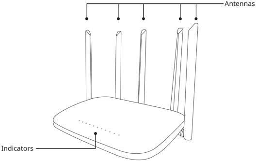

*Page 5 (PDF page 4, left)*

## Copyright © 2023 Shenzhen Pudu Technology Co., Ltd. All rights reserved.

This document may not be copied, reproduced, transcribed or translated, in part or in whole, by any persons or orga-nizations, or be transmitted in any form or by any means (electronic, photocopy, recording, etc.) for any commercial purposes without the prior written permission of Shenzhen Pudu Technology Co., Ltd. The product specifications and information mentioned herein are for reference only and are subject to change without prior notice. Unless otherwise specified, this document is used as a user guide only and comes with no guarantees of any kind.

# 1. Safety Instructions

- Do not place the gateway near any heat source or naked flames, such as microwave ovens, ovens, stoves, candles, or other places that may cause scorching temperatures, so as to prevent the gateway from malfunctioning or exploding.
- Do not use the gateway in a humid atmosphere or near a magnetic field to prevent its internal circuit from malfunctioning.
- Do not rinse or soak the gateway in water to avoid damaging the components.
- Do not place the gateway in any area exposed to direct sunlight.
- Do not store or transport the gateway in the same container with flammable and explosive articles.
- Be sure to protect the gateway from violent impact or shock to avoid malfunction.
- Do not dispose of the gateway or its accessories as household waste. Always dispose of the product and its accessories according to local laws and regulations, and recycle wherever possible.
- Do not clean the gateway with caustic chemicals, cleansers, or detergents. Always clean the gateway by wiping it with a clean and dry cloth.
- Do not disassemble or modify the gateway and its accessories by yourself, as this will void your warranty. In case of malfunction, contact Shenzhen Pudu Technology Co., Ltd. for technical support.
- Gateway has been tested and exhibits waterproof and dustproof performance in specific environments, but it is not a professional waterproof device.
- Do not use the gateway in places where wireless devices are explicitly prohibited. Otherwise, it may cause interference to other electronic devices or lead to other dangers.
- In healthcare establishments where wireless devices are explicitly prohibited, please abide by the regulations.
- The radio waves generated by the gateway may affect the proper functioning of implanted medical devices or personal medical devices, such as pacemakers, cochlear implants, and hearing aids. When using the gateway, please keep it at a distance of at least 15 cm from these devices.

# 2. In the Box

## 2.1 Product overview

PGCG01 beeper gateway (hereinafter referred to as "gateway") is a relay gateway that supports LoRa communication protocol. It is designed to be used with button beepers and LoRa-supported robots from PuduTech, with the call com-munication system built upon LoRa LAN and cloud service. The gateway, which works as a communication relay between the button beeper and the robot, allows the user to call the robot to any destination and supports multi-calling. It helps to improve robot efficiency and is suitable for scenarios such as deliveries in restaurants and office buildings.

## 2.2 Packing list

Beeper Gateway × 1, Charger × 1, User Manual × 1

---

*Page 6 (PDF page 4, right)*

## 2.3 Exterior and components

> *Figure description (AI):* The figure shows the exterior components of the Pudu GW1 device. It identifies the locations of the antennas on the top of the unit. It points out the indicator lights located on the front surface of the device.

## 2.4 Technical specifications

| Feature | Description |
|---|---|
| Product Name | Pudu GW1 |
| Model | PGCG01 |
| Power Input | 5V DC Max. 2A |
| Quantity of Antennas | 5 |
| Enclosure Material | ABS |
| Weight | 300 g |
| Dimensions | 246 × 165 × 185 mm |
| Heat Dissipation | Fanless cooling |
| Mounting Method | Desktop/wall mounting |
| Working Frequency | 2402.0 - 2483.5 MHz |
| Transmission Power | Adjustable up to 12.5 dBm |
| Wi-Fi | LoRa (2.4G), Wi-Fi (2.4G) |
| Wired Network | LAN (RJ45 100M) |
| Power Consumption | 12W (typical), 17W (max.) |
| Communication Protocols | PUDU LoRa TSCH |
| Working Environment | Temperature: 0 to 40 °C; Humidity: ≤ 85% RH |
| Storage Environment | Temperature: -40 to 65 °C; Humidity: ≤ 85% RH |
| Indicators | 6 |

---

*Page 7 (PDF page 5, left)*

# 3. How to Use

## 3.1 Connecting the beeper to the network using the gateway

The button beeper and the beeper gateway are configured in the same network and share the same LoRa communication frequency.

## 3.2 Binding the gateway

- Download Pudu Link App;
- Go to "App > My > Device Management" and tap "Add Gateway";
- Scan the barcode on the back of the gateway to obtain its serial number (SN);
- Set the gateway level (Tips: The first gateway added for a store must be the main gateway);
- Power on the gateway and connect it via Pudu Link App;
- Configure the network connection of the gateway (Wi-Fi/local network);
- Set up communication parameters, and the gateway is now successfully bound to the network.

## 3.3 Binding the beeper

- Download Pudu Link App;
- Go to "App > My > Device Management" and tap "Add Beeper";
- Select the gateway for the beeper;
- Press and hold the button beeper for 10 seconds to activate it;
- After Pudu Link App obtains the SN of the beeper, tap Bind to complete the binding. (Tips: A gateway must be added before adding any beeper.)

## 3.4 Indicators

| Type | Quantity | Description |
|---|---|---|
| Power indicator | 1 | A steady-on power indicator indicates that the gateway is powered and working properly |
| Role indicator | 1 | A steady-on role indicator indicates that the gateway is the "root gate-way" in the network |
| Working indicator | 4 | A steady-on working indicator indicates that the corresponding wireless transceiving ports are in a working state |

# 4. After-Sales Service

## 4.1 Free warranty

Shenzhen Pudu Technology Co., Ltd provides free warranty services within the effective warranty period (the warranty period starts from the activation date and may vary for different components. See Warranty Period of Major Components for details). The fees incurred by the after-sales service will be covered by Pudu. Beyond the warranty period or in any circumstances not covered by the free warranty, a certain fee will be charged according to the normal price. Please call the after-sales hotline on our official website for repair services.

---

*Page 8 (PDF page 5, right)*

## Free Warranty Terms & Conditions:

- Defects are caused by non-human factors during normal use within the specified warranty period;
- There are no unauthorized disassembly, modification, or addition guided by unofficial instructions, or other faults caused by non-human factors;
- The S/N stickers, factory labels, and other labels are not removed or altered;
- Effective purchase certificate, receipt, and order number are provided;
- Damaged components replaced under warranty are properties of Pudu and shall be sent back to Pudu as required. Otherwise, Pudu shall have the right to reject the free warranty request.

## Circumstances not covered by the free warranty:

- Collisions or burnings caused by other factors rather than quality issues, or quality problems due to unauthorized modification or intrusion of foreign objects (water, oil, sand, etc.);
- Damage caused by unauthorized modification, disassembly, or opening of the shell guided by unofficial instructions;
- Damage caused by improper installation, use, operation, or storage not following the user manual;
- Damage caused by unauthorized repair of parts in the absence of official instructions;
- Damage caused by circuit modification guided by unofficial instructions or improper use of the battery;
- Damage caused by overloading;
- Damages caused by insufficient discharge when the battery is low or using a battery with quality problems;
- When a second on-site service (such as deployment, installation, and commissioning) is required for the customer's own reasons;
- Faults and damage caused by force majeure events (such as earthquakes and fires);
- Other circumstances not covered by the free warranty.

The warranty period starts from the activation date recorded in the system. See Warranty Period of Major Components for the warranty period of different components.

## 4.2 After-sales service consultation

If you have any questions,

please contact Purdue Technology customer service hotline: +86 755-86952935. Email: techservice@pudutech.com

---

*Page 9 (PDF page 6, left)*

## Disposal and recycling information

The Waste Electrical and Electronic Equipment (WEEE) Directive aims to minimize the impact of electrical and electronic goods on the environment, by increasing re-use and recycling and by reducing the amount of WEEE going to landfill. The symbol on this product or its packaging signifies that this product must be disposed separately from ordinary household wastes at its end of life. Be aware that this is your responsibility to dispose of electronic equipment at recycling centers in order to conserve natural resources. Each country should have its collection centers for electrical and electronic equipment recycling. For information about your recycling drop off area, please contact your related electrical and electronic equipment waste management authority, your local city office, or your house hold waste disposal service.

## FCC Compliance Statement

1. This device complies with Part 15 of the FCC rules. Operation is subject to the following two conditions:

(1) this device may not cause harmful interference, and

(2) this device must accept any interference received, including interference that may cause undesired operation.

2. Changes or modifications not expressly approved by the party responsible for compliance could void the user's authority to operate the equipment.

## FCC Interference Statement

This equipment has been tested and found to comply with the limits for a Class B digital device, pursuant to part 15 of the FCC Rules.

These limits are designed to provide reasonable protectionagainst harmful interference in a residential installation.

This equipment generates, uses and can radiate radio frequency energy and, if not installed and used in accordance with the instructions, may cause harmful interference to radio communications.

However, there is no guarantee that interference will not occur in a particular installation.

If this equipment does cause harmful interference to radio or television reception, which can be determined by turning the equipment oand on, the user is encouraged to try to correct the interference by one or more of the following measures:

- Reorient or relocate the receiving antenna.
- Increase the separation between the equipment and receiver.
- Connect the equipment into an outlet on a circuit different from that to which the receiver is connected.
- Consult the dealer or an experienced radio/TV technician for help.

This transmitter must not be co-located or operating in conjunction with any other antenna or transmitter. This equipment complies with FCC radiation exposure limits set forth for an uncontrolled environment. This equipment should be installed and operated with minimum distance 20cm between the radiator & your body.

---

*Page 10 (PDF page 6, right)*

## ISED Statement:

This device contains licence-exempt transmitter(s)/receiver(s) that comply with Innovation, Science

and Economic Development Canada's licence-exempt RSS(s). Operation is subject to the following two conditions:

(1) This device may not cause interference.

(2) This device must accept any interference, including interference that may cause undesired operation of the device.

This transmitter must not be co-located or operating in conjunction with any other antenna or transmitter.

The device meets the exemption from the routine evaluation limits in section 2.5 of RSS-102 and compliance with

RSS-102 RF exposure, users can obtain Canadian information on RF exposure and compliance.

This equipment should be installed and operated with a minimum distance of 20 centimeters between the radiator and your body.

## SIMPLIFIED EU DECLARATION OF CONFORMITY

Hereby, [Shenzhen Pudu Technology Co., Ltd.] declares that the radio equipment type [PGCG01] is in compliance with Directive 2014/53/EU.

The full text of the EU declaration of conformity is available at the following internet address:

https://manual.pudutech.com/handbook/pudu-pager
