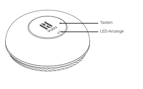

*Seite 15 (PDF-Seite 9, rechts)*

DE

Copyright © 2023 Shenzhen Pudu Technology Co., Ltd. Alle Rechte vorbehalten.
Keine Organisation oder Einzelperson darf den Inhalt dieses Benutzerhandbuchs teilweise oder vollständig ohne die ausdrückliche schriftliche Zustimmung von Shenzhen Pudu Technology Co., Ltd. kopieren, transkribieren oder übersetzen oder dieses Benutzerhandbuch zu kommerziellen Zwecken auf jedwede Art und Weise verteilen (elektronisch oder durch Fotokopieren, Aufzeichnen usw.). Die in diesem Benutzerhandbuch aufgeführten technischen Daten und Angaben zum Produkt dienen nur als Referenz und können ohne vorherige Ankündigung geändert werden. Sofern nichts anderes angegeben wird, ist dieses Benutzerhandbuch nur als Orientierungshilfe gedacht und die darin enthaltenen Gebrauchsanweisungen sind keinesfalls als Gewährleistung aufzufassen.

## 1. Sicherheitsanweisungen

* Halten Sie das Gerät von Hitze- und Zündquellen fern, wie Mikrowellenherden, Öfen, Herden, Kerzen oder anderen Orten, an denen die Umgebungstemperatur hoch werden kann, da dies dazu führen kann, dass das Gerät nicht richtig funktioniert oder explodiert.
* Halten Sie das Gerät von Feuchtigkeit oder Magnetfeldern fern, da diese die Funktion der internen Schaltkreise des Geräts beeinträchtigen können.
* Waschen oder tauchen Sie das Gerät nicht direkt ins Wasser, da dies zu Schäden an seinen Komponenten führen kann.
* Setzen Sie das Gerät nicht direktem Sonnenlicht aus.
* Lagern oder transportieren Sie das Gerät nicht im selben Behälter wie brennbare oder explosive Gegenstände.
* Setzen Sie das Gerät nicht starken Stößen oder Vibrationen aus, da dadurch Fehlfunktionen ausgelöst werden können.
* Demontieren oder modifizieren Sie die eingebaute Batterie des Geräts nicht selbst, da die Batterie oder das Gerät dadurch beschädigt werden können.
* Entsorgen Sie das Gerät und dessen Zubehör nicht über den Hausmüll. Bitte beachten Sie die lokalen Vorschriften zur Entsorgung des Geräts und seiner Zubehörteile und führen Sie es, wo möglich, dem Recycling zu.
* Verwenden Sie zum Reinigen des Geräts keine starken Chemikalien, Reinigungsmittel oder starke Waschmittel. Wischen Sie das Gerät mit einem sauberen, trockenen Tuch ab.
* Demontieren oder modifizieren Sie das Gerät oder sein Zubehör nicht eigenmächtig, sonst werden das Gerät und sein Zubehör nicht von unseren Garantieleistungen abgedeckt. Wenden Sie sich, wenn das Gerät nicht richtig funktioniert, bitte an den technischen Support von Pudu.
* Das Gerät wurde getestet, um seine Wasserdichtigkeit und Staubdichtigkeit in bestimmten Umgebungen zu demonstrieren, aber technisch gesehen ist es nicht wasserdicht.
* Verwenden Sie das Gerät nicht an Orten, an denen drahtlose Geräte ausdrücklich verboten sind, da dadurch andere elektronische Geräte gestört oder andere Gefahren verursacht werden können.
* Halten Sie sich in Krankenhäusern und anderen Gesundheitseinrichtungen, in denen die Verwendung von drahtlosen Geräten ausdrücklich verboten ist, an die Vorschriften.

---

*Seite 16 (PDF-Seite 10, links)*

2. Produktkomponenten
## 2.1 Überblick
Der Tasten-Rufsender PPCC01 ist ein LoRa-fähiges Ruf- und Benachrichtigungsgerät, das in Verbindung mit dem Rufsender-Gateway und den LoRa-kommunikationsfähigen Robotern von Pudu Technology verwendet wird. Das Rufsystem basiert auf einem LoRaWAN und Cloud-Diensten. Der Tasten-Rufsender kann verwendet werden, um den Roboter zu einer vorgegebenen Aufrufstelle zu rufen. Rufen wird für mehrere Tasten-Rufsender unterstützt. Mit dem Rufsender lässt sich die Effizienz des Roboters steigern. Er eignet sich für Lieferungen in Restaurants und Bürogebäuden und unter ähnlichen Einsatzbedingungen.
## 2.2 Packliste
Tasten-Rufsender ×1, Benutzerhandbuch ×1, Kleberücken ×2, Tischaufkleber ×1.
## 2.3 Außenansicht und Komponenten

> *Bildbeschreibung (KI):* Die Beschriftung 'Tasten' zeigt auf den physischen Tastenbereich des Geräts. Die Beschriftung 'LED-Anzeige' verweist auf die Leuchtdiode zur Statusanzeige. Das Logo mit dem Text 'Pudu' ist zentral auf der Oberseite des Geräts platziert.

---

*Seite 17 (PDF-Seite 10, rechts)*

## 2.4 Technische Daten

| Produktfunktion | Beschreibung |
|---|---|
| Produktname | Pudu-Rufsender |
| Produktmodell | PPCC01 |
| Stromversorgung | ER14505 Batterie (nicht wiederaufladbar) |
| Spannung | 3,7 V |
| Gehäusematerial | ABS |
| Gewicht | 80 g (mit Batterie) |
| Maße | Φ 76.8 × 25 mm |
| Farbe | Weiß |
| Montagemethode | Mit Aufkleber an der Tischoberfläche befestigt |
| Betriebsbänder | 2402,0 MHz bis 2483,5 MHz |
| Sendeleistung | Maximal 12,5 dBm, einstellbar |
| Kommunikationsstandard | LoRa (2,4 G) |
| Kommunikationsprotokoll | PUDU LoRa TSCH |
| Stromverbrauch | 2,1 μA (Standby), 236 μA (typisch), 60 mA (max./Spitze) |
| Batterielebensdauer | ≥ 1 Jahr (typisch) |
| Schnittstelle für die Konfiguration | Magnetische Pingo-Konfigurationsschnittstelle |
| Betriebsumgebung | Temperatur: 0 °C bis 40 °C; Luftfeuchtigkeit: ≤ 85 % |
| Lagerumgebung | Temperatur: -40 °C bis 65 °C; Luftfeuchtigkeit: ≤ 85 % |
| Tasten | 1 |

---

*Seite 18 (PDF-Seite 11, links)*

# 3. Produktanweisungen

## 3.1 Binden des Roboters an ein Gateway

- Wenn der Tasten-Rufsender zum ersten Mal eingeschaltet wird, ist er noch nicht an ein Gateway gebunden. Der Rufsender muss zuerst an ein Gateway gebunden werden, bevor der Roboter damit zu einem bestimmten Ort gerufen werden kann.

· Konfigurieren Sie den Tasten-Rufsender mit der PUDU Link APP, um ihn an ein Gateway zu binden. · Gateways werden ebenfalls über die PUDU Link APP an Roboter gebunden.

## 3.2 Hinweise zu Ruffunktionen und Lichtanzeigen

- Die Lichtanzeige wechselt zu stetig grün, wenn ein untätiger Roboter erfolgreich gerufen wurde und für einen sofortigen Einsatz bereitsteht.
- Die Anzeige beginnt grün zu blinken, wenn der Roboter die vorgegebene Aufrufstelle erreicht hat.

·

Der Kunde kann einen bereits gesendeten Ruf stornieren, indem er die Taste des Rufsenders fünf

Sekunden lang gedrückt hält. Die Anzeige fängt an, stetig rot zu leuchten, sobald der Ruf storniert

wurde.

- Wenn ein Ruf mit dem Tasten-Rufsender aus irgendeinem anderen Grund als einer Stornierung fehlschlägt, beginnt die Anzeige rot zu blinken.

| Lichtanzeige | Dauer | Beschreibung |
|---|---|---|
| Stetig blau | 5 s | Tasten-Rufsender ruft Roboter |
| Stetig grün | 5 s | Roboter hat reagiert und ist auf dem Weg |
| Grün blinkend | 5 s | Roboter ist angekommen |
| Rot blinkend | 5 s | Ruf fehlgeschlagen |
| Stetig rot | 5 s | Ruf manuell abgebrochen |

---

*Seite 19 (PDF-Seite 11, rechts)*

# 4. Kundendienst

## 4.1 Unentgeltliche Gewährleistung

Shenzhen Pudu Technology Co., Ltd. bietet unentgeltliche Garantieleistungen innerhalb der geltenden Garantiezeit (die Garantiezeit beginnt mit dem Aktivierungsdatum und kann bei verschiedenen Komponenten variieren. Weitere Informationen finden Sie unter Gewährleistungsfristen der Hauptkomponenten). Die für den Kundendienst anfallenden Gebühren werden von Pudu übernommen.

Außerhalb der Garantiezeit oder unter Umständen, die nicht durch die unentgeltliche Gewährleistung abgedeckt sind, ist eine reguläre Gebühr zu entrichten. Rufen Sie die Kundendienst-Hotline auf unserer offiziellen Website an, sollten Sie Reparaturleistungen benötigen.

Für die unentgeltlichen Gewährleistung gelten folgende Bedingungen:

- die Mängel sind bei bestimmungsgemäßem Gebrauch nicht durch Fremdeinwirkung innerhalb der angegebenen Garantiefrist aufgetreten;
- es erfolgte keine unbefugte Demontage, Modifikation oder Nachrüstung unter Nichtbeachtung der Anweisungen im offiziellen Handbuch, oder es handelt sich um andere Mängel, die nicht durch Fremdeinwirkung verursacht wurden;
- Seriennummern, Herstelleretiketten und andere Kennzeichen wurden nicht entfernt oder verändert;
- ein gültiger Kaufbeleg, Rechnung und Rechnungsnummer liegen vor;
- beschädigte Komponenten, die im Rahmen der Gewährleistung ersetzt werden, sind Eigentum von Pudu und müssen bei Bedarf an Pudu zurückgesendet werden. Andernfalls behält Pudu sich das Recht vor, Forderungen nach unentgeltlicher Gewährleistung abzulehnen.

Nicht durch die unentgeltliche Gewährleistung abgedeckte Umstände:

- Kollisionen oder Brände, die durch andere Faktoren als Qualitätsprobleme verursacht wurden, oder Qualitätsprobleme aufgrund von unbefugten Änderungen oder dem Eindringen von Fremdkörpern (Wasser, Öl, Sand, etc.);
- Schäden, die durch unbefugte Änderungen, Demontage oder Öffnen des Gehäuses unter Nichtbeachtung der Anweisungen im offiziellen Handbuch verursacht wurden;
- Schäden, die durch unsachgemäße Installation, Nutzung, Betrieb oder Lagerung unter Nichtbeachtung der Anweisungen im offiziellen Handbuch entstanden;
- Schäden, die durch die eigenmächtige, unbefugte Reparatur von Teilen unter Nichtbeachtung offizieller Anweisungen verursacht wurden;
- Schäden, die durch Schaltkreismodifikationen unter Nichtbeachtung der Anweisungen im offiziellen Handbuch oder durch unsachgemäßen Gebrauch der Batterie verursacht wurden;
- Schäden, die durch Überlastung verursacht wurden;
- Schäden, die durch Verwendung einer schwachen oder mangelhaften Batterie verursacht wurden;

---

*Seite 20 (PDF-Seite 12, links)*

- Wenn aus Kundengründen ein zweiter Vor-Ort-Service (wie Bereitstellung, Installation und Inbetriebnahme) erforderlich ist;
- Fehler und Schäden durch höhere Gewalt (wie Erdbeben und Brände);
- Andere Umstände, die nicht von der unentgeltlichen Gewährleistung abgedeckt sind.
Die Garantiezeit beginnt mit dem im System verzeichneten Aktivierungsdatum. Weitere Informationen zu den Gewährleistungsfristen verschiedener Komponenten finden Sie unter Gewährleistungsfristen der Hauptkomponenten.

## 4.2 Beratung durch den
Bei Fragen wenden Sie sich bitte an unsere Kundendienst- Hotline: +86 755-86952935. E-Mail: techservice@pudutech.com

## EU-KONFORMITÄTSERKLÄRUNG
Hiermit erklärt [Shenzhen Pudu Technology Co., Ltd.], dass der Funkgerätetyp [PPCC01] der Richtlinie 2014/53/EU entspricht. Der vollständige Text der EU-Konformitätserklärung ist unter folgender Internetadresse verfügbar: https://manual.pudutech.com/handbook/pudu-gw1
