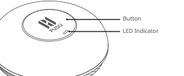

*Page 7 (PDF page 5, right)*

Copyright © 2023 Shenzhen Pudu Technology Co., Ltd. All rights reserved. No organization or individual shall imitate, copy, transcribe or translate the contents of this user guide, in part or in full, without the express written consent of Shenzhen Pudu Technology Co., Ltd., or distribute this user guide for profit in any way (electronically or via photocopying, recording, etc.). The product specifications and information provided in this user guide are for reference only and are subject to change without further notice. Unless otherwise specified, this user guide is only intended as instructions for use, and no representation shall be deemed as a warranty of any kind.

# 1. Safety Instructions

· Keep away from heat and ignition sources, such as microwave ovens, ovens, stoves, candles or other places where the ambient temperature may become high, as this may cause the device to malfunction or explode. · Keep away from moisture or magnetic fields, as this may cause the internal circuitry of the device to malfunction. · Do not directly wash or submerge the device, as this may cause damage to its components. · Do not leave the device in direct sunlight.

· Do not store or transport the device with flammable or explosive items in the same box. · Do not subject the device to strong shocks or vibrations, as this may cause the device to malfunction. · Do not disassemble or refit the built-in battery of the device by yourself, as this may damage the battery or the device.

- Do not dispose of the device or its accessories as ordinary domestic waste. Please comply with local regulations on the disposal of the device and its accessories and recycle where possible.
- Do not use strong chemicals, cleaning agents, or strong detergents to clean the device. Wipe the device with a clean, dry cloth.

· Do not disassemble or refit the device or its accessories by yourself, otherwise the device and its accessories will not be covered by our warranty services. If the device malfunctions, please contact Pudu technical support. · The device has been tested to demonstrate waterproof and dustproof performance in certain environments, but technically it is not waterproof.

- Do not use the device in locations where wireless devices are explicitly prohibited, as this may interfere with other electronic devices or cause other hazards.

---

*Page 8 (PDF page 6, left)*

In medical or other health facilities where wireless devices are explicitly prohibited, please follow the rules.

# 2. Product Components 2.1 Overview

The PPCC01 Call Button is a LoRa-enabled call and notification device that is used in conjunction with the Pudu Technology call gateway and Pudu Technology robots that supporting LoRa communications. The call system is based on a LoRa local area network and cloud services. The call button can be used to call the robot to a designated call point. Calling is supported for multiple call buttons. It helps to improve robot efficiency and is suitable for scenarios such as deliveries in restaurants and office buildings.

## 2.2 Packaging list

Call button ×1, User guide ×1, Adhesive backing ×2, Table sticker ×1.

## 2.3 Appearance and components

---

*Page 9 (PDF page 6, right)*

## 2.4 Technical specifications

| Product Feature | Description |
|---|---|
| Product name | Pudu Pager |
| Product model | PPCC01 |
| Power supply | ER14505 battery (not rechargeable) |
| Voltage | 3.7 V |
| Enclosure material | ABS |
| Weight | 80 g (with battery) |
| Dimensions | Φ76.8×25 mm |
| Color | White |
| Installation method | Fixed to desktop with adhesive |
| Operating bands | 2402.0 MHz – 2483.5 MHz |
| Transmission power | Maximum 12.5 dBm, adjustable |
| Communication standard | LoRa (2.4 G) |
| Communication protocol | PUDU LoRa TSCH |
| Power consumption | 2.1 μA (standby), 236 μA (typical), 60 mA (max./peak) |
| Battery life | ≥ 1 year (typical) |
| Configuration interface | Pingo magnetic configuration interface |
| Working environment | Temperature: 0° to 40 °C ; Humidity: ≤ 85% RH |
| Storage environment | Temperature: -40 to 65 °C ; Humidity: ≤ 85% RH |
| Button | 1 |

---

*Page 10 (PDF page 7, left)*

# 3. Product Instructions 3.1 Bind the Robot to a Gateway

- When it is first turned on, the call button is not bound to a gateway. It must be bound to a gateway before it can call the robot to a specified location.
- To bind the call button to a gateway, configure the call button using PUDU Link APP.
- Gateways are bound to robots over the PUDU Link APP.

## 3.2 Notes on calling features and indicators

- The indicator changes to solid green when an idle robot has been successfully called and is ready to proceed immediately.
- The indicator starts flashing green when the robot has reached the designated call point.
- Once a call has been made, the customer can cancel by pressing and holding the call button for five seconds. The indicator changes to solid red once the call has been canceled.
- If a call fails for any reason other than cancellation using the call button, the indicator starts flashing red.

| Indicator | Duration | Description |
|---|---|---|
| Solid blue | 5 sec | call button calling robot |
| Solid green | 5 sec | Responded to call, robot proceeding |
| Flashing green | 5 sec | Robot arrived |
| Flashing red | 5 sec | Call failed |
| Solid red | 5 sec | Call canceled manually |

---

*Page 11 (PDF page 7, right)*

# 4. After-Sales Service

## 4.1 Free warranty

Shenzhen Pudu Technology Co., Ltd provides free warranty services within the effective warranty period (the warranty period starts from the activation date and may vary for different components. See Warranty Period of Major Compo-nents for details). The fees incurred by the after-sales service will be covered by Pudu. Beyond the warranty period or in any circumstances not covered by the free warranty, a certain fee will be charged according to the normal price. Please call the after-sales hotline on our official website for repair services.

## Free Warranty Terms & Conditions:

- Defects are caused by non-human factors during normal use within the specified warranty period; · There are no unauthorized disassembly, modification, or addition guided by unofficial instructions, or other faults caused by non-human factors;
- The S/N stickers, factory labels, and other labels are not removed or altered;
- Effective purchase certificate, receipt, and order number are provided;
- Damaged components replaced under warranty are properties of Pudu and shall be sent back to Pudu as required. Otherwise, Pudu shall have the right to reject the free warranty request.

## Circumstances not covered by the free warranty:

- Collisions or burnings caused by other factors rather than quality issues, or quality problems due to unauthorized modification or intrusion of foreign objects (water, oil, sand, etc.);
- Damage caused by unauthorized modification, disassembly, or opening of the shell guided by unofficial instruc-tions;
- ·
- Damage caused by improper installation, use, operation, or storage not following the user manual;
- Damage caused by unauthorized repair of parts in the absence of official instructions;
- Damage caused by circuit modification guided by unofficial instructions or improper use of the battery;

---

*Page 12 (PDF page 8, left)*

- Damage caused by overloading;
- Damages caused by insufficient discharge when the battery is low or using a battery with quality problems;
- When a second on-site service (such as deployment, installation, and commissioning) is required for the customer's own reasons;
- Faults and damage caused by force majeure events (such as earthquakes and fires);
- Other circumstances not covered by the free warranty.

The warranty period starts from the activation date recorded in the system. See Warranty Period of Major Components for the warranty period of different components.

## 4.2 Contact us

If you have any questions, please contact our customer service.

hotline: +86 755-86952935.

Email: techservice@pudutech.com

## 5. Compliance information

### 5.1 Disposal and recycling information

The Waste Electrical and Electronic Equipment (WEEE) Directive aims to minimize the impact of electrical and electronic goods on the environment, by increasing re-use and recycling and by reducing the amount of WEEE going to landfill. The symbol on this product or its packaging signifies that this product must be disposed separately from ordinary household wastes at its end of life. Be aware that this is your responsibility to dispose of electronic equipment at recycling centers in order to conserve natural resources. Each country should have its collection centers for electrical and electronic equipment recycling. For information about your recycling drop off area, please contact your related electrical and electronic equipment waste management authority, your local city office, or your house hold waste disposal service.

---

*Page 13 (PDF page 8, right)*

Before placing electrical and electronic equipment (EEE) in the waste collection stream or in waste collection facilities, the end user of equipment containing batteries and/or accumulators must remove those batteries and accumulators for separate collection.

## 5.2 Federal Communications Commission compliance statement

This equipment has been tested and found to comply with the limits for a Class B digital device, pursuant to part 15 of the FCC Rules. These limits are designed to provide reasonable protection against harmful interference in a residential installation. This equipment generates, uses and can radiate radio frequency energy and, if not installed and used in accordance with the instructions, may cause harmful interference to radio communications. However, there is no guarantee that interference will not occur in a particular installation. If this equipment does cause harmful interference to radio or television reception, which can be determined by turning the equipment off and on, the user is encouraged to try to correct the interference by one or more of the following measures:

- Reorient or relocate the receiving antenna.

- Increase the separation between the equipment and receiver.

- Connect the equipment into an outlet on a circuit different from that to which the receiver is connected.

- Consult the dealer or an experienced radio/TV technician for help.

This device complies with Part 15 of the FCC rules. Operation is subject to the following two conditions: ・ This device may not cause harmful interference.

- This device must accept any interference received, including interference that may cause undesired operation.

---

*Page 14 (PDF page 9, left)*

## 5.3 Industry Canada compliance statement

This device complies with Industry Canada licence-exempt RSS standard(s). Operation is subject to the following two conditions:

- This device may not cause interference.
- This device must accept any interference, including interference that may cause undesired operation of the device.

## SIMPLIFIED EU DECLARATION OF CONFORMITY

Hereby, [Shenzhen Pudu Technology Co., Ltd.] declares that the radio equipment type [PPCC01] is in compliance with Directive 2014/53/EU.

The full text of the EU declaration of conformity is available at the following internet address: https://manual.pudutech.com/handbook/pudu-gw1
