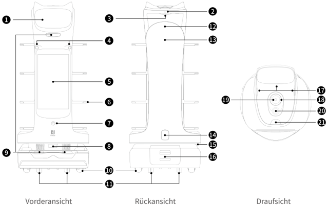
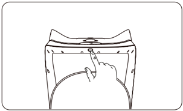

*Seite 28 (PDF-Seite 16, rechts)*

## Copyright © 2024 Shenzhen Pudu Technology Co., Ltd. Alle Rechte vorbehalten.

Keine Organisation oder Einzelperson darf den Inhalt dieses Benutzerhandbuchs teilweise oder vollständig ohne die ausdrückliche schriftliche Zustimmung von Shenzhen Pudu Technology Co., Ltd. kopieren, transkribieren oder übersetzen oder dieses Benutzerhandbuch zu kommerziellen Zwecken auf beliebige Weise verteilen (elektronisch oder durch Fotokopieren, Aufzeichnen usw.). Die in diesem Benutzerhandbuch bereitgestellten technischen Daten und Angaben zum Produkt dienen nur als Referenz und können ohne vorherige Ankündigung geändert werden. Falls nicht anders angegeben, ist dieses Benutzerhandbuch nur als Orientierungshilfe gedacht und die darin enthaltenen Darstellungen sind nicht als Gewährleistung irgendwelcher Art aufzufassen.

# 1. Sicherheitshinweise

## 1.1 Stromverbrauch

- Benutzen Sie ausschließlich Original Akkus und Ladegeräte. Es sollte kein Fremdzubehör verwendet werden. Wenn das Ladegerät beschädigt ist, tauschen Sie es sofort aus.
- Wenn der Akku auf 20 % sinkt, sollte der Roboter rechtzeitig aufgeladen werden. Längerer Betrieb mit einem schwachen Akku kann dessen Laufzeit beeinträchtigen.
- Achten Sie darauf, dass die Spannung den Angaben auf dem Ladegerät entspricht, da dieses sonst beschädigt werden kann.
- Achten Sie bei der Verwendung des Ladegeräts darauf, dass der Verschluss der Ladeschnittstelle vollständig eingerastet ist, um eine Überhitzung während des Ladevorgangs zu vermeiden. Dies kann sonst zu Verbrennungen oder Schäden am Gerät führen.

## 1.2 Betrieb

- Verdecken Sie nicht die obere Kamera des Roboters während des Betriebs, damit er sich nicht unkontrolliert bewegt. Falls die Kamera abgedeckt ist, unterbrechen Sie seine Aufgabe und setzen Sie den Roboter erst auf den richtigen Kurs, bevor Sie ihn weiter nutzen möchten.
- Reinigen oder warten Sie den Roboter nicht, wenn die Spannung eingeschaltet ist.
- Es dürfen keine Geräte mit offener Flamme oder brennbare und explosive Gegenstände auf dem Roboter abgestellt werden.
- Nehmen Sie keine Gerichte heraus und stellen Sie keine hinein, während der Roboter fährt, sonst können Lebensmittel verschüttet werden oder es kann zu Verletzungen durch versehentliche Kollisionen kommen.
- Während der Roboter arbeitet, darf er nicht gezogen oder weggetragen werden, um unerwünschte Störungen zu verhindern.
- Der Roboter sollte nicht von ungeschultem Personal zerlegt oder repariert werden. Im Falle einer Störung wenden Sie sich an Shenzhen Pudu Technology Co., Ltd., um einen zeitnahen technischen Support zu erhalten.
- Beachten Sie das Höchstgewicht, das eine Person vorschriftsgemäß anheben darf, wenn Sie den Roboter transportieren. Halten Sie den Roboter während des Transports aufrecht. Versuchen Sie niemals, ihn an einem Tablett oder an dem Rahmen anzuheben. Kinder dürfen mit dem Roboter nicht spielen.
- Kinder dürfen mit dem Roboter nicht spielen.
- Reinigen Sie den Roboter nicht mit stark sauren oder alkalischen Reinigungsmitteln.

## 1.3 Umgebung

- Betreiben oder laden Sie den Roboter nicht in einer Umgebung mit hohen Temperaturen oder Drücken. Auch nicht in Bereichen mit Feuer- oder Explosionsgefahr oder in anderen gefährlichen Umgebungen, sonst können Störungen oder Schäden am Roboter auftreten.
- Betreiben Sie den Roboter nicht in einer feuchten Umgebung oder auf Oberflächen, die mit Flüssigkeiten oder klebrigen Materialien bedeckt sind, da diese Schäden am Roboter verursachen können.
- Betreiben Sie den Roboter nicht an Orten, an denen die Verwendung von drahtlosen Geräten ausdrücklich untersagt ist, da es sonst u. a. zu Störungen anderer elektronischer Geräte oder anderen Gefahren kommen kann.
- Entsorgen Sie den Roboter und dessen Zubehör nicht über den Hausmüll. Entsorgen Sie den Roboter und das Zubehör vorschriftsgemäß und führen Sie ihn möglichst dem Recycling zu.

---

*Seite 29 (PDF-Seite 17, links)*

# 2. Produktbestandteile

## 2.1 Überblick

BellaBot Pro ist ein Servierroboter für den Innenbereich mit Laser Slam + Vslam, einem großen Werbebildschirm und visueller Tabletterkennung. Es bietet außerdem hervorragende Mensch-Roboter-Interaktionen, KI-Stimme, ein schönes Aussehen und multimodale Interaktionen. Um sich an verschiedene Geschäftsszenarien anzupassen, bietet der BellaBot Pro eine Vielzahl von Modi, wie z. B. Serviermodus, Rundfahrtmodus, Sammelmodus, Geburtstagsmodus, Führungsmodus und vieles mehr.

## 2.2 Packliste

1x Roboter, 1x BellaBot Pro Benutzerhandbuch, 1x Qualitätsbescheinigung, 1x Ladegerät, 1x Ortungsaufkleber

## 2.3 Erscheinungsbild und bestandteile

> *Bildbeschreibung (KI):* Die Abbildung zeigt die Vorder-, Rück- und Draufsicht des BellaBot Pro mit nummerierten Beschriftungen für alle Komponenten. Mit der Abbildung können die Positionen von Anschlüssen (z. B. Ladeanschluss 14), Sensoren (z. B. Lidar 8, RGB-Kamera 4) und Bedienelementen (z. B. Netzschalter 2, Blitztaste 21) lokalisiert werden. Durch die Beschriftungen wird klar, welche Bauteile wo angebracht sind – z. B. dass der Werbebildschirm (5) vorne und der Punktematrixbildschirm (13) hinten montiert ist.

*Beschriftungen:*

- **1** LCD-Bildschirm
- **2** Netzschalter
- **3** Tabletterkennungssensor
- **4** RGB-Frontkamera
- **5** Werbebildschirm
- **6** Tabletts
- **7** Boden Projektor
- **8** Lidar
- **9** Tiefensensor
- **10** Antriebsräder
- **11** Stützräder
- **12** Berührung-Abgeschlossen Sensor
- **13** Punktematrixbildschirm
- **14** Ladeanschluss
- **15** Lichtleiste
- **16** Akkufach
- **17** Berührungssensor
- **18** Kreisanordnung von 6 Mikrofonen
- **19** Nach oben gerichteter Sensor
- **20** Notausschalter
- **21** Blitztaste

---

*Seite 30 (PDF-Seite 17, rechts)*

## 2.4 Technische Daten

| Merkmale Feature | Beschreibung |
|---|---|
| Betriebsspannung | DC 23–29,4 V |
| Eingangsspannung | AC 100–240 V, 50/60 Hz |
| Ausgangsspannung | 29,4 V/8 A |
| Akkukapazität | 25,6 Ah |
| Aufladezeit | 4,5 h |
| Akkulaufzeit | 11 h (unbelastet) |
| Rundfahrtgeschwindigkeit | 0,2–1,2 m/s (einstellbar) |
| Navigationsmethode | Visuelle Ortung |
| Mindestdurchgangsbreite | 65 cm |
| Größte überwindbare Höhe | 10 mm |
| Größter Steigungswinkel | 5º |
| Maße der Ablage | 410 mm×500 mm |
| Anzahl Ablagen | 4 |
| Abstand zwischen den Tabletts | Von oben nach unten: 230 /200 /200 /180 mm (einstellbar) |
| Tablettlast | 10 kg/Fach |
| Material | ABS/Aluminiumlegierung in Luftfahrtqualität |
| Gesamtgewicht | 55 kg |
| Gesamtabmessungen | 570×550×1290 mm |
| Betriebssystem | Android |
| Mikrofon | Kreisanordnung von 6 Mikrofonen |
| Lautsprecherleistung | 2×10 W Stereolautsprecher |
| Betriebsumgebung | Temperatur: 0 ℃ bis 40 ℃ ; RF: ≤ 85% |
| Lagerumgebung | Temperatur: -20 ℃ bis 65 ℃ ; RF: ≤ 85% |
| Betriebshöhe | < 2000 m |
| Untergrundanforderung | Innenraumumgebung, ebener und glatter Boden |
| Schutzklasse | IP20 |
| Frequenzbandbereich | Wi-Fi: 2,4G WLAN: 2412–2472 MHz, 2422–2462 MHz 5,2G WLAN: 5180–5240 MHz, 5190–5230 MHz, 5210 MHz 5,3G WLAN: 5260–5320MHz, 5270–5310 MHz, 5290 MHz 5,6G WLAN: 5500–5700 MHz, 5510–5670 MHz, 5530–5610 MHz 5,8G WLAN: 5745–5825 MHz, 5755–5795 MHz, 5775 MHz |
| Frequenzbandbereich | Bluetooth: 2402–2480 MHz |
| Frequenzbandbereich | 3G: B1/B8 |
| Frequenzbandbereich | 4G LTE-FDD: B1/B3/B7/B8/B20/B28 |
| Frequenzbandbereich | 4G LTE-TDD: B34/B38/B40 |
| Max. Abstrahlleistung | Wi-Fi: 2,4G WLAN: 16,96 dBm; 5,2G WLAN: 13,07 dBm; 5,3G WLAN: 12,66 dBm; 5,6G WLAN: 12,73 dBm; 5,8G WLAN: 12,93 dBm |
| Max. Abstrahlleistung | Bluetooth: BLE: 6,96 dBm; BR/EDR: 9,83 dBm |
| Max. Abstrahlleistung | 3G: B1: 23,64 dBm; B8: 21,71 dBm |
| Max. Abstrahlleistung | 4G LTE-FDD: B1: 23,77 dBm; B3: 23,51 dBm; B7: 23,7 dBm; B8: 23,22 dBm; B20: 22,97 dBm; B28: 23,05 dBm |
| Max. Abstrahlleistung | 4G LTE-TDD: B34: 23,73 dBm; B38: 23,97 dBm; B40: 23,45 dBm |

---

*Seite 31 (PDF-Seite 18, links)*

# 3. Anwendung

## 3.1 Aufbau neuer Lagepläne

Der BellaBot Pro ermöglicht den Aufbau neuer Lagepläne auf dem Roboter. Nach dem ersten Einschalten des Roboters können Sie ohne Computer neue Lagepläne auf dem Roboter aufbauen. Bevor Sie neue Lagepläne aufbauen, wählen Sie einen geeigneten Ort zum Platzieren der Markierung. Der Roboter muss an diesem Ort initialisiert werden. Danach folgen Sie der BellaBot Pro Bedienungsanleitung zum Aufbau von Lageplänen.

## 3.2 Anweisungen für Tasten

## Einschalten:

Stellen Sie den Roboter an seinem Startpunkt auf und halten Sie den Netzschalter eine Sekunde lang gedrückt. Die untere Lichtleiste leuchtet auf und zeigt an, dass der Roboter eingeschaltet ist.

> *Bildbeschreibung (KI):* Die Abbildung zeigt die Position des Netzschalters am oberen Rand des Roboters. Ein Finger drückt auf den Netzschalter, um den Roboter einzuschalten oder auszuschalten.
## Ausschalten：

Halten Sie den Netzschalter 3 Sekunden lang gedrückt. Daraufhin wird ein Popup-Fenster zum Ausschalten angezeigt. Klicken Sie auf „Ausschalten". Der Lichtstreifen oben am Roboter und der Bildschirm werden ausgeschaltet und damit wird signalisiert, dass der Roboter erfolgreich ausgeschaltet wurde.

## Anhalten:

Tippen Sie auf den Bildschirm, um einen in Betrieb befindlichen Roboter anzuhalten. Tippen Sie ihn erneut an, wird der Betrieb fortgesetzt. Sie können auch die Blitztaste drücken, um den Roboter anzuhalten.

## Not-Aus:

Drücken Sie im Notfall den Notausschalter, um einen in Betrieb befindlichen Roboter anzuhalten. Drehen Sie den Notausschalter im Uhrzeigersinn, tippen Sie auf den Bildschirm oder drücken Sie die Blitztaste, wenn der Betrieb wieder aufgenommen werden soll.

* Weitere Angaben zur Nutzung des Roboters finden Sie in der BellaBot Pro Bedienungsanleitung.

# 4. Wartung und Pflege

| Bestandteile | Roboterstatus | Inspektionsintervall | Wartungsverfahren |
|---|---|---|---|
| Antriebsräder und Stützräder | Ausgeschaltet | 1Wöchentlich | Entfernen Sie jede Art von Verunreinigungen die sich an den Rädern befinden. |
| Tabletts | Ausgeschaltet | Wöchentlich | Wischen Sie die Oberfläche mit einem sauberen Tuch ab. |
| Optischer Sensor, Tiefensensor und Lidar | Ausgeschaltet | Wöchentlich | Benutzen Sie zur Reinigung ein sauberes Tuch oder einen sonstigen Linsenreiniger. Bei starker Verschmutzung sollten Sie sich dieser sofort annehmen, damit der Sensor nicht blockiert wird und der Roboter fehlerhaft funktioniert. |
| Robotergehäuse | Ausgeschaltet | Monatlich | Wischen Sie die Oberfläche mit einem sauberen Tuch ab. |

* Weitere Angaben zu Wartung und Pflege des Roboters finden Sie in der BellaBot Pro Bedienungsanleitung.

---

*Seite 32 (PDF-Seite 18, rechts)*

# 5. Kundendienst

Shenzhen Pudu Technology Co., Ltd. bietet einen kostenlosen Garantiedienst innerhalb der geltenden Garantiezeit (diese kann bei verschiedenen Bestandteilen variieren). Die für den Kundendienst anfallenden Gebühren werden von Pudu übernommen. Außerhalb der Garantiezeit oder unter Umständen, die nicht durch die kostenlose Garantie abgedeckt sind, ist eine reguläre Gebühr zu entrichten. Näheres zur Servicerichtlinie und zu den Reparaturleistungen erfahren Sie bei einem Anruf bei der Kundendienst-Hotline. Die Richtlinie kann auch in der BellaBot Pro Bedienungsanleitung nachgelesen werden. Pudu-Kundendienst-E-Mail: techservice@pudutech.com.

# 6. Angaben zur richtlinienerfüllung

## 6.1 Angaben zu entsorgung und recycling

Die Richtlinie über Elektro- und Elektronik-Altgeräte (WEEE) zielt darauf ab, Umwelteinflüsse durch Elektro- und Elektronikgeräte zu minimieren, indem Wiederverwendung und Recycling erhöht und Deponieabfall verringert werden. Das Symbol auf diesem Produkt oder seiner Verpackung bedeutet, dass es nach seiner Nutzungszeit getrennt vom normalen Hausmüll entsorgt werden sollte. Es liegt in Ihrer Verantwortung, Elektronikgeräte in Recycling-Zentren zu entsorgen, um die natürlichen Ressourcen zu schonen. Jedes Land sollte seine eigenen Sammelstellen für das Recycling von elektrischen und elektronischen Geräten haben. Wo Sie Elektro- und Elektronikgeräte abgeben können, erfahren Sie vom zuständigen Amt, der Stadtverwaltung oder dem Entsorgungsdienst.

Vor dem Einbringen von Elektro- und Elektronikgeräten in der Abfallsammlung oder in Abfallsammelstellen sollten Batterien und Akkus zur getrennten Sammlung entfernt werden.
