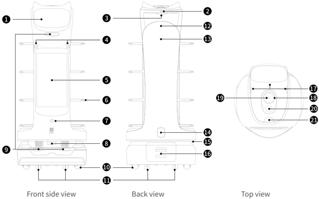
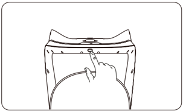

*Page 1 (PDF page 3, left)*

Copyright © 2024 Shenzhen Pudu Technology Co., Ltd. All rights reserved.

No organization or individual shall imitate, copy, transcribe or translate the contents of this user guide, in part or in full, without the express written consent of Shenzhen Pudu Technology Co., Ltd., or distribute this user guide for profit in any way (electronically or via photocopying, recording, etc.). The product specifications and information provided in this user guide are for reference only and are subject to change without further notice. Unless otherwise specified, this user guide is only intended as instructions for use, and no representation shall be deemed as a warranty of any kind.

# 1. Safety instructions

## 1.1 Power usage

- Always use the original rechargeable batteries and chargers. Do not charge your robot using non-original chargers. If the charger is damaged, replace it immediately.
- When the battery drops to 20%, the robot should be charged timely. Running at a low battery for a long time may impair battery life.
- Make sure that the power voltage matches the voltage indicated on the charger, or it may cause damages to the charger.
- When using the charger, ensure that the fastener of the charging interface is fully engaged to avoid overheating during charging, which may cause burns or damage to the equipment.

## 1.2 Robot usage

- Do not cover the robot ' s top camera while it is working to prevent it from moving abnormally. If the camera is covered, pause the current task and move the robot to the correct route before continuing the task.
- Do not clean or maintain the robot when it is powered on and working.
- Do not put open-flame stoves or any flammable and explosive articles on the robot.
- Do not pick or place dishes while the robot is moving to avoid any food loss or personal injury caused by accidental collision.
- Do not move or transport the robot while it is working to prevent it from moving abnormally.
- The robot must not be disassembled or repaired by untrained personnel. In case of malfunction, contact Shenzhen Pudu Technology Co., Ltd. for technical support in time.
- Observe the maximum weight a person is allowed to lift as required by local laws and regulations when transporting the robot. Keep the robot upright during transportation. Never attempt to transport it by lifting the tray or the box.
- Playing with the robot by children is prohibited.
- Do not clean the robot with strong acid or alkaline detergent.

## 1.3 Environment

- Do not use or charge the robot in a high temperature/pressure environment, areas with fire or explosion hazard, or other dangerous scenarios to avoid personal injury or robot damage.
- Do not use the robot in a humid environment or on surfaces covered with fluid or gooey stuff to avoid damage to the robot.
- Do not use the robot in places where the use of wireless devices is explicitly prohibited, otherwise it may cause interference to other electronic devices or lead to other dangers.
- Do not dispose of the robot or its accessories as household waste. Always dispose of the robot and its accessories according to local laws and regulations, and recycle wherever possible.

---

*Page 2 (PDF page 3, right)*

# 2. Product components

## 2.1 Overview

BellaBot Pro is an indoor delivery robot with laser Slam + Vslam, a large advertising screen, and tray visual detection. It also provides excellent human-robot interactions, AI voice, lovely looking, and multimodal interactions. To adapt to different business scenarios, the BellaBot Pro provides a variety of modes, such as Delivery Mode, Cruise Mode, Recycle Mode, Birthday Mode, Guide Mode, and more.

## 2.2 Packing list

Robot×1, BellaBot Pro User Manual×1, Quality Certificate×1, Charger×1, Positioning Sticker×1

## 2.3 Appearance & components

> *Figure description (AI):* The figure shows the locations of all product components with numbered labels. It displays the positions of buttons, ports, sensors, and wheels on the robot's front, back, and top views. Readers can identify each part by matching its number to the corresponding name in the component list. The diagram helps users locate features like the power switch, charging port, and emergency stop button.

*Labels:*

- **1** LCD screen
- **2** Power switch
- **3** Tray detection sensor
- **4** Front view RGB camera
- **5** Advertising screen
- **6** Trays
- **7** Floor projector light
- **8** Lidar
- **9** Depth vision sensors
- **10** Drive wheels
- **11** Auxiliary wheels
- **12** Touch-finished sensor
- **13** Dot matrix screen
- **14** Charging port
- **15** Light strip
- **16** Battery box
- **17** Touch sensor
- **18** 6-mic circular array kit
- **19** Upward facing sensor
- **20** Emergency stop switch
- **21** Lightning button

---

*Page 3 (PDF page 4, left)*

# 2.4 Specifications

| Feature | Description |
|---|---|
| Operating voltage | DC 23–29.4 V |
| Power input | AC 100–240 V, 50/60 Hz |
| Power output | 29.4 V/8 A |
| Battery capacity | 25.6 Ah |
| Charging time | 4.5 h |
| Battery life | 11 h (unloaded) |
| Cruise speed | 0.2–1.2 m/s (adjustable) |
| Navigation | Visual positioning |
| Min. travel width | 65 cm |
| Max. surmountable height | 10 mm |
| Max. climbing angle | 5° |
| Tray dimensions | 410 mm×500 mm |
| No. of trays | Four |
| Height between trays | From top to bottom: 230 /200 /200 /180 |
| Tray load | 10 kg/layer |
| Machine material | ABS/aviation grade aluminum alloy |
| Robot weight | 55 kg |
| Robot dimensions | 570×550×1290 mm |
| Screen size | 10.1-inch LCD screen and 18.5-inch LCD screen (advertising screen) |
| Operation system | Android |
| Microphone | 6-mic circular array kit |
| Speaker power | 2×10 W stereo speakers |
| Working environment | Temperature: 0 to 40 ℃; RH: ≤ 85% |
| Storage environment | Temperature: -20 to 65 ℃; RH: ≤ 85% |
| Working altitude | < 2000 m |
| Surface requirement | Indoor environment, flat and smooth ground |
| IP rating | IP20 |
| Frequency band range | Wi-Fi: 2.4G Wi-Fi: 2412–2472 MHz, 2422–2462 MHz 5.2G Wi-Fi: 5180–5240 MHz, 5190–5230 MHz, 5210 MHz 5.3G Wi-Fi: 5260–5320MHz, 5270–5310 MHz, 5290 MHz 5.6G Wi-Fi: 5500–5700 MHz, 5510–5670 MHz, 5530–5610 MHz 5.8G Wi-Fi: 5745–5825 MHz, 5755–5795 MHz, 5775 MHz |
| Frequency band range | Bluetooth: 2402–2480 MHz |
| Frequency band range | 3G: B1/B8 |
| Frequency band range | 4G LTE-FDD: B1/B3/B7/B8/B20/B28 |
| Frequency band range | 4G LTE-TDD: B34/B38/B40 |
| Max. transmit power | Wi-Fi: 2.4G Wi-Fi: 16.96 dBm; 5.2G Wi-Fi: 13.07 dBm; 5.3G Wi-Fi: 12.66 dBm; 5.6G Wi-Fi: 12.73 dBm; 5.8G Wi-Fi: 12.93 dBm |
| Max. transmit power | Bluetooth: BLE: 6.69 dBm; BR/EDR: 9.83 dBm |
| Max. transmit power | 3G: B1: 23.64 dBm; B8: 21.71 dBm |
| Max. transmit power | 4G LTE-FDD: B1: 23.77 dBm; B3: 23.51 dBm; B7: 23.7 dBm; B8: 23.22 dBm; B20: 22.97 dBm; B28: 23.05 dBm |
| Max. transmit power | 4G LTE-TDD: B34: 23.73 dBm; B38: 23.97 dBm; B40: 23.45 dBm |

---

*Page 4 (PDF page 4, right)*

# 3. How to use

## 3.1 Mapping instructions

BellaBot Pro supports creating new maps on the robot itself. After turning on the robot for the first time, you can create new maps on the robot without a computer. Before creating new maps, choose an appropriate location to put the marker, and the robot will need to be initialized at this location. After this, follow BellaBot Pro Operation Guide to create maps.

## 3.2 Instructions for buttons

## Power-on：

Move the robot to the startup location, and press and hold the power switch for 1 second. The bottom light strip will go on, indicating that the robot is powered on.

> *Figure description (AI):* The image shows a finger pressing the power button on the top surface of the BellaBot Pro robot. This visual demonstrates the physical location of the power switch for turning the device on or off. It illustrates the action required to initiate the startup sequence described in section 3.2.
## Power-off：

Press and hold the power switch for 3 seconds, and a shutdown prompt will pop up. Click "Powered off" and the light strip on the top of the robot and the screen will turn off, indicating that the robot has been successfully powered off.

## Pause：

Tap on the screen to pause the working robot. Tap again to resume operation. You can also press the lightning button to pause the robot.

## Emergency stop：

In case of an emergency, press the emergency stop switch to stop a working robot. Rotate the emergency stop switch clockwise, tap on the screen or press the lightning button to resume operation.

* Refer to BellaBot Pro Operation Guide for more information on how to use the robot.

## 3.3 Task Scenarios

| Mode | Description |
|---|---|
| Delivery mode | The robot delivers food to multiple tables at the same time. After the dishes ordered by different customers are placed on the trays and the table numbers are entered, the robot automatically plans the best routes for delivery. After that, the robot automatically returns to the pick-up position. |
| Cruise mode | The robot circulates along a predetermined path with self-service drinks, desserts, or napkins, and recommends them to customers by voice. |
| Recycle mode | After selecting the recycle mode, the robot can perform the recycle task. After completing the tableware recycle, the robot will return to the designated location. |
| Birthday mode | The robot delivers birthday cakes or gifts to customers, accompanied by customized background music. |
| Guide mode | The robot says hello to customers coming into the store and leads them to their tables. Then, it automatically returns to the greeting location. |

---

*Page 5 (PDF page 5, left)*

# 4. Maintenance and care

## 4.1 Component Maintenance

| Components | Robot Status | Inspection Interval | Maintenance Method |
|---|---|---|---|
| Trays, drive wheels, and auxiliary wheels | Power-off | Weekly | Clean the tangled hair and other stuck stuff. |
| Trays | Power-off | Weekly | Wipe the surface with a clean cloth. |
| Vision sensor, depth vision sensors, and Lidar | Power-off | Weekly | Use a clean cloth or lens cleanser for the cleaning. In case of unexpected contamination, address it immediately to avoid blocking the sensor and prevent the robot from working improperly. |
| Robot body | Power-off | Monthly | Wipe the surface with a clean cloth. |

* Refer to BellaBot Pro Operation Guide for more information on how to maintain and care for the robot.

# 5. After-sales service

Shenzhen Pudu Technology Co., Ltd. provides free warranty service within the effective warranty period (the warranty period may vary for different components). The fees incurred by the after-sales service will be covered by Pudu. Beyond the warranty period or in any circumstances not covered by the free warranty, a certain fee will be charged according to the normal price. Please call the after-sales hotline for detailed after-sales service policy and repair services. The policy can also be found in BellaBot Pro Operation Guide .

Pudu after-sales email: techservice@pudutech.com.

---

*Page 6 (PDF page 5, right)*

# 6. Compliance information

## 6.1 Disposal and recycling information

The Waste Electrical and Electronic Equipment (WEEE) Directive aims to minimize the impact of electrical and electronic goods on the environment, by increasing re-use and recycling and by reducing the amount of WEEE going to landfill. The symbol on this product or its packaging signifies that this product must be disposed separately from ordinary household wastes at its end of life. Be aware that this is your responsibility to dispose of electronic equipment at recycling centers in order to conserve natural resources. Each country should have its collection centers for electrical and electronic equipment recycling. For information about your recycling drop off area, please contact your related electrical and electronic equipment waste management authority, your local city office, or your house hold waste disposal service.

Before placing electrical and electronic equipment (EEE) in the waste collection stream or in waste collection facilities, the end user of equipment containing batteries and/or accumulators must remove those batteries and accumulators for separate collection.

## 6.2 Federal Communications Commission compliance statement

The following information applies to Pudu robotic.

This equipment has been tested and found to comply with the limits for a Class B digital device, pursuant to part 15 of the FCC Rules. These limits are designed to provide reasonable protection against harmful interference in a residential installation. This equipment generates, uses and can radiate radio frequency energy and, if not installed and used in accordance with the instructions, may cause harmful interference to radio communications. However, there is no guarantee that interference will not occur in a particular installation. If this equipment does cause harmful interference to radio or television reception, which can be determined by turning the equipment off and on, the user is encouraged to try to correct the interference by one or more of the following measures:

- Reorient or relocate the receiving antenna.
- Increase the separation between the equipment and receiver.
- Connect the equipment into an outlet on a circuit different from that to which the receiver is connected.
- Consult the dealer or an experienced radio/TV technician for help.

This device complies with Part 15 of the FCC rules. Operation is subject to the following two conditions:

- This device may not cause harmful interference.
- This device must accept any interference received, including interference that may cause undesired operation.

## 6.3 Industry Canada compliance statement

This device complies with Industry Canada licence-exempt RSS standard(s). Operation is subject to the following two conditions:

- This device may not cause interference.
- This device must accept any interference, including interference that may cause undesired operation of the device.
