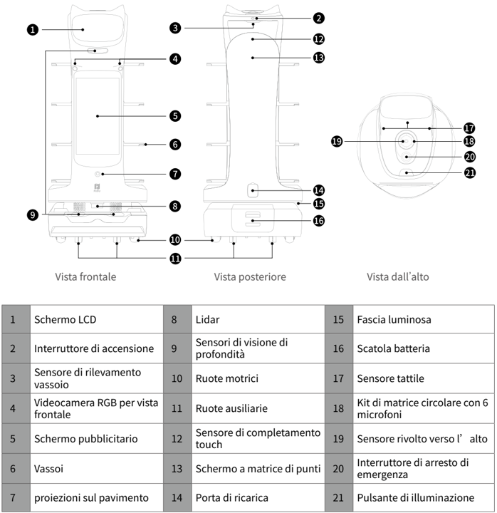
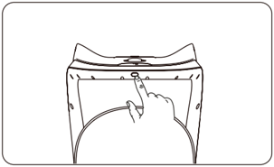

*Pagina 44 (pagina PDF 24, destra)*

Copyright © 2024 Shenzhen Pudu Technology Co., Ltd. Tutti i diritti riservati.

Nessuna organizzazione o individuo può imitare, copiare, trascrivere o tradurre i contenuti di questa guida per l'utente, in parte o per intero, senza il consenso scritto esplicito di Shenzhen Pudu Technology Co., Ltd., o distribuire questa guida per l'utente a scopo di lucro in qualsiasi modo (elettronicamente o tramite fotocopiatura, registrazione, ecc.). Le specifiche del prodotto e le informazioni fornite nella presente guida per l'utente hanno solo scopo di riferimento e sono soggette a variazione senza ulteriore preavviso. Salvo diversa indicazione, questa guida per l'utente è destinata unicamente a fornire istruzioni per l'uso, e nessuna affermazione dovrà essere considerata come una garanzia di qualsiasi tipo.

# 1. Istruzioni per la sicurezza

## 1.1 Istruzioni per l'uso dell'energia elettrica

- Utilizzare sempre batterie ricaricabili e caricatori originali. Non ricaricare il robot utilizzando caricatori non originali. Se il caricatore è danneggiato, sostituirlo immediatamente.
- Quando il livello di carica della batteria scenda al di sotto del 20%, il robot deve essere ricaricato immediatamente. Il funzionamento per lungo tempo con un basso livello di carica della batteria potrebbe compromettere la durata della batteria.
- Accertarsi che la tensione di alimentazione corrisponda a quella indicata sul caricatore: in caso contrario potrebbero verificarsi danni al caricatore.
- Quando si utilizza il caricatore, assicurarsi che il fermo dell'interfaccia di ricarica sia completamente agganciato per evitare il surriscaldamento durante la ricarica, che potrebbe causare ustioni o danni all'apparecchiatura.

## 1.2 Uso del robot

- Non coprire la videocamera superiore del robot mentre è in funzione, per evitare che si muova in modo anomalo. Se la videocamera è coperta, mettere in pausa l'attività corrente e spostare il robot sul percorso corretto prima di riprendere l'attività.
- Non pulire né manutenere il robot mentre è acceso e in funzione.
- Non appoggiare sul robot fornelli a fiamma libera o oggetti
- Non prelevare o appoggiare piatti mentre il robot è in movimento, per evitare perdite di cibo o lesioni personali causate da collisioni accidentali.
- Non spostare o trasportare il robot mentre è in funzione, per evitare che si muova in modo anomalo.
- Il robot non deve essere smontato o riparato da personale non preparato. In caso di malfunzionamento, contattare Shenzhen Pudu Technology Co., Ltd. per avere un immediato supporto tecnico.
- Rispettare il peso massimo che una persona può sollevare come previsto dalle leggi e dalle normative locali durante il trasporto del robot. Durante il trasporto, tenere il robot in posizione eretta. Non tentare mai di trasportare il robot sollevando il vassoio o il contenitore.
- I bambini non devono giocare con il robot.
- Non pulire il robot con detergenti acidi o alcalini forti.

## 1.3 Ambiente

- On utilizzare o ricaricare il robot in un ambiente ad alta temperatura/pressione, in zone a rischio di incendio o esplosione o in altri scenari pericolosi per evitare lesioni personali o danni al robot.
- On utilizzare il robot in un ambiente umido o su superfici ricoperte di liquidi o sostanze appiccicose per evitare danni al robot.
- Non utilizzare il robot in luoghi in cui sia esplicitamente vietato l'uso di dispositivi wireless: potrebbe causare interferenze ad altri dispositivi elettronici o comportare altri pericoli.
- Non smaltire il robot o i suoi accessori come rifiuti domestici. Smaltire sempre il robot e i suoi accessori secondo le leggi e i regolamenti locali, e riciclare ove possibile.

---

*Pagina 45 (pagina PDF 25, sinistra)*

# 2. Componenti del prodotto

## 2.1 Panoramica

BellaBot Pro è un robot per consegne da interni con laser Slam + Vslam, un grande schermo pubblicitario e rilevamento visivo del vassoio. È inoltre caratterizzato da ottime interazioni uomo-robot, voce basata su IA, aspetto gradevole e interazioni multimodali. Per adattarsi a diversi scenari aziendali, BellaBot Pro prevede una varietà di modalità, come la modalità di consegna, la modalità crociera, la modalità di raccolta, la modalità compleanno, la modalità guida e altro ancora.

## 2.2 Contenuto della confezione

Robot×1, Manuale utente BellaBot pro×1, Certificato di qualità×1, Caricatore×1, Adesivo di posizionamento×1

## 2.3 Aspetto e componenti

*Etichette:*

- **1** Schermo LCD
- **2** Interruttore di accensione
- **3** Sensore di rilevamento vassoio
- **4** Videocamera RGB per vista frontale
- **5** Schermo pubblicitario
- **6** Vassoi
- **7** proiezioni sul pavimento
- **8** Lidar
- **9** Sensori di visione di profondità
- **10** Ruote motrici
- **11** Ruote ausiliarie
- **12** Sensore di completamento touch
- **13** Schermo a matrice di punti
- **14** Porta di ricarica
- **15** Fascia luminosa
- **16** Scatola batteria
- **17** Sensore tattile
- **18** Kit di matrice circolare con 6 microfoni
- **19** Sensore rivolto verso l’alto
- **20** Interruttore di arresto di emergenza
- **21** Pulsante di illuminazione

> *Descrizione della figura (IA):* Ogni numero corrisponde a una parte specifica del dispositivo, come lo schermo LCD, le ruote motrici o la porta di ricarica. Le etichette indicano funzioni chiave: sensori di profondità, lidar, microfoni e interruttore di emergenza. La vista dall’alto evidenzia componenti superiori come il sensore rivolto verso l’alto e il kit di microfoni circolari.

---

*Pagina 46 (pagina PDF 25, destra)*

# 2.4 Specifiche

| Funzionalità | Descrizione |
|---|---|
| Tensione di lavoro | 23 - 29,4 VCC |
| Ingresso alimentazione | 100 - 240 VCA, 50/60 Hz |
| Uscita alimentazione | 29,4 V/8 A |
| Capacità della batteria | 25,6 Ah |
| Tempo di carica | 4,5 ore |
| Durata della batteria | 11 ore (senza carico) |
| Velocità di crociera | 0,2–1,2 m/s (regolabile) |
| Metodo di navigazione | Posizionamento visuale |
| Minima larghezza di spostamento | 65 cm |
| Massima altezza superabile | 10 mm |
| Massimo angolo di salita | 5° |
| Dimensioni dei vassoi | 410 mm×500 mm |
| Num. di vassoi | Quattro |
| Altezza fra i vassoi | Dall’alto verso il basso: 230 / /200 / /200 / /180 mm (regolabile) |
| Carico dei vassoi | 10 kg/vassoio |
| Materiale della macchina | ABS/Lega di alluminio di tipo aeronautico |
| Peso del robot | 55 kg |
| Dimensioni del robot | 570 mm×550 mm×1290 mm |
| Sistema operativo | Android |
| Microfono | Kit di matrice circolare 6 microfoni |
| Potenza del diffusore | Due diffusori stereo da 10 W |
| Ambiente di lavoro | Temperatura: da 0 ℃ a 40 ℃; ; Umidità relativa: ≤ 85% |
| Ambiente di conservazione | Temperatura: da -20 ℃ a 65 ℃; ; Umidità relativa: ≤ 85% |
| Altitudine di lavoro | < 2000 m |
| Requisiti di superficie | Ambiente interno, pavimento piano e liscio |
| Grado di protezione IP | IP20 |
| Intervallo bande di frequenza | Wi-Fi: Wi-Fi 2,4G: 2412–2472 MHz, 2422–2462 MHz Wi-Fi 5,2G: 5180–5240 MHz, 5190–5230 MHz, 5210 MHz Wi-Fi 5,3G: 5260–5320MHz, 5270–5310 MHz, 5290 MHz Wi-Fi 5,6G: 5500–5700 MHz, 5510–5670 MHz, 5530–5610 MHz Wi-Fi 5,8G: 5745–5825 MHz, 5755–5795 MHz, 5775 MHz |
| Intervallo bande di frequenza | Bluetooth: 2402–2480 MHz |
| Intervallo bande di frequenza | 3G: B1/B8 |
| Intervallo bande di frequenza | 4G LTE-FDD: B1/B3/B7/B8/B20/B28 |
| Intervallo bande di frequenza | 4G LTE-TDD: B34/B38/B40 |
| Massima potenza in trasmissione | Wi-Fi: Wi-Fi 2,4G: 16,96 dBm; Wi-Fi 5,2G: 13,07 dBm; Wi-Fi 5,3G: 12,66 dBm; Wi-Fi 5,6G: 12,73 dBm; Wi-Fi 5,8G: 12,93 dBm |
| Massima potenza in trasmissione | Bluetooth: BLE: 6,96 dBm; BR/EDR: 9,83 dBm |
| Massima potenza in trasmissione | 3G: B1: 23,64 dBm; B8: 21,71 dBm |
| Massima potenza in trasmissione | 4G LTE-FDD: B1: 23,77 dBm; B3: 23,51 dBm; B7: 23,7 dBm; B8: 23,22 dBm; B20: 22,97 dBm; B28: 23,05 dBm |
| Massima potenza in trasmissione | 4G LTE-TDD: B34: 23,73 dBm; B38: 23,97 dBm; B40: 23,45 dBm |

---

*Pagina 47 (pagina PDF 26, sinistra)*

# 3. Utilizzo

## 3.1 Istruzioni per la mappatura

BellaBot Pro permette la creazione di nuove mappe direttamente sul robot. Dopo aver acceso il robot per la prima volta, è possibile creare nuove mappe sul robot senza computer. Prima di creare nuove mappe, scegliere una posizione appropriata in cui posizionare il marcatore: il robot dovrà essere inizializzato in questa posizione. Dopodiché, seguire la Guida operativa di BellaBot Pro per creare le mappe.

## 3.2 Istruzioni per i pulsanti

## Accensione:

Portare il robot nella posizione di partenza, premere e tenere premuto l'interruttore di accensione per 1 secondo. La striscia luminosa inferiore si accenderà, indicando che il robot è acceso.

> *Descrizione della figura (IA):* Il dito indica il pulsante di accensione/spegnimento situato sulla parte superiore del robot. La posizione mostrata è quella corretta per l'inizializzazione prima della creazione di nuove mappe. Premere e tenere premuto questo interruttore per 1 secondo accende il robot. Tenere premuto lo stesso interruttore per 3 secondi avvia la procedura di spegnimento.
## Spegnimento:

Premere e tenere premuto l'interruttore di accensione per 3 secondi e verrà visualizzata una richiesta di conferma dello spegnimento. Cliccare su "Spegnimento": la striscia luminosa sulla parte superiore del robot e lo schermo si spegneranno, indicando che il robot è stato spento correttamente.

## Pausa:

Toccare lo schermo per mettere in pausa il robot. Toccare di nuovo per riprendere il funzionamento. Per mettere in pausa il robot è anche possibile premere il pulsante dell'illuminazione.

## Arresto di emergenza:

In caso di emergenza, premere l'interruttore di arresto di emergenza per arrestare un robot in funzione. Ruotare l'interruttore di arresto di emergenza in senso orario, toccare lo schermo o premere il pulsante di illuminazione per riprendere il funzionamento.

*Fare riferimento alla Guida operativa di BellaBot Pro per maggiori informazioni su come utilizzare il robot.

# 4. Manutenzione e cura

| Componenti | Stato del robot | Intervallo di ispezione | Metodo di manutenzione |
|---|---|---|---|
| Ruote motrici e ruote ausiliarie | Spegnimento | Ogni settimana | Rimuovere i peli aggrovigliati e altre cose bloccate |
| Vassoi | Spegnimento | Ogni settimana | Pulire la superficie con un panno pulito. |
| Sensore di visione, sensori di visione di profondità e Lidar | Spegnimento | Ogni settimana | Utilizzare un panno pulito o un detergente per lenti per la pulizia. In caso di contaminazione inaspettata, intervenire immediatamente per evitare di bloccare il sensore e impedire che il robot funzioni in modo improprio. |
| Corpo del robot | Spegnimento | Ogni mese | Pulire la superficie con un panno pulito. |

---

*Pagina 48 (pagina PDF 26, destra)*

# 5. Assistenza post-vendita

Shenzhen Pudu Technology Co., Ltd. fornisce un servizio di garanzia gratuito entro il periodo di garanzia efficace (il periodo di garanzia può essere diverso per i componenti diversi). I costi sostenuti per il servizio post-vendita saranno a carico di Pudu. Trascorso il periodo di garanzia o in qualunque circostanza non coperta dalla garanzia gratuita, verrà addebitato un certo costo in base al prezzo normale. Chiamare la hotline post-vendita per informazioni dettagliate sulla politica del servizio post-vendita e sui servizi di riparazione. La politica è anche disponibile nella Guida Operativa di BellaBot. E-mail del servizio post-vendita Pudu: techservice@pudutech.com.

# 6. Informazioni sulla conformità

## 6.1 Informazioni sullo smaltimento e il riciclo

La direttiva sui rifiuti di apparecchiature elettriche ed elettroniche (RAEE) mira a ridurre al minimo l ' impatto dei prodotti elettrici ed elettronici sull ' 'ambiente, aumentando il riutilizzo e il riciclo e riducendo la quantità di RAEE destinati alla discarica. Il simbolo su questo prodotto o sulla sua confezione indica che questo prodotto deve essere smaltito separatamente dai normali rifiuti domestici al termine del suo ciclo di vita. È responsabilità del cliente smaltire le apparecchiature elettroniche presso i centri di riciclo al fine di preservare le risorse naturali. Ogni paese deve avere i propri centri di raccolta per il riciclo delle apparecchiature elettriche ed elettroniche. Per informazioni sull ' area di raccolta per il riciclo, contattare l ' autorità competente per la gestione dei rifiuti di apparecchiature elettriche ed elettroniche, l ' ufficio comunale locale o il servizio di smaltimento dei rifiuti domestici.

Prima di immettere apparecchiature elettriche ed elettroniche (AEE) nel flusso di raccolta dei rifiuti o negli impianti di raccolta dei rifiuti, l ' utente finale di apparecchiature contenenti batterie e/o accumulatori deve rimuovere tali batterie e accumulatori per la raccolta differenziata.
