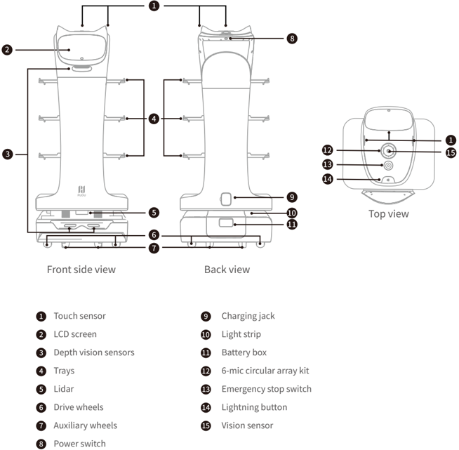
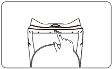
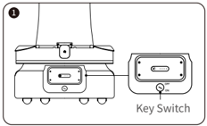
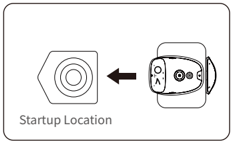
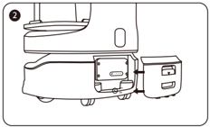
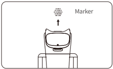

*Page 1 (PDF page 3, left)*

Copyright © 2023 Shenzhen Pudu Technology Co., Ltd. All rights reserved.

This document may not be copied, reproduced, transcribed or translated, in part or in whole, by any persons or organizations, or be transmitted in any form or by any means (electronic, photocopy, recording, etc.) for any commercial purposes without the prior written permission of Shenzhen Pudu Technology Co., Ltd. The product specifications and information mentioned herein are for reference only and are subject to change without prior notice. Unless otherwise specified, the manual is intended as a guide only and all the statements are provided without warranty of any kind.

# 1. Safety instructions

## 1.1 Power usage

- Always use the original rechargeable batteries and chargers. Do not charge your robot using non-original chargers. If the charger is damaged, replace it immediately.
- When the battery drops to 20%, the robot should be charged timely. Running at a low battery for a long time may impair battery life.
- Make sure that the power voltage matches the voltage indicated on the charger, or it may cause damages to the charger.
- When using the charger, ensure that the fastener of the charging interface is fully engaged to avoid overheating during charging, which may cause burns or damage to the equipment.

## 1.2 Robot usage

- Do not cover the robot ' s top camera while it is working to prevent it from moving abnormally. If the camera is covered, pause the current task and move the robot to the correct route before continuing the task.
- Do not clean or maintain the robot when it is powered on and working.
- Do not put open-flame stoves or any flammable and explosive articles on the robot.
- Do not pick or place dishes while the robot is moving to avoid any food loss or personal injury caused by accidental collision.
- Do not move or transport the robot while it is working to prevent it from moving abnormally.
- The robot must not be disassembled or repaired by untrained personnel. In case of malfunction, contact Shenzhen Pudu Technology Co., Ltd. for technical support in time.
- Observe the maximum weight a person is allowed to lift as required by local laws and regulations when transporting the robot. Keep the robot upright during transportation. Never attempt to transport it by lifting the tray or the box.
- Playing with the robot by children is prohibited.

## 1.3 Environment

- Do not use or charge the robot in a high temperature/pressure environment, areas with fire or explosion hazard, or other dangerous scenarios to avoid personal injury or robot damage.
- Do not use the robot in a humid environment or on surfaces covered with fluid or gooey stuff to avoid damage to the robot.
- Do not use the robot in places where the use of wireless devices is explicitly prohibited, otherwise it may cause interference to other electronic devices or lead to other dangers.
- Do not dispose of the robot or its accessories as household waste. Always dispose of the robot and its accessories according to local laws and regulations, and recycle wherever possible.

---

*Page 2 (PDF page 3, right)*

# 2. Product components

## 2.1 Packing list

Robot×1, BellaBot User Manual×1, Quality Certificate×1, Charger×1, Positioning Sticker×1, Power Key×1, Markers×1 .

## 2.2 Overview

BellaBot is an indoor delivery robot that features visual SLAM and laser SLAM positioning and navigation solutions, superior human-robot interaction capabilities, AI voice, cute design, multimodal interaction, and many other functions. It comes with various modes, including Delivery Mode, Cruise Mode, Direct Mode, Birthday Mode, and Escorting Mode, to cater to the needs of different scenarios.

## 2.3 Appearance & components

> *Figure description (AI):* The figure shows labeled components of the BellaBot robot with corresponding numbers pointing to specific parts. Each numbered label corresponds to a component name listed in the legend below the diagram. The top view illustrates the positions of sensors and buttons on the upper surface of the robot. Front side and back views display external features such as trays, wheels, charging jack, and power switch.

*Labels:*

- **1** Touch sensor
- **2** LCD screen
- **3** Depth vision sensors
- **4** Trays
- **5** Lidar
- **6** Drive wheels
- **7** Auxiliary wheels
- **8** Power switch
- **9** Charging jack
- **10** Light strip
- **11** Battery box
- **12** 6-mic circular array kit
- **13** Emergency stop switch
- **14** Lightning button
- **15** Vision sensor

---

*Page 3 (PDF page 4, left)*

## 2.4 Specifications

| Feature | Description |
|---|---|
| Operating voltage | DC 23–29.4 V |
| Power input | AC 100–240 V, 50/60 Hz |
| Power output | 29.4 V/8 A |
| Battery capacity | 25.6 Ah |
| Charging time | 4.5 h |
| Battery life | 12–24 h |
| Cruise speed | 0.2–1.2 m/s (adjustable) |
| Navigation | Laser and visual integrated SLAM positioning |
| Min. travel width | 70 cm |
| Max. surmountable height | 10 mm |
| Max. climbing angle | 5º |
| Tray dimensions | 410 mm×500 mm |
| No. of trays | Four |
| Height between trays | From top to bottom: 230 mm/200 mm/200 mm/180mm |
| Tray load | 10 kg/layer |
| Machine material | ABS/aviation grade aluminum alloy |
| Robot weight | 55 kg |
| Robot dimensions | 565 mm×537 mm×1290 mm |
| Screen size | 10.1-inch LCD screen |
| Operation system | Android |
| Microphone | 6-mic circular array kit |
| Speaker power | 2×10 W stereo speakers |
| Working environment | Temperature: 0 ℃ to 40 ℃ ; RH: ≤ 85 % |
| Storage environment | Temperature: -40 ℃ to 65 ℃ ; RH: ≤ 85 % |
| Working altitude | < 2000 m |
| Surface requirement | Indoor environment, flat and smooth ground |
| IP rating | IP20 |
| Frequency band range | Wi-Fi: 2.4G Wi-Fi: 2412–2472 MHz, 2422–2462 MHz 5.2G Wi-Fi: 5180–5240 MHz, 5190–5230 MHz, 5210 MHz 5.3G Wi-Fi: 5260–5320MHz, 5270–5310 MHz, 5290 MHz 5.6G Wi-Fi: 5500–5700 MHz, 5510–5670 MHz, 5530–5610 MHz 5.8G Wi-Fi: 5745–5825 MHz, 5755–5795 MHz, 5775 MHz |
| Frequency band range | Bluetooth: 2402–2480 MHz |
| Frequency band range | 3G: B1/B8 |
| Frequency band range | 4G LTE-FDD: B1/B3/B7/B8/B20/B28 |
| Frequency band range | 4G LTE-TDD: B34/B38/B40 |
| Max. transmit power | Wi-Fi: 2.4G Wi-Fi: 16.96 dBm; 5.2G Wi-Fi: 13.07 dBm; 5.3G Wi-Fi: 12.66 dBm; 5.6G Wi-Fi: 12.73 dBm; 5.8G Wi-Fi: 12.93 dBm |
| Max. transmit power | Bluetooth: BLE: 6.69 dBm; BR/EDR: 9.83 dBm |
| Max. transmit power | 3G: B1: 23.64 dBm; B8: 21.71 dBm |
| Max. transmit power | 4G LTE-FDD: B1: 23.77 dBm; B3: 23.51 dBm; B7: 23.7 dBm; B8: 23.22 dBm; B20: 22.97 dBm; B28: 23.05 dBm |
| Max. transmit power | 4G LTE-TDD: B34: 23.73 dBm; B38: 23.97 dBm; B40: 23.45 dBm |

---

*Page 4 (PDF page 4, right)*

# 3. How to use

> *Figure description (AI):* The figure shows a hand pressing the power switch on the robot. This visual demonstrates the action required to turn the robot on.
## Caution：

Be sure to turn the key switch to "ON" and push back the battery back cover before powering on the robot.

> *Figure description (AI):* The figure shows the location of the Key Switch on the robot's base. The Key Switch has two positions labeled 'OFF' and 'ON'. The diagram illustrates how to access the Key Switch by removing the battery back cover. The figure helps users identify where to turn the key switch before powering on the robot.

The startup location for using the laser SLAM navigation (make sure that the robot has the correct position and direction at the startup location):

> *Figure description (AI):* The figure shows the correct startup location for using laser SLAM navigation. An arrow points from the robot to the designated startup position on the floor. The startup location is marked with a circular pattern on the ground. The robot must be positioned at this spot before powering on for laser SLAM operation.

> *Figure description (AI):* The figure shows the location of the key switch on the robot. It indicates where to place the robot for laser SLAM navigation startup. It marks the position for visual SLAM navigation startup (below the marker). The image displays the physical layout of the robot's base and side panel with ports/switches.
The startup location for using the visual SLAM navigation (right below the marker):

> *Figure description (AI):* The arrow points to a marker. The marker is used for visual SLAM navigation.

## Power-off：

Press and hold the power switch for 3 seconds. The bottom light strip and screen will go off, indicating that the robot is powered off.

## Pause：

Tap on the screen to pause the working robot. Tap again to resume operation. You can also press the lightning button to pause the robot.

## Emergency stop：

In case of an emergency, press the emergency stop switch to stop a working robot. Rotate the emergency stop switch clockwise, tap on the screen or press the lightning button to resume operation.

* Refer to BellaBot Operation Guide for more information on how to use the robot.

## Power-on：

Move the robot to the startup location, and press and hold the power switch for 1 second. The bottom light strip will go on, indicating that the robot is powered on.

---

*Page 5 (PDF page 5, left)*

# 4. Troubleshooting

## 4.1 Troubles during Operation

## Troubles

The following errors may be reported during the robot operation:

- Motor parameters error
- Sensor parameters error
- Sensor connection error
- Motor rotation anomaly

## Solution

The following errors may be reported during the robot operation:

- **Step 1** Following the prompts on the screen, tap OK or Continue operation to see if the robot can continue operation.
- **Step 2** If not, reboot the robot and re-enter the task.
- **Step 3** If the problem persists after the reboot, please contact our technical engineers.

## 4.2 Positioning Failure

## Troubles

The robot screen prompts I'm lost. Please push me under the positioning mark or Location failed, please click retry button. Possible Causes:

- The robot is not powered on at the startup location.
- The map selected on the robot does not match the actual site.
- There is too much change at the startup location that fails the positioning.
- There is too much change on the site.

## Solution

- If visual navigation is used, please perform the following steps:
    - **Step 1** If the current map of the robot does not match the actual site, tap Map selection to select the correct map of the current site.
    - **Step 2** Check if the robot is right below the marker. If the robot deviates too far from the marker, move the robot right below the marker. If the problem persists, please reboot the robot and try again.
    - **Step 3** Check if the vision sensor is blocked by obstacles such as oil stains. If so, clean it with a lens cleaning kit.
    - **Step 4** Check if the fill light of the vision sensor is red. If not, please contact technical engineers in time.

## 4.3 Charging Failure

## Troubles

Charging failure

## Solution

- Open the rear cover of the battery box and check if the battery is installed properly.
- Open the rear cover of the battery box and check if the key switch is turned to ON.
- Check if the rear cover of the battery box is installed properly.
- Check if the charger indicator is on. If not, the charging failure may be caused by a damaged charger. Please contact our technical engineers in time.

## 4.4 Power-on Failure

## Troubles

Power-on failure

---

*Page 6 (PDF page 5, right)*

### Solution

- If the battery is low, please charge the robot. To check the battery level, proceed as follows:

1. Open the rear cover of the battery box.

2. Press the button on the battery to check the battery level.

| Battery level | Color of battery indicator |
|---|---|
| 0%~10% | 🔴 ⚪ ⚪ ⚪ |
| 10%~25% | 🔵 ⚪ ⚪ ⚪ |
| 25%~50% | 🔵 🔵 ⚪ ⚪ |
| 50%~75% | 🔵 🔵 🔵 ⚪ |
| 75%~90% | 🔵 🔵 🔵 🔵 |
| 90%~100% | 🟢 🟢 🟢 🟢 |

3. Check if the vision sensor is blocked by obstacles such as oil stains. If so, clean it with a lens cleaning kit.

- If the battery level is normal, proceed as follows:

1. Open the rear cover of the battery box and check if the battery is installed properly.

2. Check if the key switch is turned to ON.

3. Check if the rear cover of the battery box is installed properly.

- If the problem persists, please contact our technical engineers.

## 4.5 ray Detection Anomaly

### Troubles

When the tray sensor switch is turned on, the robot does not automatically complete the task 5 seconds after the dishes are taken, or it automatically completes the task before the dishes are taken.

### Solution

- Check if the trays are installed correctly.

- Clean the tray sensor with a clean cloth or lens cleanser. (Line drawings to be provided)

## 4.6 Robot Does Not Move Smoothly

### Troubles

The robot does not move smoothly or stops moving.

### Solution

- Check if there are obstacles in front of the robot.

- Check if there are stains like oil or soup on the depth vision sensors.

- Check if the passageway is wider than the minimum travel width.

- Check if there are mirrored and reflective metal surfaces on either side of the passageway that may affect the robot's operation. If so, attach matte stickers 16 cm–20 cm above the ground.

---

*Page 7 (PDF page 6, left)*

# 5. Maintenance and care

## 5.1 Component Maintenance

| Components | Robot Status | Inspection Interval | Maintenance Method |
|---|---|---|---|
| Trays, driving wheels, and auxiliary wheels | Power-off | Weekly | Wipe the surface with a clean cloth |
| Vision sensor, depth vision sensors, and Lidar | Power-off | Weekly | Use a clean cloth or lens cleanser for the cleaning. |
| Robot body | Power-off | Monthly | Wipe the surface with a clean cloth. |

## 5.2 Cleaning Method

Warning：Do not use water or any other liquid to clean the robot. Always make sure that the robot is kept dry.

- **Step 1** Press and hold the power switch for 3 seconds to ensure that the robot is powered off.
- **Step 2** Open the rear cover of the battery box, turn the key switch to OFF, and make sure that the robot is powered off.
- **Step 3** Wipe the robot surface with a clean cloth.
- **Step 4** Wipe the trays, drive wheels, and auxiliary wheels with a clean cloth.

(* If the drive wheels or auxiliary wheels are entangled or stuck with debris, please place the robot down on its side for cleaning. Keep the ground clean and tidy (a mat can be used) to avoid scratches on the robot surface when placing the robot down on its side.

If there are oil stains on the tray pad, take it out and wash it separately. Put back the tray pad after it dries off completely.)

- **Step 5** Clean the vision sensor, depth vision sensors, and Lidar with a clean cloth or specialized lens cleanser.

( * In case of unexpected contamination, address it immediately to avoid blocking the sensor and preventing the robot from working improperly.)

## 5.1 Battery Replacement

- **Step 1** Open the rear cover of the battery box and turn the key switch to OFF.
- **Step 2** Lift the battery handle to the horizontal position.
- **Step 3** Extract the battery pack using both hands.
- **Step 4** Insert the new battery pack using both hands.
- **Step 5** Press the battery handle back to the vertical position.
- **Step 6** Turn the key switch to ON.
- **Step 7** Close the rear cover of the battery box. The robot is thereby ready to use.

# 6. After-sales service

Shenzhen Pudu Technology Co., Ltd. provides free warranty service within the effective warranty period (the warranty period may vary for different components). The fees incurred by the after-sales service will be covered by Pudu. Beyond the warranty period or in any circumstances not covered by the free warranty, a certain fee will be charged according to the normal price. Please call the after-sales hotline for detailed after-sales service policy and repair services. The policy can also be found in BellaBot Operation Guide .

Pudu after-sales email: techservice@pudutech.com.

* Refer toBellaBot Operation Guide for more information on how to maintain and care for the robot.

---

*Page 8 (PDF page 6, right)*

# 7. Compliance information

## 7.1 Disposal and recycling information

The Waste Electrical and Electronic Equipment (WEEE) Directive aims to minimize the impact of electrical and electronic goods on the environment, by increasing re-use and recycling and by reducing the amount of WEEE going to landfill. The symbol on this product or its packaging signifies that this product must be disposed separately from ordinary household wastes at its end of life. Be aware that this is your responsibility to dispose of electronic equipment at recycling centers in order to conserve natural resources. Each country should have its collection centers for electrical and electronic equipment recycling. For information about your recycling drop off area, please contact your related electrical and electronic equipment waste management authority, your local city office, or your house hold waste disposal service.

Before placing electrical and electronic equipment (EEE) in the waste collection stream or in waste collection facilities, the end user of equipment containing batteries and/or accumulators must remove those batteries and accumulators for separate collection.

## 7.2 Federal Communications Commission compliance statement

The following information applies to Pudu robotic.

This equipment has been tested and found to comply with the limits for a Class B digital device, pursuant to part 15 of the FCC Rules. These limits are designed to provide reasonable protection against harmful interference in a residential installation. This equipment generates, uses and can radiate radio frequency energy and, if not installed and used in accordance with the instructions, may cause harmful interference to radio communications. However, there is no guarantee that interference will not occur in a particular installation. If this equipment does cause harmful interference to radio or television reception, which can be determined by turning the equipment off and on, the user is encouraged to try to correct the interference by one or more of the following measures:

- Reorient or relocate the receiving antenna.
- Increase the separation between the equipment and receiver.
- Connect the equipment into an outlet on a circuit different from that to which the receiver is connected.
- Consult the dealer or an experienced radio/TV technician for help.

This device complies with Part 15 of the FCC rules. Operation is subject to the following two conditions:

- This device may not cause harmful interference.
- This device must accept any interference received, including interference that may cause undesired operation.

## 7.3 Industry Canada compliance statement

This device complies with Industry Canada licence-exempt RSS standard(s). Operation is subject to the following two conditions:

- This device may not cause interference.
- This device must accept any interference, including interference that may cause undesired operation of the device.
