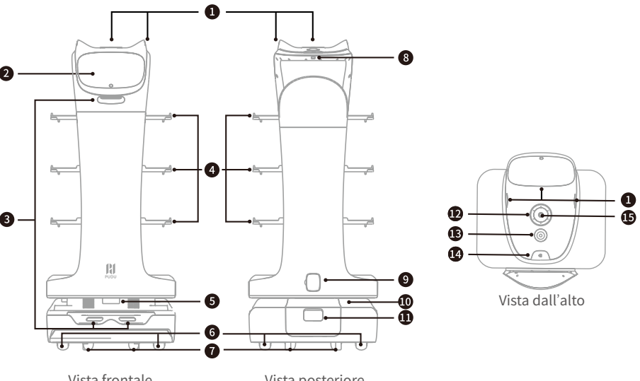
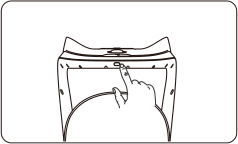
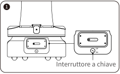
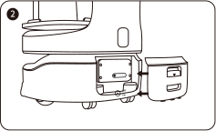
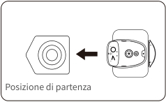
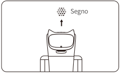

*Pagina 46 (pagina PDF 25, destra)*

Copyright © 2023 Shenzhen Pudu Technology Co., Ltd. Tutti i diritti riservati.

Il presente documento non può essere copiato, riprodotto, trascritto o tradotto, in parte o complessivamente, da qualun - que persona o organizzazione, né essere trasmesso in alcuna forma o con qualunque mezzo (elettronica, fotocopiatura, registrazione, ecc.) per qualunque scopo commerciale senza il preventivo permesso scritto di Shenzhen Pudu Technology Co., Ltd. Le specifiche di prodotto e le informazioni qui riportate sono da intendersi solo come riferimento e possono essere modificate senza preavviso. Tranne che se diversamente specificato, il manuale è inteso solo come guida e tutte le dichiarazioni sono fornite senza garanzie di alcun tipo.

# 1. Istruzioni per la sicurezza

## 1.1 Uso dell'alimentazione elettrica

- Utilizzare sempre batterie ricaricabili e caricatori originali. Non ricaricare il robot utilizzando caricatori non originali. Se il caricatore è danneggiato, sostituirlo immediatamente.
- Quando il livello di carica della batteria scenda al di sotto del 20%, il robot deve essere ricaricato in tempo. Il funzionamento per lungo tempo con un basso livello di carica della batteria potrebbe compromettere la durata della batteria.
- Accertarsi che la tensione di alimentazione corrisponda a quella indicata sul caricatore: in caso contrario potrebbero verificarsi danni al caricatore.
- Quando si utilizza il caricatore, assicurarsi che il fermo dell'interfaccia di ricarica sia completamente agganciato per evitare il surriscaldamento durante la ricarica, che potrebbe causare ustioni o danni all'apparecchiatura.

## 1.2 Uso del robot

- Non coprire la videocamera superiore del robot mentre è in funzione, per evitare che si muova in modo anomalo. Se la videocamera è coperta, mettere in pausa l ' attività corrente e spostare il robot sul percorso corretto prima di proseguire l ' attività.
- Non pulire né manutenere il robot mentre è acceso e in movimento.
- Non appoggiare fornelli a fiamma libera o articoli infiammabili o esplosivi sul robot.
- Non prelevare o appoggiare piatti mentre il robot è in movimento per evitare perdite di cibo o lesioni personali causate da collisioni accidentali.
- Non spostare o trasportare il robot mentre è in funzione, per evitare che si muova in modo anomalo.
- Il robot non deve essere smontato o riparato da personale non preparato. In caso di malfunzionamento, contattare immediatamente Shenzhen Pudu Technology Co., Ltd. per avere assistenza tecnica.
- Rispettare il peso massimo che una persona può sollevare come richiesto dalle leggi e dalle normative locali durante il trasporto del robot. Durante il trasporto, tenere il robot in posizione eretta. Non tentare mai di trasportare il robot sollevando il vassoio o il contenitore.

## 1.3 Ambiente

- Non utilizzare o ricaricare il robot in un ambiente ad alta temperatura/pressione, in zone a rischio di incendio o esplosione o in altri ambienti pericolosi, per evitare lesioni personali o danni al robot.
- Non utilizzare il robot in un ambiente umido o su superfici ricoperte di liquidi o sostanze appiccicose per evitare danni al robot.
- Non utilizzare il robot in luoghi in cui è esplicitamente vietato l ' uso di dispositivi wireless: potrebbe causare interferenze ad altri dispositivi elettronici o comportare altri pericoli.
- Non smaltire il robot o i suoi accessori come rifiuti domestici. Smaltire sempre il robot e i suoi accessori secondo le leggi e le normative locali e riciclarli ove possibile.

---

*Pagina 47 (pagina PDF 26, sinistra)*

# 2. Componenti del prodotto

## 2.1 Elenco del contenuto

Robot×1, BellaBot Manuale dell’utente×1, Certificato di qualità×1, Caricatore×1, Adesivo di posizionamento×1, Chiavetta di accensione×1, Segni ×1.

## 2.2 Panoramica

BellaBot è un robot per consegne per interni che presenta soluzioni SLAM visuale e SLAM laser per il posizionamento e la navigazione, capacità di interazione uomo-robot superiori, voce basata su IA, design accattivante, interazione multimodale e molte altre funzioni. Il robot è dotato di varie modalità, tra cui la modalità Consegna, la modalità Crociera, la modalità Diretta, la modalità Compleanno e la modalità Accompagnamento, per soddisfare le esigenze di diversi scenari.

## 2.3 Aspetto e componenti

> *Descrizione della figura (IA):* La figura mostra le posizioni dei componenti del robot BellaBot con etichette numerate. I numeri indicano parti specifiche come sensori, schermi, ruote e pulsanti. Le viste frontale, posteriore e dall'alto aiutano a identificare la posizione di ogni componente. L'utente può usare questa figura per trovare rapidamente i componenti durante l'uso o la manutenzione.

*Etichette:*

- **1** Sensore tattile
- **2** Schermo LCD
- **3** Sensori di visione di profondità
- **4** Vassoi
- **5** Lidar
- **6** Ruote motrici
- **7** Ruote ausiliarie
- **8** Interruttore di accensione
- **9** Spinotto di ricarica
- **10** Striscia luminosa
- **11** Vano batteria
- **12** Kit di matrice circolare 6 microfoni
- **13** Interruttore arresto di emergenza
- **14** Pulsante illuminazione
- **15** Sensore di visione

---

*Pagina 48 (pagina PDF 26, destra)*

# 2.4 Specifiche

| Funzionalità | Descrizione |
|---|---|
| Tensione di lavoro | CC 23–29,4 V |
| Ingresso alimentazione | CA 100–240 V, 50/60 Hz |
| Uscita alimentazione | 29,4 V/8 A |
| Capacità della batteria | 25,6 Ah |
| Tempo di carica | 4,5 ore |
| Durata della batteria | 12–24 ore |
| Velocità di crociera | 0,2–1,2 m/s (regolabile) |
| Navigazione | Posizionamento SLAM integrato laser e visivo |
| Minima larghezza di spostamento | 70 cm |
| Massima altezza superabile | 10 mm |
| Massimo angolo di salita | 5° |
| Dimensioni dei vassoi | 410 mm×500 mm |
| Num. di vassoi | Quattro |
| Altezza fra i vassoi | Dall’alto verso il basso: 230 mm/200 mm/200 mm/180 mm |
| Carico dei vassoi | 10 kg per vassoio |
| Materiale della macchina | ABS/Lega di alluminio di tipo aeronautico |
| Peso del robot | 55 kg |
| Dimensioni del robot | 565 mm×537 mm×1290 mm |
| Sistema operativo | Android |
| Microfono | Kit di matrice circolare 6 microfoni |
| Potenza del diffusore | Due diffusori stereo da 10 W |
| Ambiente di lavoro | Temperatura: da 0 ℃ a 40 ℃; ; Umidità relativa: ≤ 85% |
| Ambiente di conservazione | Temperatura: da -40 ℃ a 65 ℃; ; Umidità relativa: ≤ 85% |
| Altitudine di lavoro | < 2000 m |
| Requisiti di superficie | Ambiente interno, pavimento piano e liscio |
| Valutazione IP | IP20 |
| Banda di frequenza | Wi-Fi |
| Banda di frequenza | Wi-Fi 2,4G: 2412–2472 MHz, 2422–2462 MHz |
| Banda di frequenza | Wi-Fi 5,2G: 5180–5240 MHz, 5190–5230 MHz, 5210 MHz |
| Banda di frequenza | Wi-Fi 5,3G: 5260–5320MHz, 5270–5310 MHz, 5290 MHz |
| Banda di frequenza | Wi-Fi 5,6G: 5500–5700 MHz, 5510–5670 MHz, 5530–5610 MHz |
| Banda di frequenza | Wi-Fi 5,8G: 5745–5825 MHz, 5755–5795 MHz, 5775 MHz |
| Banda di frequenza | Bluetooth |
| Banda di frequenza | 2402–2480 MHz |
| Banda di frequenza | 3G |
| Banda di frequenza | B1/B8 |
| Banda di frequenza | 4G LTE-FDD |
| Banda di frequenza | B1/B3/B7/B8/B20/B28 |
| Banda di frequenza | 4G LTE-TDD |
| Banda di frequenza | B34/B38/B40 |
| Massima potenza in trasmissione | Wi-Fi |
| Massima potenza in trasmissione | Wi-Fi 2,4G: 16,96 dBm; Wi-Fi 5,2G: 13,07 dBm; |
| Massima potenza in trasmissione | Wi-Fi 5,3G: 12,66 dBm; Wi-Fi 5,6G: 12,73 dBm; |
| Massima potenza in trasmissione | Wi-Fi 5,8G: 12,93 dBm |
| Massima potenza in trasmissione | Bluetooth |
| Massima potenza in trasmissione | BLE: 6,96 dBm; BR/EDR: 9,83 dBm |
| Massima potenza in trasmissione | 3G |
| Massima potenza in trasmissione | B1: 23,64 dBm; B8: 21,71 dBm |
| Massima potenza in trasmissione | 4G LTE-FDD |
| Massima potenza in trasmissione | B1: 23,77 dBm; B3: 23,51 dBm; B7: 23,7 dBm; |
| Massima potenza in trasmissione | B8: 23,22 dBm; B20: 22,97 dBm; B28: 23,05 dBm |
| Massima potenza in trasmissione | 4G LTE-TDD |
| Massima potenza in trasmissione | B34: 23,73 dBm; B38: 23,97 dBm; B40: 23,45 dBm |

---

*Pagina 49 (pagina PDF 27, sinistra)*

# 3. Modalità d’uso

> *Descrizione della figura (IA):* La figura mostra la posizione corretta del robot per l'avvio della navigazione SLAM visiva. Il dito indica il punto esatto su cui posizionare il robot rispetto al segno di riferimento. L'immagine illustra come allineare il dispositivo prima di accenderlo per l'utilizzo della navigazione SLAM visiva. La posizione mostrata corrisponde a quella specificata nel testo come 'esattamente sotto il segno'.
### Accensione:

Portare il robot nella posizione di partenza e tenere premuto l’interruttore di accensione per 1 secondo. La striscia luminosa inferiore si accenderà, indicando che il robot è acceso.

### Attenzione：

Accertarsi di portare l’interruttore a chiave su "ON" e di spingere indietro il coperchio posteriore della batteria prima di accendere il robot.

> *Descrizione della figura (IA):* L'immagine mostra la posizione dell'interruttore a chiave sul lato del robot. La freccia indica che l'interruttore deve essere impostato su 'ON' per accendere il dispositivo. Il numero 1 identifica l'interruttore a chiave come elemento da controllare prima dell'accensione. L'etichetta 'Interruttore a chiave' conferma la funzione del componente mostrato.

> *Descrizione della figura (IA):* La figura mostra come aprire il coperchio posteriore per accedere alla batteria. È visibile l'interruttore a chiave con le posizioni ON e OFF.
La posizione di partenza per l’utilizzo della navigazione SLAM laser (accertarsi che il robot sia nella posizione e nella direzione corrette alla posizione di partenza):

> *Descrizione della figura (IA):* La freccia indica la direzione corretta per posizionare il robot nella posizione di partenza. Il simbolo a sinistra rappresenta la vista superiore del robot orientato correttamente. Il simbolo a destra mostra l'interruttore a chiave impostato su 'ON' e il coperchio posteriore della batteria spinto indietro. La didascalia 'Posizione di partenza' identifica questa configurazione come punto iniziale per l'accensione.

La posizione di partenza per l’utilizzo della navigazione SLAM visiva (esattamente sotto il segno):

> *Descrizione della figura (IA):* Il segno indicato nella figura deve essere posizionato esattamente sotto il robot per l'utilizzo della navigazione SLAM visiva. La freccia indica la direzione corretta in cui il robot deve essere orientato rispetto al segno. La posizione di partenza per la navigazione SLAM visiva è definita come 'esattamente sotto il segno'. Il testo 'Segno' identifica l'elemento grafico che funge da punto di riferimento per il posizionamento iniziale del robot.

### Spegnimento:

Premere e tenere premuto l’interruttore di accensione per 3 secondi. La striscia luminosa inferiore e lo schermo si spegneranno, indicando che il robot è spento.

### Pausa:

Toccare lo schermo per mettere in pausa il robot. Toccare di nuovo per riprendere il funzionamento. Per mettere in pausa il robot è anche possibile premere il pulsante dell’illuminazione.

### Arresto di emergenza:

In caso di emergenza, premere l’interruttore arresto di emergenza per arrestare un robot in funzione. Ruotare l’interruttore arresto di emergenza in senso orario, toccare lo schermo o premere il pulsante di illuminazione per riprendere il funzionamento.

* Fare riferimento alla Guida operativa di BellaBot per maggiori informazioni su come utilizzare il robot.

---

*Pagina 50 (pagina PDF 27, destra)*

# 4. Manutenzione e cura

| Componenti | Stato del robot | Intervallo di ispezione | Metodo di manutenzione |
|---|---|---|---|
| Vassoi, ruote motrici e ruote ausiliarie | Spegnimento | Settimanalmente | Pulire la superficie con un panno pulito. |
| Sensore di visione, sensori di visione di profondità e Lidar | Spegnimento | Settimanalmente | Utilizzare un panno pulito o un detergente per lenti per la pulizia. In caso di contaminazione inaspettata, intervenire immediatamente per evitare di bloccare il sensore e impedire che il robot funzioni in modo improprio. |
| Corpo del robot | Spegnimento | Mensilmente | Pulire la superficie con un panno pulito. |

# 5. Assistenza post-vendita

Shenzhen Pudu Technology Co., Ltd. fornisce un servizio di garanzia gratuito entro il periodo di garanzia efficace (il periodo di garanzia può essere diverso per i componenti diversi). I costi sostenuti per il servizio post-vendita saranno a carico di Pudu. Trascorso il periodo di garanzia o in qualunque circostanza non coperta dalla garanzia gratuita, verrà addebitato un certo costo in base al prezzo normale. Chiamare la hotline post-vendita per informazioni dettagliate sulla politica del servizio post-vendita e sui servizi di riparazione. La politica è anche disponibile nella Guida Operativa di BellaBot. E-mail post-vendita Pudu: techservice@pudutech.com.

# 6. Informazioni sulla conformità

## 6.1 Informazioni sullo smaltimento e il riciclo

La direttiva sui rifiuti di apparecchiature elettriche ed elettroniche (RAEE) mira a ridurre al minimo l ' impatto dei prodotti elettrici ed elettronici sull ' 'ambiente, aumentando il riutilizzo e il riciclo e riducendo la quantità di RAEE destinati alla discarica. Il simbolo su questo prodotto o sulla sua confezione indica che questo prodotto deve essere smaltito separatamente dai normali rifiuti domestici al termine del suo ciclo di vita. È responsabilità del cliente smaltire le apparecchiature elettroniche presso i centri di riciclo al fine di preservare le risorse naturali. Ogni paese deve avere i propri centri di raccolta per il riciclo delle apparecchiature elettriche ed elettroniche. Per informazioni sull ' area di raccolta per il riciclo, contattare l ' autorità competente per la gestione dei rifiuti di apparecchiature elettriche ed elettroniche, l ' ufficio comunale locale o il servizio di smaltimento dei rifiuti domestici.

Prima di immettere apparecchiature elettriche ed elettroniche (AEE) nel flusso di raccolta dei rifiuti o negli impianti di raccolta dei rifiuti, l ' utente finale di apparecchiature contenenti batterie e/o accumulatori deve rimuovere tali batterie e accumulatori per la raccolta differenziata.

* Fare riferimento alla Guida operativa di BellaBot per maggiori informazioni su come manutenere e avere cura del robot.
