*Seite 36 (PDF-Seite 20, rechts)*

## Copyright © 2025 Shenzhen Pudu Technology Co., Ltd. Alle Rechte vorbehalten.

Keine Organisation oder Einzelperson darf den Inhalt dieses Benutzerhandbuchs teilweise oder vollständig ohne die ausdrückliche schriftliche Zustimmung von Shenzhen Pudu Technology Co., Ltd. kopieren, transkribieren oder übersetzen oder dieses Benutzerhandbuch zu kommerziellen Zwecken auf beliebige Weise verteilen (elektronisch oder durch Fotokopieren, Aufzeichnen usw.). Die in diesem Benutzerhandbuch bereitgestellten technischen Daten und Angaben zum Produkt dienen nur als Referenz und können ohne vorherige Ankündigung geändert werden. Falls nicht anders angegeben, ist dieses Benutzerhandbuch nur als Orientierungshilfe gedacht und die darin enthaltenen Darstellungen sind nicht als Gewährleistung irgendwelcher Art aufzufassen.

---

*Seite 37 (PDF-Seite 21, links)*

# 1. Sicherheitsanweisungen

## 1.1 Elektrizität

- Laden Sie den Roboter mit dem mitgelieferten Ladegerät auf. Verwenden Sie keine anderen Ladegeräte. Tauschen Sie das Ladegerät bei Beschädigung sofort aus.
- Laden Sie den Akku vor dem ersten Gebrauch auf 100 % auf.
- Wenn der Akkustand unter 20 % liegt, laden Sie den Roboter rechtzeitig auf. Lassen Sie den Roboter nicht über einen längeren Zeitraum mit einem niedrigen Akkustand laufen. Dies kann die Lebensdauer des Akkus verkürzen.
- Stellen Sie sicher, dass die Stromversorgung mit dem Spannungsbereich des Ladegeräts übereinstimmt. Andernfalls kann das Ladegerät beschädigt werden.

## 1.2 Gebrauchshinweise

- Die Sensoren des Roboters darf nicht abgedeckt werden. Der Roboter kann sich sonst nicht korrekt bewegen oder verliert die Orientierung.
- Reinigen oder warten Sie den Roboter nicht, wenn die Spannung eingeschaltet ist.
- Stellen Sie keine Kochgeräte mit offenen Flammen oder brennbare oder explosive Gegenstände auf den Roboter.
- Legen Sie keine Gegenstände auf den Roboter oder entfernen Sie keine Gegenstände vom Roboter, wenn er sich bewegt. Andernfalls kann es durch eine unerwartete Kollision zu Sachschäden und Personenschäden kommen.
- Den Roboter nicht ziehen oder schieben, während er sich bewegt. Der Roboter kann sich sonst nicht korrekt bewegen.
- Nur professionell ausgebildete Techniker dürfen den Roboter demontieren und warten. Wenn am Roboter Fehler auftreten, wenden Sie sich umgehend an die technischen Support-Techniker von Pudu.
- Entfernen Sie sämtliche Kabel auf dem Boden, um zu verhindern, dass der Roboter sich einfädelt. Entfernen Sie alle scharfkantigen Objekte (wie Dekorationsabfälle, Glas und Nägel) vom Boden, damit das Roboterchassis nicht beschädigt wird.
- Aus Sicherheitsgründen wird es empfohlen, die Geschwindigkeit des Roboters auf bis 0,8 m/s einzustellen. Spielen Sie nicht vor dem Roboter. Andernfalls kann es zu unerwarteten Schäden kommen. Der Roboter verfügt zwar über eine automatische Hinderniserkennung, es kann jedoch tote Winkel geben. Deshalb kann es zu Unfällen kommen, wenn der Roboter sich mit hoher Geschwindigkeit bewegt und abrupt blockiert wird.
- Der Roboter darf nicht überlastet werden. Stellen Sie keine brennbaren Festkörper, Gase oder Flüssigkeiten auf das Tablett. Heiß erhitzte Gegenstände oder Suppen sind nicht zu liefern. Andernfalls kann der Roboter beschädigt werden und die vorbeigehende Personen können verletzt werden. Unverpackte Flüssigkeiten sind nicht zu liefern, wie etwa Getränke.
- Ziehen oder schieben Sie den Roboter nicht, während er sich bewegt. Falls Sie ihn schieben oder tragen müssen, drücken Sie zunächst auf den Notausschalter, um ihn anzuhalten.

## 1.3 Umgebungsbedingungen

- Betreiben oder laden Sie den Roboter nicht in einer Umgebung mit hohen Temperaturen oder Drücken, in Bereichen mit Feuer- oder Explosionsgefahr oder anderen gefährlichen Szenarien. Andernfalls kann es zu Verletzungen oder Schäden am Roboter kommen.
- Verwenden Sie den Roboter nicht in einer feuchten Umgebung mit Flüssigkeiten oder klebrigen Stoffen auf dem Boden. Andernfalls kann es zu Schäden am Roboter kommen.
- Betreiben Sie den Roboter nicht an Orten, an denen die Verwendung von drahtlosen Geräten ausdrücklich untersagt ist. Andernfalls kann der Roboter andere elektronische Geräte stören oder andere Gefahren verursachen.
- Entsorgen Sie den Roboter und dessen Zubehör nicht über den Hausmüll. Entsorgen Sie sie stets gemäß den örtlichen Gesetzen und Vorschriften und recyceln Sie sie, wenn möglich.
- Verwenden Sie den Roboter in Umgebungen, deren Bedingungen denen in diesem Benutzerhandbuch angegebenen entsprechen. Andernfalls kann es zu Betriebsausfällen des Roboters oder anderen Gefahren kommen.

---

*Seite 38 (PDF-Seite 21, rechts)*

# 2. Produktbestandteile

## 2.1 Packliste

| Artikel | Lieferart |
|---|---|
| Roboter | Standard |
| Ladegerät | Standard |
| Ladekabel | Standard |
| Benutzerhandbuch | Standard |
| Qualitätszertifikat | Standard |
| Ladestation | Optional |
| Telefonanlage | Optional |
| Steuersystem für den Aufzug | Optional |

## 2.2 Aussehen und Bestandteile

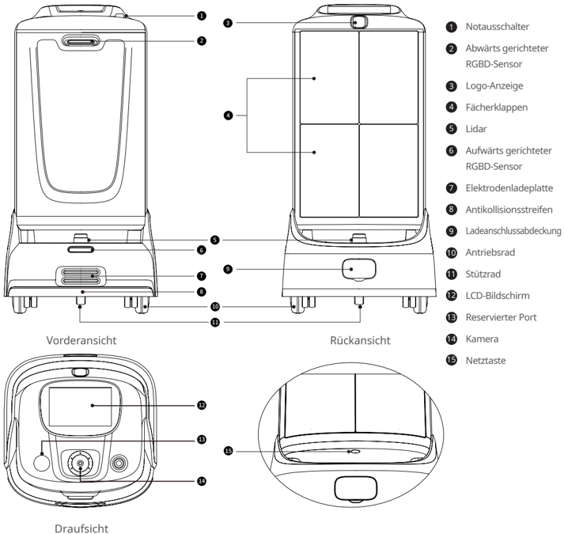
> *Bildbeschreibung (KI):* Die Abbildung zeigt die Vorder-, Rück- und Draufsicht des Roboters mit nummerierten Beschriftungen für alle wichtigen Komponenten. Mit der Nummer 1 wird der Notausschalter an der Oberseite des Geräts markiert. An der Unterseite sind Antriebsräder (10), Stützräder (11) und die Elektrodenladeplatte (7) positioniert. Auf der Rückansicht ist der LCD-Bildschirm (12) sowie Kamera (14) und Reservierter Port (13) sichtbar.

*Beschriftungen:*

- **1** Notausschalter
- **2** Abwärts gerichteter RGBD-Sensor
- **3** Logo-Anzeige
- **4** Fächerklappen
- **5** Lidar
- **6** Aufwärts gerichteter RGBD-Sensor
- **7** Elektrodenladeplatte
- **8** Antikollisionsstreifen
- **9** Ladeanschlussabdeckung
- **10** Antriebsrad
- **11** Stützrad
- **12** LCD-Bildschirm
- **13** Reservierter Port
- **14** Kamera
- **15** Netztaste

---

*Seite 39 (PDF-Seite 22, links)*

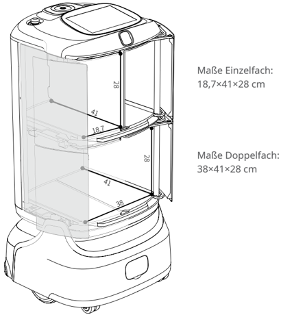
> *Bildbeschreibung (KI):* Im Einzelfach-Modus beträgt die Breite des Fachs 18,7 cm. Im Doppelfach-Modus beträgt die Gesamtbreite 38 cm. Die Höhe jedes Fachs beträgt 28 cm.

## Hinweis

Die vertikale Trennplatte ist abnehmbar.

## Entfernen der Trennplatte

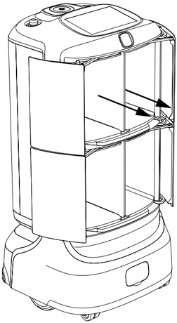
> *Bildbeschreibung (KI):* Die Pfeile zeigen die Richtung an, in der die vertikale Trennplatte entfernt werden kann.

Maße Einzelfach:

Maße Doppelfach:

---

*Seite 40 (PDF-Seite 22, rechts)*

## 2.3 Technische Daten

| Artikel | Beschreibung |
|---|---|
| Maße des Roboters (L×B×H) | 53,8×53,4×105,2 cm |
| Ladekapazität | 20 kg (10 kg pro Tablett) |
| Anzahl Fachtüren | 2 bis 4 (verstellbar) |
| Dimensionen des Ladebereichs | Maße Einzelfach (L×B×H): 18,7×41×28 cm Maße Doppelfach (L×B×H): 38×41×28 cm |
| Eingangsspannung des Ladegerätes | AC 100 V – 240 V, 50/60 Hz |
| Ausgangsspannung des Ladegerätes | 29,4 V, 3,5 A |
| Aufladezeit | 4 h mit Ladestation / 3,5 h mit Ladegerät (von 0 % auf 100 %) |
| Akkulaufzeit | 9 h |
| Positionierungsmodus | PUDU-SLAM, PUDU-VSLAM+ |
| Max. Bewegungsgeschwindigkeit | 1,2 m/s |
| Gehäusematerial | Hochwertiger Industriekunststoff + Aluminiumlegierung in Luftfahrtqualität |
| Mindestdurchgangsbreite | 70 cm |
| Max. überwindbare Höhe | 2 cm |
| Max. überwindbarer Spalt | 3,5 cm |
| Max. Neigungswinkel | 8° |
| Akku | 10 Ah |
| Stereo-Leistung | 10 W Stereo |
| Betriebstemperatur | 0 °C bis 40 °C |
| Lagertemperatur | -20 °C bis +60 °C |
| WLAN | 2,4G: 2412-2472; 5G: 5180-2825; BT: 2402-2480 |
| 4G | B1/B3/B7/B8/B20/B28/B34/B38/B40/B41 |

---

*Seite 41 (PDF-Seite 23, links)*

# 3. Produktverwendung

## 3.1 Ein-/Ausschalten und Betrieb

## Einschalten:

Verschieben Sie den Roboter an den Startpunkt. →Drücken Sie die Netztaste 0,5 s lang. →Warten Sie, bis die Logo-Anzeige blau leuchtet und der Bildschirm aufleuchtet.

> *Bildbeschreibung (KI):* Die Abbildung zeigt die Netztaste am Roboter. Der Benutzer muss die Taste für 0,5 Sekunden drücken, um den Roboter einzuschalten.

## Startpunkt:

- Es werden mehrere Startpunkte unterstützt.
- Als Startpunkt kann die Ladestation eingestellt werden.

## Ausschalten:

Halten Sie die Netztaste 6 s lang gedrückt, tippen Sie auf dem Bildschirm auf „Herunterfahren" und warten Sie, bis die Logo-Anzeige und der Bildschirm erlöschen. Der Roboter ist ausgeschaltet.

> *Bildbeschreibung (KI):* Die Abbildung zeigt die Position der Netztaste am unteren Teil des Roboters. Eine Hand drückt auf die Taste, um den Ausschaltvorgang zu demonstrieren. Die Abbildung veranschaulicht die physische Aktion zum Ausschalten des Roboters.

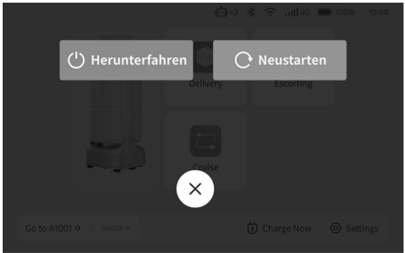
> *Bildbeschreibung (KI):* Die beiden grauen Buttons zeigen die Optionen 'Herunterfahren' und 'Neustarten' an. Der weiße Button mit dem 'X'-Symbol dient zum Schließen des Fensters. Im Hintergrund sind Teile der Benutzeroberfläche wie 'Delivery', 'Escorting' und 'Cruise' sichtbar.

---

*Seite 42 (PDF-Seite 23, rechts)*

## Erzwungenes Ausschalten:

Halten Sie die Netztaste 12 s lang gedrückt.

> *Bildbeschreibung (KI):* Die Abbildung zeigt die Position der Netztaste am Roboter.

## Anhalten:

Wenn der Roboter fährt, kann er durch Drücken des Notausschalters angehalten werden.

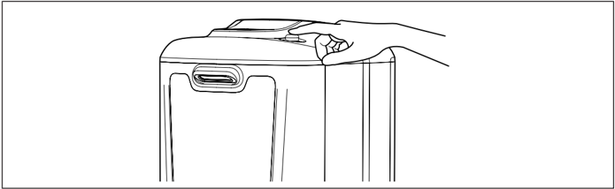
> *Bildbeschreibung (KI):* Die Abbildung zeigt die Position der Netztaste am Gerät. Eine Hand drückt auf die Taste, um das erzwungene Ausschalten zu demonstrieren.
Nachdem Sie den Roboter angehalten haben, müssen Sie zum Ändern der Aufgaben das Administratorpasswort eingeben.

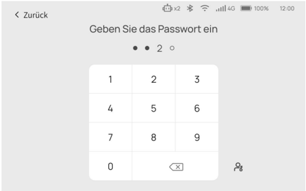
> *Bildbeschreibung (KI):* Der Benutzer muss das Administratorpasswort eingeben, um nach dem Anhalten des Roboters Aufgaben zu ändern. Das Symbol unten rechts ist ein Benutzerprofil-Icon, möglicherweise für den Zugriff auf Benutzereinstellungen oder -konten.
Der Roboter kann nicht angehalten werden, wenn er auf einen Aufzug wartet oder fährt.

---

*Seite 43 (PDF-Seite 24, links)*

## 3.2 Aufladen

Der Roboter kann über das Ladegerät und die Ladestation aufgeladen werden.

## Aufladen mit dem Ladegerät:

Stecken Sie das Ladekabel in den Ladeanschluss des Roboters ein. Wenn der Roboter eingeschaltet ist, wird während des Ladevorgangs auf dem Bildschirm „Ladevorgang läuft" angezeigt.

Wenn der Roboter ausgeschaltet ist, leuchtet die Logo-Anzeige während des Ladevorgangs.

## Aufladen mit der Ladestation:

Tippen Sie auf dem Bildschirm auf „Jetzt aufladen". Zum Aufladen fährt der Roboter automatisch zur Ladestation. Alternativ können Sie den Roboter zur Ladestation schieben und dabei die Ladeelektrodenplatten des Roboters mit denen an der Ladestation ausrichten. Wenn der Roboter eingeschaltet ist, wird während des Ladevorgangs auf dem Bildschirm „Ladevorgang läuft" angezeigt. Wenn der Roboter ausgeschaltet ist, leuchtet die Logo-Anzeige während des Ladevorgangs.

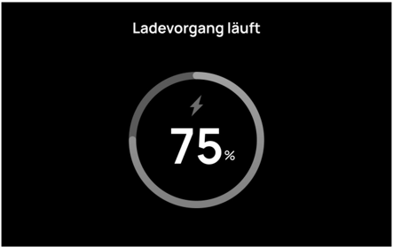
> *Bildbeschreibung (KI):* Die Anzeige zeigt den aktuellen Ladezustand des Roboters an. Das Symbol im Kreis (Blitz) kennzeichnet den Ladevorgang. Der Text 'Ladevorgang läuft' bestätigt, dass der Roboter gerade geladen wird.
## Akkustandanzeige:

| Akkustand | Anzeigestatus |
|---|---|
| 0 % bis 30 % | Rot pulsierend |
| 30 % bis 60 % | Gelb pulsierend |
| 60 % bis 90 % | Grün pulsierend |
| 90 % bis 100 % | Blau pulsierend |
| 100 % | Blau leuchtet |

---

*Seite 44 (PDF-Seite 24, rechts)*

## 3.3 Funktionsbeschreibung

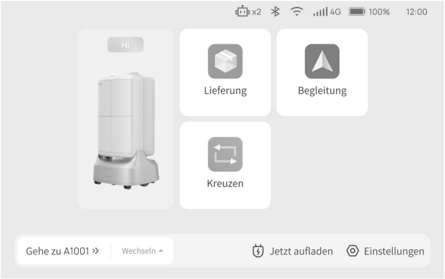
> *Bildbeschreibung (KI):* Die App zeigt eine grafische Darstellung des Roboters mit dem Begrüßungstext 'Hi' an. Es gibt drei Hauptfunktionen: 'Lieferung', 'Begleitung' und 'Kreuzen'. Der Nutzer kann den Roboter zu einem spezifischen Zielort (z.B. A1001) schicken. Zusätzliche Optionen sind das Wechseln des Ziels, Aufladen und Einstellungen.
## Liefermodus:

Tippen Sie auf „Lieferung", um die Seite mit den Liefereinstellungen aufzurufen. Das Initialpasswort ist 0000. Legen Sie die zu liefernden Objekte in ein Fach, legen Sie das Ziel für das Fach fest und tippen Sie auf „Los geht's". Der Roboter fährt zum Ziel.

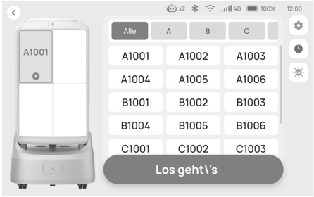
> *Bildbeschreibung (KI):* Die Abbildung zeigt die Benutzeroberfläche für den Liefermodus des Roboters. Der Benutzer kann durch Tippen auf eine der Zellen (z.B. A1001) ein Fach auswählen. Nachdem das Ziel-Fach ausgewählt wurde, wird mit dem Button 'Los geht's' der Versand gestartet. Die Beschriftungen wie 'Alle', 'A', 'B', 'C' dienen zur Filterung oder Gruppierung der Fächer.
## Hinweis:

Nachdem der Roboter das Ziel erreicht hat, wird nur das dem Ziel entsprechende Fach geöffnet.

---

*Seite 45 (PDF-Seite 25, links)*

## Begleitmodus:

Im Begleitmodus begleitet der Roboter Gäste zu ihrem Ziel.

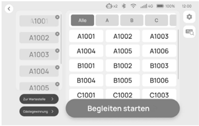
> *Bildbeschreibung (KI):* Die Tabelle zeigt die verfügbaren Begleit-Modi mit den Bezeichnungen A1001 bis C1003. Der Benutzer kann einen Modus auswählen, indem er auf das entsprechende Feld in der Tabelle tippt. Die linke Spalte enthält weitere Optionen wie 'Zur Werkstatt' und 'Datenwiedergabe'. Der große Button unten rechts startet den ausgewählten Begleit-Modus.

> *Bildbeschreibung (KI):* Die Bezeichnung A1001 identifiziert das Gerät oder Modell. Der Kreis mit leuchtenden Punkten könnte eine Statusanzeige oder ein Designelement darstellen.
Wenn innerhalb von 30 s keine Aktion ausgeführt wird, wird auf dem Bildschirm der Gastbegrüßungsausdruck angezeigt.

> *Bildbeschreibung (KI):* Die beiden oberen Elemente sind Bedienelemente: 'Begleiten starten' und 'Zur Wartestelle'. Das linke weiße Element ist ein runder Button oder Indikator. Das mittlere weiße Element ist eine halbrunde Form, möglicherweise ein Statusindikator oder Teil des Displays. Das rechte weiße Element entspricht dem linken – beide könnten identische Funktionen haben.
## Laden mit einem Tippen:

Tippen Sie auf dem Bildschirm auf „Jetzt aufladen". Zum Aufladen fährt der Roboter automatisch zur Ladestation.

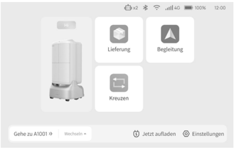
> *Bildbeschreibung (KI):* Die drei quadratischen Felder mit den Beschriftungen „Lieferung Begleitung

> *Bildbeschreibung (KI):* Die Beschriftung 'Zur Ladesäule gehen' zeigt an, dass der Roboter sich auf dem Weg zur Ladestation befindet. Der Kreis mit punktierten Linien umgibt den Text und deutet möglicherweise einen Bewegungspfad oder eine Zielzone an.

---

*Seite 46 (PDF-Seite 25, rechts)*

# 4. Kundendienst

## 4.1 Kostenlose Garantieleistung

Shenzhen Pudu Technology Co., Ltd (nachfolgend „Pudu Robotics" genannt) bietet unter den folgenden Bedingungen, ab dem Datum des Produkterhalts, innerhalb der effektiven Garantiezeit des Produkts (die Garantiezeit der verschiedenen Produktteile unterscheidet sich) kostenlose Produktgarantieleistungen.

- Das Produkt wird ab Kaufdatum und innerhalb der gültigen Garantiezeit bestimmungsgemäß verwendet. Es gibt dennoch nicht vom Menschen verursachte Qualitätsprobleme.
- Es liegt keine unbefugte Demontage des Produkts, keine Umbauten oder Installationen vor, die nicht den Anweisungen im Benutzerhandbuch entsprechen, keine durch menschliches Versagen verursachten Fehler und kein Abreißen oder Verändern von Seriennummern, Fabriketiketten und anderen Markierungen auf dem Produkt.
- Es müssen ein gültiger Kaufbeleg, Quittungen und Bestellnummern vorgelegt werden.
- Während der kostenlosen Garantiezeit ersetzte beschädigte Teile sind Eigentum des Unternehmens und müssen auf Anfrage des Unternehmens zurückgesandt werden.

## 4.2 Leistungen nach Ablauf der Garantie

Bei Kundendienstleistungen, die nicht im Rahmen der kostenlosen Garantie liegen (außerhalb der Garantiezeit oder die Bedingungen der kostenlosen Garantie innerhalb der Garantiezeit nicht erfüllen), bietet das Unternehmen kostenpflichtige Kundendienstleistungen an.

- Das Unternehmen bietet offiziell Online- und Fernunterstützungskanäle an. Vom Kunden wird erwartet, dass sie unsere Techniker bei der Problembehandlung und Fehlerbehebung unterstützen.
- Wenn die technischen Ingenieure feststellen, dass das Problem vor Ort gelöst werden muss, werden professionelle Techniker für die Vor-Ort-Leistungen abgestellt. Für Kundendienstleistungen, die nicht im Rahmen der kostenlosen Garantie liegen, muss der Kunde das erforderliche Kundendienstformular ausfüllen. Die Servicegebühr beinhaltet: Wartungsgebühr und Ersatzteilgebühr.

## 4.3 Kundendienst kontaktieren

Wenn Sie Fragen haben, kontaktieren Sie uns unter: techservice@pudutech.com. Kundendienstzeiten: 9:30 - 12:00 und 13:30 - 18:00, Montag bis Samstag (GMT+8).

---

*Seite 47 (PDF-Seite 26, links)*

# 5. Angaben zur Richtlinienerfüllung

## 5.1 Informationen über Entsorgung und Recycling

Die Richtlinie über Elektro- und Elektronik-Altgeräte (WEEE) zielt darauf ab, Umwelteinflüsse durch Elektround Elektronikgeräte zu minimieren, indem Wiederverwendung und Recycling erhöht und Deponieabfall verringert werden. Das Symbol auf diesem Produkt oder seiner Verpackung bedeutet, dass es nach seiner Nutzungszeit getrennt vom normalen Hausmüll entsorgt werden sollte. Es liegt in Ihrer Verantwortung, Elektronikgeräte in Recycling-Zentren zu entsorgen, um die natürlichen Ressourcen zu schonen. Jedes Land sollte seine eigenen Sammelstellen für das Recycling von elektrischen und elektronischen Geräten haben. Wo Sie Elektro- und Elektronikgeräte abgeben können, erfahren Sie vom zuständigen Amt, der Stadtverwaltung oder dem Entsorgungsdienst.

Vor dem Einbringen von Elektro- und Elektronikgeräten in der Abfallsammlung oder in Abfallsammelstellen sollten Batterien und Akkus zur getrennten Sammlung entfernt werden.
