*Page 1 (PDF page 3, left)*

## Copyright © 2025 Shenzhen Pudu Technology Co., Ltd. All rights reserved.

No organization or individual shall imitate, copy, transcribe, or translate the content of this user manual, in part or in full, without the express written consent of Shenzhen Pudu Technology Co., Ltd., or distribute this user manual for profit in any way (electronically or via photocopying, recording, etc.). The product specifications and information provided in this user manual are for reference only and are subject to change without further notice. Unless otherwise specified, this user manual is intended only as instructions for use, and no representation shall be deemed as a warranty of any kind.

---

*Page 2 (PDF page 3, right)*

# 1. Safety Instructions

## 1.1 Instructions for Electricity

- Charge the robot using the charger delivered with it. Do not use other chargers. If the charger is damaged, replace it immediately.
- Charge the battery to 100% before use for the first time.
- When the battery is lower than 20%, charge the robot in a timely manner. Do not run the robot with a low battery for a long time. The battery life may be reduced.
- Ensure that the voltage of the power supply meets that specified on the charger. Otherwise, the charger may be damaged.

## 1.2 Instructions for Use

- Do not block the sensors of the robot. Otherwise, the robot may fail to move properly or get lost.
- Do not clean or maintain the robot when it is powered on.
- Do not place any cookers with open fire or flammable and explosive objects on the robot.
- Do not place objects on or remove objects from the robot when it is moving. Otherwise, property damage and personal injury may be caused due to unexpected collision.
- Do not push or carry the robot while it is moving. Otherwise, the robot may fail to move properly.
- Only professionally trained engineers are allowed to disassemble and maintain the robot. If faults occur on the robot, contact Pudu technical support engineers in a timely manner.
- Put away all the cables on the ground to prevent the robot from dragging them. Remove all sharp objects (such as decoration wastes, glass, and nails) from the ground to prevent damage to the robot chassis.
- For safety, you are advised to set the speed of the robot to 0.8 m/s. Do not play in front of the robot. Otherwise, unexpected harm may be caused. Although the robot features automatic obstacle avoidance, there may be blind spots. Therefore, blocking the robot abruptly when it moves at a high speed may cause accidents.
- Do not overload the robot. Do not place any flammable solid, gas, or liquid on the tray. Do not deliver high-temperature objects or soups. Otherwise, the robot may be damaged, and passers-by may be injured. Do not deliver unpackaged liquid, such as beverages.
- Do not pull or push the robot when it is moving. If you need to push or carry it, press the emergency stop switch to stop it first.

## 1.3 Instructions for Environment

- Do not use or charge the robot in 4high-temperature or high-pressure environments, places with fire or explosion hazard, or other dangerous scenarios. Otherwise, personal injuries or damage to the robot may be caused.
- Do not use the robot in a humid environment with liquid or gooey stuff on the ground. Otherwise, damage to the robot may be caused.
- Do not use the robot in places where the use of wireless devices is expressly prohibited. Otherwise, the robot may interfere with other electronic devices or cause other hazards.
- Do not dispose of the robot or its accessories as household waste. Always dispose of them according to local laws and regulations and recycle them wherever possible.
- Use the robot in environments where the conditions meet those stated in this user manual. Otherwise, robot operation exceptions or other dangers may occur.

---

*Page 3 (PDF page 4, left)*

# 2. Product Components

## 2.1 Packing List

| Item | Delivery type |
|---|---|
| Robot | Standard |
| Charger | Standard |
| Charging cable | Standard |
| User Manual | Standard |
| Certificate of Compliance | Standard |
| Charging station | Optional |
| Phone system | Optional |
| Elevator control system | Optional |

## 2.2 Appearance and Components

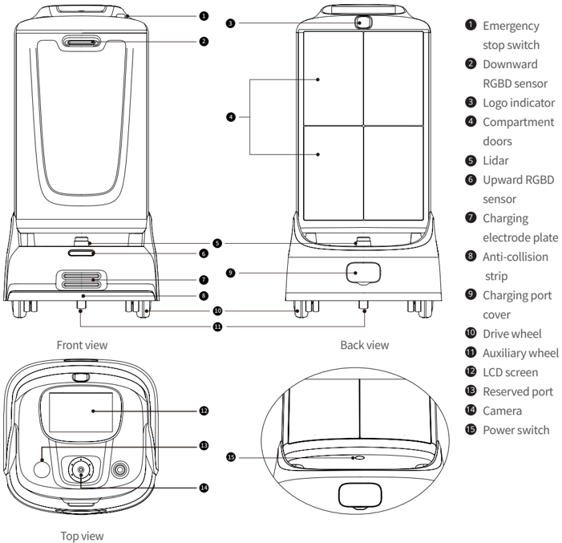
> *Figure description (AI):* The figure shows labeled components of the robot from front, back, top, and close-up views. Each numbered part corresponds to a specific function or feature such as sensors, wheels, ports, and switches. Readers can identify where buttons like the emergency stop switch and power switch are located. The diagram helps users locate charging ports, camera positions, and other functional elements for operation and maintenance.

*Labels:*

- **1** Emergency stop switch
- **2** Downward RGBD sensor
- **3** Logo indicator
- **4** Compartment doors
- **5** Lidar
- **6** Upward RGBD sensor
- **7** Charging electrode plate
- **8** Anti-collision strip
- **9** Charging port cover
- **10** Drive wheel
- **11** Auxiliary wheel
- **12** LCD screen
- **13** Reserved port
- **14** Camera
- **15** Power switch

---

*Page 4 (PDF page 4, right)*

Note:

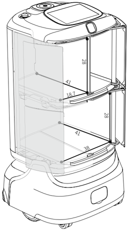
> *Figure description (AI):* The figure shows a dual-compartment storage unit with removable vertical partition plates. Each compartment measures 18.7 cm in width, 41 cm in height, and 28 cm in depth. The total dual-compartment dimensions are 38 cm wide, 41 cm high, and 28 cm deep. The illustration demonstrates how the internal shelves and dividers can be reconfigured or removed.

The vertical partition plate can be removed.

Remove the partition plate Compartment dimensions: 18.7×41×28 cm 7.36×16.14×11.02 inches Dual-compartment dimensions: 38×41×28 cm 14.96×16.14×11.02 inches

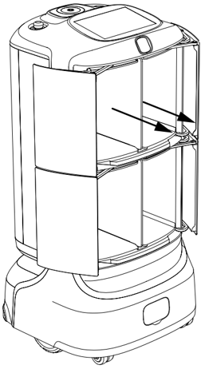
> *Figure description (AI):* The arrows point to the vertical partition plate inside the FlashBot. This figure shows how the partition plate can be removed from the main compartment.

---

*Page 5 (PDF page 5, left)*

## 2.3 Technical Specifications

| Item | Description |
|---|---|
| Robot dimensions (L×W×H) | 53.8×53.4×105.2 cm |
| Load capacity | 20 kg (10 kg per tray) |
| Number of compartment doors | 2 ~ 4 (Adjustable) |
| Loading area dimensions | Single compartment dimension (L×W×H): 18.7×41×28 cm Dual-compartment dimension (L×W×H): 38×41×28 cm |
| Charger power input | AC 100 V – 240 V, 50/60 Hz |
| Charger power output | 29.4 V, 3.5 A |
| Charging time | 4 h using the charging station / 3.5 h using the charger (from 0% to 100%) |
| Battery life | 9 h |
| Positioning mode | PUDU SLAM, PUDU VSLAM+ |
| Screen type | 10.1-inch LCD screen |
| Max. moving speed | 1.2 m/s |
| Enclosure material | High-quality industrial plastic + aviation-grade aluminum alloy |
| Min. travel width | 70 cm |
| Max. surmountable height | 2 cm |
| Max. surmountable gap | 3.5 cm |
| Max. climbing angle | 8° |
| Battery | 10 Ah |
| Stereo power | 10 W stereo |
| Working temperature | 0°C –40°C |
| Storage temperature | -20°C to +60°C |
| WIFI | 2.4G: 2412-2472; 5G: 5180-2825; BT: 2402-2480 |
| 4G | B1/B3/B7/B8/B20/B28/B34/B38/B40/B41 |

---

*Page 6 (PDF page 5, right)*

# 3. Using the Product

## 3.1 Powering On/Off and Running

## Power on:

Push the robot to the startup positioning location. → Press the power switch for 0.5s. → Wait until the logo indicator lights up blue and the screen lights up.

> *Figure description (AI):* The figure shows a hand pressing the power switch on the robot. The label '0.5s' indicates the duration to press the power switch for startup. This visual step corresponds to the 'Power on' instruction in the manual.

## Startup positioning location:

- Multiple positioning locations are supported.
- You can set the charging station as a positioning location.

## Power off:

Hold down the power switch for 6s, tap "Shut Down" on the screen, and wait until the logo indicator and screen go off. The robot is powered off.

> *Figure description (AI):* The figure shows a hand pressing the power switch on the robot. The '6s' label indicates the duration to hold the power switch for shutdown.

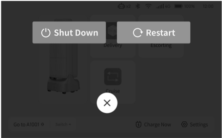
> *Figure description (AI):* The figure shows a screen interface with two main options: 'Shut Down' and 'Restart'. A close button (×) is visible at the bottom center of the screen. The 'Shut Down' option appears to be highlighted or selected. This visual guide complements the text instructions for powering off the robot by showing the on-screen confirmation step.

---

*Page 7 (PDF page 6, left)*

## Forcibly power off:

Hold down the power switch for 12s.

> *Figure description (AI):* The figure shows a hand pressing the power switch on the robot. The label '12s' indicates the duration to hold the power switch for forced power off.

## Pause:

When the robot is moving, press the emergency stop switch to pause the robot.

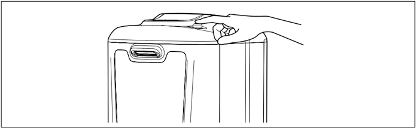
> *Figure description (AI):* The figure shows a hand pressing the emergency stop switch on top of the robot. This visual demonstrates how to pause the robot by activating the emergency stop function. The location of the emergency stop switch is clearly indicated for user reference.
After pausing the robot, to modify the tasks, you need to enter the administrator password.

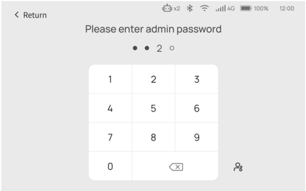
> *Figure description (AI):* The 'X' button is located below the number pad to clear input. Two filled circles indicate two characters have been entered in the password field. An empty circle indicates one more character slot remains available for entry.
The robot cannot enter the paused state when it is waiting for or riding an elevator.

---

*Page 8 (PDF page 6, right)*

## 3.2 Charging

The robot can be charged by charger or charging station.

## Charging by charger:

Plug the connector of the charging cable into the charging port of the robot. If the robot is powered on, the screen displays " Charging in progress " during the charging.

If the robot is powered off, the logo indicator lights up during the charging.

## Charging by charging station:

Tap " Charge Now " on the screen. The robot automatically goes to the charging station for charging. Alternatively, you can push the robot to the charging station, aligning the charging electrode plates of the robot with those on the charging station. If the robot is powered on, the screen displays " Charging in progress " during the charging.

If the robot is powered off, the logo indicator lights up during the charging.

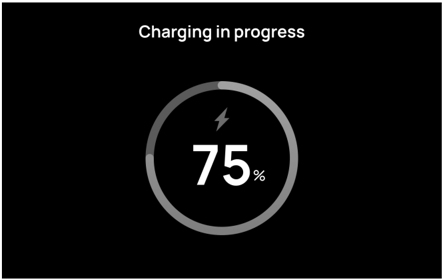
> *Figure description (AI):* The screen displays 'Charging in progress' while the robot is charging.
## Battery level indication:

| Battery level | Indicator state |
|---|---|
| 0–30% | Breathing red |
| 30–60% | Breathing yellow |
| 60–90% | Breathing green |
| 90–100% | Breathing blue |
| 100% | Solid blue |

---

*Page 9 (PDF page 7, left)*

## 3.3 Function Description

> *Figure description (AI):* The figure shows a robot with four main functions: Delivery, Escorting, Cruise, and Go to A1001. The 'Delivery' function allows users to set the destination for the compartment and start the delivery process. The 'Escorting' function enables the robot to escort users or objects from one location to another. The 'Cruise' function allows the robot to move autonomously without a specific destination. The 'Go to A1001' button is used to navigate the robot to a specific location, such as a charging station. The 'Switch' button allows users to switch between different modes or settings. The 'Charge Now' button initiates the charging process for the robot. The 'Settings' button provides access to various configuration options for the robot.
## Delivery mode:

Tap " Delivery " to enter the delivery setting page. The initial password is 0000. Place the objects to be delivered into a compartment, set the destination for the compartment, and tap " Start. " The robot goes to the destination.

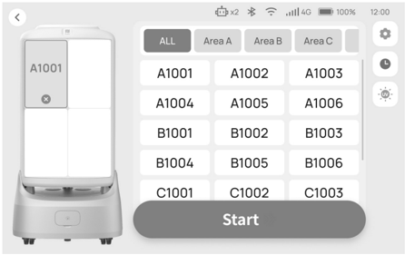
> *Figure description (AI):* The robot's screen displays a compartment labeled 'A1001' with an 'X' mark, indicating it is selected or active. The grid on the right shows multiple compartments (e.g., A1001–A1006, B1001–B1006, C1001–C1003) organized by area (Area A, B, C). Tapping 'Start' initiates delivery to the selected compartment after placing objects inside. Only the compartment matching the destination will open when the robot arrives.
## Note:

After the robot arrives at the destination, only the compartment corresponding to the destination is opened.

---

*Page 10 (PDF page 7, right)*

## Escorting mode:

In escorting mode, the robot escorts guests to their destinations.

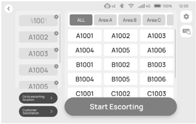
> *Figure description (AI):* The screen displays a grid of destination points labeled A1001 through C1003, organized by area (Area A, B, C) or all areas. A button on the left side allows selection between 'Get escorting location' and 'Customer location'. A large 'Start Escorting' button is positioned at the bottom center of the screen to initiate the escort function. The top bar shows system status indicators including battery level, signal strength, time, and connectivity icons.
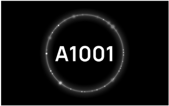
> *Figure description (AI):* The label A1001 identifies the robot model. The circular ring with dots around the text likely indicates a status indicator or charging status. This figure serves as a visual reference for the robot's appearance and branding.
If no operation is performed within 30s, the screen displays the guest greeting expression.

> *Figure description (AI):* Tap 'Start Escorting' to begin escorting guests to their destinations. Tap 'Go to escorting location' to navigate the robot to the designated escorting spot. The visual display includes two circular shapes and one semi-circular shape as part of the guest greeting expression.
## One-tap charging:

Tap " Charge Now " on the screen. The robot automatically goes to the charging station for charging.

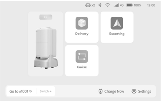
> *Figure description (AI):* The screen displays three main operation modes: Delivery, Escorting, and Cruise. Each mode is represented by a distinct icon with its corresponding label below it. A 'Charge Now' button is available to initiate automatic charging. The bottom navigation bar includes options such as 'Go to A1001', 'Switch', and 'Settings'.

> *Figure description (AI):* The circular graphic with glowing dots represents the charging station. The text 'Charging Station' identifies the location shown in the image.

---

*Page 11 (PDF page 8, left)*

# 4. After-Sales Services

## 4.1 Complimentary Warranty Services

Shenzhen Pudu Technology Co., Ltd. (hereinafter referred to as Pudu Robotics) provides complimentary warranty services within the effective warranty period (the warranty period may vary for different components) for the product under the following circumstances from the date the product is received.

- From the date of purchase and within the effective warranty period, the product is used as instructed but non-man-made quality problems occur.
- There is no unauthorized disassembly of the product, modifications or additions that are not in accordance with the instructions of the user manual, faults caused by human errors, or tearing or alteration of serial numbers, factory labels, and other markings on the product.
- Valid proof of purchase, receipts, and order numbers are provided.
- Damaged parts replaced during the complimentary warranty period are the property of the company and should be sent back at the company's request.

## 4.2 Post-Warranty Services

For after-sales service not covered by the complimentary warranty (beyond the warranty period or not complying with the terms of the complimentary warranty within the warranty period), the company provides paid after-sales services.

- The company provides online and remote technical support channels, and the customer needs to collaborate with the technical engineers for problem diagnosis and troubleshooting purposes.
- If the technical engineers diagnose that the problem needs to be solved on the site, professional technicians are assigned to provide on-site services. For after-sales services not covered complimentary warranty, the customer needs to fill in the After-Sales Service Form as required. The service fees include the fees of after-sales maintenance and spare parts.

## 4.3 Contact

If you have any questions, contact us at: techservice@pudutech.com

After-sales service hours: Monday through Saturday, 9:30 a.m. to 12:00 p.m. and 1:30 p.m. to 6:00 p.m. (GMT+8)

---

*Page 12 (PDF page 8, right)*

# 5. Compliance Information

## 5.1 Disposal and Recycling Information

The Waste Electrical and Electronic Equipment (WEEE) Directive aims to minimize the impact of electrical and electronic goods on the environment, by increasing re-use and recycling and by reducing the amount of WEEE going to landfill. The symbol on this product or its packaging signifies that this product must be disposed separately from ordinary household wastes at its end of life. Be aware that this is your responsibility to dispose of electronic equipment at recycling centers in order to conserve natural resources. Each country should have its collection centers for electrical and electronic equipment recycling. For information about your recycling drop off area, please contact your related electrical and electronic equipment waste management authority, your local city office, or your household waste disposal service.

Before placing electrical and electronic equipment (EEE) in the waste collection stream or in waste collection facilities, the end user of equipment containing batteries and/or accumulators must remove those batteries and accumulators for separate collection.

## 5.2 Federal Communications Commission Compliance Statement

The following information applies to Pudu Robotics.

This equipment has been tested and found to comply with the limits for a Class B digital device, pursuant to part 15 of the FCC Rules. These limits are designed to provide reasonable protection against harmful interference in a residential installation. This equipment generates, uses and can radiate radio frequency energy and, if not installed and used in accordance with the instructions, may cause harmful interference to radio communications. However, there is no guarantee that interference will not occur in a particular installation. If this equipment does cause harmful interference to radio or television reception, which can be determined by turning the equipment off and on, the user is encouraged to try to correct the interference by one or more of the following measures:

- Reorient or relocate the receiving antenna.
- Increase the separation between the equipment and receiver.
- Connect the equipment into an outlet on a circuit different from that to which the receiver is connected.
- Consult the dealer or an experienced radio/TV technician for help.

This device complies with Part 15 of the FCC rules. Operation is subject to the following two conditions:

- This device may not cause harmful interference.
- This device must accept any interference received, including interference that may cause undesired operation.

---

*Page 13 (PDF page 9, left)*

## 5.3 Industry Canada Compliance Statement

This device complies with Industry Canada licence-exempt RSS standard(s). Operation is subject to the following two conditions:

- This device may not cause interference.
- This device must accept any interference, including interference that may cause undesired operation of the device.

L ' émetteur/récepteur exempt de licence contenu dans le présent appareil est conforme aux CNR d ' Innovation, Sciences et Développement économique Canada applicables aux appareils radio exempts de licence. L ' exploitation est autorisée aux deux conditions suivantes :

- L ' appareil ne doit pas produire de brouillage;
- L ' appareil doit accepter tout brouillage radioélectrique subi, même si le brouillage est susceptible d ' en compromettre le fonctionnement.
