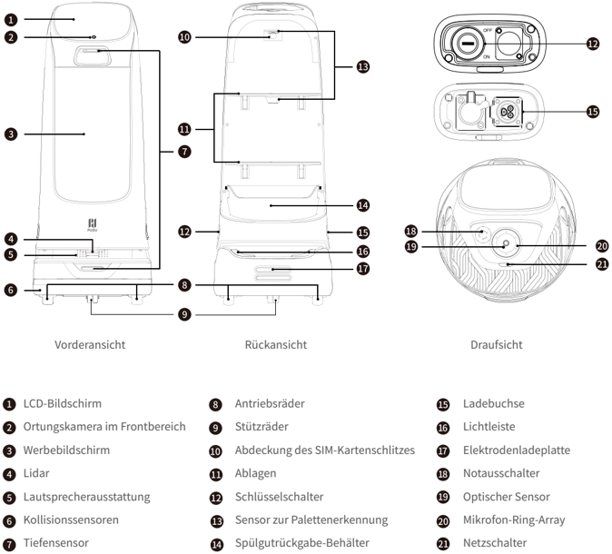
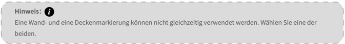
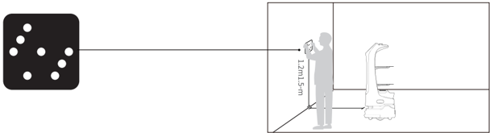
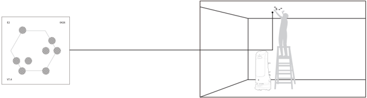
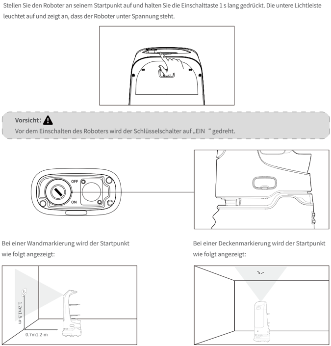

*Seite 32 (PDF-Seite 19, rechts)*

## Copyright © 2024 Shenzhen Pudu Technology Co., Ltd. Alle Rechte vorbehalten.

Kein Teil dieser Publikation darf ohne vorherige schriftliche Zustimmung von Shenzhen Pudu Technology Co., Ltd. analog oder digital vervielfältigt, transkribiert, übersetzt oder zum Zwecke der Gewinnerzielung übertragen werden. Technische Daten und Angaben in dieser Unterlage dienen nur zu Informationszwecken und können ohne vorherige Mitteilung geändert werden. Falls nicht anders angegeben, dient dieses Dokument nur als Benutzerhandbuch und berechtigt nicht zur Inanspruchnahme von Garantien.

# 1. Sicherheitsanweisungen

## 1.1 Spannungsquellen

- Es sollte kein Fremdzubehör verwendet werden. Tauschen Sie das Ladegerät bei Beschädigung sofort aus.
- Wenn der Akku auf 20 % sinkt, sollte der Roboter rechtzeitig aufgeladen werden. Längerer Betrieb mit einem schwachen Akku kann dessen Laufzeit beeinträchtigen.
- Achten Sie darauf, dass die Spannung den Angaben auf dem Ladegerät entspricht, da dieses sonst beschädigt werden kann.
- Wenn Sie das Ladegerät benutzen, muss der Verschluss der Ladeschnittstelle vollständig greifen, damit sich beim Laden keine Überhitzung bildet, die zu Verbrennungen oder Geräteschäden führen kann.

## 1.2 Betrieb

- Verdecken Sie die obere Kamera des Roboters während des Betriebs nicht, damit er sich nicht unkontrolliert bewegt. Falls die Kamera abgedeckt ist, unterbrechen Sie seine Aufgabe und setzen Sie den Roboter auf den richtigen Kurs, bevor Sie ihn weitermachen lassen.
- Reinigen oder warten Sie den Roboter nicht, wenn die Spannung eingeschaltet ist.
- Es dürfen keine Vorrichtungen mit offener Flamme oder brennbare und explosive Gegenstände auf dem Roboter abgestellt werden.
- Nehmen Sie keine Gerichte heraus und stellen Sie keine hinein, während der Roboter fährt, sonst können Lebensmittel verschüttet werden oder Verletzungen durch versehentliche Kollisionen entstehen.
- Den Roboter nicht ziehen oder wegtragen, während er arbeitet. Unerwünschtes Verhalten kann die Folge sein.
- Der Roboter sollte nicht von ungeschultem Personal zerlegt oder repariert werden. Im Falle einer Fehlfunktion wenden Sie sich rechtzeitig an Shenzhen Pudu Technology Co., Ltd. um technische Hilfe.
- Beachten Sie das Höchstgewicht, das eine Person vorschriftsgemäß anheben darf, wenn Sie den Roboter transportieren. Halten Sie den Roboter während des Transports aufrecht. Versuchen Sie niemals, ihn an Ablage oder Rahmen anzuheben.

## 1.3 Umgebung

- Betreiben oder laden Sie den Roboter nicht in einer Umgebung mit hohen Temperaturen oder Drücken, in Bereichen mit Feuer- oder Explosionsgefahr oder in anderen gefährlichen Umgebungen, sonst können Verletzungen oder Schäden am Roboter auftreten.
- Betreiben Sie den Roboter nicht in einer feuchten Umgebung oder auf Oberflächen, die mit Flüssigkeiten oder klebrigen Materialien bedeckt sind, da diese Schäden am Roboter verursachen können.
- Betreiben Sie den Roboter nicht an Orten, an denen die Verwendung von drahtlosen Geräten ausdrücklich untersagt ist, da es sonst u. a. zu Störungen anderer elektronischer Geräte oder anderen Gefahren kommen kann.
- Entsorgen Sie den Roboter und dessen Zubehör nicht über den Hausmüll. Entsorgen Sie Roboter und Zubehör vorschriftsgemäß. Führen Sie ihn möglichst dem Recycling zu.

---

*Seite 33 (PDF-Seite 20, links)*

# 2. Produktbestandteile

## 2.1 Packliste

Roboter×1, Benutzerhandbuch KettyBot×1, Qualitätsbescheinigung×1, Ladegerät×1, Startschlüssel×1, Wandmarkierungen×1, Deckenmarkierungen×1.

## 2.2 Überblick

KettyBot ist ein Servier- und Empfangsroboter mit einem großen Werbebildschirm sowie einem SLAM-Ortungs- und Navigationssystem, das optische und Laserpositionsbestimmung vereint. Seine überlegene Durchgangsbreite von nur 55 cm gestattet es ihm, sich auch in komplexer und überfüllter Umgebung leicht zu bewegen. Als vielseitiger Alleskönner für Marketing, Gästegewinnung und -betreuung, Begrüßung und Begleitung, Servieren, Sprachkontakt usw. eignet sich der KettyBot für den Einsatz in Restaurants, Hotels, Supermärkten und vielen anderen Geschäftsbereichen.

## 2.3 Erscheinungsbild und bestandteile

> *Bildbeschreibung (KI):* Die Abbildung zeigt die Vorder-, Rück- und Draufsicht des KettyBot-Roboters mit nummerierten Beschriftungen für alle wichtigen Komponenten. Durch die Draufsicht (rechts) wird die räumliche Anordnung der oberen Komponenten wie Mikrofon-Ring-Array (20) und Optischer Sensor (19) sichtbar gemacht.

*Beschriftungen:*

- **1** LCD-Bildschirm
- **2** Ortungskamera im Frontbereich
- **3** Werbebildschirm
- **4** Lidar
- **5** Lautsprecherausstattung
- **6** Kollisionssensoren
- **7** Tiefensensor
- **8** Antriebsräder
- **9** Stützräder
- **10** Abdeckung des SIM-Kartenschlitzes
- **11** Ablagen
- **12** Schlüsselschalter
- **13** Sensor zur Palettenerkennung
- **14** Spülgutrückgabe-Behälter
- **15** Ladebuchse
- **16** Lichtleiste
- **17** Elektrodenladeplatte
- **18** Notausschalter
- **19** Optischer Sensor
- **20** Mikrofon-Ring-Array
- **21** Netzschalter

---

*Seite 34 (PDF-Seite 20, rechts)*

## 2.4 Technische Daten

| Merkmale | Beschreibung |
|---|---|
| Betriebsspannung | DC 25,6 V |
| Eingangsspannung | AC 100–240 V, 50/60 Hz |
| Ausgangsspannung | 29,4 V/8 A |
| Akkukapazität | 25 Ah |
| Aufladezeit | 4 h |
| Aufladungsmodus | Manuelles und automatisches Aufladen |
| Akkulaufzeit | 11 h (Betrieb im Leerlauf) |
| Rundfahrtgeschwindigkeit | 0,2–1,2 m/s (einstellbar) |
| Navigation | Laser- und optische integrierte SLAM-Positionsbestimmung |
| Mindestdurchgangsbreite | 55 cm |
| Max. überwindbare Höhe | 5 mm |
| Max. Neigungswinkel | 5º |
| Maße der Ablage | 352 mm x 340 mm |
| Anzahl Ablagen | Zwei Ablagen und ein Spülgutrückgabe-Behälter |
| Abstand zwischen Ablagen | Von oben nach unten: 248 mm/253 mm/223 mm |
| Ablagelast | 10 kg/Ablage |
| Werkstoffe der Maschine | ABS/Aluminiumlegierung in Luftfahrtqualität |
| Gewicht des Roboters | 38 kg |
| Maße des Roboters | 435 mm x 450 mm x 1120 mm |
| Betriebssystem | Android |
| Mikrofon | Kreisanordnung von 6 Mikrofonen |
| Lautsprecherleistung | 2 x 10 W Stereolautsprecher |
| Laufzeit | 5 Jahre |
| Betriebsumgebung | Temperatur: 0 ℃ bis 40 ℃ ; RF: ≤ 85% |
| Lagerumgebung | Temperatur: -40 ℃ bis 65 ℃ ; RF: ≤ 85% |
| Betriebshöhe | < 2000 m |
| Untergrundanforderung | Innenraumumgebung, ebener und glatter Boden |
| Schutzklasse | IP20 |
| Frequenzbandbereich | WLAN: 2,4G WLAN: 2412–2472 MHz, 2422–2462 MHz 5,2–5,6G WLAN: 5180–5320 MHz, 5500–5700 MHz, 5190–5310 MHz, 5510–5670 MHz, 5210–5290 MHz, 5530–5610 MHz 5,8G WLAN: 5745–5825 MHz, 5755–5795 MHz, 5775 MHz |
| Frequenzbandbereich | Bluetooth: 2402–2480 MHz |
| Frequenzbandbereich | 3G: B1/B8 |
| Frequenzbandbereich | 4G: B1/B3/B7/B8/B20/B28/B34/B38/B40 |

---

*Seite 35 (PDF-Seite 21, links)*

| Merkmale | Beschreibung | Beschreibung |
|---|---|---|
| Max. Abstrahlleistung | WLAN | 2,4G WLAN: 17,48 dBm; 5,2–5,6G WLAN: 13,35 dBm; 5,8G WLAN: 13,85 dBm |
| Max. Abstrahlleistung | Bluetooth | BLE: 5,96 dBm; BR/EDR: 8,49 dBm |
| Max. Abstrahlleistung | 3G | B1: 23,56 dBm; B8: 23,43 dBm |
| Max. Abstrahlleistung | 4G | B1: 23,49 dBm; B3: 23,96 dBm; B7: 24,33 dBm; B8: 23,45 dBm; B20: 23,36 dBm; B28: 23,81 dBm; B34: 23,32 dBm; B38: 24,76 dBm; B40: 23,25 dBm |

# 3. Benutzung

## 3.1 Aufbau neuer lagepläne

Der KettyBot ermöglicht den Aufbau neuer Lagepläne auf dem Roboter selbst. Wenn der Roboter zum ersten Mal gestartet wird, können Sie neue Lagepläne direkt auf ihm aufbauen, ohne dass Sie weitere Software benötigen.

Zuvor fordern Sie bitte von unserem Kundendienst einen Aktivierungscode an und wählen eine Stelle aus, an der Sie eine Wand- oder Deckenmarkierung anbringen, die als Ausgangsort dienen wird. Danach bauen Sie den Lageplan gemäß den Bildschirmanweisungen auf. Weitere Angaben finden Sie in der KettyBot-Bedienungsanleitung.

> *Bildbeschreibung (KI):* Die Markierung zeigt an, dass entweder eine Wand- oder eine Deckenmarkierung gewählt werden muss. Es ist nicht möglich, beide Markierungstypen gleichzeitig zu verwenden.
## Hinweis：

Eine Wand- und eine Deckenmarkierung können nicht gleichzeitig verwendet werden. Wählen Sie eine der

beiden.

- Eine Wandmarkierung dürfen Sie nicht auf reflektierenden Oberflächen wie Glas oder Keramikfliesen anbringen.

> *Bildbeschreibung (KI):* Der Roboter sollte in einer Ecke platziert werden, wie im Bild dargestellt.

- Eine Deckenmarkierung dürfen Sie nicht auf einer stark spiegelnden Decke anbringen.

> *Bildbeschreibung (KI):* Die linke Grafik zeigt eine schematische Darstellung eines KettyBot-Roboters mit markierten Punkten (z. B. '9424', 'V7.4'), die möglicherweise Sensoren oder Referenzpunkte für den Lageplan-Aufbau darstellen. Der Roboter auf der rechten Seite ist in einer Position dargestellt, an der er eine Wand- oder Deckenmarkierung ausführt – dies illustriert den Schritt zur Auswahl eines Ausgangsorts für den neuen Lageplan. Die Verbindungslinie zwischen der linken Grafik und dem Roboter deutet darauf hin, dass die linke Darstellung die zu erstellende Struktur des Lageplans visualisiert, während der Roboter diese physisch realisiert. Die Beschriftungen '9424' und 'V7.4' auf der linken Grafik könnten Modellbezeichnungen oder Versionen sein, die im Kontext des Lageplan-Aufbaus relevant sind.

---

*Seite 36 (PDF-Seite 21, rechts)*

## 3.2 Anweisungen für tasten

## Einschalten:

> *Bildbeschreibung (KI):* Der Schlüsselschalter muss vor dem Einschalten auf „EIN“ gedreht werden.
Bei einer Wandmarkierung wird der Startpunkt wie folgt angezeigt:

Bei einer Deckenmarkierung wird der Startpunkt wie folgt angezeigt:

Vorsicht：

Vor dem Einschalten des Roboters wird der Schlüsselschalter auf „EIN“ gedreht.

Stellen Sie den Roboter an seinem Startpunkt auf und halten Sie die Einschalttaste 1 s lang gedrückt. Die untere Lichtleiste leuchtet auf und zeigt an, dass der Roboter unter Spannung steht.

## Ausschalten:

Halten Sie den Netzschalter 3 s lang gedrückt, die Option Ausschalten wird auf dem Bildschirm angezeigt. Tippen Sie auf Ausschalten. Die untere Lichtleiste und der Bildschirm gehen aus und zeigen an, dass der Roboter nicht mehr unter Spannung steht.

## Anhalten:

Tippen Sie auf den Bildschirm, um einen verfahrenden Roboter anzuhalten. Tippen Sie erneut an, wird der Betrieb fortgesetzt.

## Nothalt:

Drücken Sie im Notfall den Notausschalter, um einen in Betrieb befindlichen Roboter anzuhalten. Drehen Sie den Notausschalter im Uhrzeigersinn, und der Vorgang wird gemäß den Bildschirmhinweisen fortgesetzt.

* Weitere Angaben zur Nutzung des Roboters finden Sie in der KettyBot-Bedienungsanleitung.

---

*Seite 37 (PDF-Seite 22, links)*

# 4. Wartung und pflege

| Bestandteile | Roboterstatus | Inspektionsintervall | Wartungsverfahren |
|---|---|---|---|
| Ablagen, Antriebsräder und Stützräder | Ausschalten | Wöchentlich | Wischen Sie die Oberfläche mit einem sauberen Tuch ab. |
| Optischer Sensor, Ortungskamera im Frontbereich, Tiefensensor und Lidar | Ausschalten | Wöchentlich | Benutzen Sie zur Reinigung ein sauberes Tuch oder einen sonstigen Linsenreiniger. Bei starker Verschmutzung sollten Sie sich dieser sofort annehmen, damit der Sensor nicht blockiert wird und der Roboter fehlerhaft funktioniert. |
| Robotergehäuse | Ausschalten | Monatlich | Wischen Sie die Oberfläche mit einem sauberen Tuch ab. |

* Weitere Angaben zu Wartung und Pflege des Roboters finden Sie in der KettyBot-Bedienungsanleitung.

## 5. Kundendienst

Shenzhen Pudu Technology Co., Ltd. bietet einen kostenlosen Garantiedienst innerhalb der geltenden Garantiezeit (diese kann bei verschiedenen Bestandteilen variieren). Die für den Kundendienst anfallenden Gebühren werden von Pudu übernommen. Außerhalb der Garantiezeit oder unter Umständen, die nicht durch die kostenlose Garantie abgedeckt sind, ist eine reguläre Gebühr zu entrichten. Näheres zur Servicerichtlinie und zu den Reparaturleistungen erfahren Sie bei einem Anruf bei der Kundendienst-Hotline. Die Richtlinie kann auch in der KettyBot-Bedienungsanleitung nachgelesen werden.

E-Mail-Adresse des Kundendienstes von Pudu: techservice@pudutech.com.

## 6. Angaben zur richtlinienerfüllung

### 6.1 Angaben zu entsorgung und recycling

Die Richtlinie über Elektro- und Elektronik-Altgeräte (WEEE) zielt darauf ab, Umwelteinflüsse durch Elektro- und Elektronikgeräte zu minimieren, indem Wiederverwendung und Recycling erhöht und Deponieabfall verringert werden. Das Symbol auf diesem Produkt oder seiner Verpackung bedeutet, dass es nach seiner Nutzungszeit getrennt vom normalen Hausmüll entsorgt werden sollte. Es liegt in Ihrer Verantwortung, Elektronikgeräte in Recycling-Zentren zu entsorgen, um die natürlichen Ressourcen zu schonen. Jedes Land sollte seine eigenen Sammelstellen für das Recycling von elektrischen und elektronischen Geräten haben. Wo Sie Elektro- und Elektronikgeräte abgeben können, erfahren Sie vom zuständigen Amt, der Stadtverwaltung oder dem Entsorgungsdienst.

Vor dem Einbringen von Elektro- und Elektronikgeräten in der Abfallsammlung oder in Abfallsammelstellen sollten Batterien und Akkus zur getrennten Sammlung entfernt werden.
