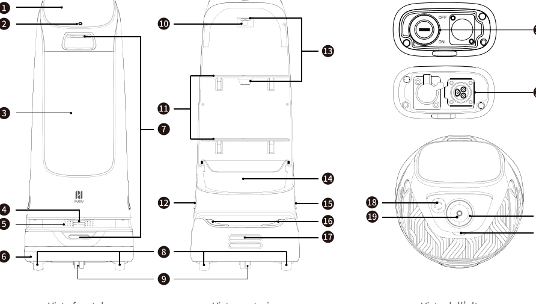
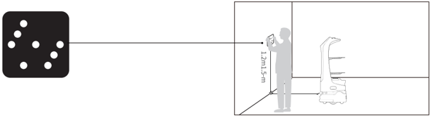
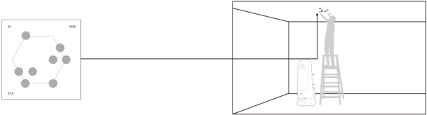
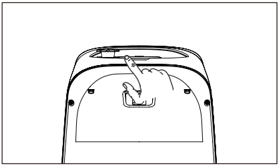
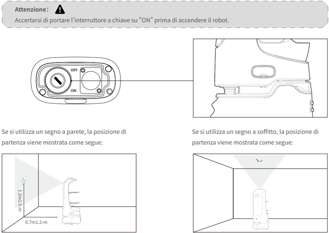

*Pagina 51 (pagina PDF 29, sinistra)*

## Copyright © 2024 Shenzhen Pudu Technology Co., Ltd. Tutti i diritti riservati.

Il presente documento non può essere copiato, riprodotto, trascritto o tradotto, in parte o complessivamente, da qualunque persona o organizzazione, né essere trasmesso in alcuna forma o con qualunque mezzo (elettronica, fotocopiatura, registrazione, ecc.) per qualunque scopo commerciale senza il preventivo permesso scritto di Shenzhen Pudu Technology Co., Ltd. Le specifiche di prodotto e le informazioni qui riportate sono da intendersi solo come riferimento e possono essere modificate senza preavviso. Tranne che se diversamente specificato, il manuale è inteso solo come guida e tutte le dichiarazioni sono fornite senza garanzie di alcun tipo.

# 1. Istruzioni per la sicurezza

## 1.1 Uso dell'alimentazione elettrica

- Non ricaricare il robot utilizzando caricatori non originali. Se il caricatore è danneggiato, sostituirlo immediatamente.
- Quando il livello di carica della batteria scenda al di sotto del 20%, il robot deve essere ricaricato in tempo. Il funzionamento per lungo tempo con un basso livello di carica della batteria potrebbe compromettere la durata della batteria.
- Accertarsi che la tensione di alimentazione corrisponda a quella indicata sul caricatore: in caso contrario potrebbero verificarsi danni al caricatore.
- Quando si utilizza il caricatore, assicurarsi che il fermo dell ' interfaccia di ricarica sia completamente agganciato per evitare il surriscaldamento durante la ricarica, che potrebbe causare ustioni o danni all ' apparecchiatura.

## 1.2 Uso del robot

- Non coprire la videocamera superiore del robot mentre è in funzione, per evitare che si muova in modo anomalo. Se la videocamera è coperta, mettere in pausa l ' attività corrente e spostare il robot sul percorso corretto prima di proseguire l ' attività.
- Non pulire né manutenere il robot mentre è acceso e in movimento.
- Non appoggiare fornelli a fiamma libera o articoli infiammabili o esplosivi sul robot.
- Non prelevare o appoggiare piatti mentre il robot è in movimento per evitare perdite di cibo o lesioni personali causate da collisioni accidentali.
- Non spostare o trasportare il robot mentre è in funzione, per evitare che si muova in modo anomalo.
- Il robot non deve essere smontato o riparato da personale non preparato. In caso di malfunzionamento, contattare immediatamente Shenzhen Pudu Technology Co., Ltd. per avere assistenza tecnica.
- Rispettare il peso massimo che una persona può sollevare come richiesto dalle leggi e dalle normative locali durante il trasporto del robot. Durante il trasporto, tenere il robot in posizione eretta. Non tentare mai di trasportare il robot sollevando il vassoio o il contenitore.

## 1.3 Ambiente

- Non utilizzare o ricaricare il robot in un ambiente ad alta temperatura/pressione, in zone a rischio di incendio o esplosione o in altri ambienti pericolosi, per evitare lesioni personali o danni al robot.
- Non utilizzare il robot in un ambiente umido o su superfici ricoperte di liquidi o sostanze appiccicose per evitare danni al robot.
- Non utilizzare il robot in luoghi in cui è esplicitamente vietato l ' uso di dispositivi wireless: potrebbe causare interferenze ad altri dispositivi elettronici o comportare altri pericoli.
- Non smaltire il robot o i suoi accessori come rifiuti domestici. Smaltire sempre il robot e i suoi accessori secondo le leggi e le normative locali e riciclarli ove possibile.

---

*Pagina 52 (pagina PDF 29, destra)*

# 2. Componenti del prodotto

## 2.1 Elenco del contenuto

Robot × 1, KettyBot Manuale dell'utente × 1, Certificato di qualità × 1, Caricatore × 1, Chiavetta di accensione × 1, Segni a parete × 1, Segni a soffitto × 1.

## 2.2 Panoramica

KettyBot è un robot per consegna e accoglienza con un grande schermo pubblicitario che supporta soluzioni di posizionamento e navigazione SLAM integrando sia il posizionamento visivo che laser. La sua eccezionale esigenza di spazio di soli 55 cm gli consente di muoversi senza problemi in ambienti complessi e affollati. Come versatile tuttofare per il marketing, l’attrazione e l’acquisizione dei clienti, i saluti e l’accompagnamento, la consegna di piatti, l’interazione vocale e altro ancora, KettyBot è adatto per l’uso in ristoranti, hotel, supermercati e molti altri scenari aziendali.

## 2.3 Aspetto e componenti

> *Descrizione della figura (IA):* Le immagini a destra illustrano i dettagli dei connettori di ricarica, inclusi gli spinotti e le prese per l'alimentazione.

> *Descrizione della figura (IA):* Le immagini a destra illustrano i dettagli dei connettori di ricarica, inclusi gli spinotti e le prese per l'alimentazione.

> *Descrizione della figura (IA):* Le immagini a destra illustrano i dettagli dei connettori di ricarica, inclusi gli spinotti e le prese per l'alimentazione.

*Etichette:*

- **1** Schermo LCD
- **2** Videocamera di posizionamento frontale
- **3** Schermo pubblicitario
- **4** Lidar
- **5** Apparecchiatura audio
- **6** Sensori di collisione
- **7** Sensori di visione di profondità
- **8** Ruote motrici
- **9** Ruote ausiliarie
- **10** Coperchio del vano per la scheda SIM
- **11** Vassoi
- **12** Interruttore a chiave
- **13** Sensore di rilevamento pallet
- **14** Scatola per ritorno piatti
- **15** Spinotto di ricarica
- **16** Striscia luminosa
- **17** Piastra elettrodo di ricarica
- **18** Interruttore arresto di emergenza
- **19** Sensore di visione
- **20** Array di microfoni ad anello
- **21** Interruttore di accensione

---

*Pagina 53 (pagina PDF 30, sinistra)*

## 2.4 Specifiche

| Funzionalità | Descrizione |
|---|---|
| Tensione di lavoro | CC 25,6 V |
| Ingresso alimentazione | CA 100–240 V, 50/60 Hz |
| Uscita alimentazione | 29,4 V/ 8A |
| Capacità della batteria | 25 Ah |
| Tempo di carica | 4 ore |
| Modalità di ricarica | Ricarica manuale e automatica |
| Durata della batteria | 11 ore (Funzionamento a vuoto) |
| Velocità di crociera | 0,2–1,2 m/s (regolabile) |
| Navigazione | Posizionamento SLAM integrato laser e visivo |
| Minima larghezza di spostamento | 55 cm |
| Massima altezza superabile | 5 mm |
| Massimo angolo di salita | 5º |
| Dimensioni dei vassoi | 352 mm x 340 mm |
| Num. di vassoi | Due vassoi e una scatola per ritorno piatti |
| Altezza fra i vassoi | Dall ’ alto verso il basso: 248 mm/253 mm/223 mm |
| Carico dei vassoi | 10 kg per vassoio |
| Materiale della macchina | ABS/Lega di alluminio di tipo aeronautico |
| Peso del robot | 38 kg |
| Dimensioni del robot | 435 mm x 450 mm x 1120 mm |
| Sistema operativo | Android |
| Microfono | Kit di matrice circolare 6 microfoni |
| Potenza del diffusore | Due diffusori stereo da 10 W |
| Durata | 5 anni |
| Ambiente di lavoro | Temperatura: da 0 ℃ a 40 ℃ ; Umidità relativa: ≤ 85% |
| Ambiente di conservazione | Temperatura: da -40 ℃ a 65 ℃ ; Umidità relativa: ≤ 85% |
| Altitudine di lavoro | < 2000 m |
| Requisiti di superficie | Ambiente interno, pavimento piano e liscio |
| Valutazione IP | IP20 |
| Banda di frequenza | Wi-Fi: Wi-Fi 2,4G: 2412–2472 MHz, 2422–2462 MHz Wi-Fi 5,2–5,6G: 5180–5320 MHz, 5500–5700 MHz, 5190–5310 MHz, 5510–5670 MHz, 5210–5290 MHz, 5530–5610 MHz Wi-Fi 5,8G: 5745–5825 MHz, 5755–5795 MHz, 5775 MHz |
| Banda di frequenza | Bluetooth: 2402–2480 MHz |
| Banda di frequenza | 3G: B1/B8 |
| Banda di frequenza | 4G: B1/B3/B7/B8/B20/B28/B34/B38/B40 |

---

*Pagina 54 (pagina PDF 30, destra)*

| Funzionalità | Descrizione | Descrizione |
|---|---|---|
| Massima potenza in trasmissione | Wi-Fi | 2,4G Wi-Fi: 17,48 dBm; 5,2–5,6G Wi-Fi: 13,35 dBm; 5,8G Wi-Fi: 13,85 dBm |
| Massima potenza in trasmissione | Bluetooth | BLE: 5,96 dBm; BR/EDR: 8,49 dBm |
| Massima potenza in trasmissione | 3G | B1: 23,56 dBm; B8: 23,43 dBm |
| Massima potenza in trasmissione | 4G | B1: 23,49 dBm; B3: 23,96 dBm; B7: 24,33 dBm; B8: 23,45 dBm; B20: 23,36 dBm; B28: 23,81 dBm; B34: 23,32 dBm; B38: 24,76 dBm; B40: 23,25 dBm |

# 3. Modalità d'uso

## 3.1 Istruzioni per la mappatura

KettyBot permette la creazione di nuove mappe sullo stesso robot. Quando il robot viene avviato per la prima volta, è possibile creare nuove mappe direttamente sul robot senza utilizzare strumenti di mappatura.

Prima di creare una mappa, contattare la nostra assistenza tecnica per avere un codice di attivazione e scegliere una posizione per applicare un segno a parete o a soffitto per utilizzarlo come posizione di partenza. È poi possibile creare la mappa come indicato sullo schermo. Fare riferimento alla Guida operativa di KettyBot per maggiori dettagli.

## Nota：

Non è possibile utilizzare contemporaneamente un segno a soffitto e uno a parete. È necessario scegliere uno solo dei due.

- Se si utilizza un segno a parete, non applicarlo su superfici riflettenti come vetro o piastrelle di ceramica.

> *Descrizione della figura (IA):* L'utente deve tenere il dispositivo (tablet o smartphone) in verticale e orientato verso il robot KettyBot. Il segno a parete o a soffitto (non visibile nella figura ma menzionato nel testo) funge da punto di riferimento per l'avvio della mappatura. La freccia indica che l'utente deve stare davanti al robot, non lateralmente o dietro.

- Se si utilizza un segno a soffitto, non applicarlo su un soffitto altamente riflettente.

> *Descrizione della figura (IA):* Il diagramma a sinistra mostra una configurazione di punti (etichettati come VT.4 e HD6) che rappresentano posizioni o sensori rilevanti per il robot. La linea tratteggiata collega la configurazione dei punti al robot KettyBot, indicando un processo di mappatura o allineamento. Il robot è posizionato su una scala mentre interagisce con un segno applicato al soffitto, suggerendo l'uso del segno come punto di riferimento per la creazione della mappa. La figura illustra visivamente il passo iniziale delle istruzioni per la mappatura: applicare un segno a parete o a soffitto e usarlo come posizione di partenza.

---

*Pagina 55 (pagina PDF 31, sinistra)*

## 3.2 Istruzioni per i pulsanti

## Accensione:

Portare il robot nella posizione di partenza e tenere premuto l ' interruttore di accensione per 1 secondo. La striscia luminosa inferiore si accenderà, indicando che il robot è acceso.

> *Descrizione della figura (IA):* La figura mostra la posizione dell'interruttore di accensione/arresto sul retro del robot KettyBot. L'indicatore visivo punta all'interruttore a chiave che deve essere impostato su 'ON' prima di accendere il dispositivo. L'immagine illustra dove si trova l'interruttore da premere per spegnere o riavviare il robot in caso di emergenza. La posizione dell'interruttore è visibile sul pannello posteriore del robot, sotto la striscia luminosa.

> *Descrizione della figura (IA):* L'interruttore a chiave deve essere impostato su "ON" prima di accendere il robot. La posizione di partenza per un segno a soffitto è mostrata con il robot posizionato sotto il segnale. Il diagramma mostra la vista dell'interruttore a chiave con le posizioni "OFF" e "ON".
Se si utilizza un segno a parete, la posizione di partenza viene mostrata come segue:

Se si utilizza un segno a soffitto, la posizione di partenza viene mostrata come segue:

Attenzione：

Accertarsi di portare l ’ interruttore a chiave su "ON" prima di accendere il robot.

## Spegnimento：

Premere e tenere premuto l ' interruttore di accensione per 3 secondi: sullo schermo apparirà l ' opzione Spegnimento .

Toccare Spegnimento: la striscia luminosa in basso e lo schermo si spegneranno, indicando che il robot è spento.

## Pausa：

Toccare lo schermo per mettere in pausa il robot. Toccare di nuovo per riprendere il funzionamento.

## Arresto di emergenza:

In caso di emergenza, premere l ' interruttore arresto di emergenza per arrestare un robot in funzione. Ruotare l ' interruttore arresto di emergenza in senso orario e riprendere il funzionamento secondo i suggerimenti riportati a video.

* Fare riferimento alla Guida operativa di KettyBot per maggiori informazioni su come utilizzare il robot.

---

*Pagina 56 (pagina PDF 31, destra)*

# 4. Manutenzione e cura

| Componenti | Stato del robot | Intervallo di ispezione | Metodo di manutenzione |
|---|---|---|---|
| Vassoi, ruote motrici e ruote ausiliarie | Spegnimento | Settimanalmente | Pulire la superficie con un panno pulito. |
| Sensore di visione, Videocamera di posizionamento frontale, sensori di visione di profondità e Lidar | Spegnimento | Settimanalmente | Utilizzare un panno pulito o un detergente per lenti per la pulizia. In caso di contaminazione inaspettata, intervenire immediatamente per evitare di bloccare il sensore e impedire che il robot funzioni in modo improprio. |
| Corpo del robot | Spegnimento | Mensilmente | Pulire la superficie con un panno pulito. |

* Fare riferimento alla Guida operativa di KettyBot per maggiori informazioni su come manutenere e avere cura del robot.

# 5. Assistenza post-vendita

Shenzhen Pudu Technology Co., Ltd. fornisce un servizio di garanzia gratuito entro il periodo di garanzia efficace (il periodo di garanzia può essere diverso per i componenti diversi). I costi sostenuti per il servizio post-vendita saranno a carico di Pudu. Trascorso il periodo di garanzia o in qualunque circostanza non coperta dalla garanzia gratuita, verrà addebitato un certo costo in base al prezzo normale. Chiamare la hotline post-vendita per informazioni dettagliate sulla politica del servizio post-vendita e sui servizi di riparazione. La politica è anche disponibile nella Guida Operativa di KettyBot.

E-mail post-vendita Pudu: techservice@pudutech.com.

# 6. Informazioni sulla conformità

## 6.1 Informazioni sullo smaltimento e il riciclo

La direttiva sui rifiuti di apparecchiature elettriche ed elettroniche (RAEE) mira a ridurre al minimo l’impatto dei prodotti elettrici ed elettronici sull’ambiente, aumentando il riutilizzo e il riciclo e riducendo la quantità di RAEE destinati alla discarica. Il simbolo su questo prodotto o sulla sua confezione indica che questo prodotto deve essere smaltito separatamente dai normali rifiuti domestici al termine del suo ciclo di vita. È responsabilità del cliente smaltire le apparecchiature elettroniche presso i centri di riciclo al fine di preservare le risorse naturali. Ogni paese deve avere i propri centri di raccolta per il riciclo delle apparecchiature elettriche ed elettroniche. Per informazioni sull’area di raccolta per il riciclo, contattare l’autorità competente per la gestione dei rifiuti di apparecchiature elettriche ed elettroniche, l’ufficio comunale locale o il servizio di smaltimento dei rifiuti domestici.

Prima di immettere apparecchiature elettriche ed elettroniche (AEE) nel flusso di raccolta dei rifiuti o negli impianti di raccolta dei rifiuti, l’utente finale di apparecchiature contenenti batterie e/o accumulatori deve rimuovere tali batterie e accumulatori per la raccolta differenziata.
