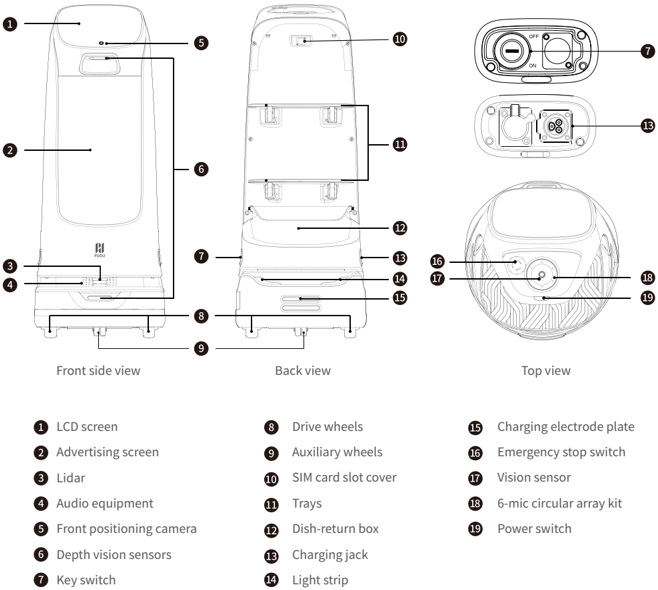
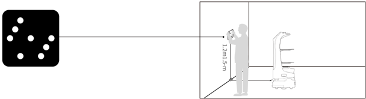
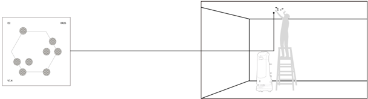
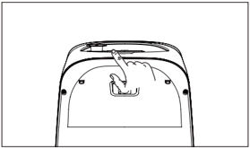
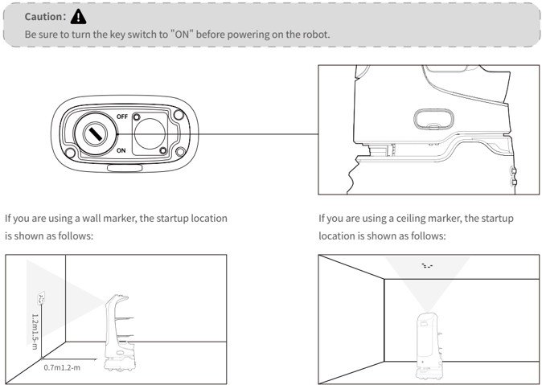

*Page 1 (PDF page 3, left)*

## Copyright © 2023 Shenzhen Pudu Technology Co., Ltd. All rights reserved.

This document may not be copied, reproduced, transcribed or translated, in part or in whole, by any persons or organizations, or be transmitted in any form or by any means (electronic, photocopy, recording, etc.) for any commercial purposes without the prior written permission of Shenzhen Pudu Technology Co., Ltd. The product specifications and information mentioned herein are for reference only and are subject to change without prior notice. Unless otherwise specified, the manual is intended as a guide only and all the statements are provided without warranty of any kind.

# 1. Safety instructions

## 1.1 Power usage

- Do not charge your robot using non-original chargers. If the charger is damaged, replace it immediately.
- When the battery drops to 20%, the robot should be charged timely. Running at a low battery for a long time may impair battery life.
- Make sure that the power voltage matches the voltage indicated on the charger, or it may cause damages to the charger.
- When using the charger, ensure that the fastener of the charging interface is fully engaged to avoid overheating during charging, which may cause burns or damage to the equipment.

## 1.2 Robot usage

- Do not cover the robot ' s top camera while it is working to prevent it from moving abnormally. If the camera is covered, pause the current task and move the robot to the correct route before continuing the task.
- Do not clean or maintain the robot when it is powered on and working.
- Do not put open-flame stoves or any flammable and explosive articles on the robot.
- Do not pick or place dishes while the robot is moving to avoid any food loss or personal injury caused by accidental collision.
- Do not move or transport the robot while it is working to prevent it from moving abnormally.
- The robot must not be disassembled or repaired by untrained personnel. In case of malfunction, contact Shenzhen Pudu Technology Co., Ltd. for technical support in time.
- Observe the maximum weight a person is allowed to lift as required by local laws and regulations when transporting the robot. Keep the robot upright during transportation. Never attempt to transport it by lifting the tray or the box.

## 1.3 Environment

- Do not use or charge the robot in a high temperature/pressure environment, areas with fire or explosion hazard, or other dangerous scenarios to avoid personal injury or robot damage.
- Do not use the robot in a humid environment or on surfaces covered with fluid or gooey stuff to avoid damage to the robot.
- Do not use the robot in places where the use of wireless devices is explicitly prohibited, otherwise it may cause interference to other electronic devices or lead to other dangers.
- Do not dispose of the robot or its accessories as household waste. Always dispose of the robot and its accessories according to local laws and regulations, and recycle wherever possible.

---

*Page 2 (PDF page 3, right)*

# 2. Product components

## 2.1 Packing list

Robot×1, KettyBot User Manual×1, Quality Certificate×1, Charger×1, Power Key×1, Wall Markers×1, Ceiling Markers×1.

## 2.2 Overview

KettyBot is a delivery and reception robot with a large advertising screen that supports SLAM positioning and navigation solutions integrating both visual and laser positioning. Its superior trafficability of only 55 cm allows it to move around effortlessly in complex and crowded environments. As a versatile all-rounder for marketing, customer attraction & acquisition, greeting & escorting, food delivery, voice interaction, and more, KettyBot is suitable for use in restaurants, hotels, supermarkets, and many other business scenarios.

## 2.3 Appearance & components

> *Figure description (AI):* The diagram shows the positions of ports and connectors, including the charging jack (13) and SIM card slot cover (10) on the back view.

*Labels:*

- **1** LCD screen
- **2** Advertising screen
- **3** Lidar
- **4** Audio equipment
- **5** Front positioning camera
- **6** Depth vision sensors
- **7** Key switch
- **8** Drive wheels
- **9** Auxiliary wheels
- **10** SIM card slot cover
- **11** Trays
- **12** Dish-return box
- **13** Charging jack
- **14** Light strip
- **15** Charging electrode plate
- **16** Emergency stop switch
- **17** Vision sensor
- **18** 6-mic circular array kit
- **19** Power switch

---

*Page 3 (PDF page 4, left)*

## 2.4 Specifications

| Feature | Description |
|---|---|
| Operating voltage | DC 25.6 V |
| Power input | AC 100–240 V, 50/60 Hz |
| Power output | 29.4 V/ 8 A |
| Battery capacity | 20 Ah |
| Charging time | 4 h |
| Charging mode | Manual and auto charging |
| Battery life | > 8 h |
| Cruise speed | 0.5–1.2 m/s (adjustable) |
| Navigation | Laser and visual integrated SLAM positioning |
| Min. travel width | 55 cm |
| Max. surmountable height | 5 mm |
| Max. climbing angle | 5º |
| Tray dimensions | 352 mm x 340 mm |
| No. of trays | Two trays and one dish-return box |
| Height between trays | From top to bottom: 248 mm/253 mm/223 mm |
| Tray load | 10 kg/layer |
| Machine material | ABS/aviation grade aluminum alloy |
| Robot weight | 38 kg |
| Robot dimensions | 435 mm x 450 mm x 1120 mm |
| Screen size | 10.1-inch LCD screen and 18.5-inch LCD screen (advertising screen) |
| Operation system | Android |
| Microphone | 6-mic circular array kit |
| Speaker power | 2 x 10 W stereo speakers |
| Service life | 5 years |
| Working environment | Temperature: 0 ℃ to 40 ℃ ; RH: ≤ 85% |
| Storage environment | Temperature: -40 ℃ to 65 ℃ ; RH: ≤ 85% |
| Working altitude | < 2000 m |
| Surface requirement | Indoor environment, flat and smooth ground |
| IP rating | IP20 |
| Frequency band range | Wi-Fi: 2.4G Wi-Fi: 2412–2472 MHz, 2422–2462 MHz 5.2–5.6G Wi-Fi: 5180–5320 MHz, 5500–5700 MHz, 5190–5310 MHz, 5510–5670 MHz, 5210–5290 MHz, 5530–5610 MHz 5.8G Wi-Fi: 5745–5825 MHz, 5755–5795 MHz, 5775 MHz |
| Frequency band range | Bluetooth: 2402–2480 MHz |
| Frequency band range | 3G: B1/B8 |
| Frequency band range | 4G: B1/B3/B7/B8/B20/B28/B34/B38/B40 |

---

*Page 4 (PDF page 4, right)*

| Feature | Description | Description |
|---|---|---|
| Max. transmit power | Wi-Fi | 2.4G Wi-Fi: 17.48 dBm; 5.2–5.6G Wi-Fi: 13.35 dBm; 5.8G Wi-Fi: 13.85 dBm |
| Max. transmit power | Bluetooth | BLE: 5.96 dBm; BR/EDR: 8.49 dBm |
| Max. transmit power | 3G | B1: 23.56 dBm; B8: 23.43 dBm |
| Max. transmit power | 4G | B1: 23.49 dBm; B3: 23.96 dBm; B7: 24.33 dBm; B8: 23.45 dBm; B20: 23.36 dBm; B28: 23.81 dBm; B34: 23.32 dBm; B38: 24.76 dBm; B40: 23.25 dBm |

# 3. How to use

## 3.1 Mapping instructions

KettyBot supports creating new maps on the robot itself. When the robot is first started, you can create new maps directly on the robot without using any mapping tools.

Before creating a map, please contact our technical support for an activation code, and pick a location to apply a wall or ceiling marker and use it as the startup location. You can then create the map as instructed on the screen. Please refer to KettyBot Operation Guide for details.

## Note：

A wall marker and a ceiling marker cannot be used at the same time. Please choose either one of them.

- If you are using a wall marker, do not apply it to reflective surfaces such as glass or ceramic tiles.

> *Figure description (AI):* A wall marker is being applied to the wall by the person. The KettyBot robot is positioned nearby for mapping purposes.

- If you are using a ceiling marker, do not apply it to a highly reflective ceiling.

> *Figure description (AI):* The diagram shows a robot with multiple sensors positioned around it. A person is shown standing on a ladder next to the robot. The figure illustrates the setup or mapping process for the KettyBot robot.

---

*Page 5 (PDF page 5, left)*

## 3.2 Instructions for buttons

## Power-on:

Move the robot to the startup location, and press and hold the power switch for 1 second. The bottom light strip will go on, indicating that the robot is powered on.

> *Figure description (AI):* The figure shows a hand pressing the power switch on the top of the robot. This visual demonstrates the physical location and action required to turn the robot on or off. It complements the text instructions by showing which button corresponds to 'Power-on' and 'Power-off'. The illustration helps users identify the correct component for emergency stop if it is located nearby (though not shown here).

> *Figure description (AI):* The key switch must be turned to 'ON' before powering on the robot. The startup location for a ceiling marker is also illustrated in the figure. The power switch position and its 'ON'/'OFF' states are clearly labeled.
If you are using a wall marker, the startup location is shown as follows:

If you are using a ceiling marker, the startup location is shown as follows:

## Caution：

Be sure to turn the key switch to "ON" before powering on the robot.

## Power-off：

Press and hold the power switch for 3 seconds, the Power Off option will appear on the screen. Tap the Power Off , and the bottom light strip and screen will go off, indicating that the robot is powered off.

## Pause：

Tap on the screen to pause the working robot. Tap again to resume operation.

## Emergency stop:

In case of an emergency, press the emergency stop switch to stop a working robot. Rotate the emergency stop switch clockwise, and resume the operation according to the screen tips.

* Refer to KettyBot Operation Guide for more information on how to use the robot.

---

*Page 6 (PDF page 5, right)*

# 4. Maintenance and care

| Components | Robot Status f | Inspection Interval | Maintenance Method |
|---|---|---|---|
| Trays, driving wheels, and auxiliary wheels | Power-off f | Weekly | Wipe the surface with a clean cloth. |
| Vision sensor, front positioning camera, depth vision sensors, and Lidar | Power-off f | Weekly | Use a clean cloth or lens cleanser for the cleaning. In case of unexpected contamination, address it immediately to avoid blocking the sensor and prevent the robot from working improperly. |
| Robot body | Power-off | Monthly | Wipe the surface with a clean cloth. |

* Refer to KettyBot Operation Guide for more information on how to maintain and care for the robot.

# 5. After-sales service

Shenzhen Pudu Technology Co., Ltd. provides free warranty service within the effective warranty period (the warranty period may vary for different components). The fees incurred by the after-sales service will be covered by Pudu. Beyond the warranty period or in any circumstances not covered by the free warranty, a certain fee will be charged according to the normal price. Please call the after-sales hotline for detailed after-sales service policy and repair services. The policy can also be found in KettyBot Operation Guide. Pudu after-sales email: techservice@pudutech.com.

# 6. Compliance information

## 6.1 Disposal and recycling information

The Waste Electrical and Electronic Equipment (WEEE) Directive aims to minimize the impact of electrical and electronic goods on the environment, by increasing re-use and recycling and by reducing the amount of WEEE going to landfill. The symbol on this product or its packaging signifies that this product must be disposed separately from ordinary household wastes at its end of life. Be aware that this is your responsibility to dispose of electronic equipment at recycling centers in order to conserve natural resources. Each country should have its collection centers for electrical and electronic equipment recycling. For information about your recycling drop off area, please contact your related electrical and electronic equipment waste management authority, your local city office, or your house hold waste disposal service.

Before placing electrical and electronic equipment (EEE) in the waste collection stream or in waste collection facilities, the end user of equipment containing batteries and/or accumulators must remove those batteries and accumulators for separate collection.

---

*Page 7 (PDF page 6, left)*

## 6.2 Federal Communications Commission compliance statement

The following information applies to Pudu robotic.

This equipment has been tested and found to comply with the limits for a Class B digital device, pursuant to part 15 of the FCC Rules. These limits are designed to provide reasonable protection against harmful interference in a residential installation. This equipment generates, uses and can radiate radio frequency energy and, if not installed and used in accordance with the instructions, may cause harmful interference to radio communications. However, there is no guarantee that interference will not occur in a particular installation. If this equipment does cause harmful interference to radio or television reception, which can be determined by turning the equipment off and on, the user is encouraged to try to correct the interference by one or more of the following measures:

- Reorient or relocate the receiving antenna.
- Increase the separation between the equipment and receiver.
- Connect the equipment into an outlet on a circuit different from that to which the receiver is connected.
- Consult the dealer or an experienced radio/TV technician for help.

This device complies with Part 15 of the FCC rules. Operation is subject to the following two conditions:

- This device may not cause harmful interference.
- This device must accept any interference received, including interference that may cause undesired operation.

## 6.3 Industry Canada compliance statement

This device complies with Industry Canada licence-exempt RSS standard(s). Operation is subject to the following two conditions:

- This device may not cause interference.
- This device must accept any interference, including interference that may cause undesired operation of the device.
