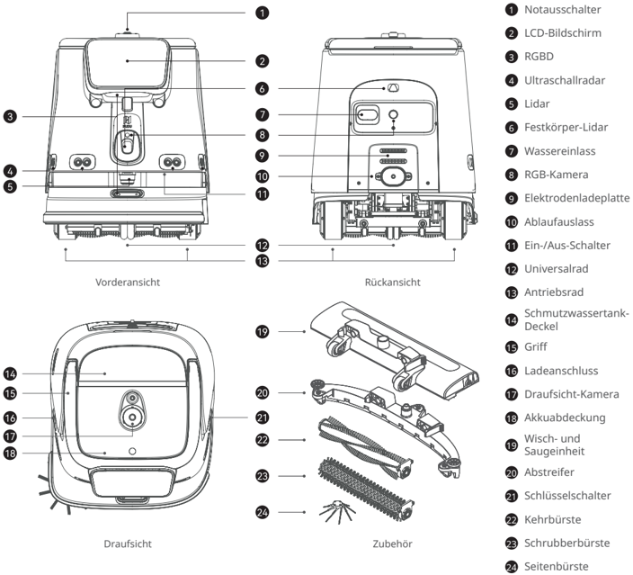
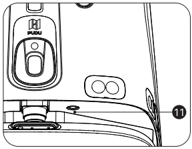
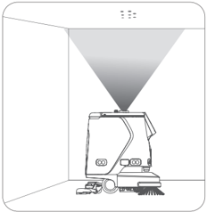
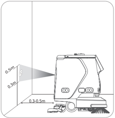
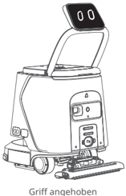
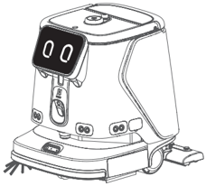

*Seite 21 (PDF-Seite 13, links)*

## Copyright © 2025 Shenzhen Pudu Technology Co., Ltd. Alle Rechte vorbehalten.

Keine Organisation oder Einzelperson darf den Inhalt dieses Benutzerhandbuchs teilweise oder vollständig ohne die ausdrückliche schriftliche Zustimmung von Shenzhen Pudu Technology Co., Ltd. kopieren, transkribieren oder übersetzen oder dieses Benutzerhandbuch zu kommerziellen Zwecken auf beliebige Weise verteilen (elektronisch oder durch Fotokopieren, Aufzeichnen usw.). Die in diesem Benutzerhandbuch bereitgestellten technischen Daten und Angaben zum Produkt dienen nur als Referenz und können ohne vorherige Ankündigung geändert werden. Falls nicht anders angegeben, ist dieses Benutzerhandbuch nur als Orientierungshilfe gedacht und die darin enthaltenen Darstellungen sind nicht als Gewährleistung irgendwelcher Art aufzufassen.

---

*Seite 22 (PDF-Seite 13, rechts)*

# 1. Sicherheitsanweisungen

## 1.1 Elektrizität

- Laden Sie Ihren Roboter nicht mit nicht-originalen Ladegeräten auf. Tauschen Sie das Ladegerät bei Beschädigung sofort aus.
- Bitte laden Sie den Akku vor dem ersten Gebrauch auf 100 % auf.
- Halten Sie den Akkuladestand immer über 10 %, damit Nutzen und Laufzeit des Roboters bestmöglich erhalten bleiben.
- Ein Ladestand von unter 10 % bedeutet, dass der Roboter bald keine Energie mehr hat und so schnell wie möglich aufgeladen werden sollte.
- Ein Akkuladestand von unter 2 % bedeutet, dass der Akku in Sicherheitsbetrieb geschaltet wird. Der Roboter ist in diesem Fall nicht arbeitsfähig und muss wieder aufgeladen werden.
- Wenn Sie die Maschine längere Zeit nicht benutzen, schalten Sie den Startschlüssel bitte in die Position „Aus".
- Wenn der Roboter längere Zeit nicht verwendet wurde, laden Sie ihn vor der erneuten Verwendung vollständig auf.

## 1.2 Gebrauchshinweise

- Dieser reinigende, fahrbare Roboter darf nur in Innenräumen auf ebenen Flächen verwendet werden. Verwenden Sie ihn nicht im Freien (z. B. auf einem offenen Balkon) oder auf unebenem Untergrund (z. B. Treppen).
- Verwenden Sie den Roboter nicht bei einer Temperatur von über 40 ℃ oder unter 0 ℃.
- Nimmt er versehentlich eine falsche Position ein, z. B. aufgrund eines Hindernisses, unterbrechen Sie seine Aufgabe sofort, schieben Sie den Roboter auf die richtige Strecke und lassen Sie ihn fortfahren.
- Nicht am Roboter ziehen, während er arbeitet. Falls Sie ihn schieben oder versetzen müssen, tippen Sie zunächst auf den Bildschirm, um ihn anzuhalten.
- Den Roboter nicht rückwärts schieben, wenn er eingeschaltet ist.
- Der Sensor des Roboters darf nicht abgedeckt werden. Der Roboter kann sich sonst nicht korrekt bewegen oder verliert die Orientierung.
- Schlagen Sie nicht auf das Gerät und drücken oder tippen Sie nicht stark auf den Bildschirm, da sonst Schäden verursacht werden können.
- Verwenden Sie den Roboter nicht zum Transportieren von Gütern. Es dürfen keine Vorrichtungen mit offener Flamme oder brennbare Festkörper, Gase oder Flüssigkeiten auf das Tablett gestellt werden.
- Die Einstellungen dürfen nicht angepasst werden, während der Roboter sich bewegt. Tippen Sie immer auf den Bildschirm, um den Roboter zu pausieren, bevor Sie ihn bedienen.
- Reinigen oder warten Sie den Roboter nicht, wenn Spannung eingeschaltet ist.
- Am Boden liegende Kabel sind zuvor zu entfernen, damit sich der Roboter nicht einfädelt.
- Zur Sicherheit wird eine Höchstgeschwindigkeit von 1,2 m/s empfohlen.
- Der Roboter verfügt zwar über eine automatische Hinderniserkennung, es kann jedoch tote Winkel geben. Deshalb kann es zu Unfällen kommen, wenn die Bewegung des Roboters bei hoher Geschwindigkeit abrupt blockiert wird.
- Achten Sie beim Transport des Roboters darauf, dass das Wasser im Lösungstank und Schmutzwassertank entleert wird. Es ist strengstens untersagt, die Maschine während des Transports zu kippen, da sonst die Robotergehäuse beschädigt werden kann.
- Roboter können nicht schäumende, neutrale Reinigungsmittel mit einem pH-Wert von 6 bis 8 verwenden (Entschäumer können hinzugefügt werden). Die Verwendung von starken Säuren, starken Laugen und wirkstoffhaltigen Reinigungsmitteln ist verboten.

## 1.3 Umfeld

- Betreiben oder laden Sie den Roboter nicht in einer Umgebung mit hohen Temperaturen oder hohem Druck, in Bereichen mit Feuer- oder Explosionsgefahr oder in anderen gefährlichen Umgebungen, sonst können Verletzungen an Personen oder Schäden am Roboter auftreten.
- Entsorgen Sie den Roboter und dessen Zubehör nicht über den Hausmüll. Entsorgen Sie Roboter und Zubehör vorschriftsgemäß. Führen Sie ihn möglichst dem Recycling zu.
- Dieser Roboter ist für die Verwendung auf ebenen Oberflächen ausgelegt und eignet sich nicht für Umgebungen mit Stufen, starken Steigungen oder engen Räumen.
- Es wird nicht empfohlen, den Roboter auf stark fettigem Boden fahren zu lassen.
- Am Boden liegende Kabel usw. sind zuvor zu entfernen, damit sich der Roboter nicht einfädelt oder verheddert.
- Wenn Sie dieses Produkt über Bodenschwellen, Absätze oder Bodensteckdosen fahren lassen, müssen Sie sicherstellen, dass die Höhe der Vorsprünge maximal 8 mm (zum Reinigen) bzw. 20 mm (zum Durchfahren, nicht zum Reinigen) beträgt.
- Die Mindestdurchgangsbreite beträgt 70 cm. Damit der Roboter reibungslos durch eine lange Passage fahren kann, sollte diese sogar mindestens 75 cm breit sein.
- Die höchste zulässige Steigung für den Roboter beträgt 8° (wenn er nicht reinigt). Um Risiken durch Rückwärtsrutschen vorzubeugen, sollte der Roboter bei Steigungsfahrten nicht angehalten werden.
- Der Roboter unterstützt nur die Reinigung auf ebenen Flächen (im Reinigungszustand). Bitte verwenden Sie den Roboter nicht zum Reinigen auf mit bloßem Auge erkennbaren Steigungen (größer als 3°).
- Am Treppenrand, an der Einfahrt zu abfallenden Rampen und an anderen Orten, an denen der Roboter herunterfallen kann, sollten Geländer oder andere Schutzvorrichtungen angebracht werden.

---

*Seite 23 (PDF-Seite 14, links)*

# 2. Produktbestandteile

## 2.1 Überblick

Beim PUDU CC1 Pro Roboter handelt es sich um einen vielseitigen Reinigungsroboter, der für Szenarien kleiner und mittlerer Größe ausgelegt ist. Er vereint die Funktionen zum Kehren, Schrubben, Staubsaugen (von Teppichen) und Staubwischen und verfügt über Funktionen zum automatischen Füllen/Entleeren und automatischen Laden. Er eignet sich für verschiedene Reinigungsszenarien mit unterschiedlichen Materialien und Härten, ob es sich um Hartböden oder niederflorige Teppiche handelt. Seine typischen Anwendungsszenarien umfassen Bürogebäude, Dienststellen, Hotels, Ladenlokale und weitere Szenarien in Innenräumen, die eine leichte Reinigung erfordern. Das Produkt verbessert die Gesamtsauberkeit der Umgebung zu niedrigeren Kosten und mit höherer Effizienz.

## 2.2 Packliste

Roboter x 1, Ladegerät x 1, Startschlüssel x 2, Seitenbürste x 1, Abstreifer x 1, Wischkehrer x 1, Schrubberbürste x 2, Kehrbürste x 2, Wasserfüllrohr x 1, Düse x1, PUDU CC1 Pro Bedienungsanleitung x 1, Konformitätsbescheinigung x 1, Positionsmarkierung x 1.

## 2.3 Aussehen und Bestandteile

> *Bildbeschreibung (KI):* Die Abbildung zeigt die Vorder-, Rück- und Draufsicht des PUDU CC1 Pro Roboters mit nummerierten Beschriftungen für alle Komponenten. Jede Komponente ist durch eine Linie mit einer Nummer verbunden, die in der rechten Spalte oder im OCR-Text beschrieben wird (z. B. ① Notausschalter, ② LCD-Bildschirm). Die Abbildung enthält auch eine separate Darstellung des Zubehörs (Abstreifer, Kehrbürste, Schrubberbürste, Seitenbürste) mit entsprechenden Nummern und Bezeichnungen. Durch die Beschriftungen kann der Nutzer erkennen, wo sich wichtige Elemente wie Ladeanschluss, Ein-/Aus-Schalter oder Kamera befinden.

*Beschriftungen:*

- **1** Notausschalter
- **2** LCD-Bildschirm
- **3** RGBD
- **4** Ultraschallradar
- **5** Lidar
- **6** Festkörper-Lidar
- **7** Wassereinlass
- **8** RGB-Kamera
- **9** Elektrodenladeplatte
- **10** Ablaufauslass
- **11** Ein-/Aus-Schalter
- **12** Universalrad
- **13** Antriebsrad Schmutzwassertank-
- **14** Deckel
- **15** Griff
- **16** Ladeanschluss
- **17** Draufsicht-Kamera
- **18** Akkuabdeckung Wisch- und
- **19** Saugeinheit
- **20** Abstreifer
- **21** Schlüsselschalter
- **22** Kehrbürste
- **23** Schrubberbürste
- **24** Seitenbürste

---

*Seite 24 (PDF-Seite 14, rechts)*

## 2.4 Technische Daten

| Merkmale | Beschreibung |
|---|---|
| Modell | CCBC02 |
| Betriebsspannung | DC 23 V bis 29,2 V |
| Akku-Typ | Lithium-Eisenphosphat-Akku |
| Netzteil-Eingabe | AC 100 V bis 240 V, 50/60 Hz |
| Netzteil-Ausgabe | Max. 29,2 V, 15 A |
| Akkukapazität | 50 Ah |
| Aufladezeit | < 3 Std. |
| Akkulaufzeit | Schrubben: 5 Std.; Fegen + Staubsaugen + Wischen: 5 Std.; Staubsaugen von Teppichen: 4 Std.; Leises Wischen: 9 Std. |
| Reinigungsfähigkeiten | Kehren, Staubsaugen (von Teppichen), Wischen, Schrubben |
| Gewicht | 75 kg |
| Maße des Roboters | 629 x 552 x 695 mm |
| Gehäusematerial | PC+ABS |
| Navigationsmethode | Integriertes Lidar und optische SLAM-Positionierung |
| Rundfahrtgeschwindigkeit | 0,2–1,2 m/s (einstellbar) |
| Betriebsgeräusch | < 70 dB |
| Min. Pfadabstand | 70 cm |
| Max. überwindbare Höhe | 20 mm |
| Max. Neigungswinkel | 8º |
| Max. überwindbarer Spalt | 35 mm |
| Reinigungsbreite (mit Seitenbürste) | 500 mm |
| Flächenreinigung | 700–1000 m 2 /h: 837,19–1195,99 yr 2 /h |
| Punktreinigung | 1500–3000 m 2 /h: 1793,99–3587,97 yr 2 /h |
| Staubbehälterkapazität (Staubsaugen) | 2,5 l (Standard) / 6 l (Erweitert) |
| Fassungsvermögen des Wassertanks (Schrubben) | Lösungstank: 15 l Schmutzwassertank: 15 l |
| Betriebssystem | Android |
| Kommunikation | 4G, WLAN, Bluetooth unterstützt, Lora (Optional) |
| Mobil-App | Unterstützt |
| Betriebsmodus | Manuell/Auto |
| Automatisches Aufladen und automatisches Nachfüllen/Entleeren von Wasser | Unterstützt (in Verbindung mit Dockingstation) |
| Optionale Funktion |  |
| Arbeitsumgebung (inkl. Aufladen) | Dockingstation/Ladestation |
| Lagerumgebung | Temperatur: 1 ℃ bis 40 ℃; relative Luftfeuchtigkeit: ≤ 85 % Temperatur: -20 ℃ bis 60 ℃; relative Luftfeuchtigkeit: ≤ 85 % |
| Arbeitshöhe | < 2000 m |
| Anwendungsumfang | Terrazzo, Marmor, Fliesen, Epoxidharz, Sandstein, Kunststein, niederflorige |
| Schutzklasse | Teppiche usw. IPX4 |

(* Die Akkulaufzeit des Roboters wurde in verschiedenen Reinigungsmodi unter Laborbedingungen getestet, mit der Einstellung für den niedrigsten Gang, beginnend bei 100 % Akkuladung und fortgesetzt, bis 10 % erreicht waren.)

---

*Seite 25 (PDF-Seite 15, links)*

# 3. Produktverwendung

## 3.1 Anweisungen für Tasten

## Einschalten:

Nachdem Sie sich vergewissert haben, dass der Schlüsselschalter eingeschaltet ist, halten Sie die Einschalttaste rund 3 Sekunden lang gedrückt, bis die untere Leuchtleiste blau wird.

## Ausschalten:

Halten Sie den Netzschalter 6 Sekunden lang gedrückt, bis der Bildschirm erlischt und damit angibt, dass der Roboter erfolgreich heruntergefahren wurde.

## Anhalten:

Tippen Sie auf den Bildschirm, um den derzeit reinigenden Roboter zu pausieren . Tippen Sie erneut an, wird der Betrieb fortgesetzt.

## Nothalt:

Drücken Sie im Notfall den Notausschalter , um einen in Betrieb befindlichen Roboter anzuhalten. Drehen Sie den Notausschalter im Uhrzeigersinn, und der Vorgang wird gemäß den Bildschirmhinweisen fortgesetzt.

## Vorsicht:

Vor dem Beginn einer automatischen Reinigungsaufgabe müssen Sie sich vergewissern, dass der Roboter eingeschaltet und unterhalb oder vor der optischen Markierung platziert ist (abhängig von der Position der Markierung), um eine erfolgreiche Positionierung am Startpunkt sicherzustellen.

> *Bildbeschreibung (KI):* Die Abbildung zeigt die korrekte Startposition des Roboters: Er muss unterhalb oder vor der optischen Markierung (dem konischen Lichtkegel) platziert werden. Der Roboter ist mit dem Griff und dem Bildschirm verbunden, wie durch die sichtbare Verbindungslinie angedeutet wird.

> *Bildbeschreibung (KI):* Die Abbildung zeigt die erforderliche Positionierung des Roboters relativ zur optischen Markierung am Startpunkt. Der Roboter muss unterhalb oder vor der optischen Markierung platziert werden, um eine erfolgreiche Positionierung zu gewährleisten. Die Distanz zwischen dem Roboter und der optischen Markierung sollte zwischen 0,3 m und 0,5 m betragen. Die Höhe der optischen Markierung über dem Boden beträgt 0,3 m bis 0,5 m.

## 3.2 Griff

Wenn Sie den Roboter schieben oder mit dem Bildschirm interagieren müssen, heben Sie den Griff und Bildschirm an; Wenn sich der Roboter im Ruhezustand befindet oder im Automatikmodus arbeitet, senken Sie den Griff und Bildschirm ab. *Der Robotergriff ist mit dem Bildschirm verbunden.

> *Bildbeschreibung (KI):* Die Abbildung zeigt den Griff des Roboters in der angehobenen Position. Der Bildschirm ist mit dem Griff verbunden und wird gemeinsam angehoben oder abgesenkt. Im Ruhezustand oder im Automatikmodus sollte der Griff abgesenkt sein. Beim Schieben oder Interagieren mit dem Bildschirm muss der Griff angehoben werden.

> *Bildbeschreibung (KI):* Die Abbildung zeigt die Frontansicht des Roboters mit dem Bildschirm und den darunterliegenden Tasten. Die Position der Haupttasten (Einschalten, Ausschalten) und des Notausschalters ist angedeutet, jedoch ohne Beschriftung. Die Abbildung dient als visuelle Referenz für die Bedienelemente, die im Text beschrieben werden.

---

*Seite 26 (PDF-Seite 15, rechts)*

## 3.3 Reinigungsmodus

Der Roboter wird mit verschiedenen Modi ausgeliefert, die sich für unterschiedliche Szenarien eignen, einschließlich Wischen, Staubsaugen (von Teppichen), Staubwischen und Schrubben.

| Reinigungsmodus | Beschreibung |
|---|---|
| Modus Schrubben | Der Modus Schrubben eignet sich für das Reinigen von Hartböden. Entfernen Sie die Seitenbürste. Installieren Sie die Schrubberbürste und den Abstreifer. Vergewissern Sie sich, dass der Waschfilter im Schmutzwassertank installiert ist. |
| Modus Kehren | Im standardmäßigen Modus Kehren führt der Roboter den Reinigungsvorgang „Kehren+Staubsaugen+Staubwischen“ aus, der sich für das Reinigen von Hartböden eignet. Installieren Sie die Seitenbürste, die Kehrbürste und den Wischkehrer. Vergewissern Sie sich, dass der Staubbehälter für das Staubsaugen im Schmutzwassertank installiert und der Schmutzwassertank leer ist. |
| Modus Teppichstaubsaugen | Im Modus Teppichstaubsaugen führt der Roboter den Reinigungsvorgang „Kehren+Staubsaugen“ aus, der sich für das Reinigen von niederflorigen Teppichen eignet. Installieren Sie die Seitenbürste, die Kehrbürste und den Teppichkehrer. Vergewissern Sie sich, dass der Staubbehälter für das Staubsaugen im Schmutzwassertank installiert und der Schmutzwassertank leer ist. |
| Modus leises Wischen | Im Modus leises Wischen ist das Gebläse ausgeschaltet. Er eignet sich für geräuschempfindliche Reinigungsumgebungen. Installieren Sie die Seitenbürste, die Kehrbürste und den Wischkehrer. |

*Weitere Angaben zur Nutzung des Roboters finden Sie in der PUDU CC1 Pro Bedienungsanleitung.

# 4. Wartung und Pflege

| Fehlfunktionen | Problemlösungen |
|---|---|
| Fehler beim Starten | a. Prüfen Sie, ob der Schlüsselschalter eingeschaltet ist. b. Prüfen Sie den Akkuladestand. Laden Sie den Akku, wenn er entladen ist. |
| Reinigen nicht möglich | a. Der Staubbehälter ist voll. Entnehmen Sie den Staubbehälter und reinigen Sie ihn vor dem Neustart des Roboters. b. Prüfen Sie die Bürste. Wenn sie starke Anzeichen von Verschleiß aufweist, ersetzen Sie sie durch eine neue Bürstenbaugruppe. |
| Ablauf nicht möglich | Prüfen Sie das Ablaufrohr. Wenn es verstopft ist, entfernen Sie den Schmutz und reinigen Sie den Schmutzwassertank. |

| Bestandteile | Roboterstatus | Inspektionsintervall | Wartungsverfahren |
|---|---|---|---|
| Antriebsräder und Stützräder | Ausschalten | Wöchentlich | Wischen Sie die Oberfläche mit einem sauberen Tuch ab. |
| Optische Sensoren und Lidar | Ausschalten | Wöchentlich | Benutzen Sie zur Reinigung ein sauberes Tuch oder einen sonstigen Linsenreiniger. |
| Schmutzwassertank | Ein-/Ausschalten | 2-3 Tage | Den Schmutzwassertank mit sauberem Wasser durchspülen und das schmutzige Wasser dann ablassen. |
| Staubbehälter | Ein-/Ausschalten | 2-3 Tage | Entleeren Sie den Schmutz innerhalb des Staubbehälters, waschen Sie ihn bei Bedarf mit sauberem Wasser und trocknen Sie ihn dann. |
| Wasserfilterkammer | Ein-/Ausschalten | 2-3 Tage | Spülen Sie den Schmutz innerhalb der Wasserfilterkammer mit sauberem Wasser. |

---

*Seite 27 (PDF-Seite 16, links)*

# 5. Kundendienst

Shenzhen Pudu Technology Co., Ltd. bietet einen kostenlosen Garantiedienst innerhalb der geltenden Garantiezeit (diese kann bei verschiedenen Bestandteilen variieren). Die für den Kundendienst anfallenden Gebühren werden von Pudu übernommen. Außerhalb der Garantiezeit oder unter Umständen, die nicht durch die kostenlose Garantie abgedeckt sind, ist eine reguläre Gebühr zu entrichten. Näheres zur Servicerichtlinie und zu den Reparaturleistungen erfahren Sie bei einem Anruf bei der Kundendienst-Hotline. Die Richtlinie kann auch in der PUDU CC1 Pro-Bedienungsanleitung nachgelesen werden. Hotline: +86 755-86952935

E-Mail: techservice@pudutech.com

# 6. Angaben zur Richtlinienerfüllung

## 6.1 Angaben zu Entsorgung und Recycling

Die Richtlinie über Elektro- und Elektronik-Altgeräte (WEEE) zielt darauf ab, Umwelteinflüsse durch Elektro- und Elektronikgeräte zu minimieren, indem Wiederverwendung und Recycling erhöht und Deponieabfall verringert werden. Das Symbol auf diesem Produkt oder seiner Verpackung bedeutet, dass es nach seiner Nutzungszeit getrennt vom normalen Hausmüll entsorgt werden sollte. Es liegt in Ihrer Verantwortung, Elektronikgeräte in Recycling-Zentren zu entsorgen, um die natürlichen Ressourcen zu schonen. Jedes Land sollte seine eigenen Sammelstellen für das Recycling von elektrischen und elektronischen Geräten haben. Wo Sie Elektro- und Elektronikgeräte abgeben können, erfahren Sie vom zuständigen Amt, der Stadtverwaltung oder dem Entsorgungsdienst.

Vor dem Einbringen von Elektro- und Elektronikgeräten in die Abfallsammlung oder in Abfallsammelstellen sollten Batterien und Akkus zur getrennten Sammlung entfernt werden.

## 6.2 FCC-Konformitätserklärung

Die folgenden Informationen treffen auf Pudu Robotic zu.

Dieses Gerät wurde getestet und entspricht den Grenzwerten für ein digitales Gerät der Klasse B gemäß Teil 15 der FCCBestimmungen. Diese Grenzen sollen einen angemessenen Schutz gegen Funkstörungen in einer Wohnanlage ermöglichen. Dieses Gerät generiert, nutzt Hochfrequenzenergie und kann Hochfrequenzenergie abstrahlen und bei nicht anweisungsgemäßem Aufbau und Betrieb Funkstörungen verursachen. Es besteht jedoch keine Garantie, dass in einer gegebenen Installation keine Störungen auftreten. Wenn dieser Roboter Radio- oder Fernsehempfangsstörungen verursacht, was durch Aus- und Einschalten festgestellt werden kann, sollten Sie Abhilfe durch mindestens eine der folgenden Maßnahmen zu schaffen versuchen:

- Richten Sie die Empfangsantenne neu aus oder stellen Sie sie um.
- Erhöhen Sie den Abstand zwischen Roboter und Empfänger.
- Schließen Sie den Roboter an einen Stromkreis an, an dem nicht auch der Empfänger angeschlossen ist.
- Wenden Sie sich an den Händler oder einen erfahrenen Radio-/Fernsehtechniker.

Das Gerät entspricht Teil 15 der FCC-Bestimmungen. Für den Betrieb gelten die folgenden zwei Bedingungen:

- Das Gerät darf keine schädlichen Störungen verursachen.
- Das Gerät toleriert sämtliche empfangenen Interferenzen, einschließlich Interferenzen, die seinen Betrieb stören können.

## 6.3 Konformitätserklärung Industry Canada

Dieses Gerät entspricht den lizenzfreien RSS-Standards gemäß Industry Canada. Für den Betrieb gelten die folgenden zwei Bedingungen:

- Das Gerät darf keine Störungen verursachen.
- Das Gerät muss sämtliche Interferenzen tolerieren, einschließlich Interferenzen, die seinen Betrieb stören können.
