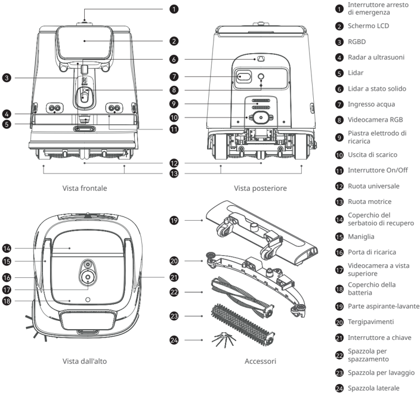
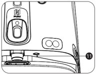
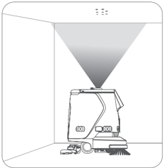
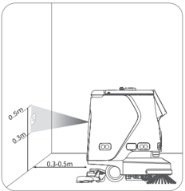
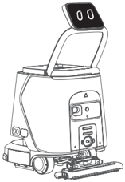
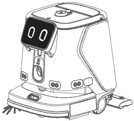

*Pagina 80 (pagina PDF 42, destra)*

## Copyright © 2025 Shenzhen Pudu Technology Co., Ltd. Tutti i diritti riservati.

Nessuna organizzazione o individuo può imitare, copiare, trascrivere o tradurre i contenuti di questo manuale dell'utente, in parte o per intero, senza il consenso scritto esplicito di Shenzhen Pudu Technology Co., Ltd., o distribuire questo manuale dell'utente a scopo di lucro in qualsiasi modo (elettronicamente o tramite fotocopiatura, registrazione, ecc.). Le specifiche del prodotto e le informazioni fornite nel presente manuale dell'utente hanno solo scopo di riferimento e sono soggette a variazione senza ulteriore preavviso. Salvo diversa indicazione, questo manuale dell'utente è destinato solo come guida per l'utente, e nessuna affermazione dovrà essere considerata come una garanzia di qualsiasi tipo.

---

*Pagina 81 (pagina PDF 43, sinistra)*

# 1. Istruzioni per la sicurezza

## 1.1 Istruzioni per l'elettricità

- Non ricaricare il robot utilizzando caricabatterie non originali. Se il caricabatterie è danneggiato, sostituirlo immediatamente.
- Caricare completamente la batteria al 100% prima del primo utilizzo.
- Per massimizzare l'efficienza e la durata della batteria del robot, mantenere sempre il livello di carica della batteria al di sopra del 10%.
- Un livello di carica della batteria inferiore al 10% significa che il robot sta per finire l'energia e deve essere ricaricato il prima possibile.
- Un livello di carica della batteria inferiore al 2% significa che la batteria è sotto protezione. In questo caso il robot non sarà in grado di eseguire delle attività e dovrà essere ricaricato prima di poter essere di nuovo utilizzato.
- Se la macchina non viene utilizzata per un lungo periodo di tempo, girare l'interruttore a chiave di alimentazione nella posizione "off".
- Se il robot non è stato utilizzato per un periodo di tempo prolungato, caricarlo completamente prima di utilizzarlo nuovamente.

## 1.2 Istruzioni per l'uso

- Questo robot auto-pulente su ruote può essere utilizzato solo al chiuso su superfici piane. Non utilizzarlo all'aperto (ad esempio su un balcone aperto) o su terreni accidentati (ad esempio scale).
- Non utilizzare il robot a una temperatura superiore a 40 ℃ o inferiore a 0 ℃.
- Se il robot raggiunge accidentalmente una posizione non corretta, a causa di un blocco o di altre ragioni, sospendere immediatamente l'attività e spingere il robot sul percorso corretto prima di riprendere l'attività.
- Non spingere il robot mentre è in funzione. Qualora sia necessario spingere o spostare il robot, toccare prima lo schermo per arrestarlo.
- Non spingere il robot all'indietro quando è acceso.
- Non bloccare il sensore del robot. In caso contrario, il robot potrebbe non muoversi in modo corretto o perdere l'orientamento.
- Non colpire il dispositivo né premere o toccare con forza sullo schermo, per evitare possibili danni.
- Non utilizzare il robot per trasportare merci. Non disporre nel vassoio fornelli a fiamma libera, né solidi, gas o liquidi infiammabili.
- Non modificare le impostazioni mentre il robot è in movimento. Toccare sempre lo schermo per mettere in pausa il robot prima di procedere con qualsiasi operazione.
- Non pulire né manutenere il robot mentre è acceso.
- Eventuali cavi presenti sul pavimento devono essere preventivamente rimossi per evitare che il robot li trascini.
- Per un utilizzo sicuro si raccomanda una velocità massima di 1,2 m/s.
- Anche se il robot è dotato di una funzionalità di aggiramento automatico degli ostacoli, possono esistere angoli ciechi. Pertanto, impedire bruscamente al robot di muoversi ad alta velocità può causare incidenti.
- Quando si trasporta il robot, assicurarsi che l'acqua nel serbatoio della soluzione e in quello delle acque reflue sia stata svuotata. È severamente vietato inclinare la macchina durante il trasporto, altrimenti il corpo potrebbe essere danneggiato.
- I robot possono utilizzare detergenti neutri non schiumogeni con un pH compreso tra 6 e 8 (è possibile aggiungere agenti antischiuma). È vietato l'uso di acidi forti, alcali forti e detergenti contenenti agenti attivi.

## 1.3 Istruzioni ambientali

- Non utilizzare o ricaricare il robot in un ambiente ad alta temperatura/pressione, in zone a rischio di incendio o esplosione o in altri ambienti pericolosi, per evitare lesioni personali o danni al robot.
- Non smaltire il robot o i suoi accessori come rifiuti domestici. Smaltire sempre il robot e i suoi accessori secondo le leggi e le normative locali e riciclarli ove possibile.
- Questo robot è progettato per essere utilizzato su superfici piane e non è adatto per l'uso in ambienti con gradini o pendenze elevate o troppo compatte.
- Non si consiglia l'uso del robot su superfici notevolmente grasse.
- Rimuovere dal pavimento cavi o altri oggetti per evitare che il robot ne finisca impigliato.
- Quando si utilizza questo prodotto su superfici con evidenti sporgenze (come soglie e prese a pavimento), assicurarsi che l'altezza delle sporgenze non sia superiore a 8 mm (per la pulizia) o 20 mm (per il passaggio senza pulizia).
- La larghezza minima di passaggio è di 70 cm. È preferibile una larghezza superiore a 75 cm per permettere al robot di muoversi agevolmente attraverso un lungo passaggio.
- La pendenza massima percorribile dal robot è di 8° (in stato non di pulizia). Per evitare eventuali rischi causati da scivolamento all'indietro, il robot non deve essere fermato durante lo spostamento in salita.
- Il robot supporta solo la pulizia su superfici piane (in stato di pulizia): non utilizzare il robot per la pulizia su pendenze visibili ad occhio nudo (superiori a 3°).
- Ai lati di eventuali scale, all'inizio di un tratto in discesa e in altre posizioni dove il robot potrebbe cadere occorre predisporre dei mancorrenti o altre strutture di protezione.

---

*Pagina 82 (pagina PDF 43, destra)*

# 2. Componenti del prodotto

## 2.1 Panoramica

Il robot PUDU CC1 Pro è un robot per pulizie versatile, progettato per scenari di piccole e medie dimensioni. Integra funzioni di spazzamento, lavaggio, aspirazione (tappeti) e pulizia della polvere e dispone di funzioni di riempimento/svuotamento automatico e di ricarica automatica.

È adatto a vari scenari di pulizia con materiali e durezze diverse, sia su pavimenti duri che su tappeti a pelo corto. I suoi tipici scenari di applicazione includono edifici per uffici, reparti, alberghi, negozi e altri scenari interni che richiedono una pulizia leggera. Il prodotto migliora la pulizia generale dell'ambiente a costi inferiori e con maggiore efficienza.

## 2.2 Contenuto della confezione

Robot x 1, Caricabatterie x 1, Chiavetta di accensione x 2, Spazzola laterale x 1, Tergipavimenti x 1, Parte aspirante-lavante x 1, Spazzola per lavaggio x 2, Spazzola per spazzamento x 2, Tubo per riempimento acqua x 1, Ugello x 1, Guida all'uso dell'utente di PUDU CC1 Pro x 1, Certificato di conformità x 1, Segno di posizionamento x 1.

## 2.3 Aspetto e Componenti

> *Descrizione della figura (IA):* La figura mostra le posizioni dei componenti principali del robot PUDU CC1 Pro, come l'interruttore On/Off (11), lo schermo LCD (2) e la porta di ricarica (16).

*Etichette:*

- **1** Interruttore arresto di emergenza
- **2** Schermo LCD
- **3** RGBD
- **4** Radar a ultrasuoni
- **5** Lidar
- **6** Lidar a stato solido
- **7** Ingresso acqua
- **8** Videocamera RGB
- **9** Piastra elettrodo di ricarica
- **10** Uscita di scarico
- **11** Interruttore On/Off
- **12** Ruota universale
- **13** Ruota motrice
- **14** Coperchio del serbatoio di recupero
- **15** Maniglia
- **16** Porta di ricarica
- **17** Videocamera a vista superiore
- **18** Coperchio della batteria
- **19** Parte aspirante-lavante
- **20** Tergipavimenti
- **21** Interruttore a chiave
- **22** Spazzola per spazzamento
- **23** Spazzola per lavaggio
- **24** Spazzola laterale

---

*Pagina 83 (pagina PDF 44, sinistra)*

## 2.4 Specifiche

| Funzionalità | Descrizione |
|---|---|
| Modello | CCBC02 |
| Tensione di esercizio | 23~29,2 VCC |
| Tipo di batteria | Batteria al litio ferro fosfato |
| Ingresso dell’alimentatore | 100 VCA - 240 VCA, 50/60 Hz |
| Uscita dell’alimentatore | Max. 29,2 V / 15 A |
| Capacità della batteria | 50 Ah |
| Tempo di carica | < 3 ore |
| Durata della batteria | Strofinamento: 5 ore; spazzamento+aspirazione+lavaggio: 5 ore: aspirazione tappeti: 4 ore; lavaggio silenzioso: 9 ore |
| Capacità di pulizia | Spazzamento, aspirazione (tappeti), lavaggio, strofinatura |
| Peso | 75 kg |
| Dimensioni del robot | 629 x 552 x 695 mm |
| Materiale dell'involucro | PC+ABS |
| Metodo di navigazione | Posizionamento integrato lidar e visivo SLAM |
| Velocità di crociera | 0,2 -1,2 m/s (regolabile) |
| Rumore di lavoro | < 70 dB |
| Minima larghezza del percorso | 70 cm |
| Massima altezza superabile | 20 mm |
| Massimo angolo di salita | 8º |
| Massimo spazio superabile | 35 mm |
| Larghezza di pulizia (con spazzola laterale) | 500 mm |
| Pulizia superficiale | 700-1000 m 2 /h: 837,19-1195,99 yr²/h |
| Pulizia localizzata | 1500-3000 m2/h: 1793,99-3587,97 yr²/h |
| Capacità del contenitore della polvere (aspirazione) | 2,5L (Predefinito) / 6L (Espandibile) |
| Capacità del serbatoio dell'acqua | Serbatoio della soluzione: 15 litri (3,96 galloni) |
| (strofinatura) | Serbatoio di recupero: 15 litri (3,96 galloni) |
| Sistema operativo | Android |
| Comunicazione | Supportati 4G, Wi-Fi, Bluetooth; Lora (opzionale) |
| App mobile | Supportata |
| Modalità operativa | Manuale/Automatica |
| Ricarica automatica e aggiunta/ svuotamento dell'acqua automatici | Supportato (in combinazione con la docking station) |
| Funzione opzionale | Docking station/Stazione di ricarica |
| Ambiente di lavoro (ricarica inclusa) | Temperatura: da 1 ℃ a 40 ℃; Umidità relativa: ≤ 85% |
| Ambiente di conservazione | Temperatura: da -20 ℃ a 60 ℃; Umidità relativa: ≤ 85% |
| Altitudine di lavoro | < 2000 m |
| Ambito di applicazione | Terrazzo, marmo, piastrelle, resina epossidica, arenaria, pietra artificiale, tappeti a pelo corto, ecc. |
| Classificazione IP | IPX4 |

(* La durata della batteria del robot in varie modalità di pulizia è stata testata in condizioni di laboratorio, con l'impostazione della marcia bassa, partendo dal 100% della batteria e proseguendo fino al raggiungimento del 10%).

---

*Pagina 84 (pagina PDF 44, destra)*

# 3. Utilizzo del prodotto

## 3.1 Istruzioni per i pulsanti

## Accensione:

Dopo aver verificato che l'interruttore a chiave sia acceso, premere e tenere premuto il pulsante di accensione per circa 3 secondi, fino a che la striscia luminosa in basso apparirà in blu.

> *Descrizione della figura (IA):* La figura mostra il pulsante di accensione con un'indicazione visiva blu sotto lo schermo. Sono presenti due indicatori luminosi circolari sullo schermo del dispositivo. La base inferiore del robot è visibile con una struttura che sembra essere parte del sistema di movimento o ricarica.

## Spegnimento:

Tenere premuto il pulsante di accensione per 6 secondi fino a quando lo schermo si spegne, indicando che il robot è stato spento correttamente.

## Pausa:

Toccare lo schermo per mettere in pausa il robot . Toccare di nuovo per riprendere il funzionamento.

## Arresto di emergenza:

In caso di emergenza, premere l'interruttore di arresto di emergenza per arrestare un robot in funzione. Ruotare l'interruttore di arresto di emergenza in senso orario e riprendere il funzionamento secondo i suggerimenti riportati a video.

## Attenzione:

Prima di avviare un'attività di pulizia automatica, assicurarsi che il robot sia acceso e posizionato sotto o di fronte al segno visivo (a seconda della posizione del segno): questo garantirà il corretto posizionamento del robot nella posizione di partenza.

> *Descrizione della figura (IA):* La figura mostra il robot posizionato sotto un cono di luce proiettato dal dispositivo superiore. Il testo 'LO' visibile sul corpo del robot indica una posizione o un indicatore specifico. La disposizione suggerisce che il robot deve essere allineato con la zona illuminata per l'avvio della pulizia automatica. Non sono presenti etichette numerate, pulsanti o connettori identificabili nella figura.

> *Descrizione della figura (IA):* La figura mostra la distanza consigliata tra il robot e il muro (0,3–0,5 m) per un posizionamento corretto prima dell'avvio della pulizia automatica. Le frecce indicate nella figura evidenziano l'area di rilevamento o scansione del robot rispetto alla parete (da 0,3 a 0,5 m). Il valore '0.5m' indica la massima distanza consigliata dal muro per il corretto funzionamento del sistema di posizionamento. Il valore '0.3m' indica la minima distanza consigliata dal muro per evitare interferenze o errori di rilevamento.

## 3.2 Istruzioni per la maniglia

Per spingere il robot o interagire con lo schermo, sollevare la maniglia e lo schermo.

Quando il robot è inattivo o funziona automaticamente, abbassare la maniglia e lo schermo.

*La maniglia del robot è collegata allo schermo.

> *Descrizione della figura (IA):* La maniglia è sollevata e collegata allo schermo, permettendo l'interazione con il display. Il pannello frontale include pulsanti e indicatori luminosi per il controllo del dispositivo. Le ruote inferiori sono visibili e necessarie per la mobilità del robot.

> *Descrizione della figura (IA):* La figura mostra il robot con la maniglia sollevata per accedere allo schermo.

---

*Pagina 85 (pagina PDF 45, sinistra)*

## 3.3 Modalità di pulizia

Il robot è dotato di varie modalità per soddisfare diversi scenari, tra cui Spazzamento, Aspirazione (su tappeti), Pulizia della polvere e Lavaggio.

| Modalità di pulizia | Descrizione |
|---|---|
| Modalità Lavaggio | Nella modalità Lavaggio viene eseguita l'operazione di lavaggio, adatta alla pulizia dei pavimenti duri. Rimuovere la spazzola laterale. Installare la spazzola per lo strofinamento e il tergipavimenti. Assicurarsi che nel serbatoio di recupero sia installato il filtro di lavaggio. |
| Modalità Spazzamento | Nella modalità Spazzamento standard, il robot eseguirà l'operazione di pulizia "spazzamento+aspirazione+rimozione della polvere", adatta per la pulizia dei pavimenti duri. Installare la spazzola laterale, la spazzola di spazzamento e la parte aspirante con panno. Accertarsi che il cestino della polvere sia installato nel serbatoio di recupero e che il serbatoio di recupero sia vuoto. |
| Modalità Aspirazione su tappeti | Nella modalità Aspirazione su tappeti, il robot eseguirà l'operazione di pulizia "spazzamento+aspirazione", adatta per la pulizia dei tappeti a pelo corto. Installare la spazzola laterale, la spazzola di spazzamento e la scopa per tappeti. Accertarsi che il cestino della polvere sia installato nel serbatoio di recupero e che il serbatoio di recupero sia vuoto. |
| Modalità Silenziosa | Nella modalità Silenziosa, il soffiatore viene spento. È adatta per ambienti di pulizia sensibili al rumore. Installare la spazzola laterale, la spazzola di spazzamento e la parte aspirante con panno. |

*Fare riferimento alla Guida all'uso di PUDU CC1 Pro per maggiori informazioni su come utilizzare il robot.

## 4. Manutenzione e cura

| Guasti | Soluzioni |
|---|---|
| Il sistema non si avvia | a. Controllare se l'Interruttore a chiave è acceso. b. Controllare il livello della batteria. Caricare la batteria se è esaurita. |
| Impossibile effettuare la pulizia | a. Il cestino della polvere è pieno. Rimuovere il cestino della polvere e pulirlo prima di riavviare il robot. b. Controllare la spazzola. Se è molto consumata, sostituirla con un nuovo gruppo spazzola. |
| Impossibile scaricare | Controllare il tubo di scarico. Se è ostruito, rimuovere lo sporco e pulire il serbatoio di recupero. |

| Componenti | Stato del robot | Intervallo di ispezione | Metodo di manutenzione |
|---|---|---|---|
| Ruote motrici e ruote ausiliarie | Spegnimento | Ogni settimana | Pulire la superficie con un panno pulito. |
| Sensori di visione e Lidar | Spegnimento | Ogni settimana | Utilizzare un panno pulito o un detergente per lenti per la pulizia. |
| Serbatoio di recupero | Spegnimento/ accensione | 2-3 giorni | Sciacquare il serbatoio di recupero con acqua pulita, poi scaricare l'acqua sporca. |
| Cestino della polvere | Spegnimento/ accensione | 2-3 giorni | Svuotare lo sporco all'interno del cestino della polvere; se necessario, lavarlo con acqua pulita e poi asciugarlo. |
| Camera del filtro acqua | Spegnimento/ accensione | 2-3 giorni | Sciacquare lo sporco all'interno della camera del filtro acqua con acqua pulita. |

---

*Pagina 86 (pagina PDF 45, destra)*

# 5. Assistenza post-vendita

Shenzhen Pudu Technology Co., Ltd. fornisce un servizio di garanzia gratuito entro il periodo di garanzia efficace (il periodo di garanzia può essere diverso per i diversi componenti). I costi sostenuti per il servizio post-vendita saranno a carico di Pudu. Trascorso il periodo di garanzia o in qualunque circostanza non coperta dalla garanzia gratuita, verrà addebitato un certo costo in base al prezzo normale. Chiamare la hotline post-vendita per informazioni dettagliate sulla politica del servizio post-vendita e sui servizi di riparazione. La politica è anche disponibile nella Guida all'uso di PUDU CC1 Pro.

Hotline: +86 755-86952935

E-mail: techservice@pudutech.com

# 6. Informazioni sulla conformità

## 6.1 Informazioni su smaltimento e riciclaggio

La direttiva sui rifiuti di apparecchiature elettriche ed elettroniche (RAEE) mira a ridurre al minimo l'impatto dei prodotti elettrici ed elettronici sull'ambiente, aumentando il riutilizzo e il riciclo e riducendo la quantità di RAEE destinati alla discarica. Il simbolo su questo prodotto o sulla sua confezione indica che questo prodotto deve essere smaltito separatamente dai normali rifiuti domestici al termine del suo ciclo di vita. È responsabilità del cliente smaltire le apparecchiature elettroniche presso i centri di riciclo al fine di preservare le risorse naturali. Ogni paese deve avere i propri centri di raccolta per il riciclo delle apparecchiature elettriche ed elettroniche. Per informazioni sull'area di raccolta per il riciclo, contattare l'autorità competente per la gestione dei rifiuti di apparecchiature elettriche ed elettroniche, l'ufficio comunale locale o il servizio di smaltimento dei rifiuti domestici.

Prima di immettere apparecchiature elettriche ed elettroniche (AEE) nel flusso di raccolta dei rifiuti o negli impianti di raccolta dei rifiuti, l'utente finale di apparecchiature contenenti batterie e/o accumulatori deve rimuovere tali batterie e accumulatori per la raccolta differenziata.

## 6.2 Dichiarazione di conformità della Federal Communications Commission

## Le seguenti informazioni si applicano a Pudu robotic.

Questa apparecchiatura è stata collaudata e trovata conforme ai limiti per un dispositivo digitale di Classe B, secondo la Parte 15 delle regole FCC. Tali limiti sono definiti per garantire una ragionevole protezione nei confronti di interferenze pericolose in una installazione residenziale. Questa apparecchiatura genera, utilizza e può irradiare energia a radiofrequenza e, se non installata secondo le istruzioni, potrebbe causare interferenze pericolose alle comunicazioni radio. Tuttavia, non vi è garanzia che non si verifichino interferenze in una particolare installazione. Se questa apparecchiatura dovesse causare interferenze dannose alla ricezione radio o televisiva, che possono essere determinate spegnendo e accendendo l'apparecchiatura, si consiglia di cercare di correggere le interferenze utilizzando una o più delle seguenti misure:

- Riorientare o spostare l'antenna ricevente.
- Aumentare la distanza tra l'apparecchiatura e il ricevitore.
- Collegare l'apparecchiatura a una presa su un circuito diverso da quello a cui è collegato il ricevitore.
- Consultare il rivenditore o un tecnico esperto di radio/TV per avere aiuto.

Questo dispositivo è conforme alla Parte 15 delle regole FCC. L'uso è soggetto alle seguenti due condizioni:

- Questo dispositivo non può causare interferenze dannose.
- Questo dispositivo deve accettare qualsiasi interferenza ricevuta, comprese le interferenze che possono causare un funzionamento indesiderato.

---

*Pagina 87 (pagina PDF 46, sinistra)*

## 6.3 Dichiarazione di conformità di Industry Canada

Questo dispositivo è conforme allo standard RSS esente da licenza di Industry Canada. L'uso è soggetto alle seguenti due condizioni:

- Questo dispositivo non può causare interferenze.
- Questo dispositivo deve accettare qualsiasi interferenza, compresa l'interferenza che può causare un funzionamento indesiderato del dispositivo.
