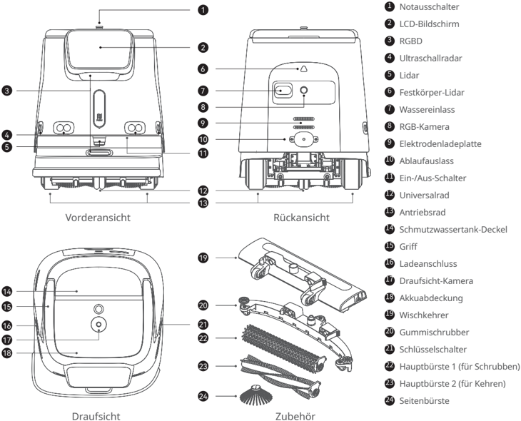
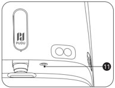
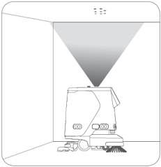
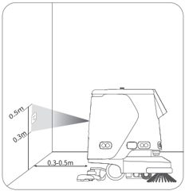
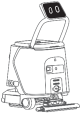
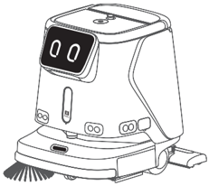

*Seite 21 (PDF-Seite 13, links)*

Copyright © 2023 Shenzhen Pudu Technology Co., Ltd. Alle Rechte vorbehalten.

Keine Organisation oder Einzelperson darf den Inhalt dieses Benutzerhandbuchs teilweise oder vollständig ohne die ausdrückliche schriftliche Zustimmung von Shenzhen Pudu Technology Co., Ltd. kopieren, transkribieren oder übersetzen oder dieses Benutzerhandbuch zu kommerziellen Zwecken auf beliebige Weise verteilen (elektronisch oder durch Fotokopieren, Aufzeichnen usw.). Die in diesem Benutzerhandbuch bereitgestellten technischen Daten und Angaben zum Produkt dienen nur als Referenz und können ohne vorherige Ankündigung geändert werden. Falls nicht anders angegeben, ist dieses Benutzerhandbuch nur als Orientierungshilfe gedacht und die darin enthaltenen Darstellungen sind nicht als Gewährleistung irgendwelcher Art aufzufassen.

---

*Seite 22 (PDF-Seite 13, rechts)*

# 1. Sicherheitsanweisungen

## 1.1 Elektrizität

- Es sollte kein Fremdzubehör verwendet werden. Tauschen Sie das Ladegerät bei Beschädigung sofort aus.
- Bitte laden Sie den Akku vor dem ersten Gebrauch vollständig auf 100% auf.
- Halten Sie den Akku immer über 10 %, damit Nutzen und Laufzeit des Roboters bestmöglich erhalten bleiben.
- Ein Ladestand von unter 10 % bedeutet, dass der Roboter bald keine Energie mehr hat und so schnell wie möglich aufgeladen werden sollte.
- Ein Akkuladestand von unter 2% bedeutet, dass der Akku in Sicherheitsbetrieb geschaltet wird. Der Roboter ist in diesem Fall nicht arbeitsfähig und muss wieder aufgeladen werden.
- Wenn die Maschine längere Zeit nicht benutzt wird, stellen Sie bitte den Netzschalter auf "Aus".

## 1.2 Gebrauchsanleitung

- In Innenräumen darf der fahrbare Roboter nur auf ebenen Oberflächen eingesetzt werden. Benutzen Sie ihn nicht im Außenbereich (z. B. auf einem offenen Balkon) oder auf unebenem Untergrund (z. B. auf Treppen).
- Verwenden Sie den Roboter nicht bei einer Temperatur von über 40℃ oder unter 0℃ .
- Nimmt der Roboter versehentlich eine falsche Position ein, z. B. aufgrund eines Hindernisses, unterbrechen Sie bitte die Aufgabe unverzüglich und schieben Sie den Roboter auf den richtigen Kurs, bevor Sie ihn weitermachen lassen.
- Nicht am Roboter ziehen, während er arbeitet. Falls Sie ihn schieben oder versetzen müssen, tippen Sie zunächst auf den Bildschirm, um ihn anzuhalten.
- Den Roboter nicht rückwärts schieben, wenn die Spannung eingeschaltet ist.
- Der Sensor des Roboters darf nicht abgedeckt werden. Der Roboter kann sich sonst nicht korrekt bewegen oder verliert die Orientierung.
- Auf das Gerät darf nicht geschlagen werden. Es darf auch nicht stark auf den Bildschirm gedrückt oder getippt werden, da sonst Schäden verursacht werden können.
- Verwenden Sie den Roboter nicht zum Transportieren von Gütern. Es dürfen keine Vorrichtungen mit offener Flamme oder brennbare Festkörper, Gase oder Flüssigkeiten auf das Tablett gestellt werden.
- Die Einstellungen dürfen nicht angepasst werden, wenn der Roboter fährt. Tippen Sie immer auf den Bildschirm, um den Roboter zu pausieren, bevor Sie ihn bedienen.
- Reinigen oder warten Sie den Roboter nicht, wenn die Spannung eingeschaltet ist.
- Am Boden liegende Kabel sind zuvor zu entfernen, damit sich der Roboter nicht einfädelt.
- Zur Sicherheit wird eine Höchstgeschwindigkeit von 1,2 m/s empfohlen.
- Der Roboter verfügt zwar über eine automatische Hinderniserkennung, es kann jedoch tote Winkel geben. Daher kann es zu Unfällen kommen, wenn der Roboter bei schneller Fahrt blockiert wird.
- Beim Transport des Roboters stellen Sie bitte sicher, dass das Wasser im Reinwassertank und Abwassertank abgelassen ist. Es ist strengstens verboten, die Maschine während des Transports zu kippen, da sonst der Körper beschädigt we

## 1.3 Umfeld

- Betreiben oder laden Sie den Roboter nicht in einer Umgebung mit hohen Temperaturen oder Drücken, in Bereichen mit Feuer- oder Explosionsgefahr oder in anderen gefährlichen Umgebungen, sonst können Verletzungen oder Schäden am Roboter auftreten.
- Entsorgen Sie den Roboter und dessen Zubehör nicht über den Hausmüll. Entsorgen Sie Roboter und Zubehör vorschriftsgemäß Führen Sie ihn möglichst dem Recycling zu.
- Dieser Roboter ist für die Verwendung auf ebenen Oberflächen ausgelegt und eignet sich nicht für Umgebungen mit Stufen, starken Steigungen oder engen Räumen.
- Es wird nicht empfohlen, den Roboter auf stark fettigem Boden fahren zu lassen.
- Am Boden liegende Kabel usw. sind zuvor zu entfernen, damit sich der Roboter nicht einfädelt oder verheddert.
- Wenn Sie dieses Produkt über Bodenschwellen, Absätze oder Bodensteckdosen fahren lassen, müssen Sie sicherstellen, dass die Höhe dieser überstehenden Objekte nicht mehr als 8 mm (für das Reinigen) oder 20 mm (für das Durchfahren, ohne zu reinigen) beträgt.
- Die Mindestdurchgangsbreite beträgt 70 cm. Damit der Roboter reibungslos durch eine lange Passage fahren kann, sollte diese sogar mindestens 75 cm breit sein.
- Die höchste zulässige Steigung für den Roboter beträgt 8° (wenn er nicht reinigt). Bei Aufwärtsfahrten sollte der Roboter nicht angehalten werden, da es sonst zum Abrutschen kommen kann.
- Der Roboter unterstützt nur die Reinigung auf flachen Oberflächen (im Reinigungszustand). Bitte verwenden Sie den Roboter nicht zur Reinigung an Hängen, die mit dem bloßen Auge sichtbar sind (größer als 3°).

---

*Seite 23 (PDF-Seite 14, links)*

# 2. Produktbestandteile

## 2.1 Überblick

Beim PUDU CC1 Roboter handelt es sich um einen vielseitigen Reinigungsroboter, der für Szenarien kleiner und mittlerer Größe ausgelegt ist. Er vereint die Funktionen zum Kehren, Schrubben, Staubsaugen (von Teppichen) und Staubwischen und verfügt über Funktionen zum automatischen Füllen/Entleeren und automatischen Laden.

Er eignet sich für verschiedene Reinigungsszenarien mit unterschiedlichen Materialien und Härten, ob es sich um Hartböden oder niederflorige Teppiche handelt. Seine typischen Anwendungsszenarien umfassen Bürogebäude, Dienststellen, Hotels, Ladenlokale und weitere Szenarien in Innenräumen, die eine leichte Reinigung erfordern. Das Produkt verbessert die Gesamtsauberkeit der Umgebung zu niedrigeren Kosten und mit höherer Effizienz.

## 2.2 Packliste

Roboter x 1, Ladegerät x 1, Startschlüssel x 2, Seitenbürste x 1, Gummischrubber x 1, Wischkehrer x 1, Scheuerbürste x 2, Kehrbürste x 2, Wasserfüllrohr x 1, Bedienungsleitfaden x 1, Konformitätsbescheinigung x 1, Positionsmarkierung x 1.

## 2.3 Aussehen und Bestandteile

> *Bildbeschreibung (KI):* Die Abbildung zeigt die Vorder-, Rück- und Draufsicht des PUDU CC1 Roboters mit nummerierten Beschriftungen für alle Komponenten. Sie veranschaulicht die Position von Sensoren wie dem Lidar (5) und der RGB-Kamera (8) an der Rückseite.

*Beschriftungen:*

- **1** Notausschalter
- **2** LCD-Bildschirm
- **3** RGBD
- **4** Ultraschallradar
- **5** Lidar
- **6** Festkörper-Lidar
- **7** Wassereinlass
- **8** RGB-Kamera
- **9** Elektrodenladeplatte
- **10** Ablaufauslass
- **11** Ein-/Aus-Schalter
- **12** Universalrad
- **13** Antriebsrad
- **14** Schmutzwassertank-Deckel
- **15** Griff
- **16** Ladeanschluss
- **17** Draufsicht-Kamera
- **18** Akkuabdeckung
- **19** Wischkehrer
- **20** Gummischrubber
- **21** Schlüsselschalter
- **22** Hauptbürste 1 (für Schrubben)
- **23** Hauptbürste 2 (für Kehren)
- **24** Seitenbürste

---

*Seite 24 (PDF-Seite 14, rechts)*

## 2.4 Technische Daten

| Merkmale | Beschreibung |
|---|---|
| Modell | CCBC01 |
| Betriebsspannung | DC 23 V ~ 29,2 V |
| Eingangsspannung des Ladegerätes | AC 100 V ~ 240 V, 50/60 Hz |
| Ausgangsspannung des Ladegerätes | 29,2 V ， 15 A |
| Akkukapazität | 50 Ah |
| Aufladezeit | < 3 h |
| Batterielebensdauer | Schrubben: 5h, Fegen+Saugen+Wischen: 5h Teppichsaugen: 4h, Leises Wischen: 9h |
| Reinigungsfähigkeiten | Wischen, Staubsaugen (von Teppichen), Staubwischen, Schrubben |
| Gewicht des Roboters | 75 kg |
| Maße des Roboters | 629 × 552 × 695 mm |
| Gehäusematerial | PC+ABS |
| Navigationsmethode | Integriertes Lidar und optische SLAM-Positionierung |
| Rundfahrtgeschwindigkeit | 0,2 m/s ~ 1,2 m/s |
| Betriebsgeräusch | < 70 dB |
| Min. Pfadabstand | 70 cm |
| Max. überwindbare Höhe | 20 mm |
| Max. Neigungswinkel | 8º |
| Max. überwindbarer Spalt | 35 mm |
| Reinigungsbreite (mit Seitenbürste) | 500 mm |
| Reinigungseffizienz | 700-1000 ㎡ /h |
| Kapazität der Staubbox | 2.5 l |
| Fassungsvermögen des Wassertanks | Reinwassertank: 15 l |
| Fassungsvermögen des Wassertanks | Schmutzwassertank: 15 l |
| Betriebssystem | Android |
| Kommunikation | 4G, WLAN, Bluetooth unterstützt, LoRa(Optionale) |
| Mobil-App | Unterstützt |
| Betriebsmodus | Manuell/Auto |
| Automatisches Aufladen & Automatisches Nachfüllen/Entleeren von Wasser | Unterstützt (in Verbindung mit Arbeitsstation) |
| Optionale Funktion | Arbeitsstation/Ladestation |
| Betriebsumgebung | Temperatur: 1 °C bis 40 °C; Rel. Luftfeuchtigkeit: ≤ 85% |
| Lagerumgebung | Temperatur: -20 °C bis 60 °C; Rel. Luftfeuchtigkeit: ≤ 85% |
| Arbeitshöhe | < 2000 m |
| Anwendungsumfang | Terrazzo, Marmor, Fliesen, Epoxidharz, Sandstein, Kunststein, niederflorige Teppiche usw. |
| Schutzklasse | IPX4 |

Einstellung des niedrigen Ganges, beginnend bei 100 % Batterie und fortgesetzt bis sie 10 % erreichte.)

(* Die Batterielaufzeit des Roboters in verschiedenen Reinigungsmodi wurde unter Laborbedingungen getestet, mit der Einstellung des niedrigen Ganges, beginnend bei 100 % Batterie und fortgesetzt bis sie 10 % erreichte.)

---

*Seite 25 (PDF-Seite 15, links)*

# 3. Gebrauch des Produkts

## 3.1 Anweisungen für Tasten

## Ein-/Ausschalten

## Einschalten:

Nachdem Sie sich vergewissert haben, dass der Schlüsselschalter eingeschaltet ist, halten Sie die Einschalttaste rund 3 Sekunden lang gedrückt, bis die untere Leuchtleiste blau wird.

> *Bildbeschreibung (KI):* Der Bereich mit den beiden Kreisen ist ein visueller Hinweis für die korrekte Startposition des Roboters. Das Logo 'PUDU' identifiziert die Marke des Produkts. Die Abbildung veranschaulicht, wo sich der Notausschalter befindet, um ihn im Notfall schnell zu erreichen.

## Ausschalten:

Halten Sie den Netzschalter 6 Sekunden lang gedrückt, bis der Bildschirm erlischt und damit angibt, dass der Roboter erfolgreich heruntergefahren wurde.

## Anhalten:

Tippen Sie auf den Bildschirm, um einen verfahrenden Roboter anzuhalten. Tippen Sie erneut an, wird der Betrieb fortgesetzt. Nothalt:

Drücken Sie im Notfall den Notausschalter , um einen in Betrieb befindlichen Roboter anzuhalten. Drehen Sie den Notausschalter im Uhrzeigersinn, und der Vorgang wird gemäß den Bildschirmhinweisen fortgesetzt.

## Vorsicht:

Vor dem Beginn einer automatischen Reinigungsaufgabe müssen Sie sich vergewissern, dass der Roboter eingeschaltet und unterhalb oder vor der optischen Markierung platziert ist (abhängig von der Position der Markierung), um eine erfolgreiche Positionierung am Startpunkt sicherzustellen.

> *Bildbeschreibung (KI):* Die Abbildung zeigt die korrekte Startposition des Roboters: Er muss unterhalb oder vor der optischen Markierung (dem dreieckigen Lichtkegel) platziert sein. Der graue Dreieckbereich stellt das Sichtfeld der optischen Markierung dar, innerhalb dessen sich der Roboter zum Start befinden muss. Die Abbildung veranschaulicht die Position des Roboters im Raum relativ zur optischen Markierung für eine erfolgreiche automatische Reinigungsaufgabe.

> *Bildbeschreibung (KI):* Der Roboter muss vor oder unter der optischen Markierung platziert werden. Die optische Markierung befindet sich in einem Abstand von 0,3 bis 0,5 Metern vom Roboter. Die Höhe der optischen Markierung liegt zwischen 0,3 und 0,5 Metern über dem Boden. Diese Positionierung ist notwendig für eine erfolgreiche Startpositionierung vor einer automatischen Reinigungsaufgabe.

## 3.2 Griff

Der mit dem Bildschirm verbundene Robotergriff ist entweder angehoben oder abgesenkt. Wenn Sie den Roboter schieben oder mit dem Bildschirm interagieren müssen, heben Sie den Griff und Bildschirm an; Wenn sich der Roboter im Ruhezustand befindet oder im Automatikmodus arbeitet, senken Sie den Griff und Bildschirm ab.

> *Bildbeschreibung (KI):* Die Abbildung zeigt die Position des Griffes und Bildschirms im angehobenen Zustand. Der Notausschalter ist an der Vorderseite des Geräts sichtbar. Die untere Leuchtleiste am Bildschirm ist blau beleuchtet, was den eingeschalteten Zustand anzeigt. Zwei Ersatzbürsten liegen vor dem Gerät.

> *Bildbeschreibung (KI):* Die Abbildung zeigt die Frontansicht des Roboters mit dem Display und den Bedienelementen. An der Unterseite sind Bürsten und Sensoren sichtbar, die für die Reinigung und Navigation wichtig sind. Der Griff ist in einer angehobenen Position dargestellt, wie er zur Interaktion mit dem Bildschirm benötigt wird.

---

*Seite 26 (PDF-Seite 15, rechts)*

## 3.3 Reinigungsmodus

Der Roboter wird mit verschiedenen Modi ausgeliefert, die sich für unterschiedliche Szenarien eignen, einschließlich Wischen, Staubsaugen (von Teppichen), Staubwischen und Schrubben.

| Reinigungsmodus | Beschreibung |
|---|---|
| Modus Schrubben | Der Modus Schrubben eignet sich für das Reinigen von Hartböden. Entfernen Sie die Seitenbürste. Installieren Sie die Waschbürste und den Gummischrubber. Vergewissern Sie sich, dass der Waschfilter im Schmutzwassertank installiert ist. |
| Modus Kehren | Im standardmäßigen Modus Kehren führt der Roboter den Reinigungsvorgang „Kehren+Staubsaugen+Staubwischen“ aus, der sich für das Reinigen von Hartböden eignet. Installieren Sie die Seitenbürste, die Kehrbürste und den Wischkehrer. Vergewissern Sie sich, dass der Staubbehälter für das Staubsaugen im Schmutzwassertank installiert und der Schmutzwassertank leer ist. |
| Modus Teppichstaubsaugen | Im Modus Teppichstaubsaugen führt der Roboter den Reinigungsvorgang „Kehren+Staubsaugen“ aus, der sich für das Reinigen von niederflorigen Teppichen eignet. Installieren Sie die Seitenbürste, die Kehrbürste und den Teppichkehrer. Vergewissern Sie sich, dass der Staubbehälter für das Staubsaugen im Schmutzwassertank installiert und der Schmutzwassertank leer ist. |
| Modus leises Wischen | Im Modus leises Wischen ist das Gebläse ausgeschaltet. Er eignet sich für geräuschempfindliche Reinigungsumgebungen. Installieren Sie die Seitenbürste, die Kehrbürste und den Wischkopf. |

*Weitere Angaben zur Nutzung des Roboters finden Sie in der PUDU CC1 Bedienungsanleitung.

## 4. Wartung und Pflege

| Fehlfunktionen | Problemlösungen |
|---|---|
| Fehler beim Starten | a. Prüfen Sie, ob der Schlüsselschalter eingeschaltet ist. b. Prüfen Sie den Akkuladestand. Laden Sie den Akku, wenn er entladen ist. |
| Reinigen nicht möglich | a. Der Staubbehälter ist voll. Entnehmen Sie den Staubbehälter und reinigen Sie ihn vor dem Neustart des Roboters. b. Prüfen Sie die Bürste. Wenn sie starke Anzeichen von Verschleiß aufweist, ersetzen Sie sie durch eine neue Bürstenbaugruppe. |
| Ablauf nicht möglich | Prüfen Sie das Ablaufrohr. Wenn es verstopft ist, entfernen Sie den Schmutz und reinigen Sie den Schmutzwassertank. |

| Bestandteile | Roboterstatus | Inspektionsintervall | Wartungsverfahren |
|---|---|---|---|
| Antriebsräder und Stützräder | Ausschalten | Wöchentlich | Wischen Sie die Oberfläche mit einem sauberen Tuch ab. |
| Optische Sensoren und Lidar | Ausschalten | Wöchentlich | Benutzen Sie zur Reinigung ein sauberes Tuch oder einen sonstigen Linsenreiniger. |
| Abwassertank | Ein-/Ausschalten | 2-3 Tage | Den Abwassertank mit sauberem Wasser durchspülen und das schmutzige Wasser dann ablassen. |
| Staubbehälter | Ein-/Ausschalten | 2-3 Tage | Entleeren Sie den Schmutz innerhalb des Staubbehälters, waschen Sie ihn bei Bedarf mit sauberem Wasser und trocknen Sie ihn dann. |
| Wasserfilterkammer | Ein-/Ausschalten | 2-3 Tage | Spülen Sie den Schmutz innerhalb der Wasserfilterkammer mit sauberem Wasser. |

---

*Seite 27 (PDF-Seite 16, links)*

# 5. Kundendienst

Shenzhen PuduRobotics Co., Ltd. bietet einen kostenlosen Garantiedienst innerhalb der geltenden Garantiezeit (diese kann bei verschiedenen Bestandteilen variieren). Die für den Kundendienst anfallenden Gebühren werden von Pudu übernommen. Außerhalb der Garantiezeit oder unter Umständen, die nicht durch die kostenlose Garantie abgedeckt sind, ist eine reguläre Gebühr zu entrichten. Näheres zur Servicerichtlinie und zu den Reparaturleistungen erfahren Sie bei einem Anruf bei der Kundendienst-Hotline. Die Richtlinie kann auch in der PUDU CC1-Bedienungsanleitung nachgelesen werden. Hotline: +86 755-86952935

E-Mail: techservice@pudutech.com

# 6. Angaben zur Richtlinienerfüllung

## 6.1 Angaben zu Entsorgung und Recycling

Die Richtlinie über Elektro- und Elektronik-Altgeräte (WEEE) zielt darauf ab, Umwelteinflüsse durch Elektro- und Elektronikgeräte zu minimieren, indem Wiederverwendung und Recycling erhöht und Deponieabfall verringert werden. Das Symbol auf diesem Produkt oder seiner Verpackung bedeutet, dass es nach seiner Nutzungszeit getrennt vom normalen Hausmüll entsorgt werden sollte. Es liegt in Ihrer Verantwortung, Elektronikgeräte in Recycling-Zentren zu entsorgen, um die natürlichen Ressourcen zu schonen. Jedes Land sollte seine eigenen Sammelstellen für das Recycling von elektrischen und elektronischen Geräten haben. Wo Sie Elektro- und Elektronikgeräte abgeben können, erfahren Sie vom zuständigen Amt, der Stadtverwaltung oder dem Entsorgungsdienst.

Vor dem Einbringen von Elektro- und Elektronikgeräten in der Abfallsammlung oder in Abfallsammelstellen sollten Batterien und Akkus zur getrennten Sammlung entfernt werden.

## 6.2 FCC(Federal Communications Commission)-Konformitätserklärung

Die folgenden Informationen treffen auf Pudu Robotic zu.

Dieses Gerät wurde getestet und entspricht den Grenzwerten für ein digitales Gerät der Klasse B gemäß Teil 15 der FCC-Bestimmungen. Diese Grenzen sollen einen angemessenen Schutz gegen Funkstörungen in einer Wohnanlage ermöglichen. Dieses Gerät generiert, nutzt Hochfrequenzenergie und kann Hochfrequenzenergie abstrahlen und bei nicht anweisungsgemäßem Aufbau und Betrieb Funkstörungen verursachen. Es besteht jedoch keine Garantie, dass in einer gegebenen Installation keine Störungen auftreten. Wenn dieser Roboter Radio- oder Fernsehempfangsstörungen verursacht, was durch Aus- und Einschalten festgestellt werden kann, sollten Sie Abhilfe durch mindestens eine der folgenden Maßnahmen zu schaffen versuchen:

- Richten Sie die Empfangsantenne neu aus oder stellen Sie sie um.
- Erhöhen Sie den Abstand zwischen Roboter und Empfänger.
- Schließen Sie den Roboter an einen Stromkreis an, an dem nicht auch der Empfänger angeschlossen ist.
- Wenden Sie sich an den Händler oder einen erfahrenen Radio-/Fernsehtechniker.

Das Gerät entspricht Teil 15 der FCC-Bestimmungen. Für den Betrieb gelten folgende Bedingungen:

- Das Gerät darf keine schädlichen Störungen verursachen.
- Das Gerät toleriert sämtliche empfangenen Interferenzen, einschließlich Interferenzen, die seinen Betrieb stören können.

---

*Seite 28 (PDF-Seite 16, rechts)*

## 6.3 Konformitätserklärung mit Industry Canada

Dieses Gerät erfüllt die lizenzfreien RSS-Standards von Industry Canada. Für den Betrieb gelten folgende Bedingungen:

- Das Gerät darf keine Störungen verursachen.
- Das Gerät muss sämtliche Interferenzen tolerieren, einschließlich Interferenzen, die seinen Betrieb stören können.

L'émetteur/récepteur exempt de licence contenu dans le présent appareil est conforme aux CNR d'Innovation, Sciences et Développement économique Canada applicables aux appareils radio exempts de licence. L'exploitation est autorisée aux deux conditions suivantes :

- L'appareil ne doit pas produire de brouillage;
- L'appareil doit accepter tout brouillage radioélectrique subi, même si le brouillage est susceptible d'en compromettre le fonctionnement.
