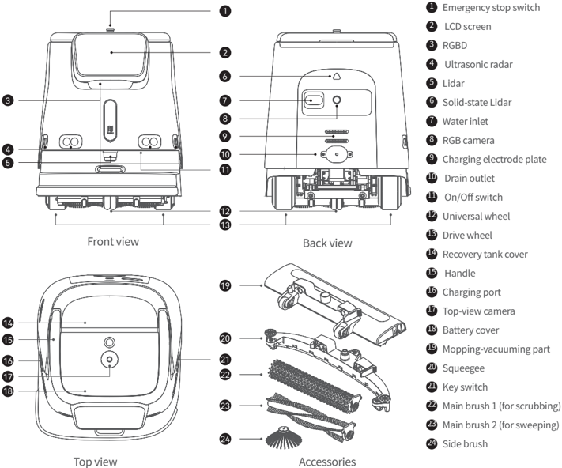
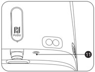
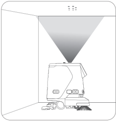
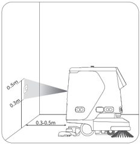
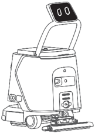
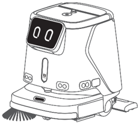

*Page 1 (PDF page 3, left)*

## Copyright © 2023 Shenzhen Pudu Technology Co., Ltd. All rights reserved.

No organization or individual shall imitate, copy, transcribe or translate the contents of this user manual, in part or in full, without the express written consent of Shenzhen Pudu Technology Co., Ltd., or distribute this user manual for profit in any way (electronically or via photocopying, recording, etc.). The product specifications and information provided in this user manual are for reference only and are subject to change without further notice. Unless otherwise specified, this user manual is only intended as a user guide, and no representation shall be deemed as a warranty of any kind.

---

*Page 2 (PDF page 3, right)*

# 1. Safety instructions

## 1.1 Instructions for Electricity

- Do not charge your robot using non-original chargers. If the charger is damaged, replace it immediately.
- Please fully charge the battery to 100% before first use.
- To maximize the efficiency and battery life of the robot, always keep the battery level above 10%.
- A battery level lower than 10% means that the robot will soon run out of power and needs to be charged as quickly as possible.
- A battery level lower than 2% means that the battery is under protection. In this case, the robot will be unable to perform tasks and must be charged before it can be used again.
- If the machine is not used for a long time, please turn the power key switch to the "off" position.

## 1.2 Instructions for Use

- This auto-cleaning wheeled robot can only be used indoors on flat surfaces. Do not use it outdoors (e.g., on an open balcony) or on any rugged ground (e.g., stairs).
- Do not use the robot at a temperature above 40℃ or below 0℃ .
- If the robot accidentally enters into any incorrect position due to blocking and some other reasons, please suspend the task promptly and push the robot to the correct route before continuing the task.
- Do not pull the robot while it is working. If you need to push or move the robot, tap on the screen to stop it from moving first.
- Do not push the robot backward when the power is on.
- Do not block the robot sensor. Otherwise, the robot may fail to move properly or get lost.
- Do not pat the device or press or tap hard on the screen, or damages may be caused.
- Do not use the robot to carry goods. Do not put open-flame stoves or any flammable solid, gas, or liquid on the tray.
- Do not adjust the settings while the robot is moving. Always tap on the screen to pause the robot before proceeding with any operations.
- Do not clean or maintain the robot when the power is on.
- Cables on the ground should be put away in advance to prevent the robot from dragging them.
- A maximum speed of 1.2 m/s is recommended for safe operation.
- Although the robot features automatic obstacle avoidance, there may be blind spots. Therefore, blocking the robot abruptly from moving at high speeds may cause accidents.
- When transporting the robot, please make sure that the water in the solution tank and sewage tank is emptied. It is strictly forbidden to tip the machine during transportation, otherwise, the body may be damaged.

## 1.3 Environmental Instructions

- Do not use or charge the robot in a high temperature/pressure environment, areas with fire or explosion hazard, or other dangerous scenarios to avoid personal injury or robot damage.
- Do not dispose of the robot or its accessories as household waste. Always dispose of the robot and its accessories according to local laws and regulations, and recycle wherever possible.
- This robot is designed for use on flat surfaces and is not suitable for use in environments with steps or large slopes or that are too compact.
- It is not recommended to use the robot on heavily greasy ground.
- Put away any wire or other objects on the ground to prevent the robot from being tripped or entangled.
- When using this product on the ground with obvious protrusions (such as thresholds and floor receptacles), make sure that the height of the protrusions is no more than 8 mm (for cleaning) or 20 mm (for passing through and not for cleaning).
- The minimal travel width is 70 cm. A width greater than 75 cm is preferred for the robot to move smoothly through a long passage.
- The maximum possible slope is 8° for the robot (non-cleaning state). To prevent any risks caused by backward slips, the robot should not be paused when moving uphill.
- The robot only supports cleaning on flat surfaces (in cleaning state), please do not use the robot for cleaning on slopes visible to the naked eye (greater than 3° ).

---

*Page 3 (PDF page 4, left)*

# 2. Product components

## 2.1 Overview

The PUDU CC1 robot is a versatile cleaning robot designed for small and medium-sized scenarios. It integrates sweeping, scrubbing, (carpet) vacuuming, and dust mopping and features auto-filling/draining and auto-charging functions. It is suitable to various cleaning scenarios with different materials and hardness, whether hard floors or low pile carpet. Its typical application scenarios include office buildings, departments, hotels, retail store and other indoor scenarios that require a light cleaning. The product improves the overall cleanliness of the environment at lower costs and higher efficiency.

## 2.2 Packing List

Robot x 1, Charger x 1, Power Key x 2, Side Brush x 1, Squeegee x 1, Mopping-vacuuming part x 1, Scrubbing Brush x 2, Sweeping Brush x 2, Water Filling Pipe x 1, User Operation Guide x 1, Certificate of Conformity x 1, Positioning Marker x 1.

## 2.3 Appearance and Components

> *Figure description (AI):* The figure identifies all external components of the PUDU CC1 robot with numbered labels corresponding to a legend. It shows the specific locations of functional ports such as the water inlet, drain outlet, and charging port on the front and back views. The diagram displays the various cleaning accessories included in the packing list, including different types of brushes and squeegees. It provides a visual reference for identifying the positions of buttons like the emergency stop switch and on/off switch.

*Labels:*

- **1** Emergency stop switch
- **2** LCD screen
- **3** RGBD
- **4** Ultrasonic radar
- **5** Lidar
- **6** Solid-state Lidar
- **7** Water inlet
- **8** RGB camera
- **9** Charging electrode plate
- **10** Drain outlet
- **11** On/Off switch
- **12** Universal wheel
- **13** Drive wheel
- **14** Recovery tank cover
- **15** Handle
- **16** Charging port
- **17** Top-view camera
- **18** Battery cover
- **19** Mopping-vacuuming part
- **20** Squeegee
- **21** Key switch
- **22** Main brush 1 (for scrubbing)
- **23** Main brush 2 (for sweeping)
- **24** Side brush

---

*Page 4 (PDF page 4, right)*

## 2.4 Specifications

| Feature | Description |
|---|---|
| Model | CCBC01 |
| Operating voltage | DC 23 V ~ 29.2 V |
| Power input | AC 100 V ~ 240 V, 50/60 Hz |
| Power output | 29.2 V，15 A |
| Battery capacity | 50 Ah |
| Charging time | < 3 h |
| Cleaning capabilities | scrubbing: 5h; Sweeping+Vacuuming+Mopping: 5h Carpet vacuuming: 4h；Silent mopping: 9h |
| Weight | 75 kg |
| Screen size | 10.1-inch LCD screen |
| Robot dimensions | 629 x 552 x 695 mm |
| Enclosure material | PC+ABS |
| Navigation method | Integrated lidar and visual SLAM positioning |
| Cruise speed | 0.2 - 1.2 m/s |
| Working noise | < 70 dB |
| Max. climbing angle | 8º |
| Min. Path Clearance | 70cm |
| Max. surmountable height | 20 mm |
| Max. surmountable gap | 35 mm |
| Cleaning width (with side brush) | 500 mm |
| Cleaning efficiency | 700-1000 ㎡ /h |
| Dustbin capacity | 2.5 L |
| Water tank capacity | Solution tank: 15 L Recovery tank: 15 L |
| Operation system | Android |
| Communication | 4G, WIFI, Bluetooth supported, Lora(Optional) |
| Mobile App | Supported |
| Operation mode | Manual/Auto |
| Auto charging & Auto adding / draining water | Supported (in conjunction with docking station) |
| Optional function | Docking station/Charing station |
| Working environment | Temperature: 1 to 40 ℃; RH: ≤ 85% |
| Storage environment | Temperature: -20 to 60 ℃; RH: ≤ 85% |
| Working altitude | < 2000 m |
| Application scope | Terrazzo, marble, tiles, epoxy resin, sandstone, artificial stone, short-pile carpets, etc. |
| IP rating | IPX4 |

(* The robot's battery life in various cleaning modes was tested under laboratory conditions, with the low gear setting, starting from 100% battery and continuing until it reached 10%.)

---

*Page 5 (PDF page 5, left)*

# 3. Using the Product

## 3.1 Instructions for Buttons

## Powering On/Off

Powering on:

After confirming that the key switch is turned on, press and hold the power button for about 3 seconds, and the bottom light strip will appear in blue.

> *Figure description (AI):* The figure shows the location of the emergency stop switch on the robot's body. It indicates where to find the PUDU brand logo on the device. The illustration helps users identify physical components not described in the text.

Powering off:

Press and hold the power button for 6 seconds till the screen goes off, indicating that the robot is successfully powered off.

## Pause:

Tap on the screen to pause the working robot. Tap again to resume operation.

## Emergency stop:

In case of an emergency, press the emergency stop switch to stop a working robot. Rotate the emergency stop switch clockwise, and resume the operation according to the screen tips.

## Caution：

Before starting an automatic cleaning task, make sure the robot is powered on and placed below or in front of the

visual marker (depending on the position of the marker) for successful positioning at the startup location.

> *Figure description (AI):* The visual marker is shown as a triangular projection on the floor. The robot must be positioned below or in front of this marker for successful startup positioning. This figure illustrates the required placement relative to the visual marker before beginning an automatic cleaning task.

> *Figure description (AI):* The figure shows the required distance between the robot and the visual marker for successful positioning. The labels indicate that the robot should be placed 0.3-0.5m away from the visual marker. The diagram illustrates the correct placement of the robot relative to the visual marker for startup location.

## 3.2 Instructions for Handle

The robot handle connected to the screen is either raised or lowered.

When you need to push the robot or interact with the screen, raise the handle and screen; When the robot is idle or working automatically, lower the handle and screen.

> *Figure description (AI):* The handle can be raised for pushing the robot or interacting with the screen. The handle can be lowered when the robot is idle or working automatically.

> *Figure description (AI):* The figure shows a robot vacuum cleaner with its handle raised. A blue light strip is visible at the bottom of the robot. The emergency stop switch is located on the side of the robot.

---

*Page 6 (PDF page 5, right)*

## 3.3 Cleaning Mode

The robot comes with various modes to cater to different scenarios, including Sweeping, (Carpet) Vacuuming, Dust Mopping, and Scrubbing.

| Cleaning Mode | Description |
|---|---|
| Scrubbing Mode | In Scrubbing Mode, scrubbing operation will be performed, which is suitable for hard floor cleaning. Remove the side brush. Install the washing brush and the squeegee. Make sure the washing filter is installed in the recovery tank. |
| Sweeping Mode | In the standard Sweeping Mode, the robot will perform "sweeping+vacuumming+dust mopping" cleaning operation, which is suitable for hard floors cleaning. Install the side brush, sweeping brush, and Mopping-vacuuming part. Make sure the vacuum dustbin is installed in the recovery tank, and the dirty water recovery tank. |
| Carpet Vacuuming Mode | In the Carpet Vacuuming Mode, the robot will perform "sweeping+vacuumming" cleaning operation, which is suitable for low-pile carpet cleaning. Install the side brush, sweeping brush, and carpet sweeper. Make sure the vacuum dustbin is installed in the recovery tank, and the recovery tank is empty. |
| Silent Mopping Mode | In the Silent Mopping Mode, the blower is turned off. It is suitable for sound-sensitive cleaning environments. Install the side brush, sweeping brush, and mop head. |

# 4. Maintenance and Care

| Faults | Solutions |
|---|---|
| Start failure | a. Check if the key switch is turned on. b. Check the battery level. Charge the battery if it is exhausted. |
| Unable to clean | a. The dustbin is full. Remove the dustbin and clean it up before restarting the robot. b. Check the brush. If it is severely worn, replace it with a new brush assembly. |
| Unable to drain | Check the drain pipe. If it is blocked, remove the dirt and clean the recovery tank. |

| Components | Robot Status | Inspection Interval | Maintenance Method |
|---|---|---|---|
| driving wheels and auxiliary wheels | Power-off | Weekly | Wipe the surface with a clean cloth. |
| Vision sensors and Lidar | Power-off | Weekly | Use a clean cloth or lens cleanser for the cleaning. |
| recovery tank | power off/on | 2-3 days | Flushing recovery tank with clean water and then drain the dirty water. |
| Dustbin | power off/on | 2-3 days | Dump the dirt inside the dustbin, if necessary, wash it with clean water and then dry it. |
| Water filter chamber | power off/on | 2-3 days | Rinse the dirt inside the water filter chamber with clean water. |

*Refer to PUDU CC1 Operation Guide for more information on how to use the robot.

---

*Page 7 (PDF page 6, left)*

# 5. After-sales service

Shenzhen PuduRobotics Co., Ltd provides free warranty service within the effective warranty period (the warranty period may vary for different components). The fees incurred by the after-sales service will be covered by Pudu. Beyond the warranty period or in any circumstances not covered by the free warranty, a certain fee will be charged according to the normal price. Please call the after-sales hotline for detailed after-sales service policy and repair services. The policy can also be found in PUDU CC1 Operation Guide.

Hotline: +86 755-86952935

Email: techservice@pudutech.com

# 6. Compliance information

## 6.1 Disposal and recycling information

The Waste Electrical and Electronic Equipment (WEEE) Directive aims to minimize the impact of electrical and electronic goods on the environment, by increasing re-use and recycling and by reducing the amount of WEEE going to landfill. The symbol on this product or its packaging signifies that this product must be disposed separately from ordinary household wastes at its end of life. Be aware that this is your responsibility to dispose of electronic equipment at recycling centers in order to conserve natural resources. Each country should have its collection centers for electrical and electronic equipment recycling. For information about your recycling drop off area, please contact your related electrical and electronic equipment waste management authority, your local city office, or your house hold waste disposal service.

Before placing electrical and electronic equipment (EEE) in the waste collection stream or in waste collection facilities, the end user of equipment containing batteries and/or accumulators must remove those batteries and accumulators for separate collection.

## 6.2 Federal Communications Commission compliance statement

The following information applies to Pudu robotic.

This equipment has been tested and found to comply with the limits for a Class B digital device, pursuant to part 15 of the FCC Rules. These limits are designed to provide reasonable protection against harmful interference in a residential installation. This equipment generates, uses and can radiate radio frequency energy and, if not installed and used in accordance with the instructions, may cause harmful interference to radio communications. However, there is no guarantee that interference will not occur in a particular installation. If this equipment does cause harmful interference to radio or television reception, which can be determined by turning the equipment off and on, the user is encouraged to try to correct the interference by one or more of the following measures:

- Reorient or relocate the receiving antenna.
- Increase the separation between the equipment and receiver.
- Connect the equipment into an outlet on a circuit different from that to which the receiver is connected.
- Consult the dealer or an experienced radio/TV technician for help.

This device complies with Part 15 of the FCC rules. Operation is subject to the following two conditions:

- This device may not cause harmful interference.
- This device must accept any interference received, including interference that may cause undesired operation.

---

*Page 8 (PDF page 6, right)*

## 6.3 Industry Canada compliance statement

This device complies with Industry Canada licence-exempt RSS standard(s). Operation is subject to the following two conditions:

- This device may not cause interference.
- This device must accept any interference, including interference that may cause undesired operation of the device. L'émetteur/récepteur exempt de licence contenu dans le présent appareil est conforme aux CNR d'Innovation, Sciences et Développement économique Canada applicables aux appareils radio exempts de licence. L'exploitation est autorisée aux deux conditions suivantes :
- L'appareil ne doit pas produire de brouillage;
- L'appareil doit accepter tout brouillage radioélectrique subi, même si le brouillage est susceptible d'en compromettre le fonctionnement.
