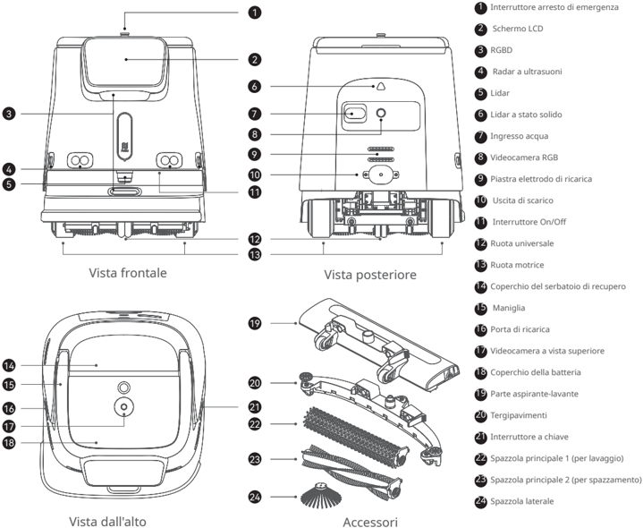
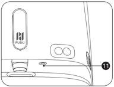
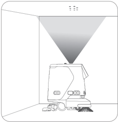
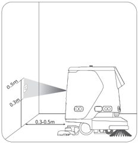
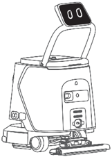
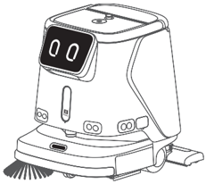

*Pagina 79 (pagina PDF 42, sinistra)*

Copyright © 2023 Shenzhen Pudu Technology Co., Ltd. Tutti i diritti riservati.

Nessuna organizzazione o individuo può imitare, copiare, trascrivere o tradurre i contenuti di questo manuale dell'utente, in parte o per intero, senza il consenso scritto esplicito di Shenzhen Pudu Technology Co., Ltd., o distribuire questo manuale dell'utente a scopo di lucro in qualsiasi modo (elettronicamente o tramite fotocopiatura, registrazione, ecc.). Le specifiche del prodotto e le informazioni fornite nel presente manuale dell'utente hanno solo scopo di riferimento e sono soggette a variazione senza ulteriore preavviso. Salvo diversa indicazione, questo manuale dell'utente è destinato solo come guida per l'utente, e nessuna affermazione dovrà essere considerata come una garanzia di qualsiasi tipo.

---

*Pagina 80 (pagina PDF 42, destra)*

# 1. Istruzioni per la sicurezza

## 1.1 Istruzioni per l'elettricità

- Non ricaricare il robot utilizzando caricatori non originali. Se il caricatore è danneggiato, sostituirlo immediatamente.
- Caricare completamente la batteria al 100% prima del primo utilizzo.
- Per massimizzare l'efficienza e la durata della batteria del robot, mantenere sempre il livello di carica della batteria al di sopra del 10%.
- Un livello di carica della batteria inferiore al 10% significa che il robot sta per finire l'energia e deve essere ricaricato prima possibile.
- Un livello di carica della batteria inferiore al 2% significa che la batteria è sotto protezione. In questo caso, il robot non sarà in grado di eseguire attività e dovrà essere caricato prima di poter essere utilizzato di nuovo.
- Se la macchina non viene utilizzata per un lungo periodo di tempo, girare l'interruttore a chiave di alimentazione nella posizione "off".

## 1.2 Istruzioni per l'uso

- Questo robot auto-pulente su ruote può essere utilizzato solo al chiuso su superfici piane. Non utilizzarlo all'aperto (ad esempio su un balcone aperto) o su un pavimento accidentato (ad esempio scale).
- Non utilizzare il robot a una temperatura superiore a 40 ℃ o inferiore a 0 ℃.
- Se il robot accede accidentalmente a una posizione errata a causa di blocchi o altre ragioni, sospendere immediatamente l'attività e spingere il robot sul percorso corretto prima di continuare l'attività.
- Non spingere il robot mentre è in funzione. Qualora sia necessario spingere o spostare il robot, toccare prima lo schermo per arrestarlo.
- Non spingere il robot all'indietro quando è acceso.
- Non bloccare il sensore del robot. In caso contrario, il robot potrebbe non muoversi in modo corretto o perdere l'orientamento.
- Non colpire il dispositivo né premere o toccare con forza sullo schermo, per evitare possibili danni.
- Non utilizzare il robot per trasportare merci. Non disporre nel vassoio fornelli a fiamma libera, né solidi, gas o liquidi infiammabili.
- Non modificare le impostazioni mentre il robot è in movimento. Toccare sempre lo schermo per mettere in pausa il robot prima di procedere con qualsiasi operazione.
- Non pulire né manutenere il robot mentre è acceso.
- Eventuali cavi presenti sul pavimento devono essere preventivamente rimossi per evitare che il robot li trascini.
- Per un utilizzo sicuro si raccomanda una velocità massima di 1,2 m/s.
- Anche se il robot è dotato di una funzionalità di aggiramento automatico degli ostacoli, possono esistere angoli ciechi. Pertanto, bloccare il robot bruscamente quando è in movimento ad alta velocità potrebbe causare incidenti.
- Quando si trasporta il robot, assicurarsi che l'acqua nel serbatoio della soluzione e in quello delle acque reflue sia stata svuotata. È severamente vietato inclinare la macchina durante il trasporto, altrimenti il corpo potrebbe essere danneggiato.

## 1.3 Istruzioni ambientali

- Non utilizzare o ricaricare il robot in un ambiente ad alta temperatura/pressione, in zone a rischio di incendio o esplosione o in altri scenari pericolosi per evitare lesioni personali o danni al robot.
- Non smaltire il robot o i suoi accessori come rifiuti domestici. Smaltire sempre il robot e i suoi accessori secondo le leggi e i regolamenti locali, e riciclare ove possibile.
- Questo robot è progettato per essere utilizzato su superfici piane e non è adatto per l'uso in ambienti con gradini o pendenze elevate o che siano troppo stretti.
- Non si consiglia l'uso del robot su superfici notevolmente grasse.
- Rimuovere dal pavimento cavi o altri oggetti per evitare che il robot ne finisca impigliato.
- Quando si utilizza questo prodotto su superfici con evidenti sporgenze (come soglie e prese a pavimento), assicurarsi che l'altezza delle sporgenze non superi 8 mm (per la pulizia) o 20 mm (per il passaggio senza pulizia).
- La larghezza minima di passaggio è di 70 cm. È preferibile una larghezza superiore a 75 cm per permettere al robot di muoversi agevolmente attraverso un lungo corridoio.
- La pendenza massima percorribile dal robot è di 8° (in stato non di pulizia). Per prevenire qualsiasi rischio causato da scivolamenti all'indietro, il robot non deve essere messo in pausa quando si sta spostando in salita.
- Il robot supporta solo la pulizia su superfici piane (in stato di pulizia): non utilizzare il robot per la pulizia su pendenze visibili ad occhio nudo (superiori a 3°).

---

*Pagina 81 (pagina PDF 43, sinistra)*

# 2. Componenti del prodotto

## 2.1 Panoramica

Il robot PUDU CC1 è un robot per pulizie versatile, progettato per scenari di piccole e medie dimensioni. Integra funzioni di spazzamento, lavaggio, aspirazione (tappeti) e pulizia della polvere e dispone di funzioni di riempimento/svuotamento automatico e di ricarica automatica.

È adatto a vari scenari di pulizia con materiali e durezze diverse, sia su pavimenti duri che su tappeti a pelo corto. I suoi tipici scenari di applicazione includono edifici per uffici, reparti, alberghi, negozi e altri scenari interni che richiedono una pulizia leggera. Il prodotto migliora la pulizia generale dell'ambiente a costi inferiori e con maggiore efficienza.

## 2.2 Contenuto della confezione

Robot x 1, Caricatore x 1, Chiavetta di accensione x 2, Spazzola laterale x 1, Tergipavimenti x 1, Parte aspirante-lavante x 1, Spazzola per lavaggio x 2, Spazzola per spazzamento x 2, Tubo per riempimento acqua x 1, Guida all'uso dell'utente x 1, Certificato di conformità x 1, Segno di posizionamento x 1.

## 2.3 Aspetto e Componenti

*Etichette:*

- **1** Interruttore arresto di emergenza
- **2** Schermo LCD
- **3** RGBD
- **4** Radar a ultrasuoni
- **5** Lidar
- **6** Lidar a stato solido
- **7** Ingresso acqua
- **8** Videocamera RGB
- **9** Piastra elettrodo di ricarica
- **10** Uscita di scarico
- **11** Interruttore On/Off
- **12** Ruota universale
- **13** Ruota motrice
- **14** Coperchio del serbatoio di recupero
- **15** Maniglia
- **16** Porta di ricarica
- **17** Videocamera a vista superiore
- **18** Coperchio della batteria
- **19** Parte aspirante-lavante
- **20** Tergipavimenti
- **21** Interruttore a chiave
- **22** Spazzola principale 1 (per lavaggio)
- **23** Spazzola principale 2 (per spazzamento)
- **24** Spazzola laterale

---

*Pagina 82 (pagina PDF 43, destra)*

## 2.4 Specifiche

| Funzionalità | Descrizione |
|---|---|
| Modello | CCBC01 |
| Tensione di lavoro | 23 VCC - 29,2 VCC |
| Ingresso alimentazione | 100 VCA - 240 VCA, 50/60 Hz |
| Uscita alimentazione | 29,2 V, 15 A |
| Capacità della batteria | 50 Ah |
| Tempo di carica | < 3 h |
| Durata della batteria | Pulitura: 5 ore; Spazzatura+Aspirazione+Lavaggio: 5 ore |
| Capacità di pulizia | Aspirazione tappeti: 4 ore; Lavaggio silenzioso: 9 ore Spazzamento, aspirazione (su tappeti), pulizia della polvere, lavaggio |
| Peso | 75 kg |
| Dimensioni del robot | 629 × 552 × 695 mm |
| Materiale dell'involucro | PC+ABS |
| Metodo di navigazione | Posizionamento integrato lidar e visivo SLAM |
| Velocità di crociera | 0,2 - 1,2 m/s |
| Rumore di lavoro | < 70 dB |
| Massimo angolo di salita | 8º 70 cm |
| Minima larghezza del percorso Massima altezza superabile | 20 mm |
| Massimo vuoto superabile | 35 mm |
| Larghezza di pulizia (con spazzola | 500 mm |
| laterale) | 700-1000 ㎡ /h |
| Efficienza di pulizia Capacità del cestino della polvere | 2,5 L |
| Efficienza di pulizia Capacità del cestino della polvere | Serbatoio della soluzione: 15 L |
| Capacità del serbatoio dell'acqua | Serbatoio di recupero: 15 L |
| Sistema operativo | Android |
| Comunicazione | Supportati 4G, WIFI, Bluetooth; Lora (opzionale) |
| App mobile | Supportata |
| Modalità operativa | Manuale/Automatica |
| Ricarica e aggiunta / svuotamento dell'acqua automatici | Supportato (in combinazione con stazione di lavoro) |
| Funzione opzionale | Stazione di lavoro/Stazione di ricarica |
| Ambiente di lavoro | Temperatura: 1-40 ℃; Umidità relativa: ≤ 85% |
| Ambiente di conservazione | Temperatura: -20-60 ℃; Umidità relativa: ≤ 85% |
| Altitudine di lavoro | ＜ 2000 m |
| Ambito di applicazione | Terrazzo, marmo, piastrelle, resina epossidica, arenaria, pietra artificiale, tappeti a pelo corto, ecc. |
| Classificazione IP | IPX4 |

(* L'autonomia della batteria del robot in vari modi di pulizia è stata testata in condizioni di laboratorio, con l'impostazione della marcia bassa, partendo dal 100% di batteria e continuando fino al raggiungimento del 10%.)

---

*Pagina 83 (pagina PDF 44, sinistra)*

# 3. Utilizzo del prodotto

## 3.1 Istruzioni per i pulsanti

### Accensione/spegnimento

#### Accensione:

Dopo aver verificato che l'interruttore a chiave sia acceso, tenere premuto il pulsante di accensione per circa 3 secondi, fino a che la striscia luminosa in basso apparirà in blu.

> *Descrizione della figura (IA):* La striscia luminosa in basso al pulsante mostra lo stato di accensione (blu quando acceso). Il logo PUDU è visibile sul pannello frontale del robot.

#### Spegnimento:

Tenere premuto il pulsante di accensione per 6 secondi fino a quando lo schermo si spegne, indicando che il robot è stato spento correttamente.

#### Pausa:

Toccare lo schermo per mettere in pausa il robot. Toccare di nuovo per riprendere il funzionamento.

#### Arresto di emergenza:

In caso di emergenza, premere l'interruttore di arresto di emergenza per arrestare un robot in funzione. Ruotare l'interruttore di arresto di emergenza in senso orario e riprendere il funzionamento secondo i suggerimenti riportati a video.

> **Avvertenza:**
>
> Prima di avviare un'attività di pulizia automatica, assicurarsi che il robot sia acceso e posizionato sotto o di fronte al segno visivo (a seconda della posizione del segno): questo garantirà il corretto posizionamento del robot nella posizione di partenza.

> *Descrizione della figura (IA):* Il triangolo grigio indica la zona di rilevamento o scansione del robot. La posizione del robot sotto il triangolo mostra dove posizionarlo prima dell'avvio della pulizia automatica. Il disegno illustra come il robot si muove e interagisce con lo spazio circostante, inclusa la base di ricarica.

> *Descrizione della figura (IA):* Il robot deve essere posizionato tra 0,3 e 0,5 metri dal segno visivo sul pavimento prima di avviare la pulizia automatica. La striscia luminosa in basso sul robot si accende in blu quando il dispositivo è acceso correttamente. Per spegnere il robot, tieni premuto il pulsante di accensione per 6 secondi finché lo schermo non si spenge. Il segno visivo (indicato come '0.3-0.5m') deve essere posizionato sotto o di fronte al robot prima dell'avvio della pulizia.

## 3.2 Istruzioni per la maniglia

La maniglia del robot, collegata allo schermo, può essere sollevata o abbassata.

Per spingere il robot o interagire con lo schermo, sollevare la maniglia e lo schermo.

Quando il robot è inattivo o funziona automaticamente, abbassare la maniglia e lo schermo.

> *Descrizione della figura (IA):* La maniglia dello schermo può essere sollevata per spingere il robot o interagire con lo schermo. Il pulsante di accensione/spegnimento è posizionato sulla parte inferiore della maniglia, vicino allo schermo. L'interruttore a chiave si trova sul lato sinistro del corpo principale del robot.

> *Descrizione della figura (IA):* La striscia luminosa in basso è visibile e si accende in blu quando il robot è acceso. Il pulsante di accensione/spegnimento è posizionato sulla parte superiore del robot, vicino allo schermo. L'interruttore a chiave non è visibile nella figura, ma è menzionato nel testo come necessario per l'accensione.

---

*Pagina 84 (pagina PDF 44, destra)*

## 3.3 Modalità di pulizia

Il robot è dotato di varie modalità per soddisfare diversi scenari, tra cui Spazzamento, Aspirazione (su tappeti), Pulizia della polvere e Lavaggio.

| Modalità di pulizia | Descrizione |
|---|---|
| Modalità Lavaggio | Nella modalità Lavaggio viene eseguita l'operazione di lavaggio, adatta alla pulizia dei pavimenti duri. Rimuovere la spazzola laterale. Installare la spazzola per il lavaggio e il tergipavimenti. Assicurarsi che nel serbatoio di recupero sia installato il filtro di lavaggio. |
| Modalità Spazzamento | Nella modalità Spazzamento standard, il robot eseguirà l'operazione di pulizia "spazzament o+aspirazione+pulizia della polvere", adatta per la pulizia dei pavimenti duri. Installare la spazzola laterale, la spazzola di spazzamento e la parte aspirante con panno. Accertarsi che il cestino della polvere sia installato nel serbatoio di recupero, e il serbatoio di recupero dell'acqua sporca sia vuoto. |
| Modalità Aspirazione su tappeti | Nella modalità Aspirazione su tappeti, il robot eseguirà l'operazione di pulizia "spazzamento+aspirazione", adatta per la pulizia dei tappeti a pelo corto. Installare la spazzola laterale, la spazzola di spazzamento e la scopa per tappeti. Accertarsi che il cestino della polvere sia installato nel serbatoio di recupero e che il serbatoio di recupero sia vuoto. |
| Modalità Silenziosa | Nella modalità Silenziosa, il soffiatore viene spento. È adatta per ambienti di pulizia sensibili al rumore. Installare la spazzola laterale, la spazzola di spazzamento e la testina del panno. |

* Fare riferimento alla Guida all'uso di PUDU CC1 per maggiori informazioni su come utilizzare il robot.

# 4. Manutenzione e cura

| Guasti | Soluzioni |
|---|---|
| Il sistema non si avvia | a. Controllare se l'Interruttore a chiave è acceso. b. Controllare il livello della batteria. Caricare la batteria se è esaurita. |
| Impossibile effettuare la pulizia | a. Il cestino della polvere è pieno. Rimuovere il cestino della polvere e pulirlo prima di riavviare il robot. b. Controllare la spazzola. Se è molto consumata, sostituirla con un nuovo gruppo spazzola. |
| Impossibile scaricare | Controllare il tubo di scarico. Se è ostruito, rimuovere lo sporco e pulire il serbatoio di recupero. |

| Componenti | Stato del robot | Intervallo di ispezione | Metodo di manutenzione |
|---|---|---|---|
| ruote motrici e ruote ausiliarie | Spegnimento | Ogni settimana | Pulire la superficie con un panno pulito. |
| Sensori di visione e Lidar | Spegnimento | Ogni settimana | Utilizzare un panno pulito o un detergente per lenti per la pulizia. |
| serbatoio di recupero | spegnimento/ accensione | 2-3 giorni | Sciacquare il serbatoio di recupero con acqua pulita, poi scaricare l'acqua sporca. |
| Cestino della polvere | spegnimento/ accensione | 2-3 giorni | Svuotare lo sporco all'interno del cestino della polvere; se necessario, lavarlo con acqua pulita e poi asciugarlo. |
| Camera del filtro acqua | spegnimento/ accensione | 2-3 giorni | Sciacquare lo sporco all'interno della camera del filtro acqua con acqua pulita. |

---

*Pagina 85 (pagina PDF 45, sinistra)*

# 5. Assistenza post-vendita

Shenzhen PuduRobotics Co., Ltd fornisce un servizio di garanzia gratuito entro il periodo di garanzia efficace (il periodo di garanzia può essere diverso per i componenti diversi). I costi sostenuti per il servizio post-vendita saranno a carico di Pudu. Trascorso il periodo di garanzia o in qualunque circostanza non coperta dalla garanzia gratuita, verrà addebitato un certo costo in base al prezzo normale. Chiamare la hotline post-vendita per informazioni dettagliate sulla politica del servizio post-vendita e sui servizi di riparazione. La politica è anche disponibile nella Guida all'uso di PUDU CC1. Hotline: +86 755-86952935

E-mail: techservice@pudutech.com

# 6. Informazioni sulla conformità

## 6.1 Informazioni su smaltimento e riciclaggio

La direttiva sui rifiuti di apparecchiature elettriche ed elettroniche (RAEE) mira a ridurre al minimo l'impatto dei prodotti elettrici ed elettronici sull'ambiente, aumentando il riutilizzo e il riciclo e riducendo la quantità di RAEE destinati alla discarica. Il simbolo su questo prodotto o sulla sua confezione indica che questo prodotto deve essere smaltito separatamente dai normali rifiuti domestici al termine del suo ciclo di vita. È responsabilità del cliente smaltire le apparecchiature elettroniche presso i centri di riciclo al fine di preservare le risorse naturali. Ogni paese deve avere i propri centri di raccolta per il riciclo delle apparecchiature elettriche ed elettroniche. Per informazioni sull'area di raccolta per il riciclo, contattare l'autorità competente per la gestione dei rifiuti di apparecchiature elettriche ed elettroniche, l'ufficio comunale locale o il servizio di smaltimento dei rifiuti domestici.

Prima di immettere apparecchiature elettriche ed elettroniche (AEE) nel flusso di raccolta dei rifiuti o negli impianti di raccolta dei rifiuti, l'utente finale di apparecchiature contenenti batterie e/o accumulatori deve rimuovere tali batterie e accumulatori per la raccolta differenziata.

## 6.2 Dichiarazione di conformità della Federal Communications Commission

Le seguenti informazioni si applicano a Pudu robotic.

Questa apparecchiatura è stata collaudata e trovata conforme ai limiti per un dispositivo digitale di Classe B, secondo la Parte 15 delle regole FCC. Tali limiti sono definiti per garantire una ragionevole protezione nei confronti di interferenze pericolose in una installazione residenziale. Questa apparecchiatura genera, utilizza e può irradiare energia a radiofrequenza e, se non installata secondo le istruzioni, potrebbe causare interferenze pericolose alle comunicazioni radio. Tuttavia, non vi è garanzia che non si verifichino interferenze in una particolare installazione. Se questa apparecchiatura dovesse causare interferenze dannose alla ricezione radio o televisiva, che possono essere determinate spegnendo e accendendo l'apparecchiatura, si consiglia di cercare di correggere le interferenze utilizzando una o più delle seguenti misure:

- Riorientare o spostare l'antenna ricevente.
- Aumentare la distanza tra l'apparecchiatura e il ricevitore.
- Collegare l'apparecchiatura a una presa su un circuito diverso da quello a cui è collegato il ricevitore.
- Consultare il rivenditore o un tecnico esperto di radio/TV per avere aiuto.

Questo dispositivo è conforme alla Parte 15 delle regole FCC. L'uso è soggetto alle seguenti due condizioni:

- Questo dispositivo non può causare interferenze dannose.
- Questo dispositivo deve accettare qualsiasi interferenza ricevuta, comprese le interferenze che possono causare un funzionamento indesiderato.

---

*Pagina 86 (pagina PDF 45, destra)*

## 6.3 Dichiarazione di conformità di Industry Canada

Questo dispositivo è conforme allo standard RSS esente da licenza di Industry Canada. L'uso è soggetto alle seguenti due condizioni:

- Questo dispositivo non può causare interferenze.
- Questo dispositivo deve accettare qualsiasi interferenza, compresa l'interferenza che può causare un funzionamento indesiderato del dispositivo.

L'émetteur/récepteur exempt de licence contenu dans le présent appareil est conforme aux CNR d'Innovation, Sciences et Développement économique Canada applicables aux appareils radio exempts de licence. L'exploitation est autorisée aux deux conditions suivantes :

- L'appareil ne doit pas produire de brouillage;
- L'appareil doit accepter tout brouillage radioélectrique subi, même si le brouillage est susceptible d'en compromettre le fonctionnement.
