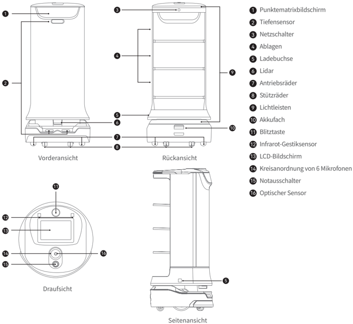
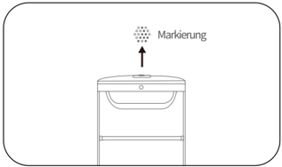
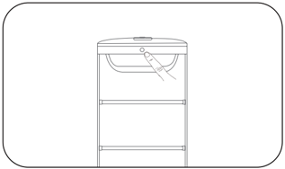
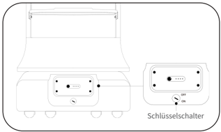
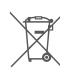
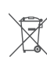

*Seite 28 (PDF-Seite 16, rechts)*

Copyright © 2023 Shenzhen Pudu Technology Co., Ltd. Alle Rechte vorbehalten.

Kein Teil dieser Publikation darf ohne vorherige schriftliche Zustimmung von Shenzhen Pudu Technology Co., Ltd. analog oder digital vervielfältigt, transkribiert, übersetzt oder zum Zwecke der Gewinnerzielung übertragen werden. Technische Daten und Angaben in dieser Unterlage dienen nur zu Informationszwecken und können ohne vorherige Mitteilung geändert werden. Falls nicht anders angegeben, dient dieses Dokument nur als Benutzerhandbuch und berechtigt nicht zur Inanspruchnahme von Garantien.

# 1. Sicherheitsanweisungen

## 1.1 Spannungsquellen

- Setzen Sie ausschließlich Original-Akkus und -Ladegeräte ein. Es sollte kein Fremdzubehör verwendet werden. Tauschen Sie das Ladegerät bei Beschädigung sofort aus.
- Wenn der Akku auf 20 % sinkt, sollte der Roboter rechtzeitig aufgeladen werden. Längerer Betrieb mit einem schwachen Akku kann dessen Laufzeit beeinträchtigen.
- Achten Sie darauf, dass die Spannung den Angaben auf dem Ladegerät entspricht, da dieses sonst beschädigt werden kann.
- Wenn Sie das Ladegerät benutzen, muss der Verschluss der Ladeschnittstelle vollständig greifen, damit sich beim Laden keine Überhitzung bildet, die zu Verbrennungen oder Geräteschäden führen kann.

## 1.2 Betrieb

- Verdecken Sie die obere Kamera des Roboters während des Betriebs nicht, damit er sich nicht unkontrolliert bewegt. Falls die Kamera abgedeckt ist, unterbrechen Sie seine Aufgabe und setzen Sie den Roboter auf den richtigen Kurs, bevor Sie ihn weitermachen lassen.
- Reinigen oder warten Sie den Roboter nicht, wenn die Spannung eingeschaltet ist.
- Es dürfen keine Vorrichtungen mit offener Flamme oder brennbare und explosive Gegenstände auf dem Roboter abgestellt werden.
- Nehmen Sie keine Tabletts heraus und stellen Sie keine hinein, während der Roboter fährt, sonst können Lebensmittel verschüttet und Geschirr beschädigt werden oder Verletzungen durch versehentliche Kollisionen entstehen.
- Den Roboter nicht ziehen oder wegtragen, während er arbeitet. Unerwünschtes Verhalten kann die Folge sein.
- Der Roboter sollte nicht von ungeschultem Personal zerlegt oder repariert werden. Im Falle einer Fehlfunktion wenden Sie sich rechtzeitig an Shenzhen Pudu Technology Co., Ltd. um technische Hilfe.
- Beachten Sie das Höchstgewicht, das eine Person vorschriftsgemäß anheben darf, wenn Sie den Roboter transportieren. Halten Sie den Roboter während des Transports aufrecht. Versuchen Sie niemals, ihn an Ablage oder Rahmen anzuheben.

## 1.3 Umgebung

- Betreiben oder laden Sie den Roboter nicht in einer Umgebung mit hohen Temperaturen oder Drücken, in Bereichen mit Feuer- oder Explosionsgefahr oder in anderen gefährlichen Umgebungen, sonst können Verletzungen oder Schäden am Roboter auftreten.
- Betreiben Sie den Roboter nicht in einer feuchten Umgebung oder auf Oberflächen, die mit Flüssigkeiten oder klebrigen Materialien bedeckt sind, da diese Schäden am Roboter verursachen können.
- Betreiben Sie den Roboter nicht an Orten, an denen die Verwendung von drahtlosen Geräten ausdrücklich untersagt ist, da es sonst u. a. zu Störungen anderer elektronischer Geräte oder anderen Gefahren kommen kann.
- Entsorgen Sie den Roboter und dessen Zubehör nicht über den Hausmüll. Entsorgen Sie Roboter und Zubehör vorschriftsgemäß. Führen Sie ihn möglichst dem Recycling zu.

---

*Seite 29 (PDF-Seite 17, links)*

# 2. Produktbestandteile

## 2.1 Packliste

Roboter×1, Benutzerhandbuch Pudu HolaBot×1, Qualitätsbescheinigung×1, Ladegerät×1, Startschlüssel×1, Markierungen×1.

## 2.2 Überblick

Als Servierroboter mit Funktionen wie Anruf und Mitteilungen enthält der Pudu HolaBot ein SLAM-Ortungs- und Navigationssystem, das optische und Laserpositionsbestimmung vereint. Pudu HolaBot zeichnet sich durch hohe Tragfähigkeit, Sprachsteuerung und Fernbedienbarkeit aus und integriert Funktionen wie Anruf, Mitteilungen und selbstständige Bewegungen. In verschiedenen Situationen ist er bequem und flexibel einsetzbar. Der Pudu HolaBot ist mit verschiedenen Modi wie Servierund Abholmodus versehen, um verschiedensten Situationen gerecht zu werden.

## 2.3 Erscheinungsbild und bestandteile

> *Bildbeschreibung (KI):* Die Abbildung zeigt die verschiedenen Ansichten des Pudu HolaBot-Roboters (Vorder-, Rück-, Seiten- und Draufsicht) mit nummerierten Beschriftungen für einzelne Komponenten. Mit Hilfe der Nummerierung können die Positionen von Teilen wie dem Punktematrixbildschirm, Tiefensensor, Netzschalter, Ablagen, Ladebuchse, Lidar, Antriebsrädern, Stützrädern, Lichtleisten, Akkufach, Blitztaste, Infrarot-Gestiksensor, LCD-Bildschirm, Kreisanordnung von 6 Mikrofonen, Notausschalter und Optischen Sensor identifiziert werden. Die Draufsicht verdeutlicht die räumliche Anordnung der Sensoren und Mikrofone auf der Oberseite des Roboters. Die Seitenansicht zeigt die Position der Ladebuchse an der Seite des Geräts.

*Beschriftungen:*

- **1** Punktematrixbildschirm
- **2** Tiefensensor
- **3** Netzschalter
- **4** Ablagen
- **5** Ladebuchse
- **6** Lidar
- **7** Antriebsräder
- **8** Stützräder
- **9** Lichtleisten
- **10** Akkufach
- **11** Blitztaste
- **12** Infrarot-Gestiksensor
- **13** LCD-Bildschirm
- **14** Kreisanordnung von 6 Mikrofonen
- **15** Notausschalter
- **16** Optischer Sensor

---

*Seite 30 (PDF-Seite 17, rechts)*

## 2.4 Technische daten

| Merkmale | Beschreibungg |
|---|---|
| Betriebsspannung | DC 23–29,4 V |
| Eingangsspannung | AC 100–240 V, 50/60 Hz |
| Ausgangsspannung | 29,4 V/8 A |
| Akkukapazität | 25,6 Ah |
| Aufladezeit | 4,5 h |
| Akkulaufzeit | 10–24 h |
| Rundfahrtgeschwindigkeit | 0,2–1,2 m/s (einstellbar) |
| Navigation | Laser- und optische integrierte SLAM-Positionsbestimmung |
| Mindestdurchgangsbreite | 70 cm |
| Max. überwindbare Höhe | 7 mm |
| Max. Neigungswinkel | 5º |
| Maße der Ablage | 390 mm×360 mm, extragroßer Rauminhalt 120 l |
| Anzahl Ablagen | 4 (einstellbar) |
| Abstand zwischen Ablagen | Von oben nach unten: 216 mm/184 mm/184 mm/184 mm |
| Ablagelast | Flache Oberfläche: 15 kg/Ablage; Hindernisübergangshöhe von 5 mm: 10 kg/Ablage |
| Werkstoffe der Maschine | ABS/Aluminiumlegierung in Luftfahrtqualität |
| Gewicht des Roboters | 55 kg |
| Maße des Roboters | 542 mm×534 mm×1228 mm |
| Betriebssystem | Android |
| Mikrofon | Kreisanordnung von 6 Mikrofonen |
| Lautsprecherleistung | 2×10 W Stereolautsprecher |
| Betriebsumgebung | Temperatur: 0 ℃ bis 40 ℃ ; RF: ≤ 85% |
| Lagerumgebung | Temperatur: -40 ℃ bis 65 ℃ ; RF: ≤ 85% |
| Betriebshöhe | < 2000 m |
| Untergrundanforderung | Innenraumumgebung, ebener und glatter Boden |
| Schutzklasse | Roboter: IP20; Ablagefach: IPX5 |
| Frequenzbandbereich | WLAN: 2,4G WLAN: 2412–2472 MHz, 2422–2462 MHz 5,2G WLAN: 5180–5240 MHz, 5190–5230 MHz, 5210 MHz 5,3G WLAN: 5260–5320 MHz, 5270–5310 MHz, 5290 MHz 5,6G WLAN: 5500–5700 MHz, 5510–5670 MHz, 5530–5610 MHz 5,8G WLAN: 5745–5825 MHz, 5755–5795 MHz, 5775 MHz |
| Frequenzbandbereich | Bluetooth: 2402–2480 MHz |
| Frequenzbandbereich | 3G: B1/B8 |
| Frequenzbandbereich | 4G LTE-FDD: B1/B3/B7/B8/B20/B28 |
| Frequenzbandbereich | 4G LTE-TDD: B34/B38/B40 |
| Max. Abstrahlleistung | WLAN: 2,4G WLAN: 16,96 dBm; 5,2G WLAN: 13,07 dBm; 5,3G WLAN: 12,66 dBm; 5,6G WLAN: 12,73 dBm; 5,8G WLAN: 12,93 dBm |
| Max. Abstrahlleistung | Bluetooth: BLE: 6,96 dBm; BR/EDR: 9,83 dBm |
| Max. Abstrahlleistung | 3G: B1: 23,64 dBm; B8: 21,71 dBm |
| Max. Abstrahlleistung | 4G LTE-FDD: B1: 23,77 dBm; B3: 23,51 dBm; B7: 23,7 dBm; B8: 23,22 dBm; B20: 22,97 dBm; B28: 23,05 dBm |
| Max. Abstrahlleistung | 4G LTE-TDD: B34: 23,73 dBm; B38: 23,97 dBm; B40: 23,45 dBm |

---

*Seite 31 (PDF-Seite 18, links)*

# 3. Benutzung

## Einschalten：

Stellen Sie den Roboter an seinem Startpunkt auf und halten Sie den Netzschalter 1 s lang gedrückt. Lichtleisten und Punktematrixbildschirm blinken und zeigen damit an, dass der Roboter eingeschaltet ist.

> *Bildbeschreibung (KI):* Die Markierung zeigt die Position an, an der der Roboter stehen muss. Der Pfeil deutet darauf hin, dass der Roboter an dieser Stelle positioniert werden soll.

> *Bildbeschreibung (KI):* Die Abbildung zeigt die Position des Schlüsselschalters am oberen Teil des Roboters. Der Schlüsselschalter befindet sich auf der hinteren Akkuabdeckung.
## Vorsicht：

Vor dem Einschalten des Roboters wird der Schlüsselschalter auf "EIN" gestellt und die hintere Akkuabdeckung zurückgeschoben.

> *Bildbeschreibung (KI):* Der Schlüsselschalter befindet sich auf der Rückseite des Roboters. Die Position des Schlüsselschalters ist mit einem Pfeil markiert. Der Schlüsselschalter hat eine ON/OFF-Stellung. Der Schlüsselschalter ist ein runder Knopf.

## Ausschalten：

Halten Sie den Netzschalter 3 s lang gedrückt, die Option Ausschalten wird auf dem Bildschirm angezeigt. Tippen Sie auf Ausschalten. Lichtleisten, Punktematrixbildschirm und LCD-Bildschirm gehen aus und zeigen damit an, dass der Roboter nicht mehr unter Spannung steht.

## Anhalten:

Tippen Sie auf den Bildschirm, um einen verfahrenden Roboter anzuhalten. Tippen Sie erneut an, wird der Betrieb fortgesetzt. Sie können auch die Blitztaste drücken, um den Roboter anzuhalten.

## Nothalt:

Drücken Sie im Notfall den Notausschalter, um einen in Betrieb befindlichen Roboter anzuhalten. Drehen Sie den Notausschalter im Uhrzeigersinn, tippen Sie auf den Bildschirm oder drücken Sie die Blitztaste, wenn der Betrieb wieder aufgenommen werden soll.

* Weitere Angaben zur Nutzung des Roboters finden Sie in der Pudu HolaBot-Bedienungsanleitung.

---

*Seite 32 (PDF-Seite 18, rechts)*

# 4. Wartung und pflege

| Bestandteile | Roboterstatus | Inspektionsintervall | Wartungsverfahren |
|---|---|---|---|
| Antriebsräder und Stützräder | Ausschalten | Wöchentlich | Wischen Sie die Oberfläche mit einem sauberen Tuch ab. |
| Ablagen | Ausschalten | Wöchentlich | Wischen Sie die Oberfläche mit einem sauberen Tuch ab. Wenn Ölflecken auf dem Silikonpolster der Ablage stehen, reinigen Sie es mit Wasser und trocknen Sie es rechtzeitig. |
| Optischer Sensor, Tiefensensor und Lidar | Ausschalten | Wöchentlich | Benutzen Sie zur Reinigung ein sauberes Tuch oder einen sonstigen Linsenreiniger. Bei starker Verschmutzung sollten Sie sich dieser sofort annehmen, damit der Sensor nicht blockiert wird und der Roboter fehlerhaft funktioniert. |
| Robotergehäuse | Ausschalten | Monatlich | Wischen Sie die Oberfläche mit einem sauberen Tuch ab. |

*Weitere Angaben zu Wartung und Pflege des Roboters finden Sie in der Pudu HolaBot-Bedienungsanleitung.

## 5. Kundendienst

Shenzhen Pudu Technology Co., Ltd. bietet einen kostenlosen Garantiedienst innerhalb der geltenden Garantiezeit (diese kann bei verschiedenen Bestandteilen variieren). Die für den Kundendienst anfallenden Gebühren werden von Pudu übernommen. Außerhalb der Garantiezeit oder unter Umständen, die nicht durch die kostenlose Garantie abgedeckt sind, ist eine reguläre Gebühr zu entrichten. Näheres zur Servicerichtlinie und zu den Reparaturleistungen erfahren Sie bei einem Anruf bei der Kundendienst-Hotline. Die Richtlinie kann auch in der Pudu HolaBot-Bedienungsanleitung nachgelesen werden. E-Mail-Adresse des Kundendienstes von Pudu: techservice@pudutech.com.

## 6. Angaben zur richtlinienerfüllung

### 6.1 Angaben zu entsorgung und recycling

Die Richtlinie über Elektro- und Elektronik-Altgeräte (WEEE) zielt darauf ab, Umwelteinflüsse durch Elektro- und Elektronikgeräte zu minimieren, indem Wiederverwendung und Recycling erhöht und Deponieabfall verringert werden. Das Symbol auf diesem Produkt oder seiner Verpackung bedeutet, dass es nach seiner Nutzungszeit getrennt vom normalen Hausmüll entsorgt werden sollte. Es liegt in Ihrer Verantwortung, Elektronikgeräte in Recycling-Zentren zu entsorgen, um die natürlichen Ressourcen zu schonen. Jedes Land sollte seine eigenen Sammelstellen für das Recycling von elektrischen und elektronischen Geräten haben. Wo Sie Elektro- und Elektronikgeräte abgeben können, erfahren Sie vom zuständigen Amt, der Stadtverwaltung oder dem Entsorgungsdienst.

Vor dem Einbringen von Elektro- und Elektronikgeräten in der Abfallsammlung oder in Abfallsammelstellen sollten Batterien und Akkus zur getrennten Sammlung entfernt werden.
