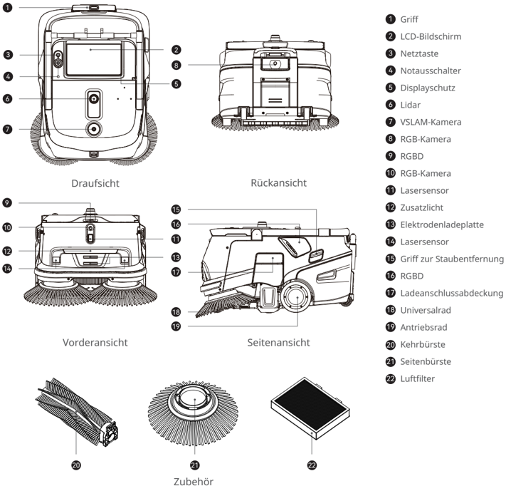
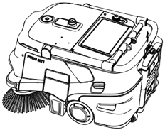
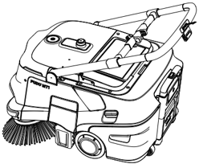
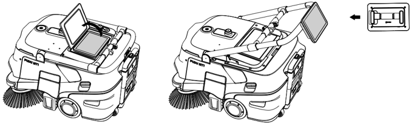

*Seite 20 (PDF-Seite 24)*

Copyright © 2024 Shenzhen Pudu Technology Co., Ltd. Alle Rechte vorbehalten.

Keine Organisation oder Einzelperson darf den Inhalt dieses Benutzerhandbuchs teilweise oder vollständig ohne die ausdrückliche schriftliche Zustimmung von Shenzhen Pudu Technology Co., Ltd. kopieren, transkribieren oder übersetzen oder dieses Benutzerhandbuch zu kommerziellen Zwecken auf beliebige Weise verteilen (elektronisch oder durch Fotokopieren, Aufzeichnen usw.). Die in diesem Benutzerhandbuch bereitgestellten technischen Daten und Angaben zum Produkt dienen nur als Referenz und können ohne vorherige Ankündigung geändert werden. Falls nicht anders angegeben, ist dieses Benutzerhandbuch nur als Orientierungshilfe gedacht und die darin enthaltenen Darstellungen sind nicht als Gewährleistung irgendwelcher Art aufzufassen.

---

*Seite 21 (PDF-Seite 25)*

# 1. Sicherheitsanweisungen

## 1.1 Elektrizität

- Es sollte kein Fremdzubehör verwendet werden. Tauschen Sie das Ladegerät bei Beschädigung sofort aus.
- Bitte laden Sie die Batterie vor dem ersten Gebrauch auf 100 % auf.
- Halten Sie den Akku immer über 10 %, damit Nutzen und Laufzeit des Roboters bestmöglich erhalten bleiben.
- Ein Ladestand von unter 10 % bedeutet, dass der Roboter bald keine Energie mehr hat und so schnell wie möglich aufgeladen werden sollte.
- Ein Akkuladestand von unter 2 % bedeutet, dass der Akku in Sicherheitsbetrieb geschaltet wird. Der Roboter ist in diesem Fall nicht arbeitsfähig und muss wieder aufgeladen werden.
- Wenn Sie den Roboter längere Zeit nicht benutzen, schalten Sie den Startschlüssel bitte in die Position „Aus".
- Wenn der Roboter längere Zeit nicht benutzt wurde, laden Sie ihn vor der erneuten Verwendung bitte vollständig auf.

## 1.2 Gebrauchsanleitung

- In Innenräumen darf der fahrbare Roboter nur auf ebenen Oberflächen eingesetzt werden. Verwenden Sie ihn nicht im Freien auf unebenem oder unbefestigtem Boden.
- Benutzen Sie den Roboter nicht bei Temperaturen über 40 °C oder unter 0 °C.
- Nimmt er versehentlich eine falsche Position ein, z. B. aufgrund eines Hindernisses, unterbrechen Sie seine Aufgabe sofort, schieben Sie den Roboter auf die richtige Strecke und lassen Sie ihn fortfahren.
- Den Roboter nicht gegenseitig ziehen, während er verfährt. Falls Sie ihn schieben oder versetzen müssen, tippen Sie zunächst auf den Bildschirm, um ihn anzuhalten.
- Den Roboter nicht rückwärts schieben, wenn die Spannung eingeschaltet ist.
- Der Sensor des Roboters darf nicht abgedeckt werden. Der Roboter kann sich sonst nicht korrekt bewegen oder verliert die Orientierung.
- Auf das Gerät darf nicht geschlagen werden. Es darf auch nicht stark auf den Bildschirm gedrückt oder getippt werden, da sonst Schäden verursacht werden können.
- Verwenden Sie den Roboter nicht zum Transportieren von Gütern. Es dürfen keine Vorrichtungen mit offener Flamme oder brennbare Festkörper, Gase oder Flüssigkeiten auf ihn gestellt werden.
- Die Einstellungen dürfen nicht angepasst werden, während der Roboter sich bewegt. Tippen Sie immer auf den Bildschirm, um den Roboter zu pausieren, bevor Sie ihn bedienen.
- Reinigen oder warten Sie den Roboter nicht, wenn Spannung eingeschaltet ist.
- Am Boden liegende Kabel sind zuvor zu entfernen, damit sich der Roboter nicht einfädelt.
- Zur Sicherheit wird eine Höchstgeschwindigkeit von 1,2 m/s empfohlen.
- Der Roboter verfügt zwar über eine automatische Hinderniserkennung, es kann jedoch tote Winkel geben. Deshalb kann es zu Unfällen kommen, wenn die Bewegung des Roboters bei hoher Geschwindigkeit abrupt blockiert wird.
- Achten Sie beim Transport des Roboters darauf, dass der Staubbehälter entleert wird. Es ist strengstens verboten, den Roboter während des Transports zu neigen, da sonst die Robotergehäuse beschädigt werden kann.

## 1.3 Umgebungsbedingungen

- Betreiben oder laden Sie den Roboter nicht in einer Umgebung mit hohen Temperaturen oder Drücken, in Bereichen mit Feuer- oder Explosionsgefahr oder in anderen gefährlichen Umgebungen, sonst können Verletzungen oder Schäden am Roboter auftreten.
- Entsorgen Sie den Roboter und dessen Zubehör nicht über den Hausmüll. Entsorgen Sie Roboter und Zubehör vorschriftsgemäß. Führen Sie ihn möglichst dem Recycling zu.
- Dieser Roboter ist für die Verwendung auf ebenen Oberflächen ausgelegt und eignet sich nicht für Umgebungen mit Stufen, starken Steigungen oder engen Räume.
- Es wird nicht empfohlen, den Roboter auf stark fettigem Boden oder bei offensichtlichen Pfützen fahren zu lassen.
- Am Boden liegende Kabel usw. sind zuvor zu entfernen, damit sich der Roboter nicht einfädelt oder verheddert.
- Wenn Sie dieses Produkt über Bodenschwellen, Absätze oder Bodensteckdosen fahren lassen, müssen Sie sicherstellen, dass die Höhe dieser überstehenden Objekte nicht mehr als 20 mm beträgt.
- Die minimale Durchgangsbreite beträgt 75 cm. Damit der Roboter reibungslos durch eine lange Passage fahren kann, sollte diese sogar mindestens 85 cm breit sein.
- Die höchste zulässige Steigung für den Roboter beträgt 8° (wenn er nicht reinigt). Um Risiken durch Rückwärtsrutschen vorzubeugen, sollte der Roboter bei Fahrten auf Neigungen nicht angehalten werden.
- Der Roboter unterstützt nur die Reinigung auf ebenen Flächen (im Reinigungszustand). Bitte verwenden Sie den Roboter nicht zum Reinigen auf mit bloßem Auge erkennbaren Steigungen (> 3°).
- Am Treppenrand, an der Einfahrt zu abfallenden Rampen und an anderen Orten, an denen der Roboter herunterfallen kann, sollten Geländer oder andere Schutzvorrichtungen angebracht werden.

---

*Seite 22 (PDF-Seite 26)*

# 2. Produktbestandteile

## 2.1 Überblick

PUDU MT1 ist ein professioneller Kehrroboter für große Umgebungen. Es unterstützt autonomes Laden. Der Hauptvorteil dieses Produkts besteht darin, dass es den Reinigungsanforderungen verschiedener harter Bodenoberflächen gerecht wird. Zu seinen typischen Anwendungsumgebungen zählen Lagerhallen, Fabriken, Baumärkte, Flughäfen und Bahnhöfe, wo viel Müll anfällt. Dies senkt nicht nur die Kosten und verbessert die Effizienz für die Kunden, sondern trägt auch zur allgemeinen Sauberkeit der Umgebung bei.

## 2.2 Packliste

Roboter x 1, Ladegerät x 1, Seitenbürsten x 2, Kehrbürste x 1, PUDU MT1 Benutzerhandbuch x 1, Qualitätszertifikat x 1, Positionierungsmarkierung x 1, Warnfahnenmast x 1

## 2.3 Aussehen und Bestandteile

> *Bildbeschreibung (KI):* Die Abbildung zeigt die verschiedenen Ansichten des PUDU MT1 Kehrroboters (Draufsicht, Rückansicht, Vorderansicht, Seitenansicht) und das Zubehör. Jede Komponente ist mit einer Nummer versehen und im rechten Bereich der Abbildung als Beschriftung aufgelistet (z. B. ① Griff, ② LCD-Bildschirm).

*Beschriftungen:*

- **1** Griff
- **2** LCD-Bildschirm
- **3** Netztaste
- **4** Notausschalter
- **5** Displayschutz
- **6** Lidar
- **7** VSLAM-Kamera
- **8** RGB-Kamera
- **9** RGBD
- **10** RGB-Kamera
- **11** Lasersensor
- **12** Zusatzlicht
- **13** Elektrodenladeplatte
- **14** Lasersensor
- **15** Griff zur Staubentfernung
- **16** RGBD
- **17** Ladeanschlussabdeckung
- **18** Universalrad
- **19** Antriebsrad
- **20** Kehrbürste
- **21** Seitenbürste
- **22** Luftfilter

---

*Seite 23 (PDF-Seite 27)*

## 2.4 Technische Daten

| Merkmale | Beschreibung |
|---|---|
| Modell | MTBC01 |
| Betriebsspannung | 23 V bis 29,2 V DC |
| Eingangsspannung | 100 V bis 240 V AC, 50/60 Hz |
| Ausgangsspannung | Max.: 29,2 V, 20 A |
| Batteriekapazität | 45 Ah |
| Aufladezeit | Ungefähr 3 Stunden |
| Laufzeit | 4 h bis 8 h |
| Reinigungsfähigkeiten | Papierfetzen, Plastikfolien usw. |
| Gewicht | Ungefähr 65 kg |
| Maße des Roboters (L×B×H) | 84*60*49 cm |
| Gehäusematerial | PC+ABS |
| Navigationsmethode | Integriertes Lidar und optische SLAM-Positionierung |
| Rundfahrtgeschwindigkeit | 0,2 m/s bis 1,2 m/s (einstellbar) |
| Betriebsgeräusch | < 75 dB |
| Mindestdurchgangsbreite | 75 cm |
| Max. überwindbare Höhe | 20 mm |
| Max. Neigungswinkel | 8° |
| Max. überwindbarer Spalt | 30 mm |
| Reinigungsbreite (mit Seitenbürste) | Ungefähr 70 cm |
| Fassungsvermögen des Staubbehälters | 35 L |
| Betriebssystem | Android |
| Kommunikation | Unterstützt 4G, WLAN, Bluetooth, Lora oder 2,4G (optional) |
| Mobil-App | Unterstützt |
| Betriebsmodus | Manuell/Auto |
| Autom. Laden | Unterstützt (in Verbindung mit MT1 Ladestation) |
| Betriebsumgebung | Temperatur: 0 ℃ bis 40 ℃ Luftfeuchtigkeit: ≤ 90 % RH |
| Lagerumgebung | Temperatur: -20 ℃ bis 70 ℃; Luftfeuchtigkeit: ≤ 90 % RH |
| Betriebshöhe | < 2000 m |
| Anwendungsumfang | Gepflasterter Boden aus poliertem Beton, Epoxidharz, Gummi, normalen Ziegeln, Keramikfliesen usw. |
| Schutzklasse | IPX3 |

(* Die Akkulaufzeit jedes Reinigungsmodus wird auf Grundlage der Standard-Getriebeeinstellung berechnet, wobei der Akku bei 100 % beginnt und bei 10 % endet.)

---

*Seite 24 (PDF-Seite 28)*

# 3. Produktverwendung

## 3.1 Anweisungen für Tasten

## Einschalten:

Halten Sie die Netztaste etwa 12 Sekunden lang gedrückt, bis die untere LED-Leuchtleiste blau wird.

## Ausschalten:

Halten Sie den Netztaste etwa 12 Sekunden lang gedrückt, bis der Bildschirm erlischt und damit angibt, dass der Roboter erfolgreich heruntergefahren wurde.

## Anhalten:

Tippen Sie auf den Bildschirm, um einen verfahrenden Roboter anzuhalten. Tippen Sie erneut an, wird der Betrieb fortgesetzt.

## Nothalt:

Drücken Sie im Notfall den Notausschalter, um einen in Betrieb befindlichen Roboter anzuhalten. Drehen Sie den Notausschalter im Uhrzeigersinn, und der Vorgang wird gemäß den Bildschirmhinweisen fortgesetzt.

## Vorsicht:

Vor dem Beginn einer automatischen Reinigungsaufgabe müssen Sie sich vergewissern, dass der Roboter eingeschaltet und unterhalb oder vor der optischen Markierung platziert ist (abhängig von der Position der Markierung), um eine erfolgreiche Positionierung am Startpunkt sicherzustellen.

## 3.2 Griff

Wenn Sie den Roboter schieben müssen, heben Sie den Griff an. Wenn sich der Roboter im Ruhezustand befindet oder im Automatikmodus arbeitet, senken Sie den Griff ab.

> *Bildbeschreibung (KI):* Die Abbildung zeigt die Frontansicht des PUDU MT1 Reinigungsroboters mit sichtbaren Bürsten und Sensoren. Der Griff ist oben am Gerät montiert und kann angehoben oder abgesenkt werden, wie im Text beschrieben. Auf der Oberseite sind ein Bildschirm, Tasten und eine LED-Anzeige erkennbar – diese Elemente werden im Text für Bedienung und Status erklärt. Die Position des Notausschalters ist nicht klar markiert; die Abbildung allein zeigt keine explizite Kennzeichnung dafür.

> *Bildbeschreibung (KI):* Die Abbildung zeigt die Position des Griffes am Roboter. Sie erkennen den Standort der Haupttaste und anderer Bedienelemente auf dem Deckel. Der Bildschirmschutz ist an seiner typischen Stelle über dem Display dargestellt. Die Abbildung veranschaulicht, wie der Bildschirm vom Gerät abgenommen werden kann.
Wenn Sie mit dem Bildschirm interagieren müssen, haben Sie zwei Möglichkeiten: Sie können entweder den Bildschirmschutz öffnen und direkt mit dem Bildschirm interagieren oder den Bildschirm vom Roboter abnehmen und ihn bedienen, indem Sie ihn entweder in den Händen halten oder am Griff befestigen.

> *Bildbeschreibung (KI):* Die Abbildung zeigt zwei Zustände des Roboters: mit geöffnetem Bildschirmschutz (links) und ohne ihn (rechts). Der Pfeil rechts deutet auf eine alternative Positionierung oder Montage des Bildschirms hin – möglicherweise am Griff oder in einer anderen Halterung. Die Darstellung verdeutlicht, wie der Bildschirm entweder direkt am Gerät oder separat gehalten/angebracht werden kann. Es wird gezeigt, dass der Bildschirmschutz abnehmbar ist und nicht zwingend montiert sein muss, um den Bildschirm zu bedienen.

* Der Robotergriff und der Bildschirm sind abnehmbar.

---

*Seite 25 (PDF-Seite 29)*

# 4. Wartung und Pflege

1. Fehler beim Starten: Prüfen Sie den Akkuladestand. Laden Sie den Akku, wenn er entladen ist.
2. Müll kann nicht entfernt werden:
- a. Der Staubbehälter ist voll. Entnehmen Sie den Staubbehälter und reinigen Sie ihn vor dem Neustart des Roboters.
- b. Prüfen Sie die Bürste. Wenn sie starke Anzeichen von Verschleiß aufweist, ersetzen Sie sie durch eine neue Bürstenbaugruppe.

Wartungsbestandteile

| Bestandteile | Inspektionsintervall | Wartungsverfahren |
|---|---|---|
| Antriebsräder und Stützräder | Wöchentlich | Wischen Sie die Oberfläche mit einem sauberen Tuch ab. |
| Optische Sensoren und Lidar | Wöchentlich | Benutzen Sie zur Reinigung ein sauberes, trockenes Tuch oder einen sonstigen Linsenreiniger. |
| Staubbehälter | Ein halber Monat | Räumen Sie den Staubbehälter vollständig auf. Waschen Sie ihn bei Bedarf mit klarem Wasser ab und trocknen Sie ihn, bevor Sie ihn wieder einsetzen. |
| Luftfilter | Ein halber Monat | Ziehen Sie wiederholt am Staubentfernungsgriff an der Seite des Roboterkörpers. |

# 5. Kundendienst

Shenzhen Pudu Technology Co., Ltd. bietet einen kostenlosen Garantiedienst innerhalb der geltenden Garantiezeit (diese kann bei verschiedenen Bestandteilen variieren). Die für den Kundendienst anfallenden Gebühren werden von Pudu übernommen. Außerhalb der Garantiezeit oder unter Umständen, die nicht durch die kostenlose Garantie abgedeckt sind, ist eine reguläre Gebühr zu entrichten. Näheres zur Servicerichtlinie und zu den Reparaturleistungen erfahren Sie bei einem Anruf bei der Kundendienst-Hotline. Die Richtlinie kann auch in der PUDU MT1-Bedienungsanleitung nachgelesen werden. E-Mail: techservice@pudutech.com

# 6. Angaben zur Richtlinienerfüllung

## 6.1 Informationen über Entsorgung und Recycling

Die Richtlinie über Elektro- und Elektronik-Altgeräte (WEEE) zielt darauf ab, Umwelteinflüsse durch Elektro- und Elektronikgeräte zu minimieren, indem Wiederverwendung und Recycling erhöht und Deponieabfall verringert werden. Das Symbol auf diesem Produkt oder seiner Verpackung bedeutet, dass es nach seiner Nutzungszeit getrennt vom normalen Hausmüll entsorgt werden sollte. Es liegt in Ihrer Verantwortung, Elektronikgeräte in Recycling-Zentren zu entsorgen, um die natürlichen Ressourcen zu schonen. Jedes Land sollte seine eigenen Sammelstellen für das Recycling von elektrischen und elektronischen Geräten haben. Wo Sie Elektro- und Elektronikgeräte abgeben können, erfahren Sie vom zuständigen Amt, der Stadtverwaltung oder dem Entsorgungsdienst.

Vor dem Einbringen von Elektro- und Elektronikgeräten in die Abfallsammlung oder in Abfallsammelstellen sollten Batterien und Akkus zur getrennten Sammlung entfernt werden.

---

*Seite 26 (PDF-Seite 30)*

## 6.2 FCC-Konformitätserklärung

Die folgenden Informationen treffen auf Pudu Robotics zu.

Dieses Gerät wurde getestet und entspricht den Grenzwerten für ein digitales Gerät der Klasse B gemäß Teil 15 der FCC-Bestimmungen. Diese Grenzen sollen einen angemessenen Schutz gegen Funkstörungen in einer Wohnanlage ermöglichen. Dieses Gerät generiert, nutzt Hochfrequenzenergie und kann Hochfrequenzenergie abstrahlen und bei nicht anweisungsgemäßem Aufbau und Betrieb Funkstörungen verursachen. Es besteht jedoch keine Garantie, dass in einer gegebenen Installation keine Störungen auftreten. Wenn dieser Roboter Radio- oder Fernsehempfangsstörungen verursacht, was durch Aus- und Einschalten festgestellt werden kann, sollten Sie Abhilfe durch mindestens eine der folgenden Maßnahmen zu schaffen versuchen:

- Richten Sie die Empfangsantenne neu aus, oder stellen Sie sie an einem anderen Ort auf.
- Vergrößern Sie den Abstand zwischen Gerät und Empfänger.
- Schließen Sie das Gerät an eine Steckdose an, die nicht von demselben Stromkreis wie die Steckdose des Empfängers versorgt wird.
- Wenden Sie sich an den Händler oder an erfahrenen Radio-/Fernsehtechniker.

Dieses Gerät entspricht den Bestimmungen von Abschnitt 15 der Richtlinien der amerikanischen Bundesbehörde für das Fernmeldewesen FCC (Federal Communications Commission). Für den Betrieb gelten die folgenden zwei Bedingungen:

- Dieses Gerät darf keine schädlichen Störungen verursachen.
- Dieses Gerät muss empfangene Störsignale tolerieren können. Hierzu gehören auch Interferenzen, die zu nicht gewünschten Funktionen führen können.

## 6.3 Konformitätserklärung Industry Canada

Dieses Gerät entspricht den lizenzfreien RSS-Standards gemäß Industry Canada. Für den Betrieb gelten die folgenden zwei Bedingungen:

- Dieses Gerät darf keine Interferenzen erzeugen.
- Dieses Gerät muss Interferenzen verkraften können einschließlich Interferenzen, die zu Fehlern im Betrieb führen können.

L'émetteur/récepteur exempt de licence contenu dans le présent appareil est conforme aux CNR d'Innovation, Sciences et Développement économique Canada applicables aux appareils radio exempts de licence. L'exploitation est autorisée aux deux conditions suivantes :

- L'appareil ne doit pas produire de brouillage;
- L'appareil doit accepter tout brouillage radioélectrique subi, même si le brouillage est susceptible d'en compromettre le fonctionnement.
