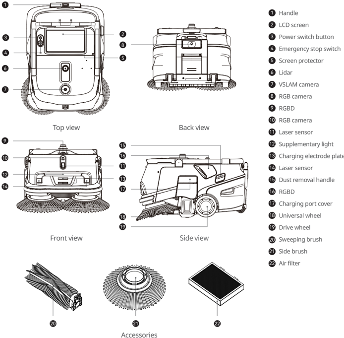
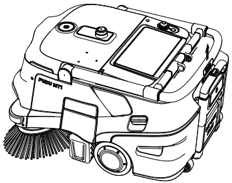
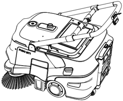
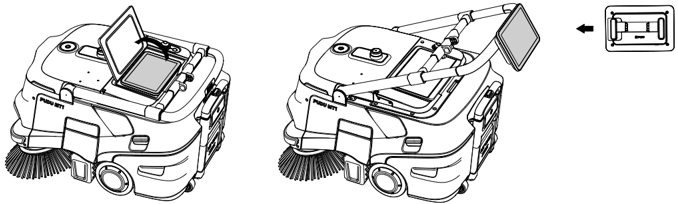

*Page 1 (PDF page 5)*

Copyright © 2024 Shenzhen Pudu Technology Co., Ltd. All rights reserved.

No organization or individual shall imitate, copy, transcribe or translate the contents of this user manual, in part or in full, without the express written consent of Shenzhen Pudu Technology Co., Ltd., or distribute this user manual for profit in any way (electronically or via photocopying, recording, etc.). The product specifications and information provided in this user manual are for reference only and are subject to change without further notice. Unless otherwise specified, this user manual is only intended as instructions for use, and no representation shall be deemed as a warranty of any kind.

---

*Page 2 (PDF page 6)*

# 1. Safety Instructions

## 1.1 Instructions for Electricity

- Do not charge your robot using non-original chargers. If the charger is damaged, replace it immediately.
- Please fully charge the battery to 100% before first use.
- To maximize the efficiency and battery life of the robot, always keep the battery level above 10%.
- A battery level lower than 10% means that the robot will soon run out of power and needs to be charged as quickly as possible.
- A battery level lower than 2% means that the battery is under protection. In this case, the robot will be unable to perform tasks and must be charged before it can be used again.
- If the machine is not used for a long time, please turn the power key switch to the "off" position.
- If the machine has not been used for a long time, please charge it fully before using it again.

## 1.2 Instructions for Use

- This auto-cleaning wheeled robot can only be used indoors on flat surfaces. Do not use it outdoors on any rugged ground or unpaved ground.
- Do not use the robot at a temperature above 40°C (104°F) or below 0°C (32°F).
- If the robot accidentally enters into any incorrect position due to blocking and some other reasons, please suspend the task promptly and push the robot to the correct route before continuing the task.
- Do not pull the robot while it is working. If you need to push or move the robot, tap on the screen to stop it from moving first.
- Do not push the robot backward when the power is on.
- Do not block the robot sensor. Otherwise, the robot may fail to move properly or get lost.
- Do not pat the device or press or tap hard on the screen, or damages may be caused.
- Do not use the robot to carry goods. Do not put open-flame stoves or any flammable solid, gas, or liquid on it.
- Do not adjust the settings while the robot is moving. Always tap on the screen to pause the robot before proceeding with any operations.
- Do not clean or maintain the robot when the power is on.
- Cables on the ground should be put away in advance to prevent the robot from dragging them.
- A maximum speed of 1.2 m/s (3.94 ft/s) is recommended for safe operation.
- Although the robot features automatic obstacle avoidance, there may be blind spots. Therefore, blocking the robot abruptly from moving at high speeds may cause accidents.
- When transporting the robot, please ensure that the garbage in the dustbin is emptied. It is strictly prohibited to tilt the robot during transportation, otherwise, the body may be damaged.

## 1.3 Instructions for Environment

- Do not use or charge the robot in a high temperature/pressure environment, areas with fire or explosion hazard, or other dangerous scenarios to avoid personal injury or robot damage.
- Do not dispose of the robot or its accessories as household waste. Always dispose of the robot and its accessories according to local laws and regulations, and recycle wherever possible.
- This robot is designed for use on flat surfaces and is not suitable for use in environments with steps or large slopes or that are too compact.
- It is not recommended to use the robot on heavily greasy surfaces or surfaces with standing water.
- Put away any wire or other objects on the ground to prevent the robot from being tripped or entangled.
- When using this product on the ground with obvious protrusions (such as thresholds and floor receptacles), make sure that the height of the protrusions is no more than 20 mm.
- The minimal travel width is 75 cm (29.53 inches). A width greater than 85 cm (33.46 inches) is preferred for the robot to move smoothly through a long passage.
- The maximum possible slope is 8° for the robot (non-cleaning state). To prevent any risks caused by backward slips, the robot should not be paused when moving on a slope.
- The robot only supports cleaning on flat surfaces (in cleaning state), please do not use the robot for cleaning on slopes visible to the naked eye (> 3°).
- Rails or other protective structures should be put in place at the edge of stairs, the entrance of downward slopes, and other locations where the robot may fall.

---

*Page 3 (PDF page 7)*

# 2. Product Components

## 2.1 Overview

PUDU MT1 is a professional sweeping robot designed for large-scale environments. It supports autonomous charging. The core advantage of this product is its ability to meet the cleaning needs of various hard floor surfaces. Its typical application environments include warehouses, factories, home improvement centers, airports, and stations where there is a large amount of rubbish. It not only reduces costs and improves efficiency for clients but also enhances the overall cleanliness of the environment.

## 2.2 Packaging List

Robot x 1, Charger x 1, Side Brushes x 2, Sweeping Brush x 1, PUDU MT1 User Manual x 1, Certificate of Compliance x 1, Positioning Marker x 1, Warning Flagpole x 1

## 2.3 Appearance and Components

> *Figure description (AI):* The figure identifies all major components of the PUDU MT1 robot with numbered labels. It shows the physical location of buttons like the power switch and emergency stop on the top view. The diagram points out specific ports and connectors such as the charging port cover and electrode plate. It distinguishes between different types of cameras (VSLAM, RGB, RGBD) and sensors (Lidar, Laser sensor).

*Labels:*

- **1** Handle
- **2** LCD screen
- **3** Power switch button
- **4** Emergency stop switch
- **5** Screen protector
- **6** Lidar
- **7** VSLAM camera
- **8** RGB camera
- **9** RGBD
- **10** RGB camera
- **11** Laser sensor
- **12** Supplementary light
- **13** Charging electrode plate
- **14** Laser sensor
- **15** Dust removal handle
- **16** RGBD
- **17** Charging port cover
- **18** Universal wheel
- **19** Drive wheel
- **20** Sweeping brush
- **21** Side brush
- **22** Air filter

---

*Page 4 (PDF page 8)*

## 2.4 Technical Specifications

| Features | Description |
|---|---|
| Model | MTBC01 |
| Operating voltage | DC 23 V–29.2 V |
| Power input | AC 100 V–240 V, 50/60 Hz |
| Power output | Max.: 29.2 V, 20 A |
| Battery capacity | 45 Ah |
| Charging time | Approximately 3 hours |
| Runtime | 4 h to 8 h |
| Cleaning capabilities | Shreds of paper, plastic film, etc. |
| Weight | Approximately 65 kg |
| Robot dimensions (L×W×H) | 84*60*49 cm |
| Enclosure material | PC+ABS |
| Screen specifications | 10.1-inch LCD screen |
| Navigation method | Integrated lidar and visual SLAM positioning |
| Cruise speed | 0.2 m/s–1.2 m/s (Adjustable) |
| Working noise | < 75 dB |
| Min. travel width | 75 cm |
| Max. surmountable height | 20 mm |
| Max. climbing angle | 8° |
| Max. surmountable gap | 30 mm |
| Cleaning Width (with side brushes) | Approximately 70 cm |
| Dustbin capacity | 35 L |
| Operation system | Android |
| Communication | Support 4G, Wi-Fi, Bluetooth, Lora or 2.4G (optional) |
| Mobile App | Supported |
| Operation mode | Manual/Auto |
| Auto charging | Supported (in conjunction with MT1 charging station) |
| Working environment | Temperature: 0℃–40℃; Humidity: ≤ 90% RH |
| Storage environment | Temperature: -20℃–70℃; Humidity: ≤ 90% RH |
| Working altitude | < 2000 m |
| Application scope | Paved ground made of polished concrete, epoxy resin, rubber, regular brick, ceramic tiles, etc. |
| IP rating | IPX3 |

(* The battery life of each cleaning mode is calculated based on the standard gear setting, with the battery starting at 100% and ending at 10%.)

---

*Page 5 (PDF page 9)*

# 3. Using the Product

## 3.1 Instructions for Buttons

## Power On:

Press and hold the power button for approximately 12 seconds, and the bottom LED light strip will appear in blue.

## Power Off:

Press and hold the power button for approximately 12 seconds till the screen goes off, indicating that the robot is successfully powered off.

## Pause:

Tap on the screen to pause the working robot. Tap again to resume operation.

## Emergency stop:

In case of an emergency, press the emergency stop switch to stop a working robot. Rotate the emergency stop switch clockwise, and resume the operation according to the screen tips.

## Caution:

Before starting an automatic cleaning task, make sure the robot is powered on and placed below or in front of the visual marker (depending on the position of the marker) for successful positioning at the startup location.

## 3.2 Instructions for Handle

When you need to push the robot, raise the handle. When the robot is idle or working automatically, lower the handle.

> *Figure description (AI):* The figure shows the physical layout of the robot vacuum cleaner. It illustrates the location of the power button, emergency stop switch, and screen on the device's top surface. The image displays the front brush assembly and side wheels for reference during setup or maintenance. This visual helps users identify components mentioned in the manual without needing to refer back to text descriptions.

> *Figure description (AI):* The figure shows a robot vacuum cleaner with its handle raised. The front of the robot has a visible brush roll for cleaning floors. A circular port or connector is located on the lower front section of the device. The top surface includes a screen area and control buttons, including what appears to be an emergency stop switch.
When you need to interact with the screen, there are two options: you can either open the screen protector and directly interact with the screen, or detach the screen from the robot and operate it either by holding it in your hands or by attaching it to the handle.

> *Figure description (AI):* The figure shows two views of the robot with its screen attached to the handle. The left view displays the screen in an upright position on the robot's body. The right view illustrates the screen detached and mounted on the handle for handheld operation. A small icon indicates the screen can be removed from the robot and used independently.
* The robot handle and the screen are designed to be detachable.

---

*Page 6 (PDF page 10)*

# 4. Maintenance and Care

1. Start failure: Check the battery level. Charge the battery if it is exhausted.
2. Unable to clean garbage:
- a. The dustbin is full. Remove the dustbin and clean it up before restarting the robot.
- b. Check the brush. If it is severely worn, replace it with a new brush assembly.

Maintenance Components

| Components | Inspection Interval | Maintenance Method |
|---|---|---|
| Drive wheels, and auxiliary wheels | Weekly | Wipe the surface with a clean cloth. |
| Vision sensors and Lidar | Weekly | Use a soft, dry cloth or lens cleanser for cleaning |
| Dustbin | Half a month | Clean up any garbage left inside the dustbin. If necessary, wash it with clean water, and then dry it before putting it back. |
| Air Filter | Half a month | Repeatedly pull the dust removal handle on the side of the robot body |

# 5. After-sales service

Shenzhen Pudu Technology Co., Ltd provides free warranty service within the effective warranty period (the warranty period may vary for different components). The fees incurred by the after-sales service will be covered by Pudu. Beyond the warranty period or in any circumstances not covered by the free warranty, a certain fee will be charged according to the normal price. Please call the after-sales hotline for detailed after-sales service policy and repair services. The policy can also be found in PUDU MT1 Operation Guide.

Email: techservice@pudutech.com

# 6. Compliance Information

## 6.1 Disposal and recycling information

The Waste Electrical and Electronic Equipment (WEEE) Directive aims to minimize the impact of electrical and electronic goods on the environment, by increasing re-use and recycling and by reducing the amount of WEEE going to landfill. The symbol on this product or its packaging signifies that this product must be disposed separately from ordinary household wastes at its end of life. Be aware that this is your responsibility to dispose of electronic equipment at recycling centers in order to conserve natural resources. Each country should have its collection centers for electrical and electronic equipment recycling. For information about your recycling drop off area, please contact your related electrical and electronic equipment waste management authority, your local city office, or your household waste disposal service.

Before placing electrical and electronic equipment (EEE) in the waste collection stream or in waste collection facilities, the end user of equipment containing batteries and/or accumulators must remove those batteries and accumulators for separate collection.

---

*Page 7 (PDF page 11)*

## 6.2 Federal Communications Commission compliance statement

The following information applies to Pudu Robotics.

This equipment has been tested and found to comply with the limits for a Class B digital device, pursuant to part 15 of the FCC Rules. These limits are designed to provide reasonable protection against harmful interference in a residential installation. This equipment generates, uses and can radiate radio frequency energy and, if not installed and used in accordance with the instructions, may cause harmful interference to radio communications. However, there is no guarantee that interference will not occur in a particular installation. If this equipment does cause harmful interference to radio or television reception, which can be determined by turning the equipment off and on, the user is encouraged to try to correct the interference by one or more of the following measures:

- Reorient or relocate the receiving antenna.
- Increase the separation between the equipment and receiver.
- Connect the equipment into an outlet on a circuit different from that to which the receiver is connected.
- Consult the dealer or an experienced radio/TV technician for help.

This device complies with Part 15 of the FCC rules. Operation is subject to the following two conditions:

- This device may not cause harmful interference.
- This device must accept any interference received, including interference that may cause undesired operation.

## 6.3 Industry Canada compliance statement

This device complies with Industry Canada licence-exempt RSS standard(s). Operation is subject to the following two conditions:

- This device may not cause interference.
- This device must accept any interference, including interference that may cause undesired operation of the device. L'émetteur/récepteur exempt de licence contenu dans le présent appareil est conforme aux CNR d'Innovation, Sciences et Développement économique Canada applicables aux appareils radio exempts de licence. L'exploitation est autorisée aux deux conditions suivantes :
- L'appareil ne doit pas produire de brouillage;
- L'appareil doit accepter tout brouillage radioélectrique subi, même si le brouillage est susceptible d'en compromettre le fonctionnement.
