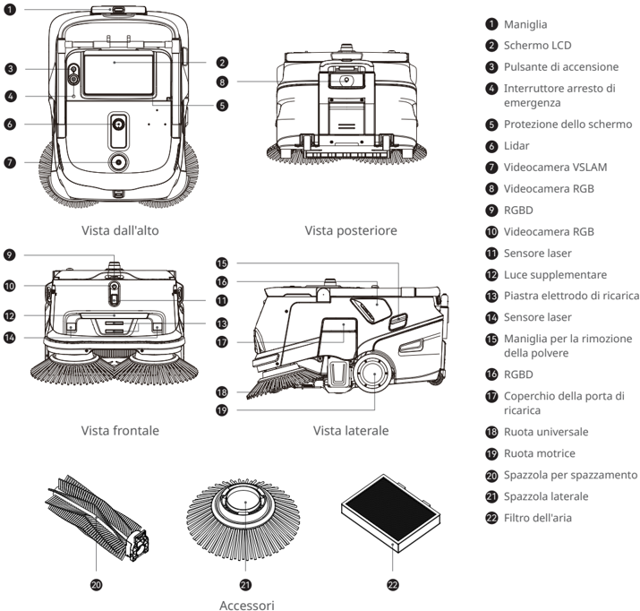
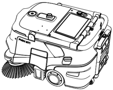
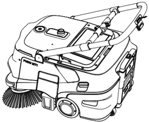
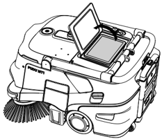
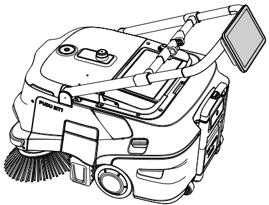

*Pagina 70 (pagina PDF 74)*

Copyright © 2024 Shenzhen Pudu Technology Co., Ltd. Tutti i diritti riservati.

Nessuna organizzazione o individuo può imitare, copiare, trascrivere o tradurre i contenuti di questo manuale dell'utente, in parte o per intero, senza il consenso scritto esplicito di Shenzhen Pudu Technology Co., Ltd., o distribuire questo manuale dell'utente a scopo di lucro in qualsiasi modo (elettronicamente o tramite fotocopiatura, registrazione, ecc.). Le specifiche del prodotto e le informazioni fornite nel presente manuale dell'utente hanno solo scopo di riferimento e sono soggette a variazione senza ulteriore preavviso. Salvo diversa indicazione, questo manuale utente è destinato unicamente a fornire istruzioni per l'utilizzo, e nessuna affermazione in esso contenuta dovrà essere considerata come una garanzia di qualsiasi tipo.

---

*Pagina 71 (pagina PDF 75)*

# 1. Istruzioni per la sicurezza

## 1.1 Istruzioni per l'elettricità

- Non ricaricare il robot utilizzando caricatori non originali. Se il caricabatterie è danneggiato, sostituirlo immediatamente.
- Caricare completamente la batteria al 100% prima del primo utilizzo.
- Per massimizzare l'efficienza e la durata della batteria del robot, mantenere sempre il livello di carica della batteria al di sopra del 10%.
- Un livello di carica della batteria inferiore al 10% significa che il robot sta per finire l'energia e deve essere ricaricato prima possibile.
- Un livello di carica della batteria inferiore al 2% significa che la batteria è sotto protezione. In questo caso il robot non sarà in grado di eseguire delle attività e dovrà essere ricaricato prima di poter essere di nuovo utilizzato.
- Se la macchina non viene utilizzata per un lungo periodo di tempo, girare l'interruttore a chiave di alimentazione nella posizione "off".
- Se la macchina non è stata utilizzata per un lungo periodo, ricaricarla completamente prima di utilizzarla nuovamente.

## 1.2 Istruzioni per l'uso

- Questo robot auto-pulente su ruote può essere utilizzato solo al chiuso su superfici piane. Non utilizzarlo all'aperto, su terreni accidentati o non asfaltati.
- Non utilizzare il robot a temperature superiori a 40 °C (104 °F) o inferiori a 0 °C (32 °F).
- Se il robot raggiunge accidentalmente una posizione non corretta, a causa di un blocco o di altre ragioni, sospendere immediatamente l'attività e spingere il robot sul percorso corretto prima di riprendere l'attività.
- Non spingere il robot mentre è in funzione. Qualora sia necessario spingere o spostare il robot, toccare prima lo schermo per arrestarlo.
- Non spingere il robot all'indietro quando è acceso.
- Non bloccare il sensore del robot. In caso contrario, il robot potrebbe non muoversi in modo corretto o perdere l'orientamento.
- Non colpire il dispositivo né premere o toccare con forza sullo schermo, per evitare possibili danni.
- Non utilizzare il robot per trasportare merci. Non disporre su di esso fornelli a fiamma libera, né solidi, gas o liquidi infiammabili.
- Non modificare le impostazioni mentre il robot è in movimento. Toccare sempre lo schermo per mettere in pausa il robot prima di procedere con qualsiasi operazione.
- Non pulire né manutenere il robot mentre è acceso.
- Eventuali cavi presenti sul pavimento devono essere preventivamente rimossi per evitare che il robot li trascini.
- Per un utilizzo sicuro si raccomanda una velocità massima di 1,2 m/s (3,94 ft/s).
- Anche se il robot è dotato di una funzionalità di aggiramento automatico degli ostacoli, possono esistere angoli ciechi. Pertanto, impedire bruscamente al robot di muoversi ad alta velocità può causare incidenti.
- Durante il trasporto del robot, assicurarsi che il cestino della polvere sia svuotato. È severamente proibito inclinare il robot durante il trasporto, altrimenti il corpo potrebbe essere danneggiato.

## 1.3 Istruzioni per l'ambiente

- Non utilizzare o ricaricare il robot in un ambiente ad alta temperatura/pressione, in zone a rischio di incendio o esplosione o in altri ambienti pericolosi, per evitare lesioni personali o danni al robot.
- Non smaltire il robot o i suoi accessori come rifiuti domestici. Smaltire sempre il robot e i suoi accessori secondo le leggi e le normative locali e riciclarli ove possibile.
- Questo robot è progettato per essere utilizzato su superfici piane e non è adatto per l'uso in ambienti con gradini o pendenze elevate o troppo compatte.
- Si consiglia di non utilizzare il robot su superfici molto unte o con acqua stagnante.
- Rimuovere dal pavimento cavi o altri oggetti per evitare che il robot ne finisca impigliato.
- Quando si utilizza questo prodotto su terreni con sporgenze evidenti (come soglie e prese a pavimento), assicurarsi che l'altezza delle sporgenze non sia superiore a 20 mm.
- La larghezza minima del percorso è 75 cm (29,53 pollici). È consigliabile una larghezza maggiore di 85 cm (33,46 pollici) per consentire al robot di muoversi agevolmente attraverso un lungo percorso.
- La pendenza massima percorribile dal robot è di 8° (in stato non di pulizia). Per evitare eventuali rischi causati da scivolamento all'indietro, il robot non deve essere fermato durante lo spostamento lungo una pendenza.
- Il robot supporta solo la pulizia su superfici piane (in stato di pulizia): non utilizzare il robot per la pulizia su pendenze visibili ad occhio nudo (> 3°).
- Ai lati di eventuali scale, all'inizio di un tratto in discesa e in altre posizioni dove il robot potrebbe cadere occorre predisporre dei mancorrenti o altre strutture di protezione.

---

*Pagina 72 (pagina PDF 76)*

# 2. Componenti del prodotto

## 2.1 Panoramica

PUDU MT1 è un robot professionale per spazzamento, progettato per ambienti di grandi dimensioni. Supporta la ricarica autonoma. Il vantaggio principale di questo prodotto è la sua capacità di soddisfare le esigenze di pulizia di diverse superfici di pavimenti duri. I suoi tipici ambienti di applicazione includono magazzini, fabbriche, centri di bricolage, aeroporti e stazioni dove è presente una grande quantità di rifiuti. Non solo riduce i costi e migliora l'efficienza per i clienti, ma migliora anche la pulizia generale dell'ambiente.

## 2.2 Contenuto della confezione

Robot x 1, Caricabatterie x 1, Spazzole laterali x 2, Spazzola per spazzamento x 1, Manuale utente PUDU MT1 x 1, Certificato di conformità x 1, Indicatore di posizionamento x 1, Asta di segnalazione x 1

## 2.3 Aspetto e componenti

> *Descrizione della figura (IA):* La figura mostra le posizioni dei componenti principali del robot PUDU MT1, come la maniglia (①), lo schermo LCD (②) e il pulsante di accensione (③).

*Etichette:*

- **1** Maniglia
- **2** Schermo LCD
- **3** Pulsante di accensione
- **4** Interruttore arresto di emergenza
- **5** Protezione dello schermo
- **6** Lidar
- **7** Videocamera VSLAM
- **8** Videocamera RGB
- **9** RGBD
- **10** Videocamera RGB
- **11** Sensore laser
- **12** Luce supplementare
- **13** Piastra elettrodo di ricarica
- **14** Sensore laser
- **15** Maniglia per la rimozione della polvere
- **16** RGBD
- **17** Coperchio della porta di ricarica
- **18** Ruota universale
- **19** Ruota motrice
- **20** Spazzola per spazzamento
- **21** Spazzola laterale
- **22** Filtro dell'aria

---

*Pagina 73 (pagina PDF 77)*

## 2.4 Specifiche tecniche

| Funzionalità | Descrizione |
|---|---|
| Modello | MTBC01 |
| Tensione di esercizio | 23-29,2 VCC |
| Potenza in ingresso | 100 - 240 VCA, 50/60 Hz |
| Potenza in uscita | Massima: 29,2 V, 20 A |
| Capacità della batteria | 45 Ah |
| Tempo di carica | Circa 3 ore |
| Autonomia | 4-8 ore |
| Capacità di pulizia | Frammenti di carta, pellicola di plastica, ecc. |
| Peso | Circa 65 kg |
| Dimensione del robot (Lunghezza×Larghezza×Altezza) | 84*60*49 cm |
| Materiale dell'involucro | PC+ABS |
| Metodo di navigazione | Posizionamento integrato lidar e visivo SLAM |
| Velocità di crociera | 0,2 - 1,2 m/s (regolabile) |
| Rumore di lavoro | < 75 dB |
| Minima larghezza di percorso | 75 cm |
| Massima altezza superabile | 20 mm |
| Massimo angolo di salita | 8° |
| Massimo spazio superabile | 30 mm |
| Larghezza di pulizia (con spazzole laterali) | Circa 70 cm |
| Capacità del cestino della polvere | 35 l |
| Sistema operativo | Android |
| Comunicazione | Supporta 4G, Wi-Fi, Bluetooth, Lora o 2.4G (opzionale) |
| App mobile | Supportata |
| Modalità operativa | Manuale/Automatica |
| Ricarica automatica | Supportata (in combinazione con la stazione di ricarica MT1) |
| Ambiente di lavoro | Temperatura: 0 ℃ - 40 ℃; Umidità: ≤ 90% UR |
| Ambiente di conservazione | Temperatura: -20 ℃ - 70 ℃; Umidità: ≤ 90% UR |
| Altitudine operativa | < 2000 m |
| Ambito di applicazione | Terreno pavimentato in cemento lucidato, resina epossidica, gomma, mattoni normali, piastrelle di ceramica, ecc. |
| Grado di protezione IP | IPX3 |

(* La durata della batteria in ciascuna modalità di pulizia è calcolata in base all'impostazione standard, con la batteria che parte dal 100% e finisce al 10%.)

---

*Pagina 74 (pagina PDF 78)*

# 3. Utilizzo del prodotto

## 3.1 Istruzioni per i pulsanti

## Accensione:

Premere e tenere premuto il pulsante di accensione per circa 12 secondi: la striscia luminosa a LED in basso si illuminerà in blu.

## Spegnimento:

Premere e tenere premuto il pulsante di accensione per circa 12 secondi, fino a quando lo schermo si spegne indicando che il robot è stato spento correttamente.

## Pausa:

Toccare lo schermo per mettere in pausa il robot. Toccare di nuovo per riprendere il funzionamento.

## Arresto di emergenza:

In caso di emergenza, premere l'interruttore di arresto di emergenza per arrestare un robot in funzione. Ruotare l'interruttore di arresto di emergenza in senso orario e riprendere il funzionamento secondo i suggerimenti riportati a video.

## Attenzione:

Prima di avviare un'attività di pulizia automatica, assicurarsi che il robot sia acceso e posizionato sotto o di fronte al segno visivo (a seconda della posizione del segno): questo garantirà il corretto posizionamento del robot nella posizione di partenza.

## 3.2 Istruzioni per la maniglia

Sollevare la maniglia quando si desidera spingere il robot. Abbassare la maniglia quando il robot è inattivo o funziona automaticamente.

> *Descrizione della figura (IA):* La figura mostra la posizione del pulsante di accensione/spegnimento sul lato superiore del robot. È visibile lo schermo touch e il suo telaio staccabile, come descritto nel testo. Si nota la maniglia laterale che può essere sollevata per spingere il robot. Sono presenti le spazzole anteriori e i sensori di bordo, utili per l'orientamento durante la pulizia.

> *Descrizione della figura (IA):* La figura mostra la posizione del pulsante di accensione e spegnimento sul pannello superiore del robot. È visibile lo schermo integrato nel corpo del robot, con indicazione della sua rimovibilità. Si nota la maniglia laterale progettata per essere sollevata durante il trasporto o l'uso manuale. Sono presenti le spazzole anteriori e i sensori di navigazione sul lato inferiore del dispositivo.
Vi sono due possibilità per interagire con lo schermo: aprire la protezione dello schermo e interagire direttamente con lo schermo oppure staccare lo schermo dal robot e azionarlo tenendolo tra le mani o agganciandolo alla maniglia.

> *Descrizione della figura (IA):* La maniglia è posizionata sul lato superiore del robot e può essere sollevata per spingere il dispositivo. Lo schermo è montato su un supporto che permette di aprirlo o staccarlo completamente dal corpo del robot. Il pannello frontale include una striscia luminosa a LED in basso, visibile quando il robot è acceso (luce blu). Sul lato destro sono presenti connettori e prese per l'alimentazione o la ricarica.

> *Descrizione della figura (IA):* La figura mostra la posizione del pulsante di accensione/spegnimento sul pannello superiore del robot. È visibile lo schermo touch e il suo supporto staccabile, con la maniglia collegata per il trasporto o l'uso manuale. Si nota il sensore a ultrasuoni (o laser) montato sulla parte anteriore, utilizzato per la navigazione. Sono presenti le ruote motrici e i pennelli laterali per la pulizia, posizionati come illustrato.
* La maniglia e lo schermo del robot sono progettati per essere staccabili.

---

*Pagina 75 (pagina PDF 79)*

# 4. Manutenzione e cura

1. Il sistema non si avvia: Controllare il livello della batteria. Caricare la batteria se è esaurita.
2. Impossibile pulire la spazzatura:
- a. Il cestino della polvere è pieno. Rimuovere il cestino della polvere e pulirlo prima di riavviare il robot.
- b. Controllare la spazzola. Se è molto consumata, sostituirla con un nuovo gruppo spazzola.

Componenti di manutenzione

| Componenti | Intervallo di ispezione | Metodo di manutenzione |
|---|---|---|
| Ruote motrici e ruote ausiliarie | Ogni settimana | Pulire la superficie con un panno pulito. |
| Sensori di visione e Lidar | Ogni settimana | Utilizzare un panno morbido e asciutto o un detergente per lenti per la pulizia |
| Cestino della polvere | Metà mese | Rimuovere eventuali rifiuti rimasti nel cestino della polvere. Se necessario, lavarlo con acqua pulita e asciugarlo prima di riporlo. |
| Filtro dell'aria | Metà mese | Tirare ripetutamente la maniglia di rimozione della polvere sul lato del corpo del robot |

# 5. Assistenza post-vendita

Shenzhen Pudu Technology Co., Ltd fornisce un servizio di garanzia gratuito entro il periodo di garanzia efficace (il periodo di garanzia può essere diverso per i componenti diversi). I costi sostenuti per il servizio post-vendita saranno a carico di Pudu. Trascorso il periodo di garanzia o in qualunque circostanza non coperta dalla garanzia gratuita, verrà addebitato un certo costo in base al normale prezzo. Chiamare la hotline post-vendita per informazioni dettagliate sulla politica del servizio post-vendita e sui servizi di riparazione. La politica è anche disponibile nella Guida all'uso di PUDU MT1.

E-mail: techservice@pudutech.com

# 6. Informazioni sulla conformità

## 6.1 Informazioni su smaltimento e riciclaggio

La direttiva sui rifiuti di apparecchiature elettriche ed elettroniche (RAEE) mira a ridurre al minimo l'impatto dei prodotti elettrici ed elettronici sull'ambiente, aumentando il riutilizzo e il riciclo e riducendo la quantità di RAEE destinati alla discarica. Il simbolo su questo prodotto o sulla sua confezione indica che questo prodotto deve essere smaltito separatamente dai normali rifiuti domestici al termine del suo ciclo di vita. È responsabilità del cliente smaltire le apparecchiature elettroniche presso i centri di riciclo al fine di preservare le risorse naturali. Ogni paese deve avere i propri centri di raccolta per il riciclo delle apparecchiature elettriche ed elettroniche. Per informazioni sull'area di raccolta per il riciclo, contattare l'autorità competente per la gestione dei rifiuti di apparecchiature elettriche ed elettroniche, l'ufficio comunale locale o il servizio di smaltimento dei rifiuti domestici.

Prima di immettere apparecchiature elettriche ed elettroniche (AEE) nel flusso di raccolta dei rifiuti o negli impianti di raccolta dei rifiuti, l'utente finale di apparecchiature contenenti batterie e/o accumulatori deve rimuovere tali batterie e accumulatori per la raccolta differenziata.

---

*Pagina 76 (pagina PDF 80)*

## 6.2 Dichiarazione di conformità della Federal Communications Commission

Le seguenti informazioni si applicano a Pudu Robotics.

Questa apparecchiatura è stata collaudata e trovata conforme ai limiti per un dispositivo digitale di Classe B, secondo la Parte 15 delle regole FCC. Tali limiti sono definiti per garantire una ragionevole protezione nei confronti di interferenze pericolose in una installazione residenziale. Questa apparecchiatura genera, utilizza e può irradiare energia a radiofrequenza e, se non installata secondo le istruzioni, potrebbe causare interferenze pericolose alle comunicazioni radio. Tuttavia, non vi è garanzia che non si verifichino interferenze in una particolare installazione. Se questa apparecchiatura dovesse causare interferenze dannose alla ricezione radio o televisiva, che possono essere determinate spegnendo e accendendo l'apparecchiatura, si consiglia di cercare di correggere le interferenze utilizzando una o più delle seguenti misure:

- Riorientare o spostare l'antenna ricevente.
- Aumentare la distanza tra l'apparecchiatura e il ricevitore.
- Collegare l'apparecchiatura a una presa su un circuito diverso da quello a cui è collegato il ricevitore.
- Consultare il rivenditore o un tecnico radio/TV esperto per avere aiuto.

Questo dispositivo è conforme alla Parte 15 delle regole FCC. L'uso è soggetto alle seguenti due condizioni:

- Questo dispositivo non può causare interferenze dannose.
- Questo dispositivo deve accettare qualsiasi interferenza ricevuta, comprese le interferenze che possono causare un funzionamento indesiderato.

## 6.3 Dichiarazione di conformità di Industry Canada

Questo dispositivo è conforme allo standard RSS esente da licenza di Industry Canada. L'uso è soggetto alle seguenti due condizioni:

- Questo dispositivo non può causare interferenze.
- Questo dispositivo deve accettare qualsiasi interferenza, comprese le interferenze che possono causare un funzionamento indesiderato del dispositivo.

L'émetteur/récepteur exempt de licence contenu dans le présent appareil est conforme aux CNR d'Innovation, Sciences et Développement économique Canada applicables aux appareils radio exempts de licence. L'exploitation est autorisée aux deux conditions suivantes :

- L'appareil ne doit pas produire de brouillage;
- L'appareil doit accepter tout brouillage radioélectrique subi, même si le brouillage est susceptible d'en compromettre le fonctionnement.
