*PDF-Seite 49, rechts*

## Copyright © 2024 Shenzhen Pudu Technology Co., Ltd. Alle Rechte vorbehalten.

Keine Organisation oder Einzelperson darf den Inhalt dieses Benutzerhandbuchs teilweise oder vollständig ohne die ausdrückliche schriftliche Zustimmung von Shenzhen Pudu Technology Co., Ltd. kopieren, transkribieren oder übersetzen oder dieses Benutzerhandbuch zu kommerziellen Zwecken auf beliebige Weise verteilen (elektronisch oder durch Fotokopieren, Aufzeichnen usw.). Die in diesem Benutzerhandbuch bereitgestellten Spezifikationen und Angaben zum Produkt dienen nur als Referenz und können ohne vorherige Ankündigung geändert werden. Falls nicht anders angegeben, ist dieses Benutzerhandbuch nur als Orientierungshilfe gedacht und die darin enthaltenen Darstellungen sind nicht als Gewährleistung irgendwelcher Art aufzufassen.

---

*Seite 18 (PDF-Seite 50, links)*

## Inhalt

- **1 Sicherheit** (S. 01)
    - 1.1 Gebrauchsanweisung (S. 01)
    - 1.2 Batterien (S. 01)
    - 1.3 Bedienungsanleitung (S. 02)
- **2 Produktvorstellung** (S. 03)
    - 2.1 Überblick (S. 03)
    - 2.2 Produktspezifikation (S. 04)
- **3 Montage** (S. 05)
    - 3.1 Auspacken (S. 05)
    - 3.2 Laden der Batterie (S. 05)
    - 3.3 Einbau der Batterie (S. 06)
    - 3.4 Einbau des Spritzschutzes (S. 06)
    - 3.5 Montage der Tellerbürste (S. 06)
    - 3.6 Montage des Abstreifers (S. 07)
    - 3.7 Installieren des kleinen Reinigungswerkzeugpartners (S. 07)
- **4 Betrieb** (S. 07)
    - 4.1 Software und App verwenden (S. 07)
    - 4.2 Vorbereitung (S. 08)
    - 4.3 Umschalten der Position (S. 09)
    - 4.4 Einschalten und Modus auswählen (S. 10)
    - 4.5 Bedienungsanleitung (S. 11)
    - 4.6 Beenden der Arbeiten (S. 11)
    - 4.7 Verbotene Operationen (S. 12)
- **5 Lagerung und Transport** (S. 13)
    - 5.1 Lagerung (S. 13)
    - 5.2 Transport (S. 13)
    - 5.3 Tragen (S. 13)
- **6 Reparatur und Wartung** (S. 14)
    - 6.1 Nach jedem Gebrauch (S. 14)
    - 6.2 Reinigen des Lösungstanks (S. 14)
    - 6.3 Reinigen des Schmutzwassertanks (S. 14)
    - 6.4 Reinigen der Tellerbürste (S. 15)
    - 6.5 Reinigen des Abstreifers (S. 16)
    - 6.6 Filterreinigung (S. 16)
    - 6.7 Auswechseln der Tellerbürste (S. 16)
    - 6.8 Auswechseln der Gummistreifen (S. 17)
- **7 Fehlerbehebung** (S. 18)
- **8 Kundendienstrichtlinien** (S. 18)

---

*Seite 1 (PDF-Seite 50, rechts)*

# 1 Sicherheit

## 1.1 Gebrauchsanweisung

Bitte nehmen Sie sich die Zeit, die Sicherheitshinweise zu lesen und zu verstehen. Unsachgemäßer Gebrauch kann zu Verletzungen führen oder die Herstellergarantie erlöschen lassen.

- Stellen Sie sicher, dass alle Bediener professionell geschult sind oder die Bedienungsanleitung vollständig verstanden haben. Die Bedienung des Geräts durch ungeschulte Personen und Kinder ist verboten.
- Pflegen Sie das Gerät regelmäßig und verwenden Sie offizielles Zubehör; Andernfalls kann der Hersteller keine Haftung für entstandene Schäden übernehmen.
- Bitte lehnen Sie das Gerät nicht gegen andere Gegenstände oder Wände, wenn es sich in der Arbeitsposition befindet. Nach Beendigung der Arbeit bringen Sie das Gerät bitte in die Lagerposition und stellen es auf einen ebenen Untergrund.
- Achten Sie darauf, dass keine Kabel auf dem Boden liegen, damit sich das Gerät nicht verheddert, wenn es in Betrieb ist.
- Entfernen Sie vor dem Einsatz alle größeren Müllpartikel vom Boden, um eine Überlastung des Motors zu vermeiden.
- Reinigen oder warten Sie das Gerät nicht, solange es eingeschaltet ist und läuft.
- Überprüfen Sie das Gerät vor dem Gebrauch. Bitte tauschen Sie die Tellerbürste und den Abstreifer nicht aus, solange das Gerät in Betrieb ist.
- Wenn das Gerät brennt, verwenden Sie Feuerlöscher mit Wasser, um einen Brand zu löschen, und kühlen Sie die defekte Batterie anschließend mit großen Mengen Wasser ab, um eine erneute Entzündung zu verhindern.

> ⚠️ Verwenden Sie keinen Hochdruckreiniger, um das Gerät zu reinigen. Tauchen Sie das Gerät nicht in Wasser ein.

## 1.2 Batterien

Batterien stellen unter normalen Betriebsbedingungen kein Sicherheitsrisiko dar. Bitte befolgen Sie die Sicherheitshinweise:

- Bauen Sie die Batterie aus, wenn Sie das Gerät längere Zeit nicht benutzen werden. Es wird empfohlen, sie alle 3 Monate vollständig aufzuladen.
- Verwenden Sie ausschließlich Original-Ladegeräte und -Batterien.
- Achten Sie darauf, dass die Versorgungsspannung mit der auf dem Ladegerät angegebenen Spannung übereinstimmt. Andernfalls kann das Ladegerät beschädigt werden.
- Sollte die Batterie ausfallen, nehmen Sie sie sofort heraus und wenden Sie sich an den Kundendienst.
- Um Schäden an der Batterie zu vermeiden, dürfen Sie das Ladegerät nicht quetschen, penetrieren oder darauf schlagen.

> ⚠️ Das Gerät und die Batterien müssen bei einer Temperatur von -20° bis 60°C und einer relativen Luftfeuchtigkeit von höchstens 40°C (93±3) %RH gelagert werden.
> Laden Sie die Batterie nicht in der Nähe von brennbaren und explosiven Gegenständen auf. Erhitzen und brennen Sie die Batterie und das Ladegerät nicht an.
> Achten Sie darauf, dass die Batterie und das Ladegerät nicht im Wasser liegen und halten Sie die Hände bei der Bedienung trocken.

---

*Seite 2 (PDF-Seite 51, links)*

# 1.3 Bedienungsanleitung

- Das Gerät darf nur auf ebenem Untergrund im Innen- und Außenbereich eingesetzt werden. Vermeiden Sie den Einsatz auf unebenen Flächen und Treppenstufen.
- Um das Entstehen gefährlicher Gase zu vermeiden, dürfen Sie verschiedene Arten von Reinigungsmitteln nicht miteinander vermischen. Geben Sie in den Lösungstank keine entflammbaren, stark sauren oder alkalischen Reinigungsmittel, da sie für das Gerät oder das Personal schädlich sein könnten.
- Das Gerät ist für den Einsatz bei einer Umgebungstemperatur von 40°C bis 1°C und einer relativen Luftfeuchtigkeit von höchstens 40°C (93±3) %RH.
- Halten Sie sich von brennbaren Stäuben, Flüssigkeiten oder Dämpfen fern, wenn Sie das Gerät bedienen.
- Lassen Sie das Gerät nicht auf Rampen oder Schrägen stehen, da es ansonsten umkippen kann. Stellen Sie das Gerät auf eine flache, harte Oberfläche.
- Es ist nicht gestattet, dass unbefugtes oder unqualifiziertes Personal die Wartungsarbeiten am Gerät durchführt.

> ⚠️ Tragen Sie bei der Arbeit mit dem Gerät keine Krawatten, Schals oder andere Accessoires, die sich in den rotierenden Teilen verfangen könnten.
> Um Verletzungen zu verhindern, müssen Sie es vermeiden, bewegliche oder rotierende Teile zu berühren, wenn das Gerät in Betrieb ist,

---

*Seite 3 (PDF-Seite 51, rechts)*

# 2 Produktvorstellung

Der PUDU SH1 ist ein professioneller Wisch- und Trockenreiniger in Miniaturformat von PUDU Robotics. Er ist für kleine und mittelgroße komplexe Einsatzbereiche und für die Reinigung der meisten Hartböden geeignet. Der SH1 verfügt über die Funktionen Waschen, Bürsten und Saugen. Das gleichzeitige Waschen und Trocknen optimiert den Reinigungsvorgang, während die ultraschnelle Hochdruck-Tellerbürste eine beachtliche Reinigungsleistung gewährleistet. Intelligente Sensoren und eine intelligente App ermöglichen die digitale Überwachung der Reinigung und leiten eine neue Ära der intelligenten Reinigung ein.

## 2.1 Überblick

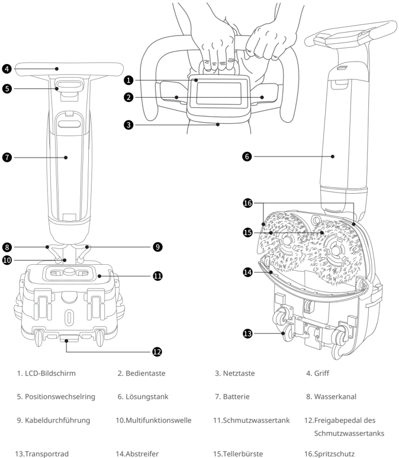
> *Bildbeschreibung (KI):* Die Abbildung zeigt alle Teile des PUDU SH1 mit Nummern und deren Bezeichnungen. Sie können die Positionen von Tasten (z. B. LCD-Bildschirm, Bedientaste) und Anschlüssen (z. B. Kabeldurchführung) erkennen. Der Aufbau der Tellerbürste und des Spritzschutzes ist detailliert dargestellt. Die Abbildung hilft bei der Identifikation von Komponenten wie dem Lösungstank oder dem Schmutzwassertank.

*Beschriftungen:*

- **1** LCD-Bildschirm
- **2** Bedientaste
- **3** Netztaste
- **4** Griff
- **5** Positionswechselring
- **6** Lösungstank
- **7** Batterie
- **8** Wasserkanal
- **9** Kabeldurchführung
- **10** Multifunktionswelle
- **11** Schmutzwassertank
- **12** Freigabepedal des Schmutzwassertanks
- **13** Transportrad
- **14** Abstreifer
- **15** Tellerbürste
- **16** Spritzschutz

---

*Seite 4 (PDF-Seite 52, links)*

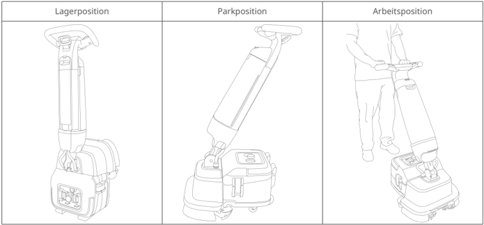
> *Bildbeschreibung (KI):* Die Abbildung zeigt die drei Betriebspositionen des Produkts: Lagerposition (aufrecht stehend), Parkposition (neigegelegt) und Arbeitsposition (in Betrieb mit Benutzer).

## 2.2 Produktspezifikation

| Spezifikationen | Beschreibung |
|---|---|
| Abmessungen des Produkts (L x W x H) | Aufrecht stehend: 49 x 53 x 120 cm |
| Abmessungen des Produkts (L x W x H) | Lagerposition: 49 x 35 x 127 cm |
| Gewicht des Produkts | 27 kg |
| Betriebsspannung | 22-29,4 VDC |
| Spannung | 100 - 240 V AC,50/60 Hz |
| Leistung | 29,4 V, 8 A |
| Kapazität der Batterie | 18 Ah |
| Aufladezeit | 2,5 Stunden |
| Betriebsdauer der Batterien | Normalbetrieb: 70 Min. ECO-Modus: 100 Min |
| Nennleistung | 380 W |
| Drehzahl der Bürste | 350 U/min |
| Reinigungsleistung | 1.000 bis 1.600 m²/ h |
| Arbeitsbreite | 44 cm |
| Breite des Abstreifers | 49 cm |
| Kapazität des Lösungstanks | 4 l |
| Kapazität des Schmutzwassertanks | 4 l |
| Aufladen des Geräts | Ja |
| Intelligente Funktionen | Touchscreen, Füllstandserkennung, WiFi, APP |
| IP-Schutzklasse | IPX4 |

---

*Seite 5 (PDF-Seite 52, rechts)*

# 3 Montage

Entfernen Sie die Verpackung und überprüfen Sie den Zustand des Geräts. Lesen Sie das Benutzerhandbuch vor dem Gebrauch genau durch.

## 3.1 Auspacken

Lieferumfang:

- 1 Gerät, 1 Ladegerät, 1 Batterie, 1 Tellerbürste, 2 Abstreifer, 1 Spritzschutz, 1 Lösungstank, 1 Schmutzwassertank,
- 1 Benutzerhandbuch, 1 Kurzanleitung, 1 Reinigungswerkzeug, 1 Zertifikat

## 3.2 Laden der Batterie

Laden Sie die Batterie vor dem ersten Gebrauch vollständig auf.

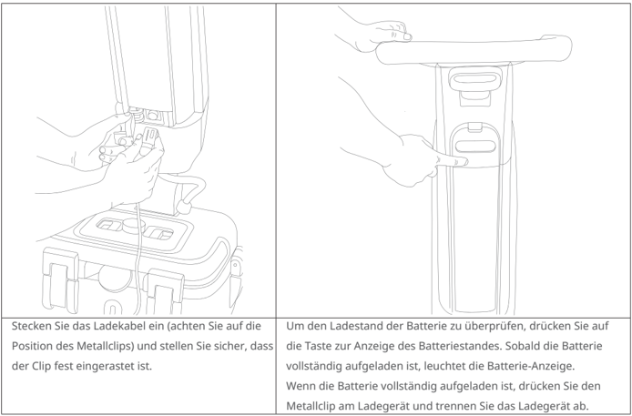
> *Bildbeschreibung (KI):* Die Abbildung zeigt die korrekte Position des Metallclips am Ladekabel für den sicheren Anschluss. Der Metallclip muss fest eingerastet sein, bevor das Ladegerät angeschlossen wird. Nach dem Laden ist der Metallclip am Ladegerät zu drücken, um es vom Gerät zu trennen. Die Abbildung veranschaulicht die Handhabung des Ladekabels und des Ladegeräts.
Stecken Sie das Ladekabel ein (achten Sie auf die Position des Metallclips) und stellen Sie sicher, dass der Clip fest eingerastet ist.

Um den Ladestand der Batterie zu überprüfen, drücken Sie auf die Taste zur Anzeige des Batteriestandes. Sobald die Batterie vollständig aufgeladen ist, leuchtet die Batterie-Anzeige. Wenn die Batterie vollständig aufgeladen ist, drücken Sie den Metallclip am Ladegerät und trennen Sie das Ladegerät ab.

| Batterie-Anzeige | Bedeutung der Anzeigen |
|---|---|
| < 5 % | ⚫ ⚪ ⚪ ⚪ Rotes Blinken |
| 5 % bis 25 % | ⚫ ⚪ ⚪ ⚪ Ununterbrochen weiß |
| 26 % bis 50 % | ⚫ ⚫ ⚪ ⚪ Ununterbrochen weiß |
| 51 % bis 75 % | ⚫ ⚫ ⚫ ⚪ Ununterbrochen weiß |
| 76 % bis 100 % | ⚫ ⚫ ⚫ ⚫ Ununterbrochen weiß |

---

*Seite 6 (PDF-Seite 53, links)*

### 3.3 Einbau der Batterie

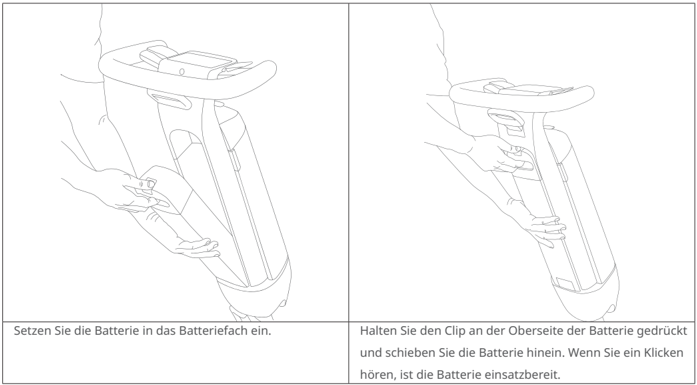
> *Bildbeschreibung (KI):* Die Abbildung zeigt die korrekte Positionierung der Batterie im Batteriefach. Der Clip an der Oberseite der Batterie muss gedrückt werden, um sie einzuschieben. Ein Klicken bestätigt den sicheren Sitz der Batterie. Die Hände zeigen die richtige Griffposition während des Einbaus.
| Setzen Sie die Batterie in das Batteriefach ein. | Halten Sie den Clip an der Oberseite der Batterie gedrückt und schieben Sie die Batterie hinein. Wenn Sie ein Klicken hören, ist die Batterie einsatzbereit. |
| --- | --- |

### 3.4 Einbau des Spritzschutzes

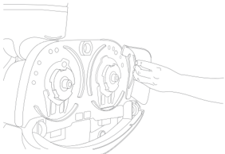
> *Bildbeschreibung (KI):* Die Abbildung zeigt die Position der Tellerbürstenhalterungen am Rahmen. Eine Hand demonstriert den Einbauvorgang einer Tellerbürste in das Gerät.
- Richten Sie die beiden Befestigungsclips am linken und rechten Spritzschutz an den Kartenlöchern aus und drücken Sie sie fest.

### 3.5 Montage der Tellerbürste

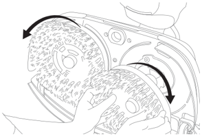
> *Bildbeschreibung (KI):* Die Pfeile zeigen die Drehrichtung der Tellerbürsten an. Die Hände demonstrieren den Einbauvorgang der Tellerbürste in das Gerät.
- Nehmen Sie die Tellerbürsten (links und rechts undefiniert), und installieren Sie sie in der Lagerposition des Geräts, indem Sie sie an den Tellerbürstenhalterungen des Rahmens ausrichten und nach außen drehen, um sie zu installieren.

---

*Seite 7 (PDF-Seite 53, rechts)*

## 3.6 Montage des Abstreifers

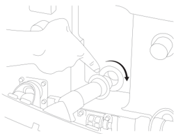
> *Bildbeschreibung (KI):* Die Abbildung zeigt die korrekte Positionierung und Drehrichtung (im Uhrzeigersinn) zum Einsetzen des Saugschlauchs in die Ansaugöffnung. Der Pfeil verdeutlicht, dass der Schlauch nach dem Ausrichten mit dem Rahmen im Uhrzeigersinn gedreht werden muss, um ihn zu fixieren.
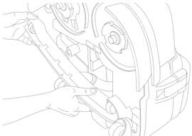
> *Bildbeschreibung (KI):* Die Abbildung zeigt die korrekte Positionierung des Abstreifers an der Maschine. Der Saugschlauch wird in die Ansaugöffnung geschraubt. Die Nagellöcher des Abstreifers müssen auf den Stift am Rahmen ausgerichtet werden. Durch Drücken wird der Abstreifer installiert.
- Schrauben Sie den Saugschlauch des Abstreifers in die Ansaugöffnung, richten Sie die Nagellöcher des Abstreifers auf den Stift am Rahmen aus und drücken Sie, um den Abstreifer zu installieren.

## 3.7 Installieren des kleinen Reinigungswerkzeugpartners

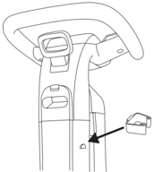
> *Bildbeschreibung (KI):* Die Abbildung zeigt die Position des kleinen Reinigungswerkzeugpartners an der Seite des Geräts. Der Pfeil weist auf den Einbauort für das kleine Werkzeug hin. Das kleine Werkzeug wird von oben nach unten in die dafür vorgesehene Aufnahme eingeführt. Zum Entfernen des Werkzeugs zieht man es von unten nach oben heraus.
- Für die kleinen Reinigungswerkzeugpartner verfügt die Maschine über insgesamt vier Werkzeugaufnahmen an zwei Seiten. Zum Einbauen führen Sie es von oben nach unten ein. Zum Entfernen ziehen Sie es von unten nach oben heraus.

# 4 Betrieb

## 4.1 Software und App verwenden

Das Gerät unterstützt WLAN und App. Wir empfehlen Ihnen dringend, das Gerät mit Internetverbindung zu verwenden. Zusammen mit der PUDULink-App können Sie intelligentere Funktionen nutzen, wie Berichte über Reinigungsaufgaben in Echtzeit, Geräteverleih, Diebstahlschutz, Benutzerverwaltung usw.

- Scannen Sie den QR-Code, um detaillierte Informationen zur Verwendung der Software und App zu erhalten.

---

*Seite 8 (PDF-Seite 54, links)*

## 4.2 Vorbereitung

- Kontrolle des Stromverbrauchs

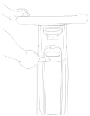
> *Bildbeschreibung (KI):* Die Abbildung zeigt die Position der Taste zur Anzeige des Batteriestands am Gerät. Sie verdeutlicht den korrekten Druckpunkt für das Aktivieren des Akkus vor dem ersten Gebrauch oder nach längerer Nichtbenutzung. Es wird dargestellt, wie man mit einer Hand den Lösungstank oben abnimmt und mit der anderen die Taste drückt.
Um den Ladestand der Batterie zu überprüfen, drücken Sie auf die Taste zur Anzeige des Batteriestandes. (*Vor dem ersten Gebrauch oder wenn die Maschine länger als 7 Tage nicht verwendet wurde, halten Sie die Taste zur Anzeige des Batteriestands gedrückt, um den Akku zu aktivieren.)

- Füllen Sie den Lösungstank auf

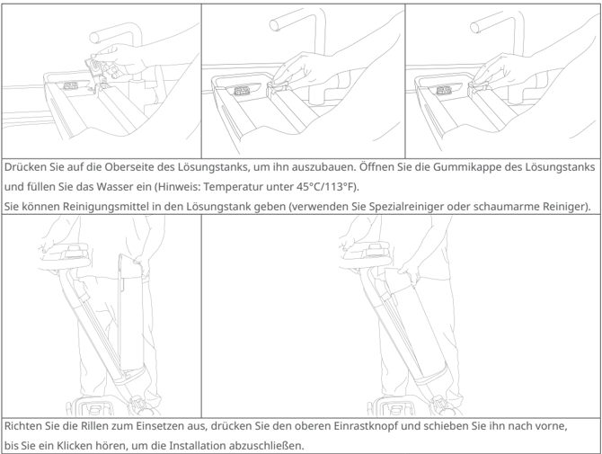
> *Bildbeschreibung (KI):* Die Abbildung zeigt den Lösungstank mit dem Wasserstand und der Gummikappe. Der Einrastknopf am oberen Ende des Tanks ist deutlich sichtbar. Die Rillen zur korrekten Ausrichtung beim Einsetzen sind markiert. Die Handpositionen zeigen, wie der Tank entnommen und wieder eingesetzt wird.
Drücken Sie auf die Oberseite des Lösungstanks, um ihn auszubauen. Öffnen Sie die Gummikappe des Lösungstanks und füllen Sie das Wasser ein (Hinweis: Temperatur unter 45°C/113°F).

Sie können Reinigungsmittel in den Lösungstank geben (verwenden Sie Spezialreiniger oder schaumarme Reiniger).

Richten Sie die Rillen zum Einsetzen aus, drücken Sie den oberen Einrastknopf und schieben Sie ihn nach vorne, bis Sie ein Klicken hören, um die Installation abzuschließen.

*Die Geräte werden vor dem Verlassen des Werks strengen Tests unterzogen. Es kann sein, dass vor der ersten Verwendung Wasser im Tank verbleibt.

---

*Seite 9 (PDF-Seite 54, rechts)*

### 4.3 Umschalten der Position

Es gibt drei Arten von Maschinenpositionen: Lagerposition, Parkposition und Arbeitsposition

- Arbeitsposition

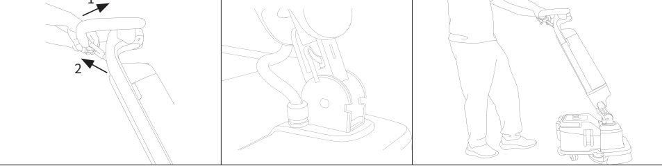
> *Bildbeschreibung (KI):* Das Bild illustriert die drei möglichen Positionen: Lagerposition (mit verriegelter Welle), Parkposition und Arbeitsposition.
Wenn die Multifunktionswelle verriegelt ist, heben Sie die Maschine diagonal nach oben, ziehen Sie den Positionswechselring, um ihn zu entriegeln. Nun kann der Winkel des Gehäuses verändert werden und in die Arbeitsposition wechseln.

- Lagerposition,

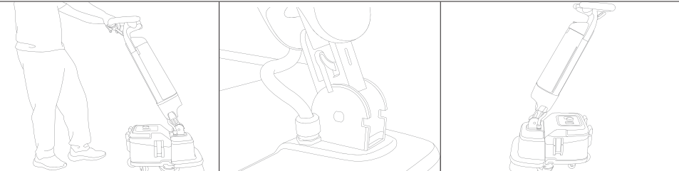
> *Bildbeschreibung (KI):* Die Abbildung zeigt die drei verschiedenen Positionen der Maschine: Lagerposition, Parkposition und Arbeitsposition. In der linken Darstellung wird gezeigt, wie die Maschine in die Arbeitsposition gehoben wird. Die mittlere Darstellung veranschaulicht den Übergang zur Lagerposition mit einem hörbaren Klick. Die rechte Darstellung zeigt die Parkposition, bei der das Gerät angehoben und diagonal gestellt wird.
Den Positionswechselring vorsichtig in die Arbeitsposition ziehen, den Rumpf auf 65° einstellen, bis ein Klicken zu hören ist. Damit verriegelt die Drehachse und das Gerät wechselt in die Lagerposition.

- Parkposition

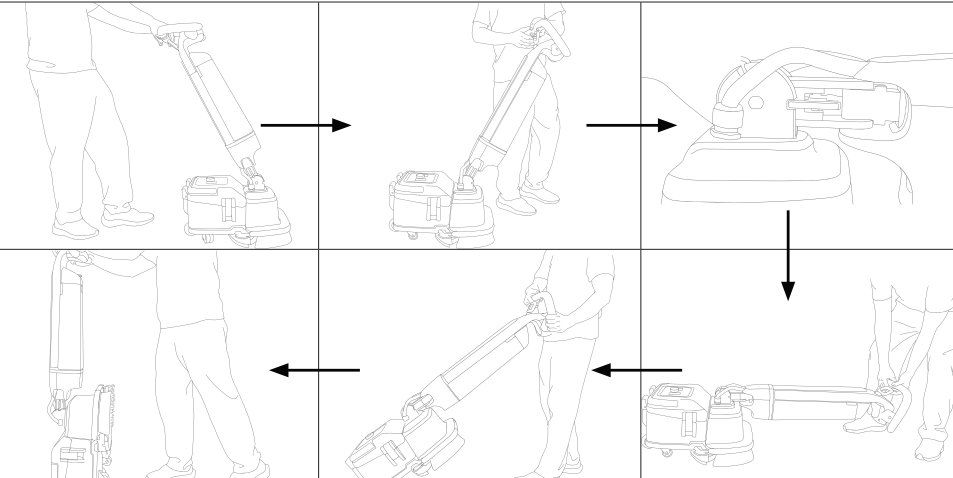
> *Bildbeschreibung (KI):* Die Abbildung zeigt die Schritte zum Wechseln zwischen Lager-, Park- und Arbeitsposition. Der Positionswechselring wird gezogen oder gelöst, um den Winkel des Gehäuses zu verändern. In der Parkposition ist die Multifunktionswelle verriegelt und das Gerät kann angehoben werden.
Ziehen Sie in der Arbeitsposition vorsichtig am Positionswechselring, setzen Sie das Gehäuse gleichmäßig in der entgegengesetzten Richtung ab, bis ein Klicken zu hören ist. Danach wird die Multifunktionswelle verriegelt. Heben Sie nun das Gerät an und bringen Sie es in die Parkposition.

---

*Seite 10 (PDF-Seite 55, links)*

## 4.4 Einschalten und Modus auswählen

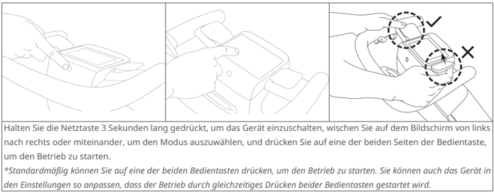
> *Bildbeschreibung (KI):* Die Abbildung zeigt die korrekte Handposition zum Drücken der Bedientaste (mit Daumen) und die falsche Position (mit Zeigefinger).
Halten Sie die Netztaste 3 Sekunden lang gedrückt, um das Gerät einzuschalten, wischen Sie auf dem Bildschirm von links nach rechts oder miteinander, um den Modus auszuwählen, und drücken Sie auf eine der beiden Seiten der Bedientaste, um den Betrieb zu starten.

*Standardmäßig können Sie auf eine der beiden Bedientasten drücken, um den Betrieb zu starten. Sie können auch das Gerät in den Einstellungen so anpassen, dass der Betrieb durch gleichzeitiges Drücken beider Bedientasten gestartet wird.

| Funktion\ Leistung\ Modus | Hohe Leistung | Normal | ECO | Rückstandsarm | Einweichen | Wasseransaugung | Bürste Maximal | Zubehör | ECO Zubehör |
|---|---|---|---|---|---|---|---|---|---|
| Drehzahl der Bürste | Hoch | Mittel | Niedrig | Niedrig | Hoch | Mittel | Hoch | x | x |
| Absaugung | Hoch | Hoch | Niedrig | Hoch | x | Hoch | x | Hoch | Niedrig |
| Menge | Hoch | Mittel | Niedrig | Niedrig | Hoch | x | x | x | x |

---

*Seite 11 (PDF-Seite 55, rechts)*

### 4.5 Bedienungsanleitung

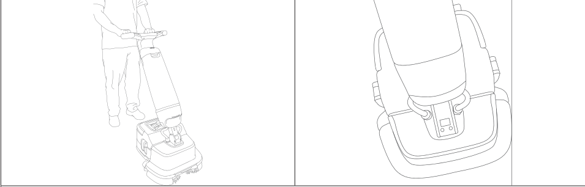
> *Bildbeschreibung (KI):* Die Abbildung zeigt die korrekte Haltung des Geräts während der Reinigung: Der Benutzer drückt das Gerät nach vorn und hält es fest. Der Abstreifer kann angehoben oder abgesenkt werden, um bei hartnäckigen Flecken mehr Reinigungskraft zu erzeugen. Die linke Darstellung illustriert die normale Betriebsposition mit dem Gerät auf dem Boden. Die rechte Darstellung zeigt den abgeklappten Zustand des Abstreifers für eine erhöhte Reinigungsleistung.
Bitte beachten Sie, dass das Gerät während des Betriebs durch den Benutzer gesteuert werden muss und nach vorn gedrückt werden muss, um es zu reinigen. Um ein optimales Reinigungsergebnis zu erzielen, ist es wichtig, dass Sie den Abstreifer bei der Reinigung von Randbereichen eng an der Wand anlegen.

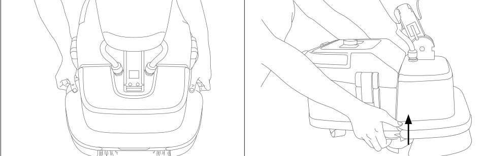
> *Bildbeschreibung (KI):* Die linke Abbildung zeigt die Rückansicht des Geräts mit den seitlichen Griffen und dem zentralen Bedienfeld. Die rechte Abbildung demonstriert, wie der Abstreifer angehoben wird, indem man unter den Hebegriff greift und nach oben zieht (Pfeil zeigt Richtung an). Der Positionswechselring befindet sich am hinteren Ende des Geräts und muss vorsichtig gezogen werden, um das Gerät in die Lagerposition zu bringen. Die Abbildung verdeutlicht die Handgriffe zum Anheben oder Absenken des Abstreifers während der Reinigung.
Wenn Sie die Modi "Einweichen" und "Bürste Maximal" verwenden, um hartnäckige Flecken zu entfernen, können Sie den Abstreifer anheben, um seine Reinigungskraft zu erhöhen. Legen Sie Ihre Hände zum Anheben des Abstreifers unter den Hebegriff und ziehen Sie ihn nach oben, oder drücken Sie sie ihn nach unten, um den Abstreifer abzusenken.

### 4.6 Beenden der Arbeiten

Wenn Sie die Netztaste gedrückt halten, schaltet sich der Bildschirm aus; dies bedeutet, dass das Gerät ausgeschaltet wurde. Ziehen Sie vorsichtig am Positionswechselring, um das Gerät für die anschließende Reinigung und Wartung in die Lagerposition zu bringen (siehe 4.3).

---

*Seite 12 (PDF-Seite 56, links)*

## 4.7 Verbotene Operationen

- Verwenden Sie die Maschine nicht ohne installierten Schwimmer des Schmutzwassertanks (A), Saugmotorfilter (B) und Wasserauslassfilter (C).

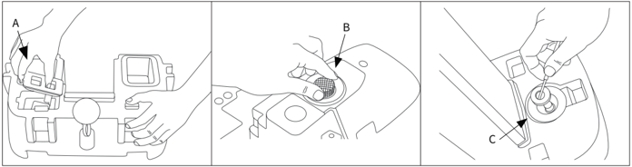
> *Bildbeschreibung (KI):* A zeigt den Schwimmer des Schmutzwassertanks. B zeigt den Saugmotorfilter. C zeigt den Wasserauslassfilter.

- Verwenden Sie die Maschine nicht ohne Schmutzwassertank.

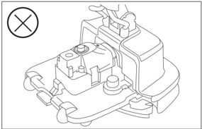
> *Bildbeschreibung (KI):* Die Abbildung zeigt die Positionen der Bauteile A (Schwimmer), B (Saugmotorfilter) und C (Wasserauslassfilter). Der Schwimmer (A) ist im Schmutzwassertank montiert. Der Saugmotorfilter (B) befindet sich an der Einlassseite des Motors. Der Wasserauslassfilter (C) ist am Auslassanschluss angebracht.

- Im Nicht-Originalverpackungszustand muss die Multifunktionswelle für den Transport entriegelt werden.

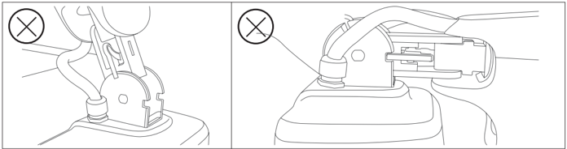
> *Bildbeschreibung (KI):* Die Figur zeigt zwei verbotene Montagezustände mit einem roten Kreuz (X) als Warnsymbol. Im linken Bild ist eine falsche Positionierung oder Befestigung des Schwimmtanks dargestellt. Im rechten Bild wird eine unzulässige Verbindung oder Installation am Wasserauslassfilter gezeigt. Der Leser erkennt aus der Figur, welche Bauteile nicht so montiert werden dürfen wie im Text beschrieben.

---

*Seite 13 (PDF-Seite 56, rechts)*

# 5 Lagerung und Transport

## 5.1 Lagerung

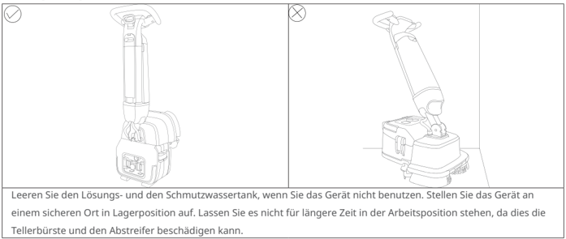
> *Bildbeschreibung (KI):* Die linke Abbildung zeigt die korrekte Lagerposition des Geräts. Die rechte Abbildung zeigt die Arbeitsposition, in der das Gerät nicht längere Zeit stehen sollte.
Leeren Sie den Lösungs- und den Schmutzwassertank, wenn Sie das Gerät nicht benutzen. Stellen Sie das Gerät an einem sicheren Ort in Lagerposition auf. Lassen Sie es nicht für längere Zeit in der Arbeitsposition stehen, da dies die Tellerbürste und den Abstreifer beschädigen kann.

## 5.2 Transport

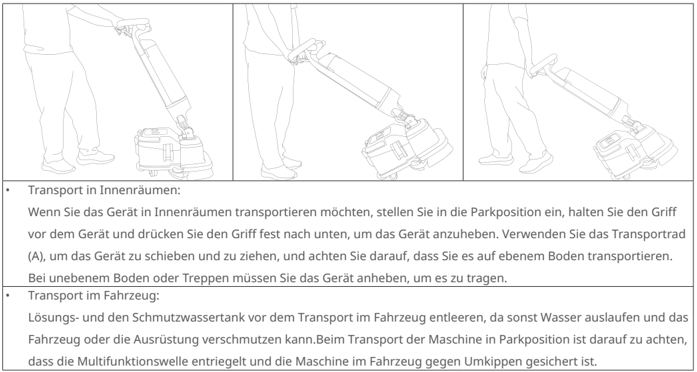
> *Bildbeschreibung (KI):* Die Abbildung zeigt die korrekte Haltung des Griffs und die Position der Füße beim Anheben des Geräts in Innenräumen. Es wird demonstriert, wie das Gerät mit dem Transportrad (A) geschoben oder gezogen werden kann. Die Darstellung verdeutlicht, dass bei unebenem Boden oder Treppen das Gerät angehoben und getragen werden muss. Im Fahrzeugtransport ist darauf zu achten, dass die Multifunktionswelle entriegelt ist und die Maschine gegen Umkippen gesichert wird.

Transport in Innenräumen:

Wenn Sie das Gerät in Innenräumen transportieren möchten, stellen Sie in die Parkposition ein, halten Sie den Griff vor dem Gerät und drücken Sie den Griff fest nach unten, um das Gerät anzuheben. Verwenden Sie das Transportrad (A), um das Gerät zu schieben und zu ziehen, und achten Sie darauf, dass Sie es auf ebenem Boden transportieren.

Bei unebenem Boden oder Treppen müssen Sie das Gerät anheben, um es zu tragen.

Transport im Fahrzeug:

Lösungs- und den Schmutzwassertank vor dem Transport im Fahrzeug entleeren, da sonst Wasser auslaufen und das Fahrzeug oder die Ausrüstung verschmutzen kann.Beim Transport der Maschine in Parkposition ist darauf zu achten, dass die Multifunktionswelle entriegelt und die Maschine im Fahrzeug gegen Umkippen gesichert ist.

## 5.3 Tragen

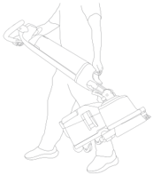
> *Bildbeschreibung (KI):* Die Abbildung zeigt die korrekte Tragposition des Geräts: Griff vor dem Gerät halten und nach unten drücken. Das Transportrad (A) wird zum Schieben oder Ziehen auf ebenem Boden verwendet. Bei unebenem Boden oder Treppen muss das Gerät angehoben werden, um es zu tragen. Lösungs- und Schmutzwassertank können demontiert werden, um das Gewicht beim Tragen zu reduzieren.
- Wenn Sie das Gerät tragen, empfehlen wir Ihnen, sich an der Abbildung zu orientieren. Der Lösungs- und der Schmutzwassertank können demontiert werden, um das Gewicht zu reduzieren.

---

*Seite 14 (PDF-Seite 57, links)*

# 6 Reparatur und Wartung

## 6.1 Nach jedem Gebrauch

- Wischen Sie den Wischerkörper mit einem sauberen, feuchten Tuch ab. Verwenden Sie zum Abwischen keine ätzenden Reinigungsmittel, sondern am besten neutrale Reinigungsmittel oder Wasser.
- Laden Sie die Batterie rechtzeitig auf, wenn sie schwach ist (siehe 3.2).
- Nehmen Sie die Tellerbürste nach jedem Gebrauch zur Reinigung heraus (siehe 6.4); wenn die Tellerbürste abgenutzt ist, ersetzen Sie sie bitte durch eine neue (siehe 6.7).
- Bauen Sie den Abstreifer nach jedem Gebrauch aus, um ihn zu reinigen (siehe 6.5) Wenn der Abstreifer abgenutzt, gebrochen oder verformt ist, was die Wasseraufnahme beeinträchtigt, müssen Sie den Streifen durch einen neuen ersetzen (siehe 6.8).

## 6.2 Reinigen des Lösungstanks

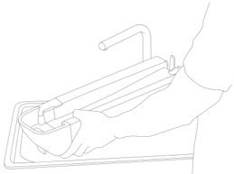
> *Bildbeschreibung (KI):* Die Abbildung zeigt den Abstreifer im entfalteten Zustand. Der Wischerkörper wird mit einer Hand gehalten und der Abstreifer mit der anderen Hand manipuliert. Es ist eine Anleitung zum Ausbauen des Abstreifers für die Reinigung sichtbar.
- Leeren Sie den Lösungstank und fügen Sie eine kleine Menge Wasser für die Innenreinigung hinzu.

## 6.3 Reinigen des Schmutzwassertanks

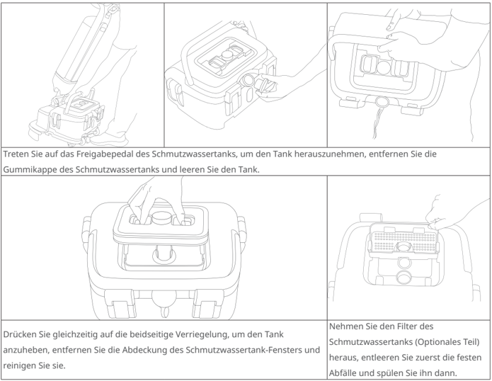
> *Bildbeschreibung (KI):* Die Abbildung zeigt die Schritte zum Herausnehmen und Reinigen des Schmutzwassertanks. Es wird gezeigt, wie man das Freigabepedal betritt, um den Tank zu entfernen. Die Position der beidseitigen Verriegelung am Tank ist dargestellt. Der Filter im Schmutzwassertank (optional) und seine Entfernung werden visualisiert.
Treten Sie auf das Freigabepedal des Schmutzwassertanks, um den Tank herauszunehmen, entfernen Sie die

Gummikappe des Schmutzwassertanks und leeren Sie den Tank.

Drücken Sie gleichzeitig auf die beidseitige Verriegelung, um den Tank anzuheben, entfernen Sie die Abdeckung des Schmutzwassertank-Fensters und reinigen Sie sie.

Nehmen Sie den Filter des Schmutzwassertanks (Optionales Teil) heraus, entleeren Sie zuerst die festen Abfälle und spülen Sie ihn dann.

---

*Seite 15 (PDF-Seite 57, rechts)*

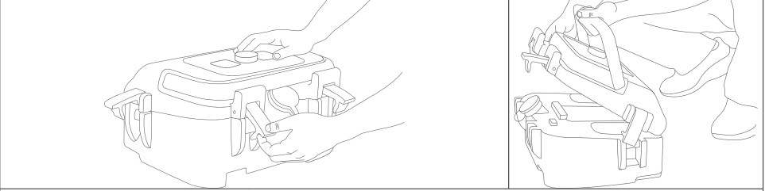

Öffnen Sie die Verriegelungen oben am Schmutzwassertank und ziehen Sie sie dann schräg nach oben, um sie nicht wieder unterzuklappen. Ziehen Sie den Griff nach hinten, um den Deckel des Schmutzwassertanks zu öffnen.

> *Bildbeschreibung (KI):* Die Abbildung zeigt die Position der Tellerbürste am Gerät. Eine Hand demonstriert das Entfernen oder Reinigen der Tellerbürste. Die Darstellung verdeutlicht den Zugang zur Reinigungskomponente.
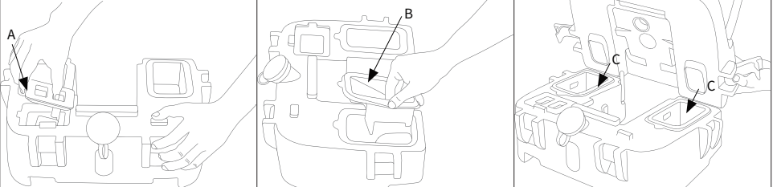

Entfernen Sie den Schwimmer (A) und den Gummiring (B) und spülen Sie ihn ab (es wird empfohlen, den Schwimmer einmal pro Woche zu reinigen). Reinigen Sie die Unterseite des Schmutzwassertanks durch Schütteln oder mit einem Werkzeug, z. B. einer Bürste. Bitte vergewissern Sie sich, dass der untere Stutzen C in der richtigen Position einrastet, bevor Sie den Deckel des Schmutzwassertanks wieder aufsetzen. Befestigen Sie den Deckel und verriegeln Sie ihn, indem Sie auf die Verriegelung des Schmutzwassertanks drücken.

> *Bildbeschreibung (KI):* Der Pfeil A zeigt auf den Bereich am Gehäuse, der für das Entfernen oder Reinigen der Tellerbürste verwendet wird. Der Pfeil B deutet auf einen Deckel oder eine Abdeckung hin, die geöffnet werden muss, um an die Bürste zu gelangen. Die Pfeile C markieren zwei Öffnungen im Inneren des Gehäuses, in denen die Tellerbürste positioniert ist. Die Abbildung zeigt die Schritte zum Zugang zur Tellerbürste: zuerst den Bereich A betätigen, dann den Deckel B öffnen und schließlich die Bürste an den Positionen C entnehmen.
## 6.4 Reinigen der Tellerbürste
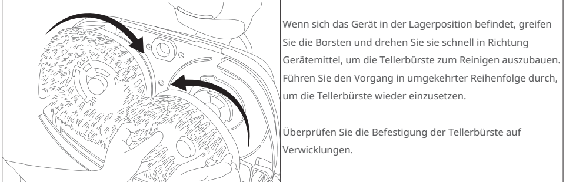

Wenn sich das Gerät in der Lagerposition befindet, greifen Sie die Borsten und drehen Sie sie schnell in Richtung Gerätemittel, um die Tellerbürste zum Reinigen auszubauen. Führen Sie den Vorgang in umgekehrter Reihenfolge durch, um die Tellerbürste wieder einzusetzen. Überprüfen Sie die Befestigung der Tellerbürste auf Verwicklungen.

> *Bildbeschreibung (KI):* Die Pfeile zeigen die Drehrichtung der Tellerbürste beim Ausbau und Einsetzen an. Der Griffpunkt an den Borsten wird durch die Handposition im Bild verdeutlicht. Die Lagerposition des Geräts ist für den Vorgang erforderlich, wie durch die Darstellung impliziert wird. Die Überprüfung auf Verwicklungen nach dem Einsetzen wird durch den Hinweis im Text unterstützt.

---

*Seite 16 (PDF-Seite 58, links)*

## 6.5 Reinigen des Abstreifers

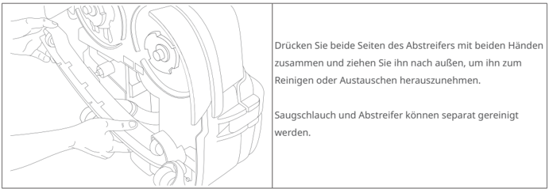
> *Bildbeschreibung (KI):* Die Abbildung zeigt die korrekte Handposition zum Entfernen des Abstreifers. Der Abstreifer wird durch Drücken der Seiten und Ziehen nach außen entfernt.
Drücken Sie beide Seiten des Abstreifers mit beiden Händen zusammen und ziehen Sie ihn nach außen, um ihn zum Reinigen oder Austauschen herauszunehmen.

Saugschlauch und Abstreifer können separat gereinigt werden.

## 6.6 Filterreinigung

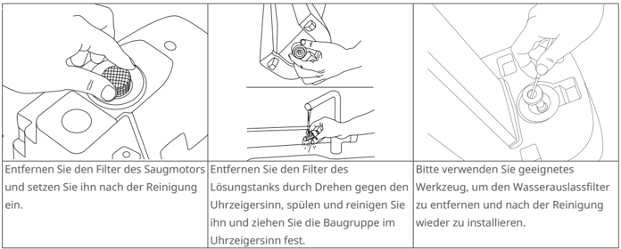
> *Bildbeschreibung (KI):* Die Abbildung zeigt die drei Schritte zur Reinigung der Filter des Saugmotors und des Lösungstanks. Es wird ein geeignetes Werkzeug benötigt, um den Wasserauslassfilter zu entfernen und wieder einzusetzen. Der Filter des Saugmotors muss nach der Reinigung wieder eingesetzt werden. Der Filter des Lösungstanks ist gegen den Uhrzeigersinn zu lösen und im Uhrzeigersinn wieder festzuziehen.
Entfernen Sie den Filter des Saugmotors und setzen Sie ihn nach der Reinigung ein.

Entfernen Sie den Filter des

Lösungstanks durch Drehen gegen den Uhrzeigersinn, spülen und reinigen Sie ihn und ziehen Sie die Baugruppe im Uhrzeigersinn fest.

Bitte verwenden Sie geeignetes

Werkzeug, um den Wasserauslassfilter zu entfernen und nach der Reinigung wieder zu installieren.

## 6.7 Auswechseln der Tellerbürste

Wenn die Borsten abgenutzt sind, empfiehlt es sich, die Tellerbürste durch eine neue zu ersetzen.

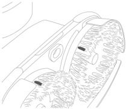
> *Bildbeschreibung (KI):* Die Abbildung zeigt die Tellerbürste mit abgenutzten Borsten. Sie dient zur Veranschaulichung des Abschnitts 6.7 über das Auswechseln der Tellerbürste.

---

*Seite 17 (PDF-Seite 58, rechts)*

# 6.8 Auswechseln der Gummistreifen

- Ausbauen der Gummistreifen

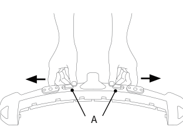
> *Bildbeschreibung (KI):* Die Bezeichnung A zeigt die Schiebeverriegelung am Abstreifergehäuse. Der Pfeil links deutet an, dass die Verriegelung nach außen geschwenkt wird, um den Halter zu öffnen.
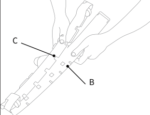
> *Bildbeschreibung (KI):* Die Beschriftung C zeigt den Halter für die Abstreifergummis. Die Beschriftung B zeigt das Gehäuse des Abstreifers.
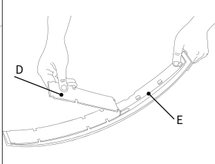
> *Bildbeschreibung (KI):* Die Beschriftung D zeigt den vorderen Gummistreifen. Die Beschriftung E zeigt den hinteren Gummistreifen.
Nehmen Sie den Abstreifer ab, schwenken Sie die Schiebeverriegelung (A) nach außen, um ihn zu öffnen, trennen Sie den Halter für die Abstreifergummis (B) vom Gehäuse (C) des Abstreifers und nehmen Sie den vorderen Gummistreifen (D) und den hinteren Gummistreifen (E) aus dem Halter für die Abstreifergummis heraus. Hint: Die Gummistreifen sind symmetrisch, und wenn eine Seite stark abgenutzt ist, können Sie die andere Seite verwenden.

- Einbau der Gummistreifen

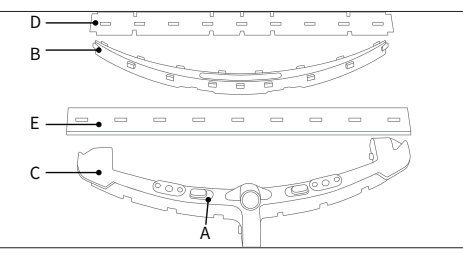
> *Bildbeschreibung (KI):* Die Beschriftungen A bis D zeigen Teile des Abstreifers: A ist die Schiebeverriegelung, B der Halter für die Gummistreifen, C das Gehäuse und D der vordere Gummistreifen. Der hintere Gummistreifen wird mit E gekennzeichnet und ist länger als der vordere Streifen (D). Die Abbildung zeigt die korrekte Reihenfolge beim Ausbau: zuerst Abstreifer abnehmen, dann Halter (B) vom Gehäuse (C) trennen, danach Streifen D und E entnehmen. Beim Einbau ist darauf zu achten, dass der vordere Streifen (D) kürzer ist als der hintere (E), wie in der Abbildung deutlich sichtbar.
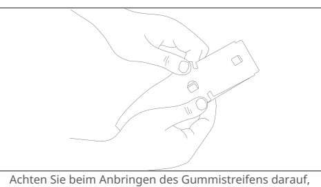
> *Bildbeschreibung (KI):* Die Abbildung zeigt die Handhabung des Gummistreifens beim Einbau. Es wird gezeigt, wie der Streifen in den Halter für Abstreifergummi eingesetzt wird.
Der vordere Gummistreifen (D) ist etwas kürzer als der hintere Gummistreifen (E). Achten Sie bei der Installation darauf, dass Sie zwischen vorne und hinten unterscheiden.

Achten Sie beim Anbringen des Gummistreifens darauf, dass eine Seite des Gummis mit der Oberkante des Halters für den Abstreifergummi übereinstimmt, und drücken Sie ihn fest. Spannen Sie die andere Seite des Gummis, bis das Loch des Streifens über den Karabinerhaken des Gehäuses passt. Prüfen Sie, ob der Streifen flach ist und nicht schrumpft.

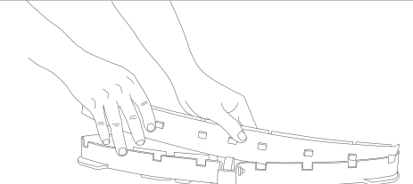
> *Bildbeschreibung (KI):* Die Abbildung zeigt die Handhabung des Abstreifers mit dem Halter für die Gummistreifen. Der vordere Gummistreifen (D) ist kürzer als der hintere Gummistreifen (E). Beim Einbau muss darauf geachtet werden, dass eine Seite des Gummis mit der Oberkante des Halters übereinstimmt.
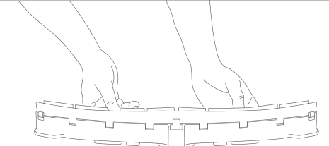
> *Bildbeschreibung (KI):* Die Abbildung zeigt die Hände beim Entfernen oder Einsetzen der Gummistreifen (D und E) aus dem Halter (B). Der vordere Gummistreifen (D) ist kürzer als der hintere Gummistreifen (E), was bei der Installation beachtet werden muss. Die Schiebeverriegelung (A) wird nach außen geschwenkt, um den Halter zu öffnen oder zu verriegeln.
Wenn Sie den Halter für den Abstreifergummi am Gehäuse des Abstreifers anbringen, drücken und schieben Sie zunächst eine Seite des Halters für den Abstreifergummi, so dass er im Gehäuse des Abstreifers eingebettet ist, und drücken Sie dann gleichmäßig auf beide Seiten, bis er vollständig im Gehäuse des Abstreifers befestigt ist. Schwenken Sie den Schiebeverriegelung (A) nach außen, um den Halter für den Gummistreifen des Abstreifers zu verriegeln.

---

*Seite 18 (PDF-Seite 59, links)*

# 7 Fehlerbehebung

| Problem | Ursache und Lösung - Ursache | Ursache und Lösung - Lösung |
|---|---|---|
| Kein Strom | Keine Batterie | Batterie einlegen |
| Kein Strom | Batterie falsch eingesetzt | Batterie ausbauen und wieder einbauen |
| Kein Strom | Batterie leer | Batterie laden |
| Kein Strom | Batterie nicht aktiviert | Tippen Sie auf die Taste für die Energieanzeige, um die Batterie zu aktivieren |
| Schlechte Wasserrückgewinnung | Abstreifer angehoben | Abstreifer absenken |
| Schlechte Wasserrückgewinnung | Abstreifer-Gummiblätter abgenutzt | Gummiblätter ersetzen |
| Schlechte Wasserrückgewinnung | Abstreifer blockiert | Prüfen und entfernen Sie Blockaden, stellen Sie sicher, dass der Abstreifer den Boden berührt |
| Schlechte Wasserrückgewinnung | Abstreifer lässt sich nicht gut mit dem Saugschlauch des Abstreifers verbinden. | Neu installieren |
| Schlechte Wasserrückgewinnung | Saugschlauch verstopft | Prüfen und Verstopfung entfernen |
| Schlechte Wasserrückgewinnung | Schmutzwassertank nicht richtig installiert | Neu installieren |
| Schlechte Wasserrückgewinnung | Deckel des Schmutzwassertanks nicht fest verschlossen | Fest verschließen |
| Schlechte Wasserrückgewinnung | Filter des Schmutzwassertanks verstopft | Reinigen Sie den Filter des Schmutzwassertanks |
| Schlechte Wasserrückgewinnung | Filter des Saugmotors verstopft | Filter des Saugmotors reinigen |
| Unzureichender/kein Wasserdurchfluss | Lösungstank leer | Lösungstank füllen |
| Unzureichender/kein Wasserdurchfluss | Lösungstank nicht richtig montiert | Neu installieren |
| Unzureichender/kein Wasserdurchfluss | Filter verstopft | Auslauf des Lösungstanks reinigen |
| Unzureichender/kein Wasserdurchfluss | Schmutz im Lösungstank | Lösungstank reinigen |
| Unzureichender/kein Wasserdurchfluss | Der verwendete Modus lautet: "kein Wasser" oder "geringer Wasserdurchfluss". | Verwenden Sie Modi wie Hohe Leistung, Normal, ECO, Rückstandsarm, Einweichen |

# 8 Kundendienstrichtlinien

Shenzhen Pudu Technology Co., Ltd. verspricht, die folgenden Konditionen innerhalb der effektiven Garantiezeit des Produkts zu erfüllen (die Garantiezeit für verschiedene Teile des Produkts kann sich ebenso unterscheiden, wie von Region zu Region). Für die kostenlose Garantie müssen die folgenden Bedingungen erfüllt sein:

- Die effektive Garantiezeit gilt nur für Geräte, die bei offiziellen Händlern gekauft wurden.
- Selbst gekaufte Produkte wurden innerhalb der angegebenen Garantiezeit des Produkts normal verwendet, und es liegen keine künstlich hervorgerufenen Qualitätsprobleme vor.
- Es hat keine unautorisierte Demontage, keine Modifikation oder Installation mit Hilfe inoffizieller Anweisungen und keine anderen nicht von Menschen verursachten Fehler gegeben.
- Die Seriennummer des Produkts, das Typenschild und andere Zeichen weisen keine Anzeichen von Rissen oder Veränderungen auf.
- Sie können einen gültigen Kaufnachweis und Belege vorlegen.

Wenn Sie Fragen haben, wenden Sie sich bitte an den Kundenservice.

E-Mail: techservice@pudutech.com.
