*PDF page 3, left*

## Copyright © 2024 Shenzhen Pudu Technology Co., Ltd. All rights reserved.

No organization or individual shall imitate, copy, transcribe or translate the contents of this user guide, in part or in full, without the express written consent of Shenzhen Pudu Technology Co., Ltd., or distribute this user guide for profit in any way (electronically or via photocopying, recording, etc.). The product specifications and information provided in this user guide are for reference only and are subject to change without further notice. Unless otherwise specified, this user guide is only intended as instructions for use, and no representation shall be deemed as a warranty of any kind.

---

*Page 16 (PDF page 3, right)*

# Directory

- **1 Safety**
    - 1.1 Instructions for Use
    - 1.2 Batteries
    - 1.3 Operation instructions
- **2 Product introduction**
    - 2.1 Overview
    - 2.2 Product Specification
- **3 Assembly**
    - 3.1 Unboxing
    - 3.2 Battery charging
    - 3.3 Battery Installation
    - 3.4 Splash Guards Installation
    - 3.5 Disc brush Installation
    - 3.6 Squeegee Installation
    - 3.7 Installing the Small Cleaning Tool Partner
- **4 Operation**
    - 4.1 Using Software and Application
    - 4.2 Preparatory work
    - 4.3 Position Switching
    - 4.4 Power up and select mode
    - 4.5 Operation Instructions
    - 4.6 Complete the Operation
    - 4.7 Prohibited operations
- **5 Storage and Transportation**
    - 5.1 Storage
    - 5.2 Transportation
    - 5.3 Carry
- **6 Repair and Maintenance**
    - 6.1 After every use
    - 6.2 Solution tank cleaning
    - 6.3 Recovery tank cleaning
    - 6.4 Disc brush cleaning
    - 6.5 Squeegee cleaning
    - 6.6 Filter cleaning
    - 6.7 Disc brush replacement
    - 6.8 Rubber strips replacement
- **7 Trouble shooting**
- **8 After-sales Service Policies**

---

*Page 1 (PDF page 4, left)*

# 1 Safety

## 1.1Instructions for Use

Please take the time to read and understand the safety instructions, improper use may cause injury or void the manufacturer's warranty.

- Ensure that all operators have been professionally trained or have fully understood the operation instructions, untrained persons and children operating the device is prohibited.
- Maintain the equipment regularly and use official accessories, otherwise, the manufacturer will not be liable for any damages incurred.
- Please don't rest the device body against other objects or walls when the device is in working position, after the task is finished, please adjust the device to the store position and store it on a flat ground.
- Ensure there is no cable disorder on the ground, to protect the device from entangle when it is working.
- Clean up any large particles of rubbish on the ground before use to avoid motor overload.
- Do not clean or maintain the device when it is powered on and working.
- Check the device before use. Do not replace the disc brush and squeegee when the device is working.
- Use water-based fire extinguishers to put out the flames, and then use large quantities of water to cool down the accidental battery to prevent re-ignition.

Do not use any water pressure cleaner to clean the device directly. Do not immerse the equipment in water.

## 1.2 Batteries

Batteries do not present safety hazardous under normal operating conditions. Please follow the safety instruction：

- If the device is not to be used for a long time, remove the battery, and a full charge every 3 months is recommended.
- Do not use the non-original chargers and batteries.
- Ensure that the supply voltage matches the voltage labeled on the charger, otherwise damage to the charger may result.
- In case of battery failure, remove the battery immediately and contact the after-sales service.
- Do not compress, penetrate, or hit the charger to avoid battery damage.

The machine and batteries should be stored at a temperature of -20° to 60° C and the relative humidity should be less than or equal to 40° C (93±3) %RH.

Do not charge nearby flammable and explosive objects. Do not heat or burn the battery and charger.

Ensure that the battery and charger are away from water and keep hands dry in operations.

## 1.3 Operation instructions

- Device can only be used on indoor and outdoor flat ground, avoiding bumpy surfaces such as steps.
- Do not mix different types of detergents to avoid hazardous gases. Do not add flammable, strong acid or alkaline detergents that may be harmful to the device or personnel to the solution tank.
- Use the machine at an ambient temperature of 40° C to 1° C and a relative humidity of less than or equal to 40° C (93±3) %RH.
- Keep away from flammable dust, liquid, or vapor when operating the device.
- Do not leave the device on ramps or slopes as the device may flip. Leave the device on a flat, hard surface.
- Do not allow unauthorized or unqualified personnel to perform the maintenance work on the equipment by unauthorized or unqualified personnel.

When operating the device, do not wear ties, scarves, or any accessories that could be entangled by the rotating parts.

Avoid touching any moving or rotating parts when device is working to prevent injuries.

---

*Page 2 (PDF page 4, right)*

# 2 Product introduction

PUDU SH1 is a professional miniature upright scrub and dry cleaner designed by PUDU Robotics, it is for small and medium- sized complex scenes and suitable for cleaning most hard floors. SH1 works with washing, brushing, and vacuum. Its simultaneous washing and drying design have promoted the cleaning procedure, and the ultra-high-speed high-pressure disc brush provides significant cleaning performance. while intelligent sensors and smart app design to enhance the level of digital monitor of cleaning, builds a new intelligent cleaning era using tech.

## 2.1 Overview

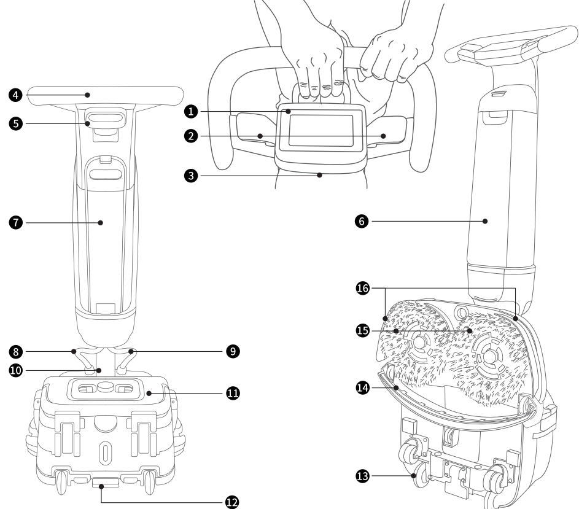
> *Figure description (AI):* The figure shows labeled parts of the PUDU SH1 scrubber dryer. Numbers point to specific features such as posture switching ring and recovery tank release pedal. Visual layout helps users locate buttons, ports, and connectors for operation.

*Labels:*

- **1** LCD Screen
- **2** Operation Button
- **3** Power Switch
- **4** Handle
- **5** Posture Switching Ring
- **6** Solution Tank
- **7** Battery
- **8** Water Channel
- **9** Cable Conduit
- **10** Multi-functional Shaft
- **11** Recovery tank
- **12** Recovery Tank Release Pedal
- **13** Transport Wheel
- **14** Squeegee
- **15** Disc Brush
- **16** Splash Guard

---

*Page 3 (PDF page 5, left)*

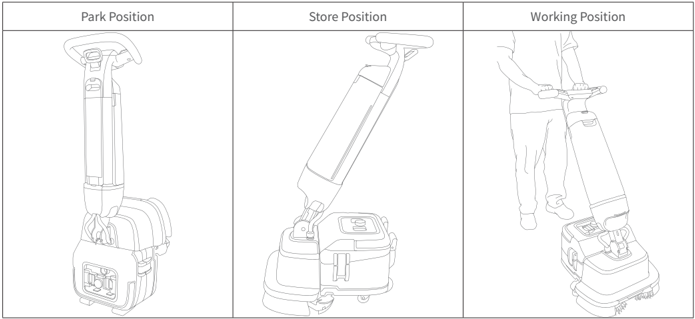
> *Figure description (AI):* The figure illustrates three distinct positions for the floor scrubber: Park Position, Store Position, and Working Position. In Park Position, the handle is fully upright and locked in a vertical orientation. In Store Position, the handle is tilted forward to reduce overall height for compact storage. In Working Position, the operator stands behind the machine with the handle adjusted to a comfortable working angle.

## 2.2 Product Specification

| Specifications | Description |
|---|---|
| Product dimensions（L x W x H） | Vertical State: 49 x 53 x 120 cm |
| Product dimensions（L x W x H） | Store Position: 49 x 35 x 127 cm |
| Product weight | 27 kg |
| Operating voltage | DC 22-29.4 V |
| Power input | AC 100V-240V,50/60Hz |
| Power output | 29.4V, 8A |
| Battery capacity | 18 Ah |
| Charging time | 2.5 h |
| Operation time of batteries | Normal Mode：70 mins |
| Operation time of batteries | ECO Mode：100 mins |
| Rated power | 380 W |
| Brush speed | 350 rpm |
| Productivity | 1100 - 1600 m²/ h |
| Working width | 44 cm |
| Squeegee width | 49 cm |
| Solution tank capacity | 4 L |
| Recovery tank capacity | 4 L |
| Wi-Fi | 2.4G Wi-Fi：19.83 dBm |
| Charge on the machine | Yes |
| Intelligent functions | Touch screen, liquid level detection, WiFi, APP |
| IP rating | IPX4 |

---

*Page 4 (PDF page 5, right)*

# 3 Assembly

Remove all packages and check the appearance of the device. Read the operation guide in detail before use.

## 3.1 Unboxing

Packing list:

Device x1, Charger x1, Battery x1, Disc Brush x2, Squeegee x1, Splash Guard x1, Solution tank x1, Recovery tank x1, User manual x1, Quick start guide x1, Cleaning Tool x1, Certification x1.

## 3.2 Battery charging

Fully charge the battery before use for the first time.

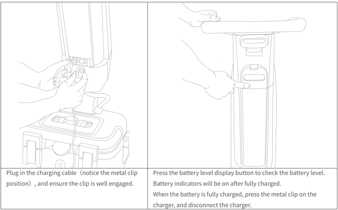
> *Figure description (AI):* The left panel shows how to plug in the charging cable, highlighting the metal clip position. The right panel demonstrates pressing the battery level display button on the device. The figure illustrates that battery indicators will light up once the battery is fully charged. The visual guide explains disconnecting the charger by pressing the metal clip when charging is complete.
Plug in the charging cable（notice the metal clip position）, and ensure the clip is well engaged.

Press the battery level display button to check the battery level. Battery indicators will be on after fully charged.

When the battery is fully charged, press the metal clip on the charger, and disconnect the charger.

| Battery Indicator | Indicator Status |
|---|---|
| < 5% | ● ○ ○ ○ Red Flash |
| 5%~25% | ● ○ ○ ○ White Solid |
| 26%~50% | ● ● ○ ○ White Solid |
| 51%~75% | ● ● ● ○ White Solid |
| 76%~100% | ● ● ● ● White Solid |

---

*Page 5 (PDF page 6, left)*

## 3.3 Battery Installation

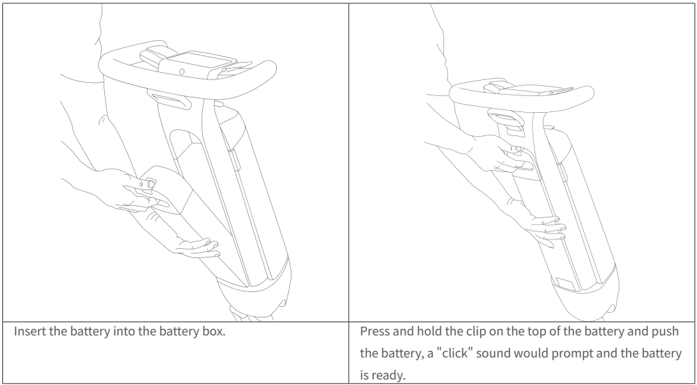
> *Figure description (AI):* The figure shows how to insert the battery into the device. It illustrates pressing and holding the clip on top of the battery while pushing it in. A 'click' sound indicates the battery is properly installed. The hands demonstrate the correct grip and motion for securing the battery.
Insert the battery into the battery box.

Press and hold the clip on the top of the battery and push the battery, a "click" sound would prompt and the battery is ready.

## 3.4 Splash Guards Installation

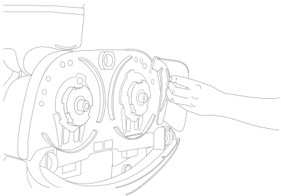
> *Figure description (AI):* The figure shows a hand installing a disc brush into the device. It illustrates how to align and rotate the disc brush outward for installation. The image demonstrates the physical placement of the disc brush in its storage position. No labels or numbers are visible in the figure to identify specific parts.
- Align the two fixing clips on the left and right splash guards with the card holes and press to fit.

## 3.5 Disc brush Installation

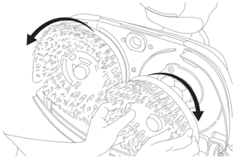
> *Figure description (AI):* The figure shows how to install disc brushes by rotating them outward from their storage position. Arrows indicate the direction of rotation needed to secure each disc brush into its mount. Hands are shown holding and positioning the disc brushes during installation. The image illustrates that both left and right disc brushes are installed simultaneously or sequentially in the same manner.
- Take the disc brushes (left and right undefined), and in the storage position of the device, install the disc brushes by aligning them with the chassis disc brush mounts and rotate outward to install.

---

*Page 6 (PDF page 6, right)*

## 3.6 Squeegee Installation

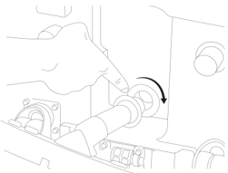
> *Figure description (AI):* The figure shows a hand inserting a cylindrical tool into a port on the machine's chassis. A curved arrow indicates that the tool should be rotated clockwise after insertion. This visual demonstrates the installation direction for a component, likely related to the squeegee or small cleaning tool partner. The image clarifies the physical orientation and rotational action required during assembly.
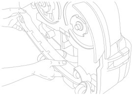
> *Figure description (AI):* The figure shows a hand inserting a small cleaning tool partner into one of the machine's tool holders. It demonstrates the correct orientation for installing the accessory from top to bottom. The illustration provides visual guidance on how to position and secure the tool within its designated slot.
- Screw the squeegee vacuum hose into suction port, aim the nail holes of the squeegee at the pin on the chassis, press to install squeegee.

## 3.7 Installing the Small Cleaning Tool Partner

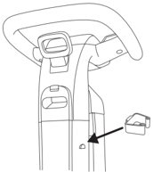
> *Figure description (AI):* The arrow points to a small tool holder on the side of the device. This location is one of four available slots for attaching the Small Cleaning Tool Partner. To install, insert the tool from the top down into this slot. To remove, pull the tool out from the bottom up.
- The machine has a total of four tool holders on two sides for the small cleaning tool partner. To install, insert it from the top down. To remove, pull it out from the bottom up.

---

*Page 7 (PDF page 7, left)*

# 4 Operation

## 4.1 Using Software and Application

The device supports Wi-Fi and app. We strongly recommend you to use the device with Internet connection, together with PUDULink app, you can experience more intelligent function, such as real-time cleaning task report, device rental, device theft proof, staff management, etc.

- Scan the QR code for detailed operation of software and app.

## 4.2 Preparatory work

- Power level check

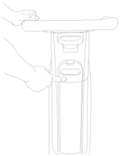
> *Figure description (AI):* The image shows a hand pressing down on the top snap button of the solution tank. This action secures the solution tank into place after filling it with water or cleaner. The grooves on the side of the tank align with corresponding slots in the device for proper installation. A 'click' sound indicates successful installation once the tank is pushed forward and snapped into position.
Press the battery level display button to check the battery level.

(*Before first use or if the machine hasn't been used for more than 7 days, press and hold the battery level display button to activate the battery.)

- Refill the solution tank

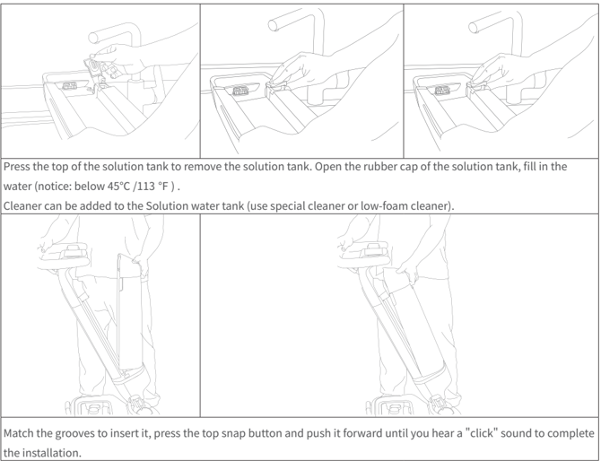
> *Figure description (AI):* The top row shows how to remove the solution tank from the device. The middle row illustrates filling the solution tank with water below 45°C / 113°F and adding cleaner. The bottom row demonstrates inserting the solution tank back into the device by matching grooves, pressing the snap button, and pushing forward until a click is heard.
Press the top of the solution tank to remove the solution tank. Open the rubber cap of the solution tank, fill in the water (notice: below 45℃ /113 ℉ ) .

Cleaner can be added to the Solution water tank (use special cleaner or low-foam cleaner).

Match the grooves to insert it, press the top snap button and push it forward until you hear a "click" sound to complete the installation.

*Devices are strictly tested before leaving the factory, water may remain inside the tank before initial use.

---

*Page 8 (PDF page 7, right)*

# 4.3 Position Switching

There are three types of machine position: store position, park position and working position

- Working Position

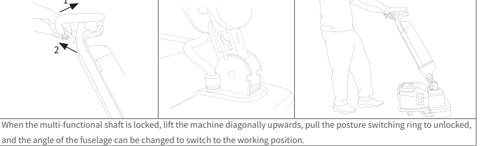
> *Figure description (AI):* The figure shows how to switch the machine from a locked state to the working position. The diagram illustrates the change in angle of the fuselage as the machine transitions to its working position.
When the multi-functional shaft is locked, lift the machine diagonally upwards, pull the posture switching ring to unlocked, and the angle of the fuselage can be changed to switch to the working position.

- Store Position

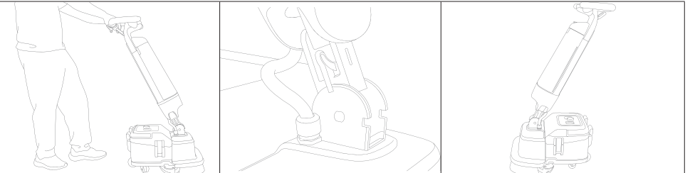
> *Figure description (AI):* The figure shows a person operating the machine in its working position. It illustrates how to switch between store, park, and working positions using the posture switching ring. The diagrams demonstrate lifting or lowering the fuselage at different angles for each mode. Visual cues like 'click' sounds are implied by the locking mechanisms shown in each position.
Pull the posture switching ring lightly in the working position, adjust the fuselage to 65° and hear the "click" sound, then the rotary axis locks and switches to the store position.

- Park Position

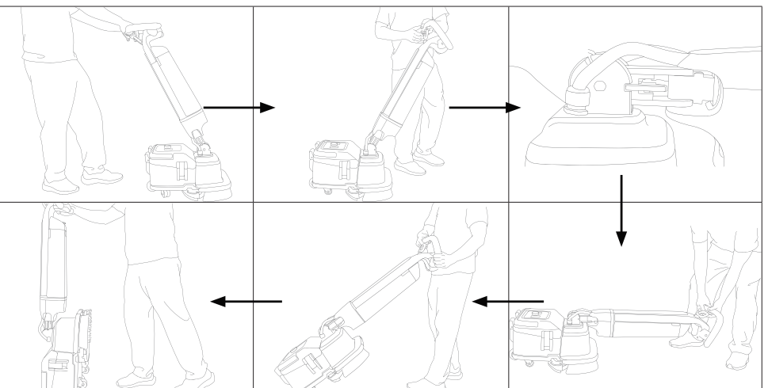
> *Figure description (AI):* The figure illustrates the sequence of steps to switch between store, park, and working positions. It shows how to lift the machine diagonally upwards to unlock the posture switching ring for the working position. It depicts putting down the body smoothly in the opposite direction from the working position to switch to the park position.
In the working position, pull the posture switching ring lightly, put down the body smoothly in the opposite direction, hear the "click" sound and then the multi-functional shaft locks, lift up the device and switch to the park position.

---

*Page 9 (PDF page 8, left)*

## 4.4 Power up and select mode

| function\power output\ mode | Heavy duty | Normal | ECO | Low residue | Soak | Water suction | Brush max | Accessory | ECO Accessory |
|---|---|---|---|---|---|---|---|---|---|
| Brush Speed | high | medium | low | low | high | medium | high | x | x |
| Suction | high | high | low | high | x | high | x | high | low |
| Volume | high | medium | low | low | high | x | x | x | x |

Press and hold the power switch for 3 seconds to power on the device, swipe the screen from either the left to the right or one another to select the mode, and press either side of the operation button to start the operation.

*The default operation button definition is to start the operation with either button pressed. You can customize the device to start the operation with both operation buttons pressed together in Settings.

## 4.5 Operation Instructions

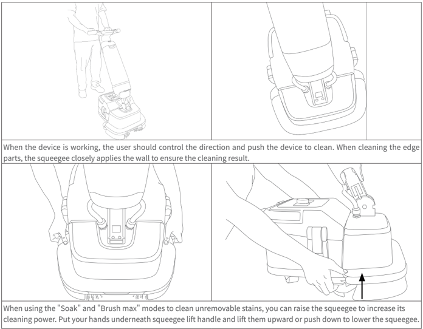
> *Figure description (AI):* The figure shows how to operate the floor cleaning device by pushing it forward while controlling its direction. It illustrates that when cleaning edges or corners, the squeegee should be pressed against the wall for better results. The diagram demonstrates how to raise or lower the squeegee using the lift handle located at the front of the machine. It visually explains that raising the squeegee increases cleaning power in 'Soak' and 'Brush max' modes.
When the device is working, the user should control the direction and push the device to clean. When cleaning the edge parts, the squeegee closely applies the wall to ensure the cleaning result.

When using the "Soak" and "Brush max" modes to clean unremovable stains, you can raise the squeegee to increase its cleaning power. Put your hands underneath squeegee lift handle and lift them upward or push down to lower the squeegee.

## 4.6 Complete the Operation

Keep pressing the power switch, the screen turns off means successful shutdown. Gently pull the Position Hook Switch to switch the device to the storage position for subsequent cleaning and maintenance (refer to 4.3).

---

*Page 10 (PDF page 8, right)*

## 4.7 Prohibited operations

- Do not use the machine without the recovery tank float (A), vacuum motor filter (B), and water outlet filter (C) installed.

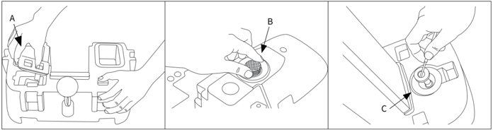
> *Figure description (AI):* The figure shows the locations of three components labeled A, B, and C. Label A points to a float inside the recovery tank. Label B points to a filter on the vacuum motor. Label C points to a filter at the water outlet.

- Do not operate the machine without the recovery tank.

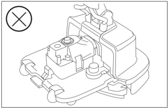
> *Figure description (AI):* The figure shows a vacuum recovery tank assembly with multiple components. It illustrates the physical layout of parts referenced in prohibited operations section. No labels or letters (A, B, C) are visible on the diagram to identify specific components. The image does not indicate which parts must be installed for safe operation.

- In the non original packaging state, multi-functional shaft must be unlocked for transport.

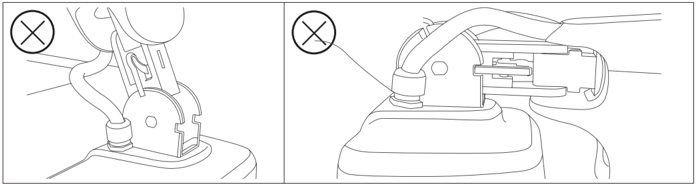
> *Figure description (AI):* The figure shows prohibited operations for the machine. Do not operate the machine without the recovery tank float (A), vacuum motor filter (B), and water outlet filter (C) installed.

---

*Page 11 (PDF page 9, left)*

# 5 Storage and Transportation

## 5.1 Storage

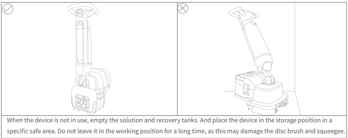
> *Figure description (AI):* The left image shows the correct storage position with a checkmark. The right image shows an incorrect working position marked with an X. Leaving the device in the working position for long periods may damage the disc brush and squeegee. Empty solution and recovery tanks before storing the device.
When the device is not in use, empty the solution and recovery tanks. And place the device in the storage position in a specific safe area. Do not leave it in the working position for a long time, as this may damage the disc brush and squeegee.

## 5.2 Transportation

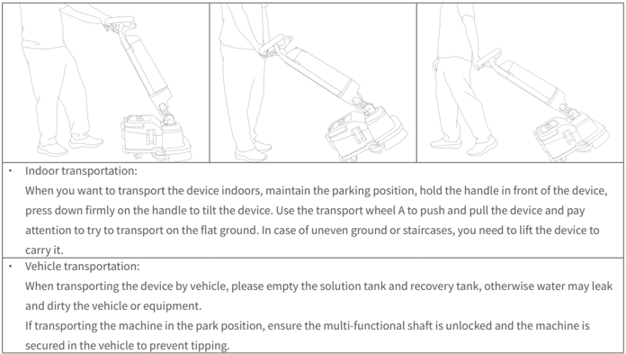
> *Figure description (AI):* The figure illustrates three different positions for transporting the device indoors. It shows how to tilt the device by pressing down on the handle. It demonstrates using the transport wheel A to push and pull the device. It indicates that the device should be lifted if the ground is uneven or there are staircases.
- Indoor transportation:

When you want to transport the device indoors, maintain the parking position, hold the handle in front of the device, press down firmly on the handle to tilt the device. Use the transport wheel A to push and pull the device and pay attention to try to transport on the flat ground. In case of uneven ground or staircases, you need to lift the device to carry it.

- Vehicle transportation:

When transporting the device by vehicle, please empty the solution tank and recovery tank, otherwise water may leak and dirty the vehicle or equipment.

If transporting the machine in the park position, ensure the multi-functional shaft is unlocked and the machine is secured in the vehicle to prevent tipping.

## 5.3 Carry

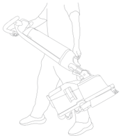
> *Figure description (AI):* The figure shows the correct carrying position for the device. It demonstrates how to hold the handle while transporting the unit by hand.
- When carrying the device, it is recommended to refer to the pic. For inconvenience, solution tank and the recovery tank can be dismantled to reduce the weight.

---

*Page 12 (PDF page 9, right)*

# 6 Repair and Maintenance

## 6.1 After every use

- Wipe the scrubber body with a clean dampened cloth. Do not use corrosive cleaning agents when wiping, it is recommended to use neutral cleaning agents or water；
- Charge in time when the battery is low(refer to 3.2)；
- Remove the disc brush for cleaning after each use(refer to 6.4).If the disc brush is worn out, please replace with new disc brushes(refer to 6.7)；
- Remove the squeegee for cleaning after each use (refer to 6.5). If the Squeegee is worn, broken, or deformed, which affects the water-absorbing effect, it is necessary to replace the strip with a new one (refer to 6.8).

## 6.2 Solution tank cleaning

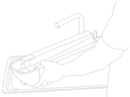
> *Figure description (AI):* The figure shows a person removing the disc brush from the scrubber body. This step is part of the after-use maintenance procedure described in section 6.1. The image illustrates how to access and remove the disc brush for cleaning or replacement.
- Empty the solution tank and add a small amount of water for interior cleaning.

## 6.3 Recovery tank cleaning

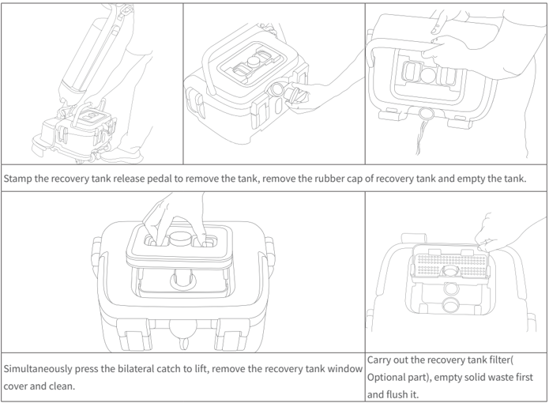
> *Figure description (AI):* The figure shows how to remove the recovery tank by stamping the release pedal. It illustrates removing the rubber cap and emptying the recovery tank. The image demonstrates lifting the window cover by pressing bilateral catches simultaneously. It depicts cleaning the recovery tank filter and flushing out solid waste.
Stamp the recovery tank release pedal to remove the tank, remove the rubber cap of recovery tank and empty the tank.

Simultaneously press the bilateral catch to lift, remove the recovery tank window cover and clean.

Carry out the recovery tank filter( Optional part), empty solid waste first and flush it.

---

*Page 13 (PDF page 10, left)*

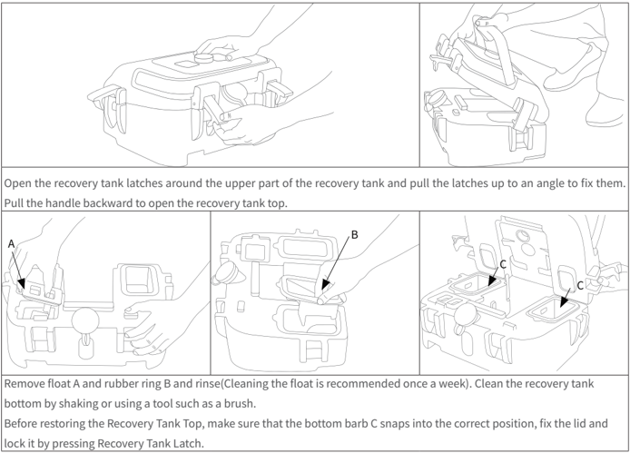
> *Figure description (AI):* The figure shows how to open the recovery tank by unlatching and pulling the handle backward. Labels A and B identify parts (float and rubber ring) that should be removed for cleaning. Label C points to a barb on the bottom of the recovery tank top that must snap into place before closing. The figure illustrates the correct positions of components during disassembly and reassembly of the recovery tank.
Open the recovery tank latches around the upper part of the recovery tank and pull the latches up to an angle to fix them. Pull the handle backward to open the recovery tank top.

Remove float A and rubber ring B and rinse(Cleaning the float is recommended once a week). Clean the recovery tank bottom by shaking or using a tool such as a brush.

Before restoring the Recovery Tank Top, make sure that the bottom barb C snaps into the correct position, fix the lid and lock it by pressing Recovery Tank Latch.

## 6.4 Disc brush cleaning

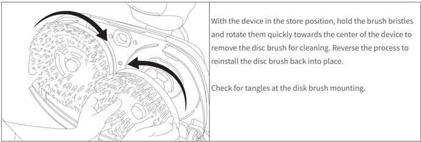
> *Figure description (AI):* The arrows show how to rotate the disc brush bristles toward the center to remove it. The arrows also show how to reverse the rotation to reinstall the disc brush. A hand is shown holding the brush bristles during removal or reinstallation. The figure illustrates the physical action required for disc brush cleaning and reinstallation.
With the device in the store position, hold the brush bristles and rotate them quickly towards the center of the device to remove the disc brush for cleaning. Reverse the process to reinstall the disc brush back into place.

Check for tangles at the disk brush mounting.

## 6.5 Squeegee cleaning

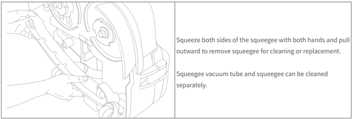
> *Figure description (AI):* The figure shows hands squeezing both sides of the squeegee to remove it from the device. The illustration demonstrates pulling the squeegee outward for cleaning or replacement. It visually confirms that the squeegee vacuum tube and squeegee can be cleaned separately.
Squeeze both sides of the squeegee with both hands and pull outward to remove squeegee for cleaning or replacement.

Squeegee vacuum tube and squeegee can be cleaned separately.

---

*Page 14 (PDF page 10, right)*

# 6.6 Filter cleaning

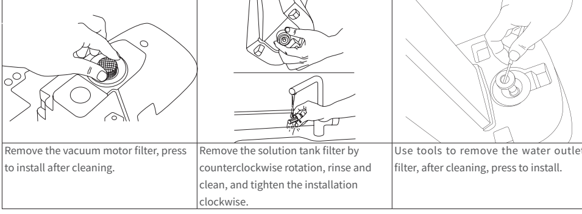

Remove the vacuum motor filter, press to install after cleaning. Remove the solution tank filter by counterclockwise rotation, rinse and clean, and tighten the installation clockwise. Use tools to remove the water outlet filter, after cleaning, press to install.

> *Figure description (AI):* The figure shows how to remove, clean, and reinstall the vacuum motor filter by pressing it into place. It illustrates removing the solution tank filter by turning it counterclockwise, rinsing it under water, and tightening it back clockwise. The image demonstrates using a tool to unscrew the water outlet filter, cleaning it, and then pressing it back in for installation. Each panel visually guides the user through specific manual steps for cleaning different filters that are not fully described in the surrounding text.
# 6.7 Disc brush replacement

When the bristles are worn out, it is recommended to replace the disc brush with a new one.

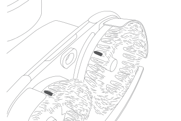

> *Figure description (AI):* The figure shows two disc brushes with rubber strips attached. It illustrates the position of the rubber strips on the disc brushes. This visual aids in understanding how to remove or replace the rubber strips during maintenance.
# 6.8 Rubber strips replacement

- Rubber strips removal

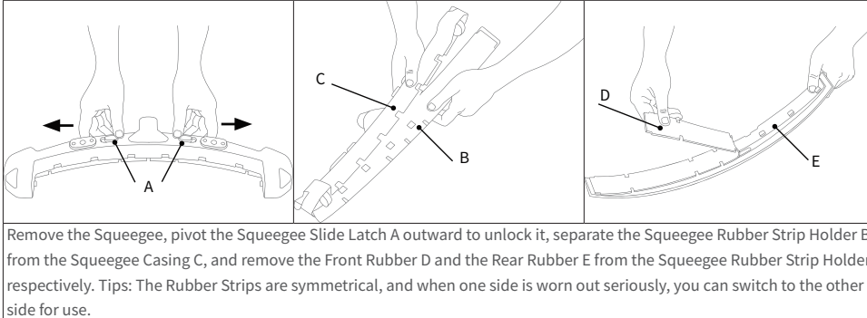

Remove the Squeegee, pivot the Squeegee Slide Latch A outward to unlock it, separate the Squeegee Rubber Strip Holder B from the Squeegee Casing C, and remove the Front Rubber D and the Rear Rubber E from the Squeegee Rubber Strip Holder respectively. Tips: The Rubber Strips are symmetrical, and when one side is worn out seriously, you can switch to the other side for use.

> *Figure description (AI):* The figure shows how to remove rubber strips from a squeegee by unlatching and separating components. Labels A, B, C, D, and E identify specific parts: Squeegee Slide Latch, Rubber Strip Holder, Squeegee Casing, Front Rubber, and Rear Rubber. Arrows indicate the direction to pivot latch A outward for unlocking. The illustration demonstrates that rubber strips can be removed from either side of the holder.

---

*Page 15 (PDF page 11, left)*

## Rubber Strips installation

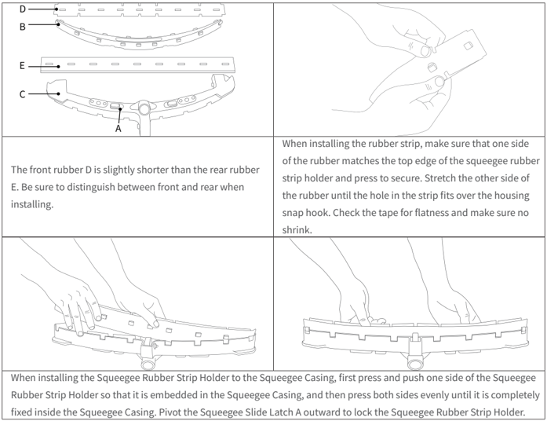
> *Figure description (AI):* The labels A, B, C, D, and E identify specific parts of the squeegee assembly. The figure shows how to install the rubber strip into the holder by stretching it over a snap hook. The illustration demonstrates pressing the Squeegee Rubber Strip Holder into the casing before locking it with latch A. The diagram visually distinguishes between the front (D) and rear (E) rubber strips for correct installation orientation.
The front rubber D is slightly shorter than the rear rubber E. Be sure to distinguish between front and rear when installing.

When installing the rubber strip, make sure that one side of the rubber matches the top edge of the squeegee rubber strip holder and press to secure. Stretch the other side of the rubber until the hole in the strip fits over the housing snap hook. Check the tape for flatness and make sure no shrink.

When installing the Squeegee Rubber Strip Holder to the Squeegee Casing, first press and push one side of the Squeegee Rubber Strip Holder so that it is embedded in the Squeegee Casing, and then press both sides evenly until it is completely fixed inside the Squeegee Casing. Pivot the Squeegee Slide Latch A outward to lock the Squeegee Rubber Strip Holder.

---

*Page 16 (PDF page 11, right)*

# 7 Trouble shooting

| Problem | Cause and solution - Cause | Cause and solution - Solution |
|---|---|---|
| No power | No battery | Insert battery |
| No power | Battery incorrectly placed | Remove and reinstall battery |
| No power | Empty battery | Charge battery |
| No power | Battery not activated | Tap the power display button to activate the battery |
| Poor water recovery | Squeegee is raised | Lower the squeegee |
| Poor water recovery | Squeegee rubber blades is worn out | Replace rubber blades |
| Poor water recovery | Squeegee blocked | Check and remove blockage, ensure that the squeegee fits the ground |
| Poor water recovery | Squeegee is not connecting well with Squeegee Vacuum Hose | Reinstall |
| Poor water recovery | Vacuum hose blocked | Check and remove blockage |
| Poor water recovery | Recovery Tank is not installed properly | Reinstall |
| Poor water recovery | Recovery Tank top not tightly covered | Close it tightly |
| Poor water recovery | Recovery Tank Filter jammed | Clean the Recovery Tank Filter |
| Poor water recovery | Vacuum Motor Filter blocked | Clean the Vacuum Motor Filter |
| Insufficient/no water flow | Empty Solution tank | Fill the solution tank |
| Insufficient/no water flow | Solution tank not in place | Reinstall |
| Insufficient/no water flow | Filter blocked | Clean the solution tank outlet |
| Insufficient/no water flow | Dirt in the solution tank | Clean solution tank |
| Insufficient/no water flow | The mode used is no water or low water flow | Use mode like heavy duty, normal, ECO, low residue, soak |

# 8 After-sales Service Policies

Shenzhen Pudu Technology Co., Ltd. promises to meet the following conditions, within the effective warranty period of the product (the warranty period for different parts of the product may be different, the warranty period is also different in different regions). Free warranty service must meet the following conditions:

- Effective warranty period only applies to devices purchased from authorized distributors.
- Self-purchased products are used normally within the specified product warranty period, and non-artificial quality problems occur.
- No unauthorized disassembly, no modification or installation under the guidance of non-official instructions, other nonman-made failures.
- Product serial number, factory label and other signs have no signs of tearing or alteration.
- Provide valid proof of purchase, documents.

If you have any questions, please contact the customer service.

Email: techservice@pudutech.com.

---

*Page 17 (PDF page 12, left)*

## Compliance information

## Disposal and recycling information

The Waste Electrical and Electronic Equipment (WEEE) Directive aims to minimize the impact of electrical and electronic goods on the environment, by increasing re-use and recycling and by reducing the amount of WEEE going to landfill. The symbol on this product or its packaging signifies that this product must be disposed separately from ordinary household wastes at its end of life. Be aware that this is your responsibility to dispose of electronic equipment at recycling centers in order to conserve natural resources. Each country should have its collection centers for electrical and electronic equipment recycling. For information about your recycling drop off area, please contact your related electrical and electronic equipment waste management authority, your local city office, or your house hold waste disposal service.

Before placing electrical and electronic equipment (EEE) in the waste collection stream or in waste collection facilities, the end user of equipment containing batteries and/or accumulators must remove those batteries and accumulators for separate collection.

## Federal Communications Commission compliance statement

The following information applies to Pudu robotic.

This equipment has been tested and found to comply with the limits for a Class B digital device, pursuant to part 15 of the FCC Rules. These limits are designed to provide reasonable protection against harmful interference in a residential installation. This equipment generates, uses and can radiate radio frequency energy and, if not installed and used in accordance with the instructions, may cause harmful interference to radio communications. However, there is no guarantee that interference will not occur in a particular installation. If this equipment does cause harmful interference to radio or television reception, which can be determined by turning the equipment off and on, the user is encouraged to try to correct the interference by one or more of the following measures:

- Reorient or relocate the receiving antenna.
- Increase the separation between the equipment and receiver.
- Connect the equipment into an outlet on a circuit different from that to which the receiver is connected.
- Consult the dealer or an experienced radio/TV technician for help.

This device complies with Part 15 of the FCC rules. Operation is subject to the following two conditions:

- This device may not cause harmful interference.
- This device must accept any interference received, including interference that may cause undesired operation.

---

*Page 18 (PDF page 12, right)*

## Industry Canada compliance statement

This device complies with Industry Canada licence-exempt RSS standard(s). Operation is subject to the following two conditions:

- This device may not cause interference.
- This device must accept any interference, including interference that may cause undesired operation of the device. L'émetteur/récepteur exempt de licence contenu dans le présent appareil est conforme aux CNR d'Innovation, Sciences et Développement économique Canada applicables aux appareils radio exempts de licence. L'exploitation est autorisée aux deux conditions suivantes :
- L'appareil ne doit pas produire de brouillage;
- L'appareil doit accepter tout brouillage radioélectrique subi, même si le brouillage est susceptible d'en compromettre le fonctionnement.
