*Pagina PDF 69, sinistra*

## Copyright © 2024 Shenzhen Pudu Technology Co., Ltd. Tutti i diritti riservati.

Non è consentito ad alcuna azienda o individuo di imitare, copiare, trascrivere o tradurre i contenuti di queste istruzioni per l'uso, in tutto o in parte, senza il consenso scritto esplicito di Shenzhen Pudu Technology Co., Ltd., né di distribuirla a scopo di lucro in qualsivoglia modo (elettronicamente o tramite fotocopiatura, registrazione, ecc.). Le specifiche del prodotto e le informazioni fornite nelle presenti istruzioni per l'uso hanno solo scopo di riferimento e sono soggette a variazione senza ulteriore preavviso. Salvo diversa indicazione, queste istruzioni per l'uso sono destinate unicamente a fornire istruzioni per l'utilizzo, e nessuna affermazione in esse contenuta dovrà essere considerata come una garanzia di qualsiasi tipo.

---

*Pagina 16 (pagina PDF 69, destra)*

## Sommario

- **1 Sicurezza** (p. 01)
    - 1.1 Istruzioni per l'uso (p. 01)
    - 1.2 Batterie (p. 01)
    - 1.3 Istruzioni per il funzionamento (p. 02)
- **2 Introduzione al prodotto** (p. 02)
    - 2.1 Panoramica (p. 03)
    - 2.2 Caratteristiche del prodotto (p. 03)
- **3 Montaggio** (p. 04)
    - 3.1 Disimballaggio (p. 04)
    - 3.2 Ricarica della batteria (p. 04)
    - 3.3 Installazione della batteria (p. 05)
    - 3.4 Installazione dei paraspruzzi (p. 05)
    - 3.5 Installazione della spazzola a disco (p. 05)
    - 3.6 Installazione del tergipavimenti (p. 06)
    - 3.7 Installazione di piccoli strumenti di pulizia ausiliari (p. 06)
- **4 Funzionamento** (p. 06)
    - 4.1 Utilizzo di software e applicazioni (p. 06)
    - 4.2 Preparazione (p. 07)
    - 4.3 Cambio di posizione (p. 08)
    - 4.4 Accensione e selezione della modalità (p. 09)
    - 4.5 Istruzioni per il funzionamento (p. 09)
    - 4.6 Fine uso (p. 10)
    - 4.7 Operazioni vietate (p. 10)
- **5 Conservazione e trasporto** (p. 11)
    - 5.1 Conservazione (p. 11)
    - 5.2 Trasporto (p. 11)
    - 5.3 Movimentazione (p. 11)
- **6 Riparazione e manutenzione** (p. 12)
    - 6.1 Dopo ogni utilizzo (p. 12)
    - 6.2 Pulizia del serbatoio della soluzione (p. 12)
    - 6.3 Pulizia del serbatoio di recupero (p. 12)
    - 6.4 Pulizia della spazzola a disco (p. 13)
    - 6.5 Pulizia del tergipavimenti (p. 13)
    - 6.6 Pulizia del filtro (p. 14)
    - 6.7 Sostituzione della spazzola a disco (p. 14)
    - 6.8 Sostituzione delle strisce di gomma (p. 14)
- **7 Risoluzione dei problemi** (p. 16)
- **8 Assistenza post-vendita** (p. 16)

---

*Pagina 1 (pagina PDF 70, sinistra)*

# 1 Sicurezza
## 1.1 Istruzioni per l'uso
Leggere attentamente le istruzioni di sicurezza. Un uso improprio del prodotto può causare lesioni o fare decadere la garanzia fornita dal produttore.
- Assicurarsi che tutti gli operatori abbiano ricevuto una formazione professionale per utilizzare il dispositivo o abbiano compreso appieno le istruzioni di utilizzo. Il dispositivo non deve essere usata da persone non qualificate e da bambini.
- Eseguire una manutenzione regolare della macchina e utilizzare accessori ufficiali: in caso contrario, il produttore non risponderà di eventuali danni.
- Non appoggiare il corpo del dispositivo contro altri oggetti o pareti quando il dispositivo è in posizione di lavoro. A fine uso, mettere il dispositivo nella posizione di riposo e riporla su una superficie piana.
- Assicurarsi che non vi siano cavi disordinati a terra, per evitare che il dispositivo vi si impigli durante il funzionamento.
- Pulire eventuale sporcizia di grandi dimensioni dal pavimento prima di usare la lavasciuga, per evitare il sovraccarico del motore.
- Non pulire il dispositivo né eseguire la manutenzione mentre è acceso e in movimento.
- Controllare lo stato del dispositivo prima dell'uso. Non sostituire la spazzola a disco e il tergipavimenti quando il dispositivo è in funzione.
- Utilizzare estintori a base d'acqua per spegnere eventuali fiamme, poi usare grandi quantità di acqua per raffreddare la batteria ed evitare la riaccensione.

> ⚠️ Non usare un'idropulitrice per pulire direttamente il dispositivo. Non immergere l'apparecchiatura in acqua.
## 1.2 Batterie
Le batterie non presentano rischi per la sicurezza in condizioni operative normali. Seguire le istruzioni di sicurezza di seguito:
- Se si prevede di non utilizzare il dispositivo per molto tempo, rimuovere la batteria. Si consiglia di eseguire una ricarica completa ogni 3 mesi.
- Non utilizzare caricabatterie e batterie non originali.
- Assicurarsi che la tensione di alimentazione corrisponda a quella indicata sul caricabatterie, per evitare di danneggiarlo.
- In caso di guasto della batteria, rimuoverla immediatamente e contattare il servizio post-vendita.
- Non comprimere, forare o colpire il caricabatterie per evitare danni alla batteria.

> ⚠️ La macchina e le batterie devono essere conservate a una temperatura compresa tra -20 ° e 60 °C e l'umidità relativa deve essere inferiore o uguale a 40 °C (93±3) %RH.
Non ricaricare la macchina in vicinanza di oggetti infiammabili o esplosivi. Non riscaldare o bruciare la batteria e il caricabatterie.
Assicurarsi che la batteria e il caricabatterie siano lontani dall'acqua e che le mani dell'operatore siano asciutte durante il funzionamento.
## 1.3 Istruzioni per il funzionamento
- Usare il dispositivo solo su superfici piane interne ed esterne, evitando superfici sconnesse come i gradini.
- Non mescolare tipi diversi di detergenti per evitare la formazione di gas pericolosi. Non aggiungere al serbatoio della soluzione detergenti infiammabili, acidi forti o basi forti che potrebbero danneggiare il dispositivo o gli operatori.
- Usare la macchina a una temperatura ambiente compresa tra 40 °C e 1 °C e a un'umidità relativa inferiore o uguale a 40 °C (93±3) %RH.
- Tenere il dispositivo lontano da polvere, liquidi o vapori infiammabili durante l'uso.
- Non lasciare il dispositivo su rampe o pendii per evitarne il ribaltamento. Quando non in movimento, lasciare il dispositivo su una superficie piana e dura.
- Non consentire a personale non autorizzato o non qualificato di eseguire lavori di manutenzione sull'apparecchiatura.

> ⚠️ Durante l'utilizzo del dispositivo, non indossare cravatte, sciarpe o altri accessori che potrebbero impigliarsi nelle parti rotanti.
Non toccare le parti mobili o rotanti quando il dispositivo è in funzione, per evitare lesioni.

---

*Pagina 2 (pagina PDF 70, destra)*

# 2 Introduzione al prodotto

PUDU SH1 è un lavasciuga verticale professionale in miniatura progettata da PUDU Robotics, ideale per ambienti complessi di piccole o medie dimensioni, e adatta per la pulizia di gran parte dei pavimenti duri. SH1 include le funzioni di lavaggio, pulizia con spazzole e aspirazione. Le funzioni simultanee di lavaggio e asciugatura ottimizzano la pulizia, e la spazzola a disco ad alta pressione ultraveloce offre un risultato impeccabile. I sensori e l'app intelligenti migliorano il monitoraggio digitale dei risultati e aprono una nuova era di pulizia intelligente.

## 2.1 Panoramica

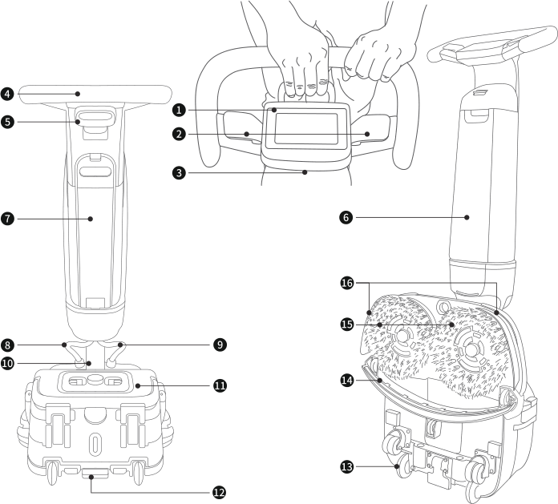
> *Descrizione della figura (IA):* La figura mostra i componenti principali del robot PUDU SH1 con etichette numerate per identificare parti come lo schermo LCD (1), il pulsante di avvio (2) e la batteria (7). L'immagine illustra come le spazzole a disco (15) e il tergipavimenti (14) siano posizionati nella parte inferiore del dispositivo. La vista laterale mostra la forma ergonomica della maniglia (4, 6) e la posizione dei serbatoi per soluzione e recupero acqua.
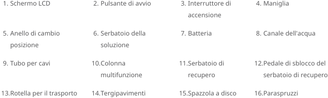
> *Descrizione della figura (IA):* La figura mostra i componenti principali del robot PUDU SH1 con etichette numerate. Le etichette identificano parti come lo schermo LCD, il pulsante di avvio, la batteria e i serbatoi. Il lettore può riconoscere le funzioni specifiche di ogni componente tramite le descrizioni fornite. La figura aiuta a localizzare fisicamente gli elementi del dispositivo per un uso corretto.

*Etichette:*

- **1** Schermo LCD
- **2** Pulsante di avvio
- **3** Interruttore di accensione
- **4** Maniglia
- **5** Anello di cambio posizione
- **6** Serbatoio della soluzione
- **7** Batteria
- **8** Canale dell'acqua
- **9** Tubo per cavi
- **10** Colonna multifunzione
- **11** Serbatoio di recupero
- **12** Pedale di sblocco del serbatoio di recupero

---

*Pagina 3 (pagina PDF 71, sinistra)*

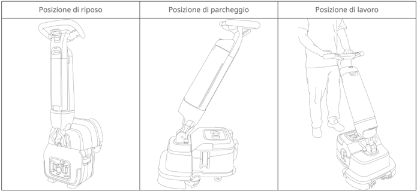
> *Descrizione della figura (IA):* La figura mostra le tre posizioni operative del prodotto: riposo, parcheggio e lavoro. Nella posizione di riposo, il manico è verticale e l'apparecchio è in piedi. Nella posizione di parcheggio, il manico è inclinato verso il basso per facilitare lo stoccaggio. Nella posizione di lavoro, un operatore tiene il manico mentre spinge l'apparecchio sul pavimento.

## 2.2 Caratteristiche del prodotto

| Specifiche | Descrizione |
|---|---|
| Dimensioni del prodotto (P x L x A) | Posizione verticale: 49 x 53 x 120 cm |
| Dimensioni del prodotto (P x L x A) | Posizione di riposo: 49 x 35 x 127 cm |
| Peso del prodotto | 27 kg |
| Tensione di esercizio | CC 22-29,4 V |
| Potenza in ingresso | CA 100 V-240 V, 50/60 Hz |
| Potenza in uscita | 29,4 V, 8 A |
| Capacità della batteria | 18 Ah |
| Tempo di carica | 2,5 ore |
| Durata di funzionamento della | Modalità normale: 70 minuti |
| batteria | Modalità ECO: 100 minuti |
| Potenza nominale | 380 W |
| Velocità della spazzola | 350 giri al minuto |
| Produttività | 1.100-1.600 m²/ora |
| Pista di lavaggio | 44 cm |
| Larghezza del tergipavimenti | 49 cm |
| Capacità del serbatoio della soluzione | 4 L |
| Capacità del serbatoio di recupero | 4 L |
| Carica sulla macchina | Sì |
| Funzioni intelligenti | Touch screen, rilevamento del livello del liquido, WiFi, APP |
| Grado di protezione IP | IPX4 |

---

*Pagina 4 (pagina PDF 71, destra)*

# 3 Montaggio

Rimuovere tutti gli imballaggi e controllare l'aspetto del dispositivo. Leggere attentamente la guida all'uso prima dell'utilizzo.

## 3.1 Disimballaggio

Elenco del contenuto:

Dispositivo x1, Caricabatterie x1, Batteria x1, Spazzola a disco x2, Tergipavimenti x1, Paraspruzzi x1, Serbatoio della soluzione x1, Serbatoio di recupero x1, Istruzioni per l'uso x1, Guida rapida x1, Strumento di pulizia x1, Certificazione x1.

## 3.2 Ricarica della batteria

Caricare completamente la batteria prima del primo utilizzo.

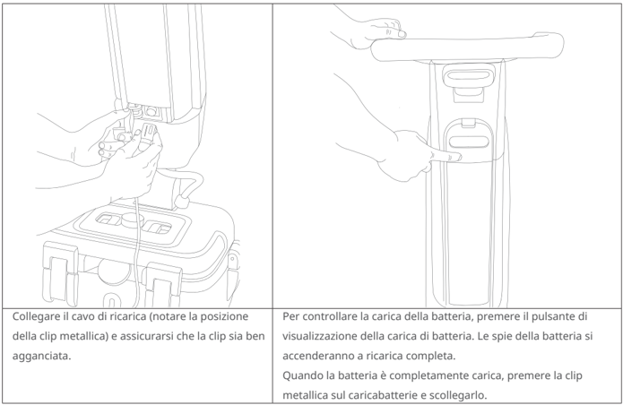
> *Descrizione della figura (IA):* La figura mostra come collegare il cavo di ricarica al dispositivo e assicurarsi che la clip metallica sia agganciata correttamente. È illustrato il pulsante per visualizzare lo stato della carica della batteria. Vengono mostrate le posizioni dei connettori sul caricabatterie e sul dispositivo. La figura indica come scollegare il cavo di ricarica premendo la clip metallica una volta completata la ricarica.
Collegare il cavo di ricarica (notare la posizione della clip metallica) e assicurarsi che la clip sia ben agganciata.

Per controllare la carica della batteria, premere il pulsante di visualizzazione della carica di batteria. Le spie della batteria si accenderanno a ricarica completa.

Quando la batteria è completamente carica, premere la clip metallica sul caricabatterie e scollegarlo.

| Spia della batteria | Stato della spia |
|---|---|
| < 5% | ⚫ ⚪ ⚪ ⚪ Rosso lampeggiante |
| 5%~25% | ⚫ ⚪ ⚪ ⚪ Bianco fisso |
| 26%~50% | ⚫ ⚫ ⚪ ⚪ Bianco fisso |
| 51%~75% | ⚫ ⚫ ⚫ ⚪ Bianco fisso |
| 76%~100% | ⚫ ⚫ ⚫ ⚫ Bianco fisso |

---

*Pagina 5 (pagina PDF 72, sinistra)*

## 3.3 Installazione della batteria

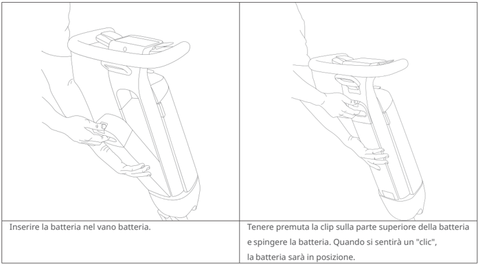
> *Descrizione della figura (IA):* La figura mostra come inserire la batteria nel vano batteria. Si deve tenere premuta la clip sulla parte superiore della batteria mentre si spinge. L'installazione è corretta quando si sente un "clic". Le mani mostrano la posizione corretta per afferrare e inserire la batteria.
| Inserire la batteria nel vano batteria. | Tenere premuta la clip sulla parte superiore della batteria e spingere la batteria. Quando si sentirà un "clic", la batteria sarà in posizione. |
| --- | --- |

## 3.4 Installazione dei paraspruzzi

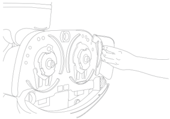
> *Descrizione della figura (IA):* La figura mostra la posizione delle spazzole a disco sul corpo macchina. Una mano sta inserendo o regolando una spazzola a disco nel suo supporto. Le spazzole a disco sono allineate con i supporti del corpo macchina per l'installazione. Il movimento di rotazione verso l'esterno è indicato dalla posizione della mano e della spazzola.
- Allineare i due perni di fissaggio dei paraspruzzi sinistro e destro ai fori di bloccaggio e premere per inserirli.

## 3.5 Installazione della spazzola a disco

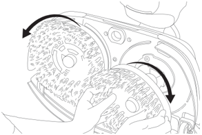
> *Descrizione della figura (IA):* Le frecce curve indicano la direzione di rotazione verso l'esterno per installare le spazzole a disco. La mano illustrata mostra come afferrare e posizionare una spazzola a disco durante il montaggio. Il corpo macchina è mostrato in posizione di riposo, come richiesto per l'installazione delle spazzole.
- Prendere le spazzole a disco (quella sinistra e destra sono identiche) e mettere la lavasciuga in posizione di riposo, montare le spazzole a disco allineandole con i supporti delle spazzole a disco del corpo macchina e ruotale verso l'esterno per l'installazione.

---

*Pagina 6 (pagina PDF 72, destra)*

## 3.6 Installazione del tergipavimenti

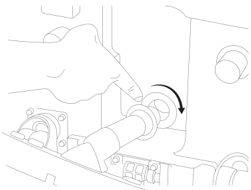
> *Descrizione della figura (IA):* La figura mostra come inserire il tubo di aspirazione per tergipavimenti nella porta di aspirazione. Allinea i fori del tergipavimenti al perno sul corpo macchina e premi per inserirlo in posizione. Ruota il tubo di aspirazione nel senso antiorario (indicato dalla freccia curva) per fissarlo correttamente.
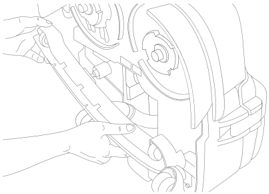
> *Descrizione della figura (IA):* La figura mostra come inserire il tubo di aspirazione per tergipavimenti nella porta di aspirazione. Le mani nell'immagine indicano la posizione corretta per allineare e premere il tergipavimenti sul corpo macchina. Il disegno illustra l'allineamento dei fori del tergipavimenti con il perno di fissaggio. L'immagine conferma che il tubo deve essere inserito completamente nella porta di aspirazione.
- Avvitare il tubo di aspirazione per tergipavimenti nella porta di aspirazione. Allineare i fori del tergipavimenti al perno sul corpo macchina e premere per inserirlo in posizione.

## 3.7 Installazione di piccoli strumenti di pulizia ausiliari

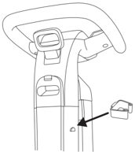
> *Descrizione della figura (IA):* La freccia indica la posizione di un accessorio rimovibile sul lato del corpo macchina. L'accessorio mostrato è progettato per essere inserito o rimosso dalla parte inferiore del dispositivo. Questo elemento fa parte dei quattro portautensili ausiliari descritti nel testo. Per l'installazione, inserire l'accessorio dall'alto verso il basso; per rimuoverlo, tirarlo dal basso verso l'alto.
- La macchina è dotata di un totale di quattro portautensili su due lati per i piccoli strumenti di pulizia ausiliari. Per la installazione, inserirli dall'alto verso il basso. Per rimuoverli, tirarli dal basso verso l'alto.

# 4 Funzionamento

## 4.1 Utilizzo di software e applicazioni

Il dispositivo supporta Wi-Fi e app. Ti consigliamo vivamente di utilizzare il dispositivo con una connessione Internet, insieme all'app PUDULink. In questo modo, sarà possibile utilizzare funzioni più intelligenti, come il rapporto sulle attività di pulizia in tempo reale, il noleggio del dispositivo, il servizio di antifurto del dispositivo, la gestione del personale, ecc.

- Scansionare il codice QR per i dettagli sulle operazioni del software e dell'app.

---

*Pagina 7 (pagina PDF 73, sinistra)*

### 4.2 Preparazione

- Controllare il livello di carica della batteria

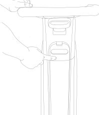
> *Descrizione della figura (IA):* La figura mostra la posizione del pulsante per controllare il livello di carica della batteria. Il pulsante è situato nella parte superiore del dispositivo, sotto l'area di visualizzazione. Premere questo pulsante attiva la batteria al primo utilizzo o dopo un periodo di inattività prolungato. Il pulsante ha una forma ovale con un indicatore centrale che si illumina quando premuto.
Per controllare la carica della batteria, premere il pulsante di visualizzazione della carica di batteria.
(*Al primo utilizzo o se l'apparecchiatura è inutilizzata da più di 7 giorni, toccare il pulsante che mostra la carica per attivare la batteria.)

- Riempire il serbatoio della soluzione

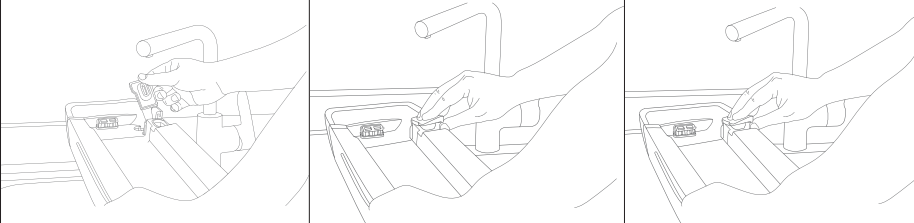
> *Descrizione della figura (IA):* La figura illustra come inserire il serbatoio della soluzione nelle scanalature del dispositivo. Mostra la posizione del pulsante a scatto nella parte superiore del serbatoio da premere per fissarlo. Indica la direzione in cui spingere il serbatoio fino a sentire un "clic" di aggancio. Rappresenta le mani che eseguono l'operazione di installazione corretta del serbatoio.
Premere la parte superiore del serbatoio della soluzione per rimuovere il serbatoio. Aprire il tappo di gomma del serbatoio della soluzione e riempirlo d'acqua (attenzione: l'acqua deve avere una temperatura inferiore a 45 °C/113 °F). È possibile aggiungere il detergente al serbatoio della soluzione (utilizzare un detergente specifico o poco schiumogeno).

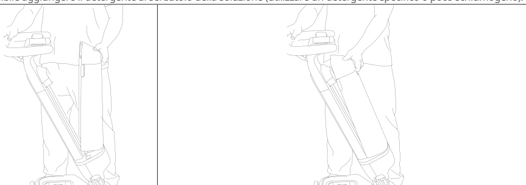
> *Descrizione della figura (IA):* La figura mostra come inserire il serbatoio della soluzione nelle scanalature dell'apparecchiatura. Il serbatoio deve essere premuto in avanti fino a sentire un 'clic' per essere correttamente posizionato. Le linee tratteggiate indicano la posizione corretta del serbatoio prima di inserirlo completamente. La figura illustra l'orientamento corretto del serbatoio durante l'inserimento.
Inserire il serbatoio nelle scanalature, premere il pulsante a scatto nella parte superiore e spingerlo in avanti: quando si sentirà "clic", il serbatoio sarà in posizione.

* I dispositivi vengono sottoposti a collaudi rigorosi prima di lasciare lo stabilimento produttivo; per questo motivo potrebbe essere già presente dell'acqua nel serbatoio al primo utilizzo.

---

*Pagina 8 (pagina PDF 73, destra)*

# 4.3 Cambio di posizione

La macchina ha tre posizioni: posizione di riposo, posizione di parcheggio e posizione di lavoro

- Posizione di lavoro

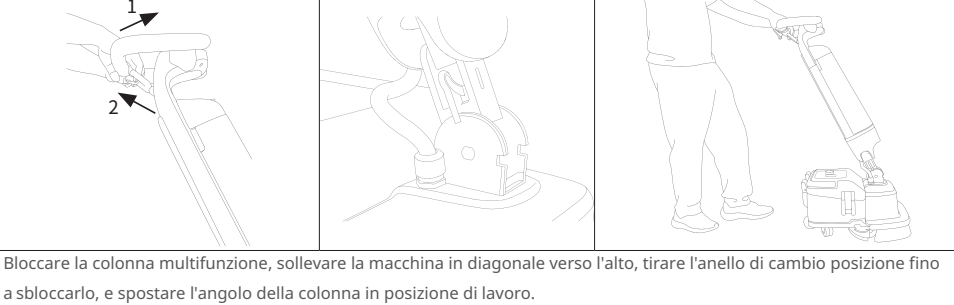

Bloccare la colonna multifunzione, sollevare la macchina in diagonale verso l'alto, tirare l'anello di cambio posizione fino a sbloccarlo, e spostare l'angolo della colonna in posizione di lavoro.

> *Descrizione della figura (IA):* La figura mostra come sollevare la macchina in diagonale verso l'alto durante il cambio posizione. L'immagine illustra lo spostamento dell'angolo della colonna nella posizione di lavoro.
- Posizione di riposo

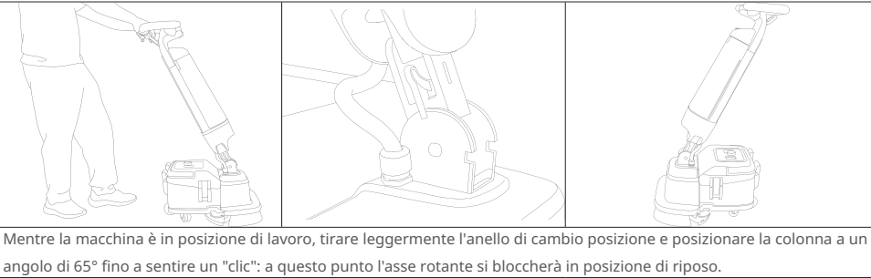

Mentre la macchina è in posizione di lavoro, tirare leggermente l'anello di cambio posizione e posizionare la colonna a un angolo di 65° fino a sentire un "clic": a questo punto l'asse rotante si bloccherà in posizione di riposo.

> *Descrizione della figura (IA):* La figura mostra come passare dalla posizione di lavoro alla posizione di riposo. È necessario tirare l'anello di cambio posizione mentre la macchina è in funzione. Si sente un "clic" quando l'asse rotante si blocca nella posizione di riposo.
- Posizione di parcheggio

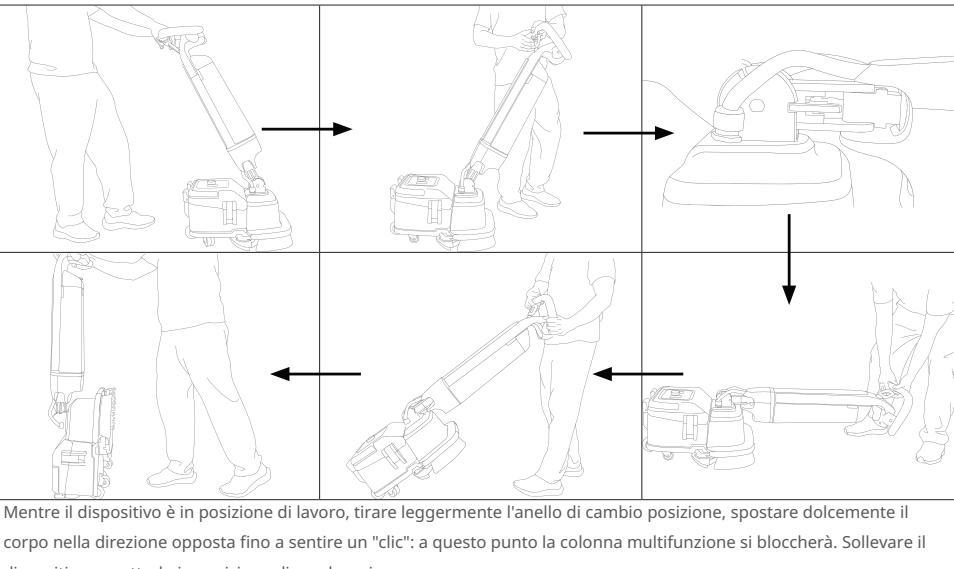

Mentre il dispositivo è in posizione di lavoro, tirare leggermente l'anello di cambio posizione, spostare dolcemente il corpo nella direzione opposta fino a sentire un "clic": a questo punto la colonna multifunzione si bloccherà. Sollevare il dispositivo e metterlo in posizione di parcheggio.

> *Descrizione della figura (IA):* La figura illustra come passare dalla posizione di lavoro alla posizione di parcheggio. Si deve tirare l'anello di cambio posizione e spostare il corpo del dispositivo fino a sentire un "clic" per bloccare la colonna multifunzione. Dopo aver bloccato la colonna, si solleva il dispositivo per riporlo nella posizione di parcheggio. Le frecce indicano la sequenza corretta delle operazioni da seguire.

---

*Pagina 9 (pagina PDF 74, sinistra)*

## 4.4 Accensione e selezione della modalità

| funzione\potenza in uscita\modalità | Pulizia intensa | Normale | ECO | Basso residuo | Ammollo | Aspirazione dell'acqua | Spazzola max | Accessorio | Accessorio ECO |
|---|---|---|---|---|---|---|---|---|---|
| Velocità della spazzola | alto | medio | basso | basso | alto | medio | alto | x | x |
| Aspirazione | alto | alto | basso | alto | x | alto | x | alto | basso |
| Volume | alto | medio | basso | basso | alto | x | x | x | x |

Tenere premuto l'interruttore di accensione per 3 secondi per accendere il dispositivo, scorrere lo schermo da sinistra a destra o viceversa per selezionare la modalità e premere uno dei pulsanti di avvio laterali per avviare il dispositivo. *La definizione predefinita del pulsante operativo prevede l'avvio dell'operazione alla pressione di uno dei due pulsanti. In Impostazioni, è possibile personalizzare l'avvio del dispositivo con entrambi i pulsanti operativi premuti simultaneamente.

## 4.5 Istruzioni per il funzionamento

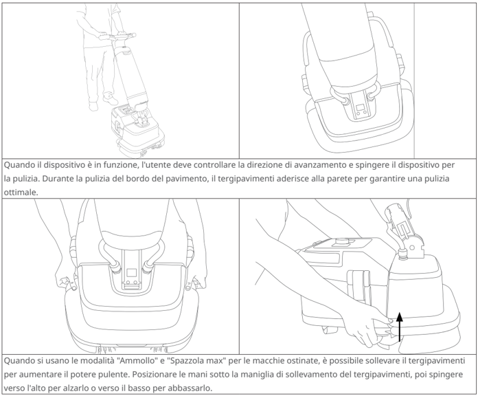
> *Descrizione della figura (IA):* La figura mostra come sollevare il tergipavimenti usando la maniglia di sollevamento. Le frecce indicano la direzione per alzare o abbassare il tergipavimenti. Il testo spiega che questo movimento aumenta il potere pulente nelle modalità 'Ammollo' e 'Spazzola max'. La figura illustra anche come spingere il dispositivo durante l'uso e come far aderire il tergipavimenti alla parete per pulire i bordi.
Quando il dispositivo è in funzione, l'utente deve controllare la direzione di avanzamento e spingere il dispositivo per la pulizia. Durante la pulizia del bordo del pavimento, il tergipavimenti aderisce alla parete per garantire una pulizia ottimale.

Quando si usano le modalità "Ammollo" e "Spazzola max" per le macchie ostinate, è possibile sollevare il tergipavimenti per aumentare il potere pulente. Posizionare le mani sotto la maniglia di sollevamento del tergipavimenti, poi spingere verso l'alto per alzarlo o verso il basso per abbassarlo.

---

*Pagina 10 (pagina PDF 74, destra)*

## 4.6 Fine uso

Tenere premuto l'interruttore di accensione. Quando lo schermo si spegne significa che la macchina è spenta. Tirare delicatamente l'anello di cambio posizione per spostare il dispositivo nella posizione di riposo, per pulirlo ed eseguire la manutenzione (si veda il punto 4.3).

## 4.7 Operazioni vietate

- Non utilizzare la macchina senza il galleggiante del serbatoio di recupero (A), il filtro del motore di aspirazione (B) e il filtro di uscita dell'acqua (C) installati.

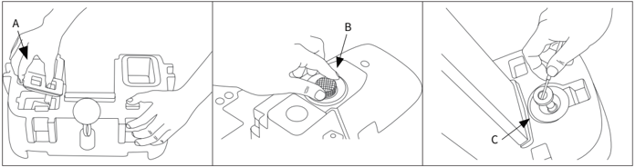
> *Descrizione della figura (IA):* La figura mostra le posizioni dei componenti A, B e C del dispositivo. Il componente A è il galleggiante del serbatoio di recupero. Il componente B è il filtro del motore di aspirazione. Il componente C è il filtro di uscita dell'acqua.

- Non utilizzare la macchina senza il serbatoio di recupero.

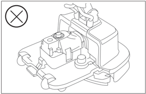
> *Descrizione della figura (IA):* La figura mostra la posizione di riposo del dispositivo, come indicato dal testo che suggerisce di tirare l'anello per spostarlo in questa posizione. L'icona con una croce rossa indica che il dispositivo non deve essere utilizzato nella configurazione mostrata (senza componenti installati). La figura illustra la struttura generale del dispositivo, inclusi i punti dove vengono montati i componenti A, B e C menzionati nel testo. Non ci sono etichette o numeri specifici nella figura, ma essa supporta visivamente le istruzioni relative alla manutenzione e alle operazioni vietate.

- In uno stato di imballaggio non originale,. Per il trasporto, la colonna deve essere sbloccata.

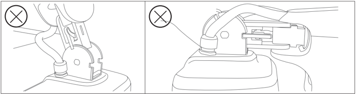
> *Descrizione della figura (IA):* Il simbolo 'X' indica che non è consentito utilizzare la macchina senza i componenti A, B e C installati. La figura mostra le posizioni dei componenti A (galleggiante del serbatoio di recupero), B (filtro del motore di aspirazione) e C (filtro di uscita dell'acqua). Le immagini illustrano come devono essere montati i componenti per un uso sicuro della macchina. Non utilizzare la macchina se uno dei componenti indicati non è presente o correttamente installato.

---

*Pagina 11 (pagina PDF 75, sinistra)*

# 5 Conservazione e trasporto

## 5.1 Conservazione

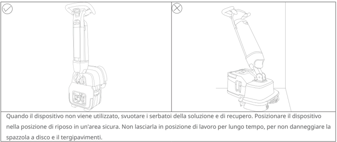
> *Descrizione della figura (IA):* La figura mostra due posizioni del dispositivo: una verticale (posizione di riposo) e una inclinata (posizione di lavoro). Il simbolo con la spunta indica la posizione corretta per il riposo del dispositivo. Il simbolo con la croce indica la posizione da evitare durante il non utilizzo. La figura illustra visivamente come posizionare il dispositivo in sicurezza quando non è in uso.
Quando il dispositivo non viene utilizzato, svuotare i serbatoi della soluzione e di recupero. Posizionare il dispositivo nella posizione di riposo in un'area sicura. Non lasciarla in posizione di lavoro per lungo tempo, per non danneggiare la spazzola a disco e il tergipavimenti.

## 5.2 Trasporto

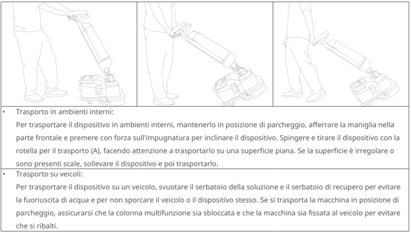
> *Descrizione della figura (IA):* La figura mostra tre posizioni diverse per il trasporto del dispositivo: inclinato con la maniglia frontale (A), in posizione di parcheggio e sollevato. L'etichetta (A) indica la rotella per il trasporto, utilizzata quando si spinge o tira il dispositivo su superfici piane. Le immagini illustrano come inclinare il dispositivo premendo sull'impugnatura frontale per facilitarne il movimento. La terza immagine mostra il dispositivo sollevato, da utilizzare quando si deve attraversare una superficie irregolare o delle scale.
- Trasporto in ambienti interni:

Per trasportare il dispositivo in ambienti interni, mantenerlo in posizione di parcheggio, afferrare la maniglia nella parte frontale e premere con forza sull'impugnatura per inclinare il dispositivo. Spingere e tirare il dispositivo con la rotella per il trasporto (A), facendo attenzione a trasportarlo su una superficie piana. Se la superficie è irregolare o

sono presenti scale, sollevare il dispositivo e poi trasportarlo.

- Trasporto su veicoli:

Per trasportare il dispositivo su un veicolo, svuotare il serbatoio della soluzione e il serbatoio di recupero per evitare la fuoriuscita di acqua e per non sporcare il veicolo o il dispositivo stesso. Se si trasporta la macchina in posizione di parcheggio, assicurarsi che la colonna multifunzione sia sbloccata e che la macchina sia fissata al veicolo per evitare che si ribalti.

## 5.3 Movimentazione

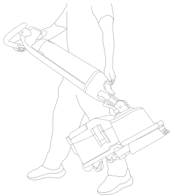
> *Descrizione della figura (IA):* La figura mostra la posizione corretta per trasportare il dispositivo a mano. Si deve afferrare la maniglia frontale e inclinare il dispositivo premendo sull'impugnatura. Il dispositivo viene trainato con la rotella per il trasporto (A) su superfici piane. Su superfici irregolari o scale, il dispositivo va sollevato prima di essere trasportato.
- Quando si trasporta il dispositivo a mano, fare riferimento alla foto per la posizione consigliata. Per comodità, il serbatoio della soluzione e il serbatoio di recupero possono essere smontati per ridurre il peso della macchina.

---

*Pagina 12 (pagina PDF 75, destra)*

# 6 Riparazione e manutenzione

## 6.1 Dopo ogni utilizzo

- Pulire il corpo della lavasciuga con un panno pulito e umido. Non usare detergenti corrosivi per pulire il corpo macchina; si consiglia di utilizzare detergenti neutri o acqua
- Caricare in tempo la batteria quando è scarica (si veda il punto 3.2)
- Rimuovere la spazzola a disco e pulirla dopo ogni utilizzo (si veda il punto 6.4). Se la spazzola a disco è usurata, sostituirla con una nuova (si veda il punto 6.7)
- Rimuovere il tergipavimenti e pulirlo dopo ogni utilizzo (si veda il punto 6.5) Se il tergipavimenti è usurato, rotto o deformato e compromette l'assorbimento dell'acqua, sostituirlo (si veda il punto 6.8).

## 6.2 Pulizia del serbatoio della soluzione

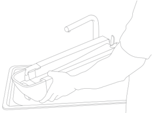
> *Descrizione della figura (IA):* La figura mostra come rimuovere il serbatoio di recupero premendo il pedale di sblocco. È illustrato il sollevamento del coperchio del serbatoio tramite il fermo bilaterale. Vengono mostrate le parti da svuotare e pulire: tappo in gomma, filtro opzionale e interno del serbatoio.
- Svuotare il serbatoio della soluzione e aggiungere una piccola quantità di acqua per la pulizia interna.

## 6.3 Pulizia del serbatoio di recupero

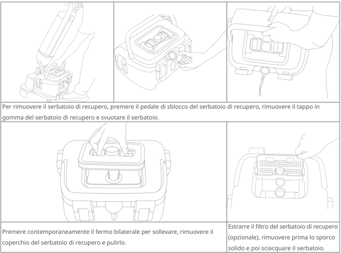
> *Descrizione della figura (IA):* La figura illustra come rimuovere il serbatoio di recupero premendo il pedale di sblocco e rimuovendo il tappo in gomma. Mostra la posizione del fermo bilaterale sul coperchio del serbatoio da premere per sollevarlo e rimuoverlo. Indica come estrarre il filtro opzionale dal serbatoio di recupero dopo aver rimosso lo sporco solido. Rappresenta le diverse fasi di smontaggio e pulizia del serbatoio di recupero, inclusi i punti di aggancio e apertura.
Per rimuovere il serbatoio di recupero, premere il pedale di sblocco del serbatoio di recupero, rimuovere il tappo in gomma del serbatoio di recupero e svuotare il serbatoio.

Premere contemporaneamente il fermo bilaterale per sollevare, rimuovere il coperchio del serbatoio di recupero e pulirlo.

Estrarre il filtro del serbatoio di recupero (opzionale), rimuovere prima lo sporco solido e poi sciacquare il serbatoio.

---

*Pagina 13 (pagina PDF 76, sinistra)*

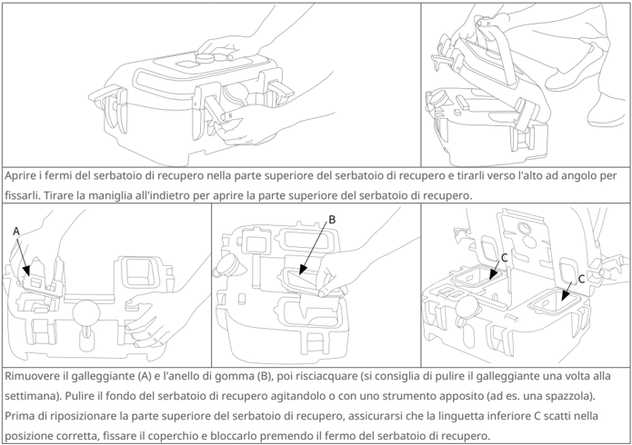
> *Descrizione della figura (IA):* La figura illustra come aprire il coperchio del serbatoio di recupero tirando la maniglia all'indietro. Le etichette A e B indicano rispettivamente il galleggiante e l'anello di gomma da rimuovere per la pulizia. L'etichetta C indica le linguette inferiori che devono essere scattate nella posizione corretta prima di rimontare il coperchio. Le immagini mostrano i passaggi pratici per smontare, pulire e rimontare correttamente il serbatoio di recupero.
Aprire i fermi del serbatoio di recupero nella parte superiore del serbatoio di recupero e tirarli verso l'alto ad angolo per fissarli. Tirare la maniglia all'indietro per aprire la parte superiore del serbatoio di recupero.

Rimuovere il galleggiante (A) e l'anello di gomma (B), poi risciacquare (si consiglia di pulire il galleggiante una volta alla settimana). Pulire il fondo del serbatoio di recupero agitandolo o con uno strumento apposito (ad es. una spazzola). Prima di riposizionare la parte superiore del serbatoio di recupero, assicurarsi che la linguetta inferiore C scatti nella posizione corretta, fissare il coperchio e bloccarlo premendo il fermo del serbatoio di recupero.

## 6.4 Pulizia della spazzola a disco

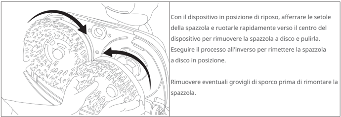
> *Descrizione della figura (IA):* La figura mostra come rimuovere la spazzola a disco ruotandola verso il centro del dispositivo. Le frecce nere indicano la direzione di rotazione per estrarre o inserire la spazzola. È visibile la posizione delle setole della spazzola durante l'operazione di rimozione. La figura illustra anche come rimuovere eventuali grovigli di sporco prima di rimontare la spazzola.
Con il dispositivo in posizione di riposo, afferrare le setole della spazzola e ruotarle rapidamente verso il centro del dispositivo per rimuovere la spazzola a disco e pulirla.

Eseguire il processo all'inverso per rimettere la spazzola a disco in posizione.

Rimuovere eventuali grovigli di sporco prima di rimontare la spazzola.

## 6.5 Pulizia del tergipavimenti

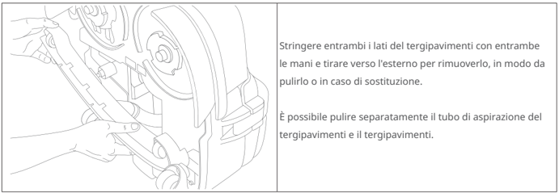
> *Descrizione della figura (IA):* La figura mostra come rimuovere il tergipavimenti stringendo entrambi i lati e tirando verso l'esterno. È visibile la posizione delle mani per afferrare correttamente il tergipavimenti durante la rimozione. Il disegno illustra anche la possibilità di pulire separatamente il tubo di aspirazione collegato al tergipavimenti. La figura conferma che il tergipavimenti può essere rimosso per pulizia o sostituzione.
Stringere entrambi i lati del tergipavimenti con entrambe le mani e tirare verso l'esterno per rimuoverlo, in modo da pulirlo o in caso di sostituzione.

È possibile pulire separatamente il tubo di aspirazione del tergipavimenti e il tergipavimenti.

---

*Pagina 14 (pagina PDF 76, destra)*

## 6.6 Pulizia del filtro

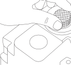

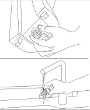
> *Descrizione della figura (IA):* La figura mostra come rimuovere il filtro del motore di aspirazione ruotandolo in senso antiorario. Dopo averlo pulito, rimontarlo premendo e ruotandolo in senso orario fino a quando non è in posizione. La seconda parte della figura illustra l'installazione o la rimozione del filtro dell'acqua sotto il lavandino. Le immagini mostrano le posizioni fisiche dei componenti da manipolare durante la manutenzione.

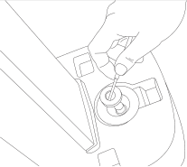
> *Descrizione della figura (IA):* La figura mostra come rimuovere il filtro del motore di aspirazione. Una mano ruota il filtro in senso antiorario per sbloccarlo dal suo alloggiamento. Dopo aver rimosso il filtro, si può pulirlo e rimetterlo premendolo in posizione. Il filtro è collegato a un tubo flessibile che fa parte del sistema di aspirazione.
Rimuovere il filtro del motore di Rimuovere il filtro del serbatoio Utilizzare un utensile per rimuovere il aspirazione, pulirlo, poi premerlo per della soluzione ruotandolo in senso filtro di uscita dell'acqua. Dopo averlo rimetterlo in posizione. antiorario, sciacquarlo e pulirlo, quindi pulito, rimontarlo premendo. rimontarlo ruotandolo in senso orario finché non è in posizione.

## 6.7 Sostituzione della spazzola a disco

Quando le setole sono usurate, si consiglia di sostituire la spazzola a disco con una nuova.

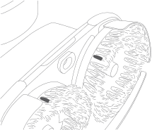
> *Descrizione della figura (IA):* La figura mostra la posizione delle due strisce di gomma del tergipavimenti (etichettate come D ed E nel testo).

## 6.8 Sostituzione delle strisce di gomma

- Rimozione delle strisce di gomma

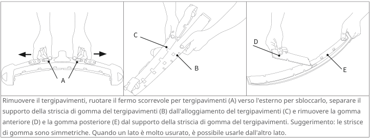
> *Descrizione della figura (IA):* Il fermo scorrevole per tergipavimenti (A) deve essere ruotato verso l'esterno per sbloccarlo. Il supporto della striscia di gomma del tergipavimenti (B) si separa dall'alloggiamento del tergipavimenti (C). La gomma anteriore (D) e la gomma posteriore (E) vengono rimosse dal supporto della striscia di gomma. Le strisce di gomma sono simmetriche e possono essere usate dall'altro lato quando un lato è molto usurato.
*Etichette:*

- Rimuovere il tergipavimenti, ruotare il fermo scorrevole per tergipavimenti (A) verso l'esterno per sbloccarlo, separare il
- supporto della striscia di gomma del tergipavimenti (B) dall'alloggiamento del tergipavimenti (C) e rimuovere la gomma
- anteriore (D) e la gomma posteriore (E) dal supporto della striscia di gomma del tergipavimenti. Suggerimento: le strisce
- di gomma sono simmetriche. Quando un lato è molto usurato, è possibile usarle dall'altro lato.

---

*Pagina 15 (pagina PDF 77, sinistra)*

- Installazione delle strisce di gomma

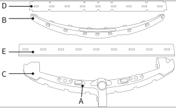
> *Descrizione della figura (IA):* La figura mostra le posizioni dei componenti del supporto della striscia di gomma del tergipavimenti. Il punto A indica il fermo scorrevole da ruotare verso l'esterno per bloccare il supporto nell'alloggiamento. I punti B, C e D indicano parti della struttura del supporto o della striscia di gomma anteriore. Il punto E indica la striscia di gomma posteriore, leggermente più lunga di quella anteriore.

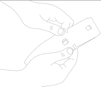
> *Descrizione della figura (IA):* La figura mostra come installare la striscia di gomma del tergipavimenti. Le etichette A e B indicano i fermi scorrevoli da ruotare per bloccare il supporto. Le etichette C e D mostrano le posizioni della gomma anteriore e posteriore. L'etichetta E indica la striscia di gomma del tergipavimenti.
Quando si installa la striscia di gomma, assicurarsi che un lato della gomma si allinei al bordo superiore del supporto La gomma anteriore (D) è leggermente più corta della della striscia di gomma del tergipavimenti e premere per gomma posteriore (E). Assicurarsi di distinguere tra fissarla in posizione. Allungare l'altro lato della gomma anteriore e posteriore durante l'installazione. e fare combaciare il foro della striscia al gancio a scatto dell'alloggiamento. Controllare che la striscia sia piatta e assicurarsi che non si restringa.

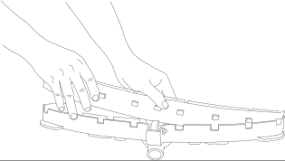
> *Descrizione della figura (IA):* Le mani mostrano come inserire e fissare la striscia di gomma del tergipavimenti nell'alloggiamento. Il fermo scorrevole (A) deve essere ruotato verso l'esterno per bloccare il supporto della striscia di gomma. La striscia di gomma anteriore (D) è leggermente più corta rispetto a quella posteriore (E). È importante allineare un lato della gomma al bordo superiore del supporto durante l'installazione.
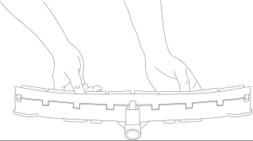
> *Descrizione della figura (IA):* Le mani mostrano come allineare e premere le strisce di gomma (D ed E) sul supporto del tergipavimenti. Il fermo scorrevole (A) deve essere ruotato verso l'esterno per bloccare il supporto in posizione. La figura illustra la corretta orientazione delle strisce di gomma anteriore e posteriore durante l'installazione.
Quando si monta il supporto della striscia di gomma del tergipavimenti sull'alloggiamento del tergipavimenti, premere e spingere un lato del supporto per fissarlo nell'alloggiamento del tergipavimenti, poi premere entrambi i lati in modo uniforme finché non è saldamente in posizione. Ruotare il fermo scorrevole per tergipavimenti (A) verso l'esterno per bloccare il supporto della striscia di gomma del tergipavimenti.

---

*Pagina 16 (pagina PDF 77, destra)*

# 7 Risoluzione dei problemi

| Problema | Causa e soluzione - Causa | Causa e soluzione - Soluzione |
|---|---|---|
| La macchina non si accende | Batteria non inserita | Inserire la batteria |
| La macchina non si accende | Batteria posizionata in modo errato | Rimuovere e rimontare la batteria |
| La macchina non si accende | Batteria scarica | Caricare la batteria |
| La macchina non si accende | Batteria non attivata | Toccare il pulsante del display di accensione per attivare la batteria |
| Scarso recupero dell'acqua | Il tergipavimenti è sollevato | Abbassare il tergipavimenti |
| Scarso recupero dell'acqua | Lame in gomma del tergipavimenti usurate | Sostituire le lame in gomma |
| Scarso recupero dell'acqua | Tergipavimenti bloccato | Controllare e rimuovere l'ostruzione, assicurarsi che il tergipavimenti si adatti al pavimento |
| Scarso recupero dell'acqua | Il tergipavimenti non si collega bene al tubo di aspirazione per tergipavimenti | Reinstallare |
| Scarso recupero dell'acqua | Tubo di aspirazione bloccato | Controllare e rimuovere l'ostruzione |
| Scarso recupero dell'acqua | Serbatoio di recupero non installato correttamente | Reinstallare |
| Scarso recupero dell'acqua | La parte superiore del serbatoio di recupero non è chiusa bene | Chiuderla saldamente |
| Scarso recupero dell'acqua | Filtro del serbatoio di recupero ostruito | Pulire il filtro del serbatoio di recupero |
| Scarso recupero dell'acqua | Filtro del motore di aspirazione ostruito | Pulire il filtro del motore di aspirazione |
| Flusso d'acqua insufficiente/assente | Serbatoio della soluzione vuoto | Riempire il serbatoio della soluzione |
| Flusso d'acqua insufficiente/assente | Serbatoio della soluzione non in posizione | Reinstallare |
| Flusso d'acqua insufficiente/assente | Filtro bloccato | Pulire l'uscita del serbatoio della soluzione |
| Flusso d'acqua insufficiente/assente | Sporcizia nel serbatoio della soluzione | Pulire il serbatoio della soluzione |
| Flusso d'acqua insufficiente/assente | La modalità utilizzata è senza acqua o ha un flusso d'acqua basso | Scegliere una modalità come: Pulizia intensa, Normale, ECO, Basso residuo o Ammollo |

# 8 Assistenza post-vendita

Shenzhen Pudu Technology Co., Ltd. garantisce di soddisfare le seguenti condizioni entro il periodo di garanzia effettivo del prodotto (il periodo di garanzia può variare in base alle diverse parti del prodotto e alla regione). La garanzia gratuita è valida alle seguenti condizioni:

- Il periodo di garanzia effettivo è valido solo per i dispositivi acquistati da distributori autorizzati.
- Il prodotto acquistato in autonomia viene utilizzato normalmente durante il periodo di garanzia specificato e non sussistono problemi di qualità causati dall'utente.
- Il prodotto non è stato smontato senza autorizzazione, non è stato modificato o installato secondo istruzioni non ufficiali, e altri guasti non causati dall'utente.
- Il numero di serie del prodotto, l'etichetta di fabbrica e altri simboli non presentano segni di strappo o alterazione.
- L'utente è in grado di fornire una prova d'acquisto o documenti di acquisto validi.

In caso di dubbi, contattare il servizio clienti.

E-mail: techservice@pudutech.com.
