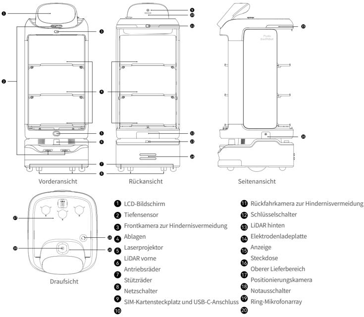
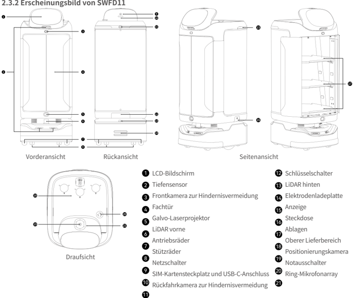
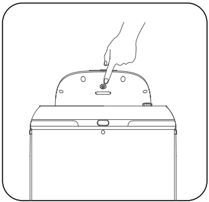
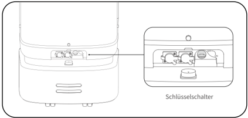
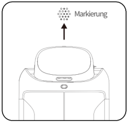

*Seite 30 (PDF-Seite 17, rechts)*

Copyright © 2023 Shenzhen Pudu Technology Co., Ltd. Alle Rechte vorbehalten.

Ohne die ausdrückliche schriftliche Zustimmung von Shenzhen Pudu Technology Co., Ltd. dürfen weder Organisationen noch Einzelpersonen den Inhalt dieses Benutzerhandbuchs ganz oder teilweise vervielfältigen, kopieren, transkribieren oder übersetzen oder dieses Benutzerhandbuch auf irgendeine Weise gewinnbringend verbreiten (elektronisch oder durch Fotokopieren, Aufzeichnen usw.). Die technischen Produktdaten und Informationen in diesem Benutzerhandbuch dienen nur als Referenz und können ohne weitere Ankündigung geändert werden. Sofern nicht anders angegeben, ist dieses Benutzerhandbuch nur als Bedienungsanleitung zu verstehen und stellt keine Zusicherung irgendeiner Art dar.

# 1. Sicherheitshinweise

## 1.1 Elektrische Anforderungen

- Es ist streng verboten, andere Ladegeräte als das Original-Ladegerät zum Aufladen des Roboters zu verwenden. Wenn das Ladegerät defekt ist, ersetzen Sie es so bald wie möglich.
- Laden Sie den Roboter auf, sobald weniger als 20 % verbleibende Leistung vorhanden sind. Der Betrieb bei niedrigem Akkustand über einen längeren Zeitraum verkürzt die Lebensdauer des Akkus.
- Stellen Sie sicher, dass die Versorgungsspannung dem Spannungsbereich am Ladegerät entspricht, da sonst das Ladegerät beschädigt werden kann.
- Wenn Sie das Ladegerät zum Aufladen des Roboters verwenden, stecken Sie es in den Ladeanschluss und vergewissern Sie sich, dass der Bügel einrastet (mit einem Klickgeräusch), um eine Überhitzung in der Nähe des Ladeanschlusses zu vermeiden, die zu Verbrennungen, Schäden am Produkt und anderen Problemen führen kann.

## 1.2 Nutzungsanforderungen

- Während der Roboter läuft, darf die Kamera nicht blockiert werden, um eine unkontrollierte Bewegung des Roboters zu vermeiden. Halten Sie in diesem Fall die aktuelle Aufgabe an, und setzen Sie den Roboter zurück auf die richtige Route, bevor er seinen Weg wieder aufnimmt.
- Es dürfen keine Reinigungs- oder Wartungsarbeiten durchgeführt werden, solange der Roboter eingeschaltet ist.
- Stellen Sie keine offenen Flammen oder brennbare bzw. explosive Gegenstände auf die Ablagen des Roboters.
- Nehmen Sie kein Geschirr vom Roboter und stellen Sie kein Geschirr darauf ab, während sich der Roboter bewegt, um Schäden am Geschirr oder Verletzungen durch versehentliche Kollisionen zu vermeiden.
- Schieben oder tragen Sie den Roboter nicht, während er sich bewegt, um eine unkontrollierte Bewegung zu verhindern.
- Der Roboter darf nur von geschultem Fachpersonal zerlegt oder repariert werden. Im Falle einer Störung des Roboters wenden Sie sich bitte sofort an einen Techniker des technischen Kundendienstes von Shenzhen Pudu Technology Co, Ltd.
- Beachten Sie bei der Umpositionierung des Roboters die gesetzlich vorgeschriebenen Anforderungen an das maximal zulässige Gewicht pro Person. Stellen Sie sicher, dass sich der Roboter während der Umpositionierung in einer aufrechten Position befindet. Der Roboter darf nicht an den Ablagen oder dem Fach angehoben werden.

## 1.3 Umgebungsbedingungen

- Verwenden oder laden Sie den Roboter nicht in gefährlichen Umgebungen mit hohen Temperaturen, hohem Druck oder Brand- und Explosionsgefahr, um Verletzungen oder Schäden am Produkt zu vermeiden.
- Verwenden Sie den Roboter nicht in feuchter Umgebung oder auf einem Untergrund, auf dem sich Flüssigkeiten oder zähflüssige Substanzen befinden, um Schäden am Roboter zu vermeiden.
- Verwenden Sie den Roboter nicht an Orten, an denen drahtlose Geräte ausdrücklich verboten sind, da dies andere elektronische Geräte stören oder andere Gefahren verursachen kann.
- Entsorgen Sie den Roboter und dessen Zubehör nicht im normalen Hausmüll. Bitte halten Sie sich an die örtlichen Vorschriften zur Entsorgung des Roboters und von dessen Zubehör und unterstützen Sie das Recycling.

---

*Seite 31 (PDF-Seite 18, links)*

# 2. Produktkomponenten

## 2.1 Einführung

Als Lieferroboter für den Innenbereich unterstützt SwiftBot visuelle LiDAR-Standort- und Navigationstechnologien und ist mit völlig neuen interaktiven Funktionen ausgestattet, darunter automatisches Öffnen und Schließen von Türen, Sprachin - teraktion und Laserprojektion sowie Algorithmen für Spitzenzeiten, wodurch er in verschiedenen Szenarien effizient, sicher und flexibel eingesetzt werden kann. SwiftBot verfügt außerdem über eine große Auswahl an Erweiterungsschnittstellen, die 4G, WLAN, Bluetooth, USB-C und andere Kommunikationsprotokolle unterstützen, sodass er mit verschiedenen Peripheriegeräten verbunden werden kann, um mehr Anforderungen zu erfüllen.

Um den geschäftlichen Anforderungen in verschiedenen Szenarien gerecht zu werden, bietet SwiftBot eine Vielzahl von Modi zur Auswahl, darunter Speisenlieferungsmodus, Serviermodus, Rundfahrmodus, Führungsmodus, Geburtstagsmodus und Interaktionsmodus.

## 2.2 Lieferumfang

Roboter×1, Swiftbot-Benutzerhandbuch×1, Qualitätsbescheinigung×1, Ladegerät×1, Startschlüssel×1, Marker×1 .

## 2.3 Erscheinungsbild und Komponenten

### 2.3.1 Erscheinungsbild von SWFD01

> *Bildbeschreibung (KI):* Die Abbildung zeigt die Vorder-, Rück-, Seiten- und Draufsicht des Lieferroboters SwiftBot mit nummerierten Komponenten. Die Beschriftungen erklären die Position und Bedeutung von Sensoren, Kameras, Ladeplatten und Schnittstellen am Gerät. Durch die verschiedenen Ansichten wird klar, wo sich wichtige Elemente wie der Laserprojektor, die Mikrofonanordnung oder die Notausschalter befinden.

*Beschriftungen:*

- **1** LCD-Bildschirm
- **2** Tiefensensor
- **3** Frontkamera zur Hindernisvermeidung
- **4** Ablagen
- **5** Laserprojektor
- **6** LiDAR vorne
- **7** Antriebsräder
- **8** Stützräder
- **9** Netzschalter
- **10** SIM-Kartensteckplatz und USB-C-Anschluss
- **11** Rückfahrkamera zur Hindernisvermeidung
- **12** Schlüsselschalter
- **13** LiDAR hinten
- **14** Elektrodenladeplatte
- **15** Anzeige
- **16** Steckdose
- **17** Oberer Lieferbereich
- **18** Positionierungskamera
- **19** Notausschalter
- **20** Ring-Mikrofonarray

---

*Seite 32 (PDF-Seite 18, rechts)*

> *Bildbeschreibung (KI):* Die Draufsicht verdeutlicht die Positionierung von Sensoren wie dem Ring-Mikrofonarray (20) und der Positionierungskamera (18) auf der Oberseite des Geräts.

*Beschriftungen:*

- **1** LCD-Bildschirm
- **2** Tiefensensor
- **3** Frontkamera zur Hindernisvermeidung
- **4** Fachtür
- **5** Galvo-Laserprojektor
- **6** LiDAR vorne
- **7** Antriebsräder
- **8** Stützräder
- **9** Netzschalter
- **10** SIM-Kartensteckplatz und USB-C-Anschluss
- **11** Rückfahrkamera zur Hindernisvermeidung
- **12** Schlüsselschalter
- **13** LiDAR hinten
- **14** Elektrodenladeplatte
- **15** Anzeige
- **16** Steckdose
- **17** Ablagen
- **18** Oberer Lieferbereich
- **19** Positionierungskamera
- **20** Notausschalter
- **21** Ring-Mikrofonarray

### 2.3.2 Erscheinungsbild von SWFD11

## 2.4 Technische Daten

| Produktparameter | Beschreibung |
|---|---|
| Produktmodell | SWFD01, SWFD11 |
| Betriebsspannung | 23–29,4 V Gleichstrom |
| Leistungsaufnahme | 100–240 V Wechselstrom, 50/60 Hz |
| Ausgangsleistung | 29,4 V/8 A |
| Akkuleistung | 20 Ah |
| Ladezeit | 4,5 Std. |
| Akkulaufzeit | 10 – 24 Std. |
| Fahrgeschwindigkeit | 0,5–1,2 m/s (einstellbar) |
| Navigationsmethode | Laser- und visuelle integrierte SLAM-Positionierung |
| Automatisches Öffnen und Schließen von Türen | SWFD01: Nicht unterstützt; SWFD11: Unterstützt |
| Minimale Durchfahrbreite | 80 cm |
| Maximal überwindbare Höhe | 20 mm |
| Maximaler Steigwinkel | 5° |
| Größe der Ablagen | 502 mm×433 mm |
| Anzahl der Ablagen | 3 |

---

*Seite 33 (PDF-Seite 19, links)*

| Produktparameter | Beschreibung |
|---|---|
| Abstand zwischen Ablagenebenen | Von oben nach unten: 228 mm/229 mm/236 mm |
| Tragfähigkeit der Ablagen | 14 kg/Ebene |
| Allgemeines Material | ABS und PC |
| Gesamtgewicht | SWFD01: 49 kg; SWFD11: 59 kg |
| Gesamtabmessung | 593 mm×488 mm×1288 mm |
| Betriebssystem | Android |
| Mikrofon | Rundes 6-Mikrofonarray |
| Lautsprecherleistung | 10 W×2 Stereolautsprecher |
| Betriebsumgebung | Temperatur: 0–40 ℃ ; Luftfeuchtigkeit: ≤ 85 % RH |
| Aufbewahrungsumgebung | Temperatur: -40–65 ℃ ; Luftfeuchtigkeit: ≤ 85 % RH |
| Betriebshöhe | < 2000 m |
| Untergrundanforderungen | Innenräume mit flachen, glatten Oberflächen |
| IP-Schutzart | IPX2 |
| Frequenzbandbereich | WLAN: 2.4G Wi-Fi: 2400–2483.5 MHz 5.1G Wi-Fi: 5150–5250 MHz 5.8G Wi-Fi: 5725–5850 MHz |
| Frequenzbandbereich | Bluetooth: 2400–2483.5 MHz |
| Frequenzbandbereich | 4G LTE-FDD: B1/B3/B7/B8/B20/B28 |
| Frequenzbandbereich | 4G LTE-TDD: B34/B38/B40 |
| Max. Abstrahlleistung | WLAN: 2.4G Wi-Fi: ≤ 20 dBm(EIRP) 5.1G Wi-Fi: ≤ 23 dBm(EIRP) 5.8G Wi-Fi: ≤ 33 dBm(EIRP) |
| Max. Abstrahlleistung | Bluetooth: ≤ 20 dBm(EIRP) |
| Max. Abstrahlleistung | 4G LTE-FDD: B1: 23,77 dBm; B3: 23,51 dBm; B7: 23,7 dBm; B8: 23,22 dBm; B20: 22,97 dBm; B28: 23,05 dBm |
| Max. Abstrahlleistung | 4G LTE-TDD: B34: 23,73 dBm; B38: 23,97 dBm; B40: 23,45 dBm |

# 3. Verwendung des Produkts

## Einschalten：

Bewegen Sie den Roboter zum Startpunkt. Halten Sie den Netzschalter eine Sekunde lang gedrückt. Die Leuchtleiste des Roboters wird blau und zeigt damit an, dass der Roboter erfolgreich eingeschaltet wurde.

> *Bildbeschreibung (KI):* Die Abbildung zeigt die Position des oberen Knopfes oder Schiebers auf dem Gerät. Der gezeigte Bereich ist der obere Teil des Geräts mit einer Bedienelement-Fläche.

---

*Seite 34 (PDF-Seite 19, rechts)*

Stellen Sie sicher, dass sich der Schlüsselschalter in der Stellung "ON" befindet, bevor Sie den Roboter starten.

> *Bildbeschreibung (KI):* Der Pfeil zeigt auf den Schlüsselschalter am unteren Rand des Roboters. Die Nahaufnahme zeigt die Position des Schlüsselschalters im Detail. Der Text 'Schlüsselschalter' identifiziert die Funktion des dargestellten Elements.

- Startpunkt für LiDAR-Standortbestimmung und -Navigation (Stellen Sie sicher, dass der Roboter am Startpunkt korrekt positioniert und ausgerichtet ist.)
- Startpunkt für visuelle Standortbestimmung und Navigation (direkt unter der Markierung)

> *Bildbeschreibung (KI):* Die Markierung zeigt den genauen Standort für die visuelle Standortbestimmung und Navigation des Roboters. Der Startpunkt für die visuelle Standortbestimmung befindet sich direkt unter der Markierung.

## Ausschalten：

Halten Sie den Netzschalter drei Sekunden lang gedrückt. Auf dem Bildschirm wird das Symbol für "Ausschalten" angezeigt. Tippen Sie auf "Ausschalten", wonach sich die untere Leuchtleiste und der Bildschirm ausschalten. Damit wird angezeigt, dass der Roboter erfolgreich ausgeschaltet wurde.

## Anhalten:

Während sich der Roboter bewegt, kann die aktuelle Aufgabe durch Tippen auf den Bildschirm unterbrochen werden. Durch erneutes Tippen auf den Bildschirm wird die aktuelle Aufgabe fortgesetzt.

## Notaus:

Drücken Sie im Notfall während der Fortbewegung des Roboters den Notausschalter, um den Roboter anzuhalten. Drehen Sie den Notausschalter im Uhrzeigersinn, und befolgen Sie die Anweisungen auf dem Bildschirm, um den Betrieb des Roboters wieder aufzunehmen.

## 3.1 Aufgabenszenarien

Um verschiedenen Geschäftsszenarien gerecht zu werden, bietet der Roboter eine Vielzahl von Modi zur Auswahl, darunter Speisenlieferungsmodus, Serviermodus, Rundfahrmodus, Führungsmodus, Geburtstagsmodus und Interaktionsmodus. Der Benutzer kann den gewünschten Modus je nach Anforderungen auswählen.

* Detaillierte Anweisungen zur Verwendung des Roboters finden Sie in der SwiftBot-Bedienungsanleitung.

---

*Seite 35 (PDF-Seite 20, links)*

# 4. Wartung und Instandhaltung

| Zu wartendes Teil | Roboterstatus | Prüffrequenz | Wartungsmethode |
|---|---|---|---|
| Ablagen, Antriebsräder und Stützräder | Ausgeschaltet | Einmal pro Woche | Wischen Sie die Oberfläche mit einem sauberen Tuch ab. |
| Positionierungskamera, Tiefensensor, Frontkamera zur Hindernisvermeidung, Rückfahrkamera zur Hindernisvermeidung, LiDAR vorne, LiDAR hinten und Galvo-Laserprojektor | Ausgeschaltet |  | Einmal pro Woche Verwenden Sie zur Reinigung ein sauberes Tuch oder Linsenreinigungswerkzeuge. Bei plötzlicher Verschmutzung müssen Sie sofort handeln, um zu vermeiden, dass die Sensoren blockiert werden, was zu einem fehlerhaften Betrieb des Roboters führen kann. |
| Robotergehäuse | Ausgeschaltet | Einmal pro Monat | Wischen Sie die Oberfläche mit einem sauberen Tuch ab. |

# 5. Kundendienst

Shenzhen Pudu Technology Co., Ltd. verpflichtet sich, während der Garantiezeit des Produkts kostenlose Garantieleistungen zu erbringen (für verschiedene Teile des Produkts können unterschiedliche Garantiezeiten gelten). Wenn die Garantiezeit abgelaufen ist oder eine Situation eintritt, in der die kostenlose Produktgarantie nicht anwendbar ist, gelten die üblichen Gebühren. Kunden können sich an die Kundendienst-Hotline wenden, um mehr über die Kundendienstrichtlinien zu erfahren oder ein Produkt warten zu lassen. Weitere Informationen zu den Kundendienstrichtlinien erhalten Kunden in der SwiftBot-Bedienungsanleitung.

Feedback-Methoden:

：+86 755-86952935

：techservice@pudutech.com

# 6. Compliance-Informationen

## 6.1 Informationen zur Entsorgung und zum Recycling

Die Richtlinie über Elektro- und Elektronik-Altgeräte (WEEE) zielt darauf ab, die Auswirkungen von Elektro- und Elektronikgeräten auf die Umwelt zu minimieren, indem die Wiederverwendung und das Recycling gefördert und die Menge der zu entsorgenden Elektro- und Elektronik-Altgeräte reduziert wird. Das Symbol auf diesem Produkt oder seiner Verpackung bedeutet, dass dieses Produkt am Ende seiner Lebensdauer getrennt vom normalen Hausmüll entsorgt werden muss. Beachten Sie, dass Sie dafür verantwortlich sind, elektronische Geräte in Recyclingzentren zu entsorgen, um natürliche Ressourcen zu schonen. In jedem Land gibt es eigene Sammelstellen für das Recycling von Elektro- und Elektronikgeräten. Informationen zum Recycling-Rückgabebereich erhalten Sie bei der zuständigen Abfallentsorgungsbehörde für elektrische und elektronische Geräte, bei der örtlichen Stadtverwaltung oder bei der Müllentsorgungsstelle Ihres Standorts.

Bevor Elektro- und Elektronikgeräte (EEE) in den Wertstoffkreislauf oder in Abfallsammelstellen gegeben werden, muss der Endnutzer von Geräten, die Batterien und/oder Akkumulatoren enthalten, diese Batterien und Akkumulatoren zur getrennten Sammlung entfernen.

*Ausführliche Wartungsanweisungen finden Sie in der SwiftBot-Bedienungsanleitung.
