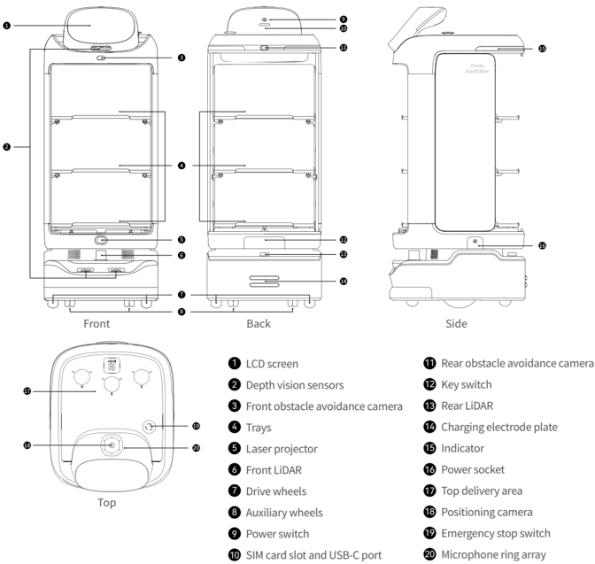
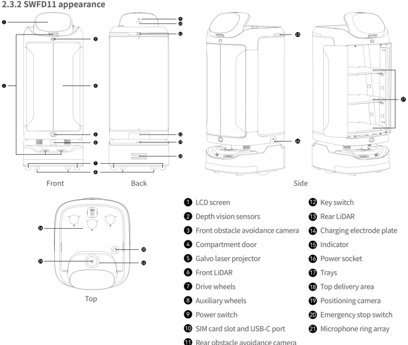
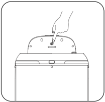
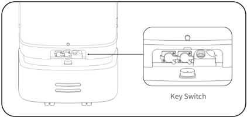
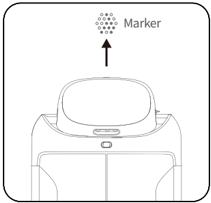

*Page 1 (PDF page 3, left)*

Copyright © 2023 Shenzhen Pudu Technology Co., Ltd. All rights reserved.

No organization or individual shall imitate, copy, transcribe or translate the contents of this user manual, in part or in full, without the express written consent of Shenzhen Pudu Technology Co., Ltd., or distribute this user manual for profit in any way (electronically or via photocopying, recording, etc.). The product specifications and information provided in this user manual are for reference only and are subject to change without further notice. Unless otherwise specified, this user manual is only intended as a user guide, and no representation shall be deemed as a warranty of any kind.

# 1. Safety instructions

## 1.1 Electrical requirement

- It is strictly prohibited to use chargers other than the original charger to charge the robot. If the charger is found to be faulty, please replace it as soon as possible.
- Be sure to charge the robot as soon as it has less than 20% power remaining. Working at low battery levels for long periods will shorten the battery's service life.
- Make sure that the power supply voltage complies with the voltage range on the charger, otherwise the charger may be damaged.
- When using the charger to charge the robot, insert the charger into the charging port and make sure that the clip fits into place (with a clicking sound), to prevent overheating near the charging port that results in burns, damage to the product and other problems.

## 1.2 Use requirements

- While the robot is moving, do not block its camera, to prevent the robot from walking abnormally. If this happens, please pause the current task and push the robot back to the correct route before letting it proceed.
- Cleaning or maintenance work is prohibited while the robot is powered on.
- Do not place cookers with naked flames or flammable or explosive items on the robot's trays.
- Do not pick up or place any dishes while the robot is moving, to avoid dish losses or personal injury caused by accidental collisions.
- Do not push or carry the robot while it is moving, to prevent it from walking abnormally.
- The robot must not be disassembled or repaired by anyone other than trained professionals. In case of any fault with the robot, please contact a technical support engineer from Shenzhen Pudu Technology Co., Ltd. immediately.
- When moving the robot, please observe the requirements on the maximum allowed weight for a single person stipulated by local laws or regulations. While the robot is being moved, please be sure to always keep it in an upright position. It is prohibited to lift the robot by the trays or the compartment.

## 1.3 Environmental requirements

- Do not use or charge the robot in dangerous environments with high temperature, high pressure, or risks of flames or explosions, so as to avoid personal injury or damage to the product.
- Do not use the robot in a humid environment or in the presence of liquid or viscous substances on the ground, so as to avoid damage to the robot.
- Do not use the robot in locations where wireless devices are explicitly prohibited, as this may interfere with other electronic devices or cause other hazards.
- Do not dispose of the robot and its accessories as ordinary domestic waste. Please comply with local regulations on the disposal of the robot and its accessories and support recycling.

---

*Page 2 (PDF page 3, right)*

# 2. Product components

## 2.1 Introduction

As an indoor delivery robot, SwiftBot supports visual-LiDAR fusion location and navigation technologies and comes equipped with all-new interactive features, including automatic door opening and closing, voice interaction, and laser projection, as well as peak-period algorithms, making it suitable to work efficiently, safely and flexibly in various scenarios. SwiftBot also has a wide range of expansion interfaces that support 4G, Wi-Fi, Bluetooth, USB-C and other communication protocols, allowing it to connect to different peripherals to serve more needs.

To meet business demands in different scenarios, SwiftBot offers a variety of modes for users to choose from, including food delivery mode, delivery mode, cruise mode, guiding mode, birthday mode and interactive mode.

## 2.2 Shipping list

Robot×1, SwiftBot User Manual×1, Quality Certificate×1, charger×1, power key×1, marker×1.

## 2.3 Appearance and Components

### 2.3.1 SWFD01 appearance

> *Figure description (AI):* The figure shows labeled views (Front, Back, Side, Top) of the SwiftBot robot with numbered parts corresponding to a legend. Each number points to a specific component such as LCD screen, drive wheels, charging electrode plate, or emergency stop switch. The diagram helps users locate physical ports and buttons like SIM card slot, USB-C port, power socket, and key switch. Indicator lights and sensor positions (e.g., depth vision sensors, LiDAR, cameras) are visually mapped for spatial understanding.

*Labels:*

- **1** LCD screen
- **2** Depth vision sensors
- **3** Front obstacle avoidance camera
- **4** Trays
- **5** Laser projector
- **6** Front LiDAR
- **7** Drive wheels
- **8** Auxiliary wheels
- **9** Power switch
- **10** SIM card slot and USB-C port
- **11** Rear obstacle avoidance camera
- **12** Key switch
- **13** Rear LiDAR
- **14** Charging electrode plate
- **15** Indicator
- **16** Power socket
- **17** Top delivery area
- **18** Positioning camera
- **19** Emergency stop switch
- **20** Microphone ring array

- SIM card slot and USB-C port 10

- Rear obstacle avoidance camera 11

- Key switch 12

- Rear LiDAR 13

- Charging electrode plate 14

- Indicator 15

- Power socket 16

- Top delivery area 17

- Positioning camera 18

- Emergency stop switch 19

- Microphone ring array 20

---

*Page 3 (PDF page 4, left)*

> *Figure description (AI):* The figure shows labeled parts of the SWFD11 robot across four views: Front, Back, Side, and Top. Each numbered label corresponds to a specific component such as LCD screen, LiDAR, wheels, or ports. The diagram helps locate physical features like the power switch, SIM card slot, USB-C port, and emergency stop switch. It also identifies internal components visible in the Side view, including trays and positioning camera.

*Labels:*

- **1** LCD screen
- **2** Depth vision sensors
- **3** Front obstacle avoidance camera
- **4** Compartment door
- **5** Galvo laser projector
- **6** Front LiDAR
- **7** Drive wheels
- **8** Auxiliary wheels
- **9** Power switch
- **10** SIM card slot and USB-C port
- **11** Rear obstacle avoidance camera
- **12** Key switch
- **13** Rear LiDAR
- **14** Charging electrode plate
- **15** Indicator
- **16** Power socket
- **17** Trays
- **18** Top delivery area
- **19** Positioning camera
- **20** Emergency stop switch
- **21** Microphone ring array

### 2.3.2 SWFD11 appearance

## 2.4 Specifications

| Feature | Description |
|---|---|
| Product model | SWFD01, SWFD11 |
| Operating voltage | DC 23–29.4 V |
| Power input | AC 100–240 V, 50/60 Hz |
| Power output | 29.4 V, 8 A |
| Battery capacity | 20 Ah |
| Charging time | 4.5 h |
| Battery life | 10–24 h |
| Cruise speed | 0.5–1.2 m/s (adjustable) |
| Navigation method | Laser and visual integrated SLAM positioning |
| Automatic door opening and closing | SWFD01: Not supported；SWFD11: Supported |
| Minimum passing width | 80 cm |
| Maximum surmountable height | 20 mm |
| Maximum climbing angle | 5° |
| Tray size | 502 mm×433 mm |
| Number of trays | 3 |

---

*Page 4 (PDF page 4, right)*

| Feature | Description |
|---|---|
| Height between tray levels | From top to bottom: 228 mm/229 mm/236 mm |
| Tray supporting capacity | 14 kg/level |
| Overall material | ABS and PC |
| Overall weight | SWFD01: 49 kg; SWFD11: 59 kg |
| Overall dimensions | 593 mm×488 mm×1288 mm |
| Screen specifications | 10.1" LCD display |
| Operating system | Android |
| Microphone | 6-mic circular array kit |
| Speaker power | 10 W×2 stereo speaker |
| Working environment | Temperature: 0–40 ℃ ; Humidity: ≤ 85% RH |
| Storage environment | Temperature: -40–65 ℃ ; Humidity: ≤ 85% RH |
| Operating altitude | < 2000 m |
| Road surface requirements | Indoor environment with flat, smooth surfaces |
| IP rating | IPX2 |
| Frequency band range | Wi-Fi: 2.4G Wi-Fi: 2400–2483.5 MHz 5.1G Wi-Fi: 5150–5250 MHz 5.8G Wi-Fi: 5725–5850 MHz |
| Frequency band range | Bluetooth: 2400–2483.5 MHz |
| Frequency band range | 4G LTE-FDD: B1/B3/B7/B8/B20/B28 |
| Frequency band range | 4G LTE-TDD: B34/B38/B40 |
| Max. transmit power | Wi-Fi: 2.4G Wi-Fi: ≤ 20 dBm(EIRP) 5.1G Wi-Fi: ≤ 23 dBm(EIRP) 5.8G Wi-Fi: ≤ 33 dBm(EIRP) |
| Max. transmit power | Bluetooth: ≤ 20 dBm(EIRP) |
| Max. transmit power | 4G LTE-FDD: B1: 23,77 dBm; B3: 23,51 dBm; B7: 23,7 dBm; B8: 23,22 dBm; B20: 22,97 dBm; B28: 23,05 dBm |
| Max. transmit power | 4G LTE-TDD: B34: 23,73 dBm; B38: 23,97 dBm; B40: 23,45 dBm |

# 3. Using the Product

Power-on：

Move the robot to the startup location. Press and hold the power switch for 1 second, and the robot's light strip will turn blue, indicating that the robot has been successfully powered on.

> *Figure description (AI):* The figure shows a hand pressing down on the top surface of the device. This action demonstrates how to interact with the upper part of the unit.

---

*Page 5 (PDF page 5, left)*

Make sure that the key switch has been turned to the "ON" position before starting up the robot.

> *Figure description (AI):* The figure shows the location of the key switch on the robot. The key switch is used to turn the robot on or off. The key switch has an indicator light that shows whether the robot is on or off.

- LiDAR location and navigation startup location (make sure that the robot is correctly positioned and oriented in the startup location)
- Visual location and navigation startup location (directly below the marker)

> *Figure description (AI):* The arrow points upward from the robot to a marker icon labeled 'Marker'. This indicates that for visual location and navigation startup, the robot must be positioned directly below the marker. The figure visually reinforces the requirement to align the robot with the marker before starting up in visual mode. No additional labels or indicators are shown beyond the marker icon and directional arrow.

## Power-off：

Press and hold the power switch for 3 seconds and a "Power off" icon will pop up on the screen. Tap "Power off" and the bottom light strip and screen will be turned off, indicating that the robot has been successfully powered off.

## Pause:

While the robot is moving, the current task can be paused by tapping the screen. Tapping the screen again will resume the current task.

## Emergency stop:

In case of an emergency while the robot is moving, press the emergency stop switch to stop the robot. Turn the emergency stop switch clockwise and follow the on-screen prompts to resume the robot's operation.

## 3.1 Task Scenarios

To cater to different business scenarios, the robot offers a variety of modes to choose from, including food delivery mode, delivery mode, cruise mode, guiding mode, birthday mode and interactive mode. The user can choose the desired mode according to their actual needs.

* For detailed instructions on using the robot, please refer to the SwiftBot User Guide .

---

*Page 6 (PDF page 5, right)*

# 4. Maintenance and Servicing

| Part to maintain | Robot status | Checking frequency | Maintenance method |
|---|---|---|---|
| Trays, drive wheels and auxiliary wheels | Powered off | One week | Please wipe the surface with a clean cloth. |
| Positioning camera, depth vision sensors, front obstacle avoidance camera, rear obstacle avoidance camera, front LiDAR, rear LiDAR and Galvo laser projector | Powered off | One week | Please use a clean cloth or lens cleaning tools to clean. In case of sudden contamination, be sure to handle immediately to avoid blocked sensors, which may lead to abnormal operation of the robot. |
| Robot body | Powered off | One month | Please wipe the surface with a clean cloth. |

# 5. After-sales service

Shenzhen Pudu Technology Co., Ltd. undertakes to provide free product warranty services during the product's warranty period (different parts of the product may have different warranty periods). If the warranty period has expired or in case of any situation where free product warranty is not applicable, the standard fees will apply. Customers can contact the aftersales service hotline to learn more about the after-sales service policy and for product maintenance, or refer to the SwiftBot User Guide for detailed after-sales service policies.

Feedback methods:

：+86 755-86952935

：techservice@pudutech.com

# 6. Compliance information

## 6.1 Disposal and recycling information

The Waste Electrical and Electronic Equipment (WEEE) Directive aims to minimize the impact of electrical and electronic goods on the environment, by increasing re-use and recycling and by reducing the amount of WEEE going to landfill. The symbol on this product or its packaging signifies that this product must be disposed separately from ordinary household wastes at its end of life. Be aware that this is your responsibility to dispose of electronic equipment at recycling centers in order to conserve natural resources. Each country should have its collection centers for electrical and electronic equipment recycling. For information about your recycling drop off area, please contact your related electrical and electronic equipment waste management authority, your local city office, or your house hold waste disposal service.

Before placing electrical and electronic equipment (EEE) in the waste collection stream or in waste collection facilities, the end user of equipment containing batteries and/or accumulators must remove those batteries and accumulators for separate collection.

*For detailed instructions on using the robot, please refer to theSwiftBot User Guide.

---

*Page 7 (PDF page 6, left)*

## 6.2 Federal Communications Commission compliance statement

The following information applies to Pudu robotic.

This equipment has been tested and found to comply with the limits for a Class B digital device, pursuant to part 15 of the FCC Rules. These limits are designed to provide reasonable protection against harmful interference in a residential installation. This equipment generates, uses and can radiate radio frequency energy and, if not installed and used in accordance with the instructions, may cause harmful interference to radio communications. However, there is no guarantee that interference will not occur in a particular installation. If this equipment does cause harmful interference to radio or television reception, which can be determined by turning the equipment off and on, the user is encouraged to try to correct the interference by one or more of the following measures:

- Reorient or relocate the receiving antenna.
- Increase the separation between the equipment and receiver.
- Connect the equipment into an outlet on a circuit different from that to which the receiver is connected.
- Consult the dealer or an experienced radio/TV technician for help.

This device complies with Part 15 of the FCC rules. Operation is subject to the following two conditions:

- This device may not cause harmful interference.
- This device must accept any interference received, including interference that may cause undesired operation.

## 6.3 Industry Canada compliance statement

This device complies with Industry Canada licence-exempt RSS standard(s). Operation is subject to the following two conditions:

- This device may not cause interference.
- This device must accept any interference, including interference that may cause undesired operation of the device.
