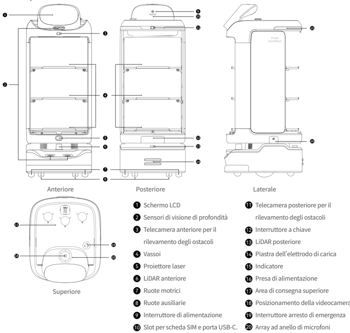
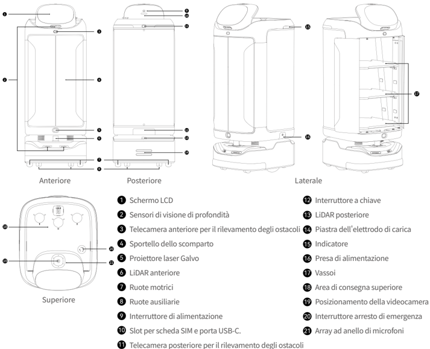
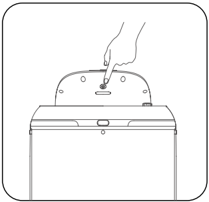
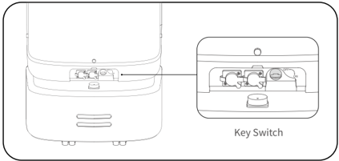
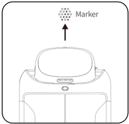

*Pagina 49 (pagina PDF 27, sinistra)*

Copyright © 2023 Shenzhen Pudu Technology Co., Ltd. Tutti i diritti riservati.

Nessuna organizzazione o persona fisica potrà imitare, copiare, trascrivere o tradurre, in parte o per intero, il contenuto del presente manuale d'uso senza l'esplicito consenso scritto di Shenzhen Pudu Technology Co., Ltd., o distribuire il presente manuale d'uso a scopo di lucro in qualsiasi modo (elettronicamente o mediante fotocopiatura, registrazione, ecc.). Le specifiche del prodotto e le informazioni fornite nel presente manuale d'uso sono riportate esclusivamente a titolo di riferimento e sono soggette a modifiche senza ulteriore avviso. Se non diversamente specificato, il presente manuale è da intendersi esclusivamente come guida per l'utente e nessuna dichiarazione è da considerarsi come garanzia di alcun tipo.

# 1. Istruzioni di sicurezza

## 1.1 Requisiti elettrici

- È severamente vietato utilizzare caricabatterie diversi da quelli originali per caricare il robot. Se il caricatore risulta danneggiato, sostituirlo tempestivamente.
- Assicurarsi di caricare il robot non appena la carica residua è inferiore al 20%. Il funzionamento con livelli della batteria bassi per lunghi periodi riduce la durata della batteria stessa.
- Assicurarsi che la tensione dell'alimentazione sia conforme alla gamma di tensione sul caricatore per evitare di danneggiarlo.
- Quando si utilizza il caricatore per caricare il robot, inserirlo nella porta di ricarica e assicurarsi che la clip sia insediata correttamente (con uno scatto), per evitare il surriscaldamento in prossimità della porta che provoca ustioni, danni al prodotto e altri problemi.

## 1.2 Requisiti d'uso

- Mentre il robot è in movimento, non bloccare la videocamera per evitare spostamenti anomali. Se ciò avviene, sospendere l'attività corrente e riportare il robot sul percorso corretto prima di farlo proseguire.
- È vietato eseguire interventi di pulizia o manutenzione quando il robot è acceso.
- Non collocare piastre con fiamme libere o oggetti infiammabili o esplosivi sui vassoi del robot.
- Non sollevare o posizionare i piatti mentre il robot è in movimento per evitare fuoriuscite di alimenti o lesioni personali causate da collisioni accidentali.
- Non spingere o trasportare il robot mentre è in movimento per evitare spostamenti anomali.
- Il robot deve essere smontato o riparato esclusivamente da professionisti qualificati. In caso di guasti al robot, contattare immediatamente un esperto del supporto tecnico di Shenzhen Pudu Technology Co., Ltd.
- Quando si sposta il robot, rispettare i requisiti sul peso massimo consentito per una sola persona, come stabilito dalle leggi o dalle normative locali. Mentre il robot è in movimento, assicurarsi di tenerlo sempre in posizione verticale. È vietato sollevare il robot dai vassoi o dal vano.

## 1.3 Requisiti ambientali

- Non utilizzare o caricare il robot in ambienti pericolosi con temperature e pressioni elevate o con rischio di fiamme o esplosioni, per evitare lesioni personali o danni al prodotto.
- Non utilizzare il robot in ambienti umidi o in presenza di sostanze liquide o viscose sul pavimento, per evitare di danneggiarlo.
- Non utilizzare il robot in luoghi in cui sono esplicitamente vietati i dispositivi wireless che potrebbero interferire con altri dispositivi elettronici o causare altri pericoli.
- Non smaltite il robot e i suoi accessori come normali rifiuti domestici. Attenersi alle normative locali riguardo allo smaltimento del robot e dei suoi accessori e favorire il riciclo.

---

*Pagina 50 (pagina PDF 27, destra)*

# 2. Componenti del prodotto

## 2.1 Introduzione

In qualità di robot per la consegna in interni, SwiftBot supporta le tecnologie di localizzazione e navigazione della fusione Visual-LiDAR ed è dotato di tutte le più recenti funzioni interattive, tra cui apertura e chiusura automatica delle porte, inter - azione vocale e proiezione laser, oltre ad algoritmi di periodi di picco, che ne garantiscono un'operatività efficiente, sicura e flessibile in vari scenari. SwiftBot dispone inoltre di un'ampia gamma di interfacce di espansione che supportano 4G, Wi-Fi, Bluetooth, USB-C e altri protocolli di comunicazione, consentendo la connessione a diverse periferiche per supportare più esigenze.

Per soddisfare le esigenze aziendali in diversi scenari, SwiftBot offre agli utenti diverse modalità tra cui scegliere, quali modalità di consegna cibo, modalità di consegna, modalità di crociera, modalità guida, modalità compleanno e modalità interattiva.

## 2.2 Elenco di spedizione

Robot×1, Manuale d'uso SwiftBot×1, certificato di qualità×1, caricatore×1, chiavetta di accensione×1, marcatore×1.

## 2.3 Aspetto e componenti

### 2.3.1 Aspetto SWFD01

> *Descrizione della figura (IA):* La figura mostra le viste Anteriore, Posteriore, Laterale e Superiore del robot SwiftBot con i numeri che indicano le varie parti.

*Etichette:*

- **1** Schermo LCD
- **2** Sensori di visione di profondità
- **3** Telecamera anteriore per il rilevamento degli ostacoli
- **4** Vassoi
- **5** Proiettore laser
- **6** LiDAR anteriore
- **7** Ruote motrici
- **8** Ruote ausiliarie
- **9** Interruttore di alimentazione
- **10** Slot per scheda SIM e porta USB-C.
- **11** Telecamera posteriore per il rilevamento degli ostacoli
- **12** Interruttore a chiave
- **13** LiDAR posteriore
- **14** Piastra dell'elettrodo di carica
- **15** Indicatore
- **16** Presa di alimentazione
- **17** Area di consegna superiore
- **18** Posizionamento della videocamera
- **19** Interruttore arresto di emergenza
- **20** Array ad anello di microfoni

---

*Pagina 51 (pagina PDF 28, sinistra)*

### 2.3.2 Erscheinungsbild von SWFD11

> *Descrizione della figura (IA):* La figura mostra le posizioni dei componenti principali del robot su quattro viste: anteriore, posteriore, laterale e superiore. I numeri da 1 a 21 indicano parti specifiche come lo schermo LCD, i sensori di profondità, il LiDAR anteriore e posteriore, le ruote motrici e ausiliarie, e l'interruttore arresto di emergenza.

*Etichette:*

- **1** Schermo LCD
- **2** Sensori di visione di profondità
- **3** Telecamera anteriore per il rilevamento degli ostacoli
- **4** Sportello dello scomparto
- **5** Proiettore laser Galvo
- **6** LiDAR anteriore
- **7** Ruote motrici
- **8** Ruote ausiliarie
- **9** Interruttore di alimentazione
- **10** Slot per scheda SIM e porta USB-C.
- **11** Telecamera posteriore per il rilevamento degli ostacoli
- **12** Interruttore a chiave
- **13** LiDAR posteriore
- **14** Piastra dell'elettrodo di carica
- **15** Indicatore
- **16** Presa di alimentazione
- **17** Vassoi
- **18** Area di consegna superiore
- **19** Posizionamento della videocamera
- **20** Interruttore arresto di emergenza
- **21** Array ad anello di microfoni

| Labels: |
|---|
| Superiore |
| Posteriore |
| Laterale |

#### Schermo LCD

#### Sensori di visione di profondità

#### Telecamera anteriore per il rilevamento degli ostacoli

#### Sportello dello scomparto

#### Proiettore laser Galvo

#### LiDAR anteriore

#### Ruote motrici

#### Ruote ausiliarie

#### Interruttore di alimentazione

#### Slot per scheda SIM e porta USB-C.

#### Telecamera posteriore per il rilevamento degli ostacoli

### 2.4 Specifiche tecniche

| Parametro del prodotto | Descrizione |
|---|---|
| Modello del prodotto | SWFD01, SWFD11 |
| Tensione d'esercizio | CC 23–29,4 V |
| Potenza assorbita | CA 100–240 V, 50/60 Hz |
| Potenza in uscita | 29,4 V/8 A |
| Capacità della batteria | 20 Ah |
| Tempo di ricarica | 4,5 h |
| Durata della batteria | 10–24 h |
| Velocità | 0,5–1,2 m/s (regolabile) |
| Metodo di navigazione | Posizionamento SLAM integrato laser e visivo |
| Apertura e chiusura automatica delle porte | SWFD01: Non supportato; SWFD11: Supportato |
| Larghezza minima di passaggio | 80 cm |
| Altezza massima superabile | 20 mm |
| Pendenza di salita massimo | 5° |
| Formato del vassoio | 502 mm×433 mm |
| Numero di vassoi | 3 |

---

*Pagina 52 (pagina PDF 28, destra)*

| Parametro del prodotto | Descrizione |
|---|---|
| Altezza tra i livelli del vassoio | Dall'alto verso il basso: 228 mm/229 mm/236 mm |
| Capacità di supporto vassoio | 14 kg/livello |
| Materiale complessivo | ABS e PC |
| Peso complessivo | SWFD01: 49 kg; SWFD11: 59 kg |
| Dimensioni complessive | 593 mm×488 mm×1288 mm |
| Specifiche dello schermo | Display LCD da 10.1" |
| Sistema operativo | Android |
| Microfono | Kit di matrice circolare 6 microfoni |
| Potenza degli altoparlanti | Altoparlante stereo da 10 W×2 |
| Ambiente di lavoro | Temperatura: 0–40 ℃ ; Umidità: ≤ 85% UR |
| Ambiente di conservazione | Temperatura: -40–65 ℃ ; Umidità: ≤ 85% UR |
| Altitudine operativa | < 2000 m |
| Requisiti di superficie | Ambiente interno con superfici piatte e lisce |
| Classificazione IP | IPX2 |
| Banda di frequenza | Wi-Fi: 2.4G Wi-Fi: 2400–2483.5 MHz 5.1G Wi-Fi: 5150–5250 MHz 5.8G Wi-Fi: 5725–5850 MHz |
| Banda di frequenza | Bluetooth: 2400–2483.5 MHz |
| Banda di frequenza | 4G LTE-FDD: B1/B3/B7/B8/B20/B28 |
| Banda di frequenza | 4G LTE-TDD: B34/B38/B40 |
| Massima potenza in trasmissione | Wi-Fi: 2.4G Wi-Fi: ≤ 20 dBm(EIRP) 5.1G Wi-Fi: ≤ 23 dBm(EIRP) 5.8G Wi-Fi: ≤ 33 dBm(EIRP) |
| Massima potenza in trasmissione | Bluetooth: ≤ 20 dBm(EIRP) |
| Massima potenza in trasmissione | 4G LTE-FDD: B1: 23,77 dBm; B3: 23,51 dBm; B7: 23,7 dBm; B8: 23,22 dBm; B20: 22,97 dBm; B28: 23,05 dBm |
| Massima potenza in trasmissione | 4G LTE-TDD: B34: 23,73 dBm; B38: 23,97 dBm; B40: 23,45 dBm |

# 3. Utilizzo del prodotto

## Accensione：

Spostare il robot nella posizione di partenza. Tenere premuto l'interruttore di accensione per 1 secondo; la striscia luminosa del robot diventa blu, ad indicare l'accensione corretta.

> *Descrizione della figura (IA):* La figura mostra come premere il pulsante di avvio/spegnimento sul pannello superiore del dispositivo. Il pulsante è posizionato al centro della parte superiore curva dell'apparecchio. Una mano è raffigurata mentre preme il pulsante, indicando l'azione da compiere per accendere o spegnere il robot.

---

*Pagina 53 (pagina PDF 29, sinistra)*

Attenzione：

Assicurarsi che l'interruttore a chiave sia stato ruotato in posizione "ON" prima di avviare il robot.

> *Descrizione della figura (IA):* La figura mostra la posizione dell'interruttore a chiave (Key Switch) sul retro del robot. L'ingrandimento evidenzia come l'interruttore a chiave sia ruotabile per accendere o spegnere il dispositivo. Il testo avverte di assicurarsi che l'interruttore a chiave sia in posizione 'ON' prima di avviare il robot. La figura aiuta a identificare fisicamente il componente menzionato nel manuale.

- Posizione LiDAR e posizione di avvio della navigazione (assicurarsi che il robot sia posizionato correttamente e orientato nella posizione di partenza)
- Posizione visiva e posizione di avvio della navigazione (direttamente sotto il marcatore)

> *Descrizione della figura (IA):* Il marcatore (Marker) è posizionato direttamente sopra il robot. La posizione visiva e di avvio della navigazione si trova sotto il marcatore. L'indicatore LED centrale sul pannello frontale del robot è visibile.

## Spegnimento：

Tenere premuto l'interruttore di accensione per 3 secondi; sullo schermo viene visualizzata l'icona di spegnimento. Toccare "Power off" per spegnere la striscia luminosa inferiore e lo schermo, ad indicare che il robot è stato spento correttamente.

## Pausa:

Mentre il robot è in movimento, è possibile mettere in pausa l'attività corrente toccando lo schermo. Toccare nuovamente lo schermo per riprenderla.

## Arresto di emergenza:

Se si verifica una situazione di emergenza mentre il robot è in movimento, premere l'interruttore di arresto di emergenza per fermarlo. Ruotare l'interruttore di arresto di emergenza in senso orario e seguire le istruzioni visualizzate sullo schermo per riprendere il funzionamento del robot.

## 3.1 Scenari di attività

Per soddisfare i diversi scenari aziendali, il robot offre diverse modalità tra cui scegliere, quali modalità di consegna cibo, modalità di consegna, modalità di crociera, modalità guida, modalità compleanno e modalità interattiva. L'utente può scegliere la modalità desiderata in base alle proprie esigenze effettive.

* Per istruzioni dettagliate sull'uso del robot, fare riferimento alla Guida per l'utente SwiftBot.

---

*Pagina 54 (pagina PDF 29, destra)*

# 4. Manutenzione e assistenza

| Parte da sottoporre a manutenzione | Stato del robot | Verifica della frequenza | Metodo di manutenzione |
|---|---|---|---|
| Vassoi, ruote motrici e ruote ausiliarie | Spento | Una settimana | Pulire la superficie con un panno pulito. |
| Telecamera di posizionamento, sensori di visione di profondità, telecamera per aggiramento degli ostacoli anteriore, telecamera per aggiramento degli ostacoli posteriore, LiDAR anteriore, LiDAR posteriore e proiettore laser Galvo | Spento | Una settimana | Per la pulizia, utilizzare un panno pulito o strumenti per la pulizia delle lenti. In caso di contaminazione improvvisa, rimuovere immediatamente lo sporco per evitare l'ostruzione dei sensori, che potrebbe causare un funzionamento anomalo del robot. |
| Corpo del robot | Spento | Un mese | Pulire la superficie con un panno pulito. |

# 5. Assistenza post-vendita

Shenzhen Pudu Technology Co., Ltd. Si impegna a fornire gratuitamente servizi di garanzia sui prodotti durante il periodo di copertura (le diverse parti del prodotto possono avere periodi di garanzia differenti). Se il periodo di garanzia è scaduto o qualora la garanzia gratuita del prodotto non sia applicabile, verranno applicate le tariffe standard. I clienti possono contattare il servizio di assistenza post-vendita per maggiori informazioni sulla politica del servizio post-vendita e sulla manutenzione del prodotto, oppure consultare la Guida per l'utente SwiftBot per ulteriori informazioni in merito.

Metodi di feedback:

：+86 755-86952935

：techservice@pudutech.com

# 6. Informazioni sulla conformità

## 6.1 Informazioni sullo smaltimento e sul riciclo

La direttiva RAEE (rifiuti di apparecchiature elettriche ed elettroniche) ha lo scopo di ridurre al minimo l'impatto delle apparecchiature elettriche ed elettroniche sull'ambiente, aumentando il riutilizzo e il riciclo e riducendo la presenza di RAEE nelle discariche. Il simbolo su questo prodotto o sulla sua confezione indica che deve essere smaltito separatamente dai normali rifiuti domestici al termine del suo ciclo di vita. Tenere presente che è responsabilità dell'utente smaltire le apparecchiature elettroniche nei centri di riciclo al fine di preservare le risorse naturali. Ogni paese deve disporre dei propri centri di raccolta per il riciclo delle apparecchiature elettriche ed elettroniche. Per informazioni sui punti di raccolta per il riciclo, contattare l'autorità competente per la gestione dei rifiuti di apparecchiature elettriche ed elettroniche, il comune di residenza o il servizio di smaltimento dei rifiuti domestici.

Prima di inserire l'apparecchiatura elettrica ed elettronica (EEE) nel circolo o nelle strutture per la raccolta differenziata, l'utente finale deve rimuovere eventuali batterie e/o accumulatori presenti per la raccolta separata.

*Per istruzioni dettagliate sulla manutenzione, fare riferimento alla Guida per l'utente SwiftBot.
