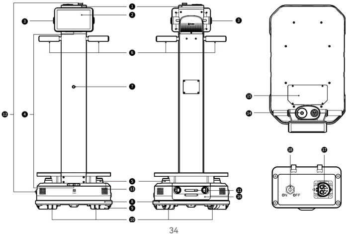
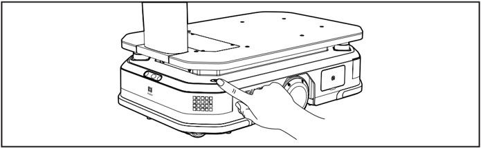
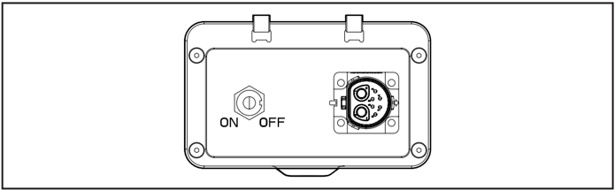
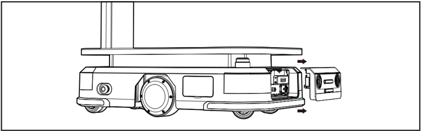
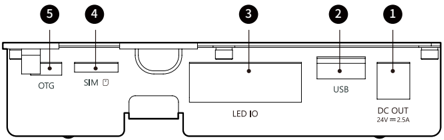

*Seite 33 (PDF-Seite 19, links)*

## Copyright © 2024 Shenzhen Pudu Technology Co., Ltd. Alle Rechte vorbehalten.

Keine Organisation oder Einzelperson darf den Inhalt dieses Benutzerhandbuchs teilweise oder vollständig ohne die ausdrückliche schriftliche Zustimmung von Shenzhen Pudu Technology Co., Ltd. kopieren, transkribieren oder übersetzen oder dieses Benutzerhandbuch zu kommerziellen Zwecken auf beliebige Weise verteilen (elektronisch oder durch Fotokopieren, Aufzeichnen usw.). Die in diesem Benutzerhandbuch bereitgestellten Spezifikationen und Angaben zum Produkt dienen nur als Referenz und können ohne vorherige Ankündigung geändert werden. Falls nicht anders angegeben, ist dieses Benutzerhandbuch nur als Orientierungshilfe gedacht und die darin enthaltenen Darstellungen sind nicht als Gewährleistung irgendwelcher Art aufzufassen.

# 1. Sicherheitsanweisungen

## 1.1 Anforderungen an die Elektrotechnik

- Es ist untersagt, den Roboter mit einem andren Ladegerät zu laden als dem Originalgerät. Wenn das Ladegerät einen Fehler aufweist, tauschen Sie es bitte sobald als möglich aus.
- Bitte laden Sie die Batterie vor dem ersten Gebrauch auf 100 % auf.
- Laden Sie den Roboter sofort auf, wenn die Ladung auf unter 20 % fällt. Wird über einen längeren Zeitraum mit einem niedrigen Batterieladestand gearbeitet, verkürzt dies die Laufzeit der Batterie.
- Stellen Sie sicher, dass die Stromversorgung mit dem Spannungsbereich des Ladegeräts übereinstimmt, da ansonsten das Ladegerät beschädigt werden kann.
- Bitte lassen Sie das Ladegerät nicht fallen bzw. vermeiden Sie Stöße mit Fremdkörpern, um Beschädigungen zu vermeiden.
- Bitte die Batterie gemäß den örtlichen Richtlinien und nicht als Hausmüll entsorgen. Unsachgemäßer Umgang kann zu einer Explosion der Batterie führen.

## 1.2 Nutzungsanforderungen

- Die Sensoren des Roboters dürfen nicht abgedeckt werden. Der Roboter kann sich sonst nicht korrekt bewegen oder verliert die Orientierung.
- Reinigung oder Wartungsarbeiten sind nicht gestattet, solange der Roboter arbeitet.
- Keine Kochgeräte mit offenen Flammen oder brennbare beziehungsweise explosive Gegenstände auf den Roboter stellen.
- Nehmen Sie keine Gegenstände heraus und stellen Sie keine hinein, während der Roboter fährt, um Sachschäden oder Verletzungen durch versehentliche Kollisionen zu vermeiden.
- Den Roboter nicht ziehen oder wegtragen, während er arbeitet. Unerwünschtes Verhalten kann die Folge sein.
- Der Roboter darf nur von geschultem Personal zerlegt oder repariert werden. Wenn ein technischer Fehler beim Roboter auftritt, wenden Sie sich bitte umgehend an den technischen Supports Ihres Händlers.
- Achten Sie beim Transport des Roboters auf die Einhaltung des erlaubten Höchstgewichts für eine einzelne Person, das von örtlichen Gesetzen und Richtlinien bestimmt ist. Stellen Sie beim Transport des Roboters bitte sicher, diesen in einer aufrechten Position zu halten.
- Während der Roboter sich bewegt, darf aus Sicherheitsgründen niemand vor dem Roboter spielen, da es sonst zu Personenschäden kommen kann.
- Auch wenn der Roboter eine automatische Hinderniserkennung umfasst, darf der Weg eines sich schnell bewegenden Roboters niemals verstellt werden, um Unfälle zu verhindern.
- Vermeiden Sie harte Schläge oder Stöße gegen den Roboter, um Beschädigungen zu vermeiden.
- Reinigen Sie den Roboter nicht mit ätzenden Chemikalien, Reinigungsmitteln oder Lösungsmitteln. Reinigen Sie den Roboter immer mit einem sauberen und trockenen Tuch.

## 1.3 Umgebungsanforderungen

- Betreiben oder laden Sie den Roboter nicht in gefährlichen Umgebungen mit hoher Temperatur, hohem Druck oder dem Risiko von Flammen oder Explosionen, um Verletzungen oder Beschädigungen am Produkt zu vermeiden.

---

*Seite 34 (PDF-Seite 19, rechts)*

- Betreiben Sie den Roboter nicht in einer feuchten Umgebung oder in Gegenwart von flüssigen oder viskosen Substanzen auf dem Boden, um Beschädigungen am Roboter zu verhindern.
- Betrieben Sie den Roboter nicht an Orten, an denen drahtlose Geräte ausdrücklich verboten sind, da dies zu Störungen bei anderen elektronischen Geräten oder sonstige Gefahren verursachen kann.
- Betreiben Sie den Roboter nicht in einer feuchten Umgebung oder auf Oberflächen, die mit Flüssigkeiten oder klebrigen Materialien bedeckt sind, da diese Schäden am Roboter verursachen können.
- Der Roboter ist für den Einsatz auf ebenem Boden geeignet. Betreiben Sie ihn nicht in einer Umgebung mit Stufen oder steilem Gefälle.
- Der Roboter muss in dem Produktbetriebsumfeld betrieben werden, das in diesem Handbuch beschrieben ist. Andernfalls kann es zu ungewöhnlichem Betrieb des Geräts oder sonstigen Gefahren führen.
- Entsorgen Sie den Roboter und dessen Zubehör nicht über den gewöhnlichen Hausmüll. Bitte halten Sie die lokalen Richtlinien zur Entsorgung des Roboters und dessen Zubehörteilen ein und unterstützen Sie das Recycling.

# 2. Produktbestandteile

## 2.1 Überblick

PUDU T300 ist ein Lieferroboter für den Materialtransport in Industrieszenarien und großen Lastaufnahmen in gewerblichen Szenarien. Er ist mit einem großen Lastträgerrahmen als Kernstück und einem Bedienschirm zur benutzerfreundlichen Bedienung ausgestattet. Die maximale Tragfähigkeit des Roboters beträgt 300 kg, und die Tragfläche ist offen und flexibel und kann mit verschiedenen Zubehörteilen ausgestattet werden, um den unterschiedlichen Tragebedürfnissen gerecht zu werden. Darüber hinaus hat er umfangreiche Schnittstellen, die sich hervorragend für Hardware-Erweiterungen und IOT-Verbindungen eignen.

## 2.2 Verpackungsliste

Roboter ×1, PUDU T300 Benutzerhandbuch ×1, Qualitätsbescheinigung ×1, Ladegerät ×1.

## 2.3 Aussehen und Bestandteile

> *Bildbeschreibung (KI):* Die Abbildung zeigt die verschiedenen Ansichten des PUDU T300 Roboters mit nummerierten Beschriftungen für seine Bestandteile. Der Roboter kann mit verschiedenen Zubehörteilen ausgestattet werden, was durch die offene Tragfläche angedeutet wird.

---

*Seite 35 (PDF-Seite 20, links)*

*Beschriftungen:*

- **1** Kontrollleuchte
- **2** LCD-Bildschirm
- **3** Bedientasten
- **4** RGBD Sensor
- **5** LiADR
- **6** Griffe
- **7** Ortungskamera im Frontbereich
- **8** Kollisionssensor
- **9** Antriebsräder
- **10** Stützräder
- **11** Ladekontakte
- **12** Notausschalter
- **13** Powerbutton
- **14** Decken Kamera
- **15** Wartungsklappe
- **16** Batteriefach
- **17** Ladeanschluss
- **18** Bremsschalter

## 2.4 Technische Spezifikationen

| Produktfunktion | Beschreibung |
|---|---|
| Betriebsspannung | DC 20,8 V bis 29,2 V |
| Batteriekapazität | 30 Ah |
| Max. Last | 300 kg |
| Aufladezeit | Etwa 2 h (von 0 % bis 90 %) |
| Batterielaufzeit | 12 h (ohne Last); 6 h (Max. Last) |
| Gesamtgewicht | 65 kg (WTID01); 81 kg (WTIDL1) |
| Gesamtabmessungen | 835 × 500 × 1350 mm |
| Rahmenabmessungen | 780 × 500 × 240 mm |
| Rundfahrtgeschwindigkeit | 0,2 m/s – 1,2 m/s (einstellbar) |
| Navigationsmethode | Visual-SLAM, Laser-SLAM |
| Min. Wegbreite | 60 cm |
| Max. überwindbare Höhe | 20 mm |
| Max. überwindbarer Spalt | 35 mm |
| Betriebssystem | Android |
| Lautsprecherleistung | 10 W × 2 Stereo-Lautsprecher |
| Betriebsumgebung | Temperatur: 0 °C bis 40 °C; Luftfeuchtigkeit: ≤ 85 % relative Luftfeuchtigkeit |
| Lagerumgebung | Temperatur: -20 °C bis 60 °C; Luftfeuchtigkeit: ≤ 85 % relative Luftfeuchtigkeit |
| Betriebshöhe | < 2000 m |
| Wegoberflächenanforderungen | Innenraum mit ebenen, flachen Oberflächen |
| Eingangsspannung des Ladegerätes | AC 100 V – 240 V, 50/60 Hz |
| Ausgangsspannung des Ladegerätes | 29,2 V, 15 A |

# 3. Produktanweisungen

## 3.1 Schalterbeschreibung

## Einschalten:

Verschieben Sie den Roboter an den Startpunkt. Halten Sie den Powerbutton 3 Sekunden lang gedrückt bis die Kontrollleuchte des Roboters blau wird, um anzuzeigen, dass der Roboter erfolgreich eingeschaltet wurde.

---

*Seite 36 (PDF-Seite 20, rechts)*

> *Bildbeschreibung (KI):* Die Abbildung zeigt die Position des Power-Buttons am Roboter. Ein Finger drückt auf den Power-Button, was die Bedienung zur Ausschaltung veranschaulicht.
## Ausschalten:

Halten Sie den Powerbutton 3 Sekunden lang gedrückt. Daraufhin wird ein Pop-up-Fenster zum Ausschalten angezeigt. Klicken Sie auf „Ausschalten". Der Lichtstreifen oben am Roboter und der Bildschirm werden ausgeschaltet und damit angeben, dass der Roboter erfolgreich ausgeschaltet wurde.

## Anhalten:

Während der Roboter sich bewegt, kann die aktuelle Aufgabe unterbrochen werden, indem auf den Bildschirm getippt wird. Erneutes Tippen auf den Bildschirm wird die Aufgabe fortgesetzt.

## Nothalt:

Kommt es während der Bewegung des Roboters zu einem Notfall, drücken Sie den Notausschalter, um den Roboter anzuhalten. Drehen Sie den Notausschalter im Uhrzeigersinn und befolgen Sie die Bildschirmanweisungen, um den Roboter wieder in Betrieb zu setzen.

## Bremsschalter:

Um die Sicherheit zu gewährleisten, greift der Bremsschalter nur, nachdem der Roboter gestoppt wurde. Wenn der Bremsschalter auf "ON" steht, stoppt der Motor bei einem Notstopp automatisch, um die Sicherheit zu gewährleisten. Wenn Sie den Roboter schieben möchten, müssen Sie den Bremsschalter auf "OFF" stellen.

> *Bildbeschreibung (KI):* Der Notausschalter befindet sich auf der Rückseite des Roboters. Der Bremsschalter ist im Uhrzeigersinn drehbar und hat die Positionen ON und OFF. Die Ladebuchse für das Ladegerät oder eine Ladesäule ist ebenfalls an der Rückseite angebracht. Der Powerbutton befindet sich oben am Gerät.
## 3.2 Aufladen und Batterietausch

## Laden:

Der T300 unterstützt das Laden mit einem Ladegerät oder einer Ladesäule.

a) Mit dem Ladegerät: Stecken Sie das passende Ladegerät an den Ladeanschluss des Roboters, um mit dem Laden zu beginnen.

b) Mit der Ladesäule: Nach dem Installieren der Ladesäule gemäß den Einsatzanweisungen starten Sie den Roboter normal. Klicken Sie auf die Taste „Zurück zum Laden" auf der Oberfläche des Roboters, um die Rückkehr zum Ladevorgang zu beginnen.

---

*Seite 37 (PDF-Seite 21, links)*

## Batterietausch:

Wenn der Roboter ausgeschaltet ist, öffnen Sie die Abdeckung des Batteriefachs. Trennen Sie die Stromverbindung an der Batterie, um die Batterie auszutauschen. Schließen Sie danach die Stromverbindung wieder an und schließen Sie die Abdeckung des Batteriefachs erneut, bevor Sie den Roboter wieder einschalten.

> *Bildbeschreibung (KI):* Die Abbildung zeigt die Seitenansicht des Roboters mit geöffnetem Batteriefach. Pfeile deuten an, dass das Batteriefach nach rechts herausgezogen werden kann. Die Position der Räder und des oberen Plattformbereichs ist dargestellt.
## 3.3 Schnittstellenbeschreibung

> *Bildbeschreibung (KI):* Die Nummer 1 zeigt den DC-Ausgang (24V = 2,5A) für die Stromversorgung. Die Nummer 2 kennzeichnet den USB-Anschluss zur Datenkommunikation. Die Nummer 4 markiert den SIM-Kartenschlitz, der Nano-SIM-Karten unterstützt.
Unterhalb des Schnittstellenfensters können externe Schnittstellen für Hardware-Erweiterungen und Geräteentstörungen verwendet werden. Nachfolgend sind die konkreten Schnittstellenspezifikationen aufgeführt:

| Nr. | Name | Beschreibung |
|---|---|---|
| 1 | Stromversorgungsschnittstelle | 24V (Batteriespannung), maximaler Ausgangsstrom 2,5 A. DC Anschlusspoldurchmesser: Ø2,5 mm |
| 2 | USB | USB 2.0, zur Datenkommunikation mit externen Geräten |
| 3 | EA | Verwendet zur Signalkommunikation von externen optionalen Zubehörteilen |
| 4 | SIM-Kartenschlitz | Unterstützt Nano-SIM-Karte |
| 5 | OTG | Verwendet zur Geräteentstörung |

## 3.4 Arbeitsmodi

Der Roboter ist mit unterschiedlichen Modi für verschiedene Szenarien ausgestattet, darunter Serviermodus, Rundfahrtmodus und Hebemodus.

---

*Seite 38 (PDF-Seite 21, rechts)*

| Modus | Beschreibung |
|---|---|
| Serviermodus | Benutzer können Materialien für unterschiedliche Ziele auf dem Roboter legen und über den Bildschirm zu verschiedenen Zielen senden. Der Roboter wählt selbst den besten Weg aus um die Gegenstände an alle Ziele zu liefern. Nach Abschluss der Lieferung kehrt er automatisch an seinen Standby-Punkt zurück. |
| Rundfahrmodus | Der Benutzer legt den Weg fest und der Roboter fährt den eingestellten Weg in einem Rundkurs ab. Außerdem kann der Roboter an einem Stopppunkt anhalten, damit der Benutzer Materialien einfacher ausnehmen und ablegen, während der Roboter auf dem Weg ist. |
| Hebemodus* | Der Benutzer kann Hebepunkte und Ablegepunkte festlegen. Der Roboter bewegt sich automatisch zu den Hebepunkten, um Materialien zu identifizieren und anzuheben, und danach die Materialien ablegen, nachdem diese zum Ziel transportiert wurden. |

T Der Hebemodus wird nur vom WTIDL 1-Modell unterstützt.

Für genaue Anweisungen zur Verwendung des Roboters finden Sie im PUDU T300-Bedienungsleitfaden.

# 4. Wartung und Pflege

| Zu pflegendes Teil | Roboterstatus | Prüfhäufigkeit | Überprüfung und Wartungsverfahren |
|---|---|---|---|
| Antriebsräder und Stützräder | Ausschalten | Wöchentlich | Wischen Sie die Oberfläche mit einem sauberen Tuch ab. Überprüfen Sie die Radoberfläche auf Abnutzung und tauschen Sie es bei Bedarf aus. |
| Optischer Sensor und LiDAR | Ausschalten | Wöchentlich | Wischen Sie die Oberfläche mit einem sauberen Tuch ab. Wenn unerwartete Verschmutzung oder Beschädigungen vorliegen, zeitnah bearbeiten, um eine Blockade des Sensors und ungewöhnlichen Betrieb des Roboters zu verhindern. |
| Robotergehäuse | Ausschalten | Monatlich | Wischen Sie die Oberfläche mit einem sauberen Tuch ab. Und überprüfen Sie die Installation. Stellen Sie sicher, dass das Gehäuse eben und sicher fixiert ist. |
| Anzeigelichter und Geräusche | Einschalten | Monatlich | Überprüfen Sie, ob alle Kontrollleuchten und akustischen Warnsignale funktionieren. |
| Notausschalter | Einschalten | Monatlich | Überprüfen Sie, ob der Notausschalter korrekt funktioniert. |
| Bremsschalter | Einschalten | Halbjährlich | Stellen Sie den Bremsschalter auf die Position „AUS“ und schieben Sie den Roboter vorwärts, um zu überprüfen, ob der Bremsschalter korrekt funktioniert. Hinweis: Schalten Sie nach der Prüfung die Bremse erneut auf „EIN“. |
| Sicherheitsaufkleber und Namensschilder | Ausschalten | Halbjährlich | Überprüfen Sie, ob die Sicherheitsaufkleber, Etiketten und Namensschilder auf dem Roboter intakt und klar ersichtlich sind. |

Detaillierte Wartungsanweisungen finden Sie im PUDU T300 Benutzerhandbuch.

---

*Seite 39 (PDF-Seite 22, links)*

# 5. Kundendienst

Shenzhen Pudu Technology Co., Ltd. ist dafür verantwortlich, während des Gewährleistungszeitraums kostenlose Garantiedienstleistungen zu gewährleisten (unterschiedliche Teile des Produkts haben unterschiedliche Gewährleistungszeiträume). Der Kunde muss keine Gebühren für diese Ersatzteile bezahlen. Standardgebühren fallen an, wenn der Gewährleistungszeitraum abgelaufen ist oder bei Fällen, bei denen kostenlose Produktgewährleistung nicht gilt. Kunden können die Kundendiensthotline anrufen, um mehr über die Kundendienstrichtlinien und Produktwartung zu erfahren, oder detaillierte Informationen über die Kundendienstrichtlinien im PUDU T300 Benutzerhandbuch erhalten.

Kundendiensthotline von Pudu Technology: +86 755-86952935, E-Mail-Adresse des Kundendienstes: techservice@pudutech. com

# 6. Compliance-Informationen

### 6.1 Informationen zur Entsorgung und zum Recycling

Die Richtlinie über Elektro- und Elektronik-Altgeräte (WEEE) zielt darauf ab, die Auswirkungen von Elektro- und Elektronikgeräten auf die Umwelt zu minimieren, indem die Wiederverwendung und das Recycling gefördert und die Menge der zu entsorgenden Elektro- und Elektronik-Altgeräte reduziert wird. Das Symbol auf diesem Produkt oder seiner Verpackung bedeutet, dass dieses Produkt am Ende seiner Lebensdauer getrennt vom normalen Hausmüll entsorgt werden muss. Beachten Sie, dass Sie dafür verantwortlich sind, elektronische Geräte in Recyclingzentren zu entsorgen, um natürliche Ressourcen zu schonen. In jedem Land gibt es eigene Sammelstellen für das Recycling von Elektro- und Elektronikgeräten. Informationen zum Recycling-Rückgabebereich erhalten Sie bei der zuständigen Abfallentsorgungsbehörde für elektrische und elektronische Geräte, bei der örtlichen Stadtverwaltung oder bei der Müllentsorgungsstelle Ihres Standorts.

Bevor Elektro- und Elektronikgeräte (EEE) in den Wertstoffkreislauf oder in Abfallsammelstellen gegeben werden, muss der Endnutzer von Geräten, die Batterien und/oder Akkumulatoren enthalten, diese Batterien und Akkumulatoren zur getrennten Sammlung entfernen.
