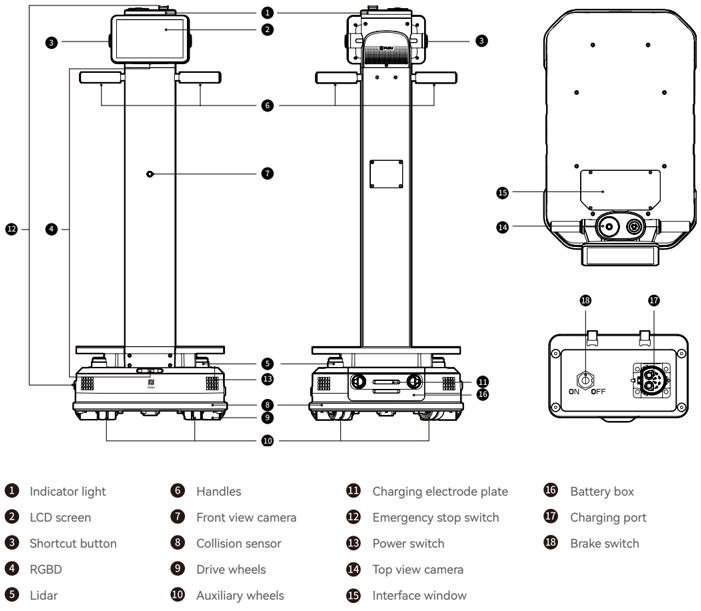
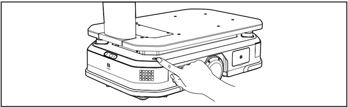
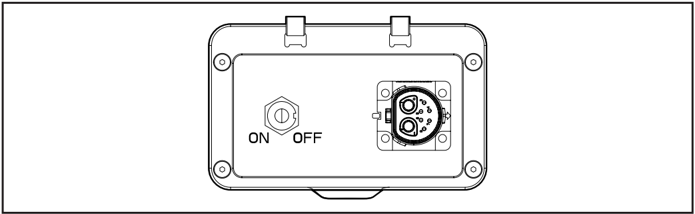
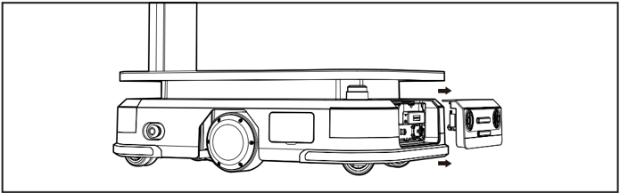
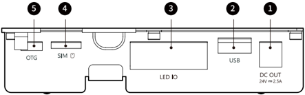

*Page 1 (PDF page 3, left)*

## Copyright © 2024 Shenzhen Pudu Technology Co., Ltd. All rights reserved.

No organization or individual shall imitate, copy, transcribe or translate the contents of this user guide, in part or in full, without the express written consent of Shenzhen Pudu Technology Co., Ltd., or distribute this user guide for profit in any way (electronically or via photocopying, recording, etc.). The product specifications and information provided in this user guide are for reference only and are subject to change without further notice. Unless otherwise specified, this user guide is only intended as instructions for use, and no representation shall be deemed as a warranty of any kind.

# 1. Safety Instructions

## 1.1 Electrical requirements

- Charge the robot using the charger delivered with it. Do not use other chargers. If the charger is damaged, replace it in a timely manner.
- Please charge the battery to 100% before first use.
- When the battery is lower than 20%, charge the robot in a timely manner. Do not run the robot with a low battery for a long time. The battery life may be reduced.
- Make sure that the power supply voltage complies with the voltage range specified on the charger, otherwise the charger may be damaged.
- Do not drop the charger or hit it. Otherwise, damage to the charger may be caused.
- Please dispose of the battery according to local regulations and do not dispose of it as household waste. Improper handling may cause the battery to explode.

## 1.2 Use requirements

- Do not block the robot sensor. Otherwise, the robot may fail to move properly or get lost.
- Cleaning or maintenance work is prohibited while the robot is powered on.
- Do not place cookers with naked flames or flammable or explosive items on the robot.
- Do not pick up or place any items while the robot is moving, to avoid property losses or personal injury caused by accidental collisions.
- Do not push or carry the robot while it is moving, to prevent it from running abnormally.
- The robot can be disassembled or repaired only by trained professionals. In case of any fault with the robot, please contact a technical support engineer immediately.
- When moving the robot, please observe the requirements on the maximum allowed weight for a single person stipulated by local laws or regulations. While the robot is being moved, please be sure to always keep it in an upright position.
- When the robot is in motion, no playing is allowed in front of the robot to avoid unnecessary harm.
- Although the robot features automatic obstacle avoidance, never block the robot moving at a high speed to avoid any accidents.
- Please prevent the robot from violent impact or shock to avoid any damage.
- Do not clean the robot with caustic chemicals, cleansers, or detergents. Always clean the robot by wiping it with a clean and dry cloth.

## 1.3 Environmental requirements

- Do not use or charge the robot in dangerous environments with high temperature, high pressure, or risks of flames or explosions, so as to avoid personal injury or damage to the product.
- Do not use the robot in a humid environment or in the presence of liquid or viscous substances on the ground, so as to avoid damage to the robot.
- Do not use the robot in locations where wireless devices are explicitly prohibited, as this may interfere with other electronic devices or cause other hazards.
- Do not use the robot in a humid environment or on surfaces covered with fluid or gooey stuff to avoid damage to the robot.

---

*Page 2 (PDF page 3, right)*

- The robot is suitable for use on flat ground. Do not use it in an environment with steps, or steep slope.
- It is necessary to use the robot under the product operating environment declared in this manual. Otherwise, there may be abnormal operation of the equipment or other hazards.
- Do not dispose of the robot and its accessories as ordinary domestic waste. Please comply with local regulations on the disposal of the robot and its accessories and support recycling.

# 2. Product Components

## 2.1 Overview

PUDU T300 is a delivery robot applied to material transfer in industrial scenarios and large load handling in commercial scenarios. It is equipped with a load carrier chassis as the core and an operation screen for user-friendly use. The maximum load of the robot can reach 300 kg, and the carrying space is open and flexible, which can be matched with different accessories to meet different carrying needs. Meanwhile, it has rich interfaces, which is convenient for hardware expansion and IOT interconnection.

## 2.2 Packaging list

Robot ×1, PUDU T300 User Manual ×1, Quality Certificate ×1, Charger ×1.

## 2.3 Appearance and Components

> *Figure description (AI):* The figure identifies key components of the PUDU T300 robot using numbered labels.

*Labels:*

- **1** Indicator light
- **2** LCD screen
- **3** Shortcut button
- **4** RGBD
- **5** Lidar
- **6** Handles
- **7** Front view camera
- **8** Collision sensor
- **9** Drive wheels
- **10** Auxiliary wheels
- **11** Charging electrode plate
- **12** Emergency stop switch
- **13** Power switch
- **14** Top view camera
- **15** Interface window
- **16** Battery box
- **17** Charging port
- **18** Brake switch

---

*Page 3 (PDF page 4, left)*

## 2.4 Technical Specifications

| Product Feature | Description |
|---|---|
| Operating voltage | DC 20.8 V-29.2 V |
| Battery capacity | 30 Ah |
| Max. load | 300 kg |
| Charging time | About 2 h (from 0% to 90%) |
| Battery life | 12 h (None load); 6 h (Max. load) |
| Overall weight | 65 kg (WTID01); 81 kg (WTIDL1) |
| Overall dimensions | 835 × 500 × 1350 mm |
| Chassis dimensions | 780 × 500 × 240 mm |
| Cruise speed | 0.2–1.2 m/s (adjustable) |
| Navigation method | Visual-SLAM, Laser-SLAM |
| Min. Path Clearance | 60 cm |
| Max. surmountable height | 20 mm |
| Max surmountable gap | 35 mm |
| Operating system | Android |
| Speaker power | 10 W × 2 stereo speaker |
| Working environment | Temperature: 0° C to 40° C; humidity: ≤ 85% RH |
| Storage environment | Temperature: -20° C to 60° C; humidity: ≤ 85% RH |
| Operating altitude | < 2000 m |
| Road surface requirements | Indoor environment with flat, smooth surfaces |
| Charger power input | AC 100 V - 240 V, 50/60 Hz |
| Charger power output | 29.2 V, 15 A |

# 3. Product Instructions

## 3.1 Button description

## Powering on:

Move the robot to the startup location. Press and hold the power switch for 3 seconds, and the Indicator light of the robot will turn blue, indicating that the robot has been successfully powered on.

> *Figure description (AI):* The image shows a hand pressing a button on the side of the robot. This indicates how to operate or interact with the device's physical controls.

---

*Page 4 (PDF page 4, right)*

## Powering off:

Press and hold the power switch for 3 seconds, and a shutdown prompt will pop up. Click "Power off" and the light strip on the top of the robot and the screen will turn off, indicating that the robot has been successfully powered off.

## Pause:

While the robot is moving, the current task can be paused by tapping the screen. Tapping the screen again will resume the current task.

## Emergency stop:

In case of an emergency while the robot is moving, press the emergency stop switch to stop the robot. Turn the emergency stop switch clockwise and follow the on-screen prompts to resume the robot's operation.

## Brake switch:

To ensure safe use, when the brake switch is in the "ON" state, the drive wheels will attempt to self-lock and stop when the robot is powered off or in certain abnormal situations. If you need to push the robot, you need to set the brake switch to "OFF".

> *Figure description (AI):* The figure shows the location of the brake switch on the robot's chassis. The brake switch has two positions labeled 'ON' and 'OFF'. When in the 'ON' position, the drive wheels will self-lock when powered off. When in the 'OFF' position, the robot can be pushed manually.
## 3.2 Charging and Battery Replacement

## Charging:

The T300 supports charging with a charger or a charging pile.

a) Using a charger: Simply insert the matching charger into the robot's charging port to start charging.

b) Using a charging pile: After deploying the charging pile according to the deployment instructions, start the robot normally. Click on the "Return to Charging" button on the robot's interface to initiate the return to charging process.

## Battery Replacement:

When the robot is powered off, open the battery compartment cover. Disconnect the power connector attached to the battery in order to replace the battery. After that, reconnect the power connector and close the battery compartment cover before turning on the robot for use.

> *Figure description (AI):* The figure shows the location of the charging port on the robot. Arrows indicate that the battery compartment cover can be opened or removed. The image illustrates how to access the internal components for battery replacement.

---

*Page 5 (PDF page 5, left)*

## 3.3 Interface Description

> *Figure description (AI):* The diagram shows the location of external interfaces on the device. Label 1 indicates the DC OUT power supply interface with a 24V output. Label 2 points to the USB port for data communication. Label 3 identifies the LED IO used for signal communication with accessories.
Under the interface window, there are external interfaces that can be used for hardware expansion and device debugging. The specific interface specifications are as follows:

| No. | Name | Description |
|---|---|---|
| 1 | Power supply interface | 24 V (battery voltage), maximum output current of 2.5 A. DC plug pin diameter: Ø2.5 mm |
| 2 | USB | USB 2.0, for data communication with external devices |
| 3 | LED IO | Used for signal communication of external optional accessories |
| 4 | SIM card slot | Supports Nano SIM card |
| 5 | OTG | Used for device debugging |

## 3.4 Mode Introduction

The robot comes with various modes to cater to different scenarios, including Delivery mode, Cruise mode, and Lifting mode.

| Mode | Description |
|---|---|
| Delivery mode | Users can place materials for multiple destinations on the robot and use the screen to send tasks for materials delivery. The robot can plan the best path by itself and deliver the items to all destinations. After the delivery is completed, it will automatically return to the standby point. |
| Cruise mode | The user can set the path, and the robot will run along the pre-set path in a cycle. In addition, the robot can stop at a stop point on the cruise path, to make it easier for the user to pick up and place materials while the robot is running. |
| Lifting mode * | Users can set lifting points and drop-off points. The robot will automatically go to the lifting point to identify and lift the materials, and then automatically unload the materials after transporting them to the destination. |

The lifting mode is only supported by the WTIDL1 model.

For detailed instructions on using the robot, please refer to the PUDU T300 Operation Guide.

---

*Page 6 (PDF page 5, right)*

# 4. Maintenance and Servicing

| Part to maintain | Robot status | Checking frequency | Inspection and maintenance method |
|---|---|---|---|
| Drive wheels and auxiliary wheels | Powered off | One week | Please wipe the surface with a clean cloth. Check the wheel surface for wear and replace the wheel if necessary. |
| Visual sensor, and LiDAR | Powered off | One week | Please wipe the surface with a clean cloth. If there is sudden dirt or damage, please handle it in time to avoid blocking the sensor and causing abnormal operation of the robot. |
| Robot body | Powered off | One month | Please wipe the surface with a clean cloth. And check the installation. Make sure the housing is flat and securely fixed. |
| Indicator lights and sound | Powered on | One month | Check that all indicator lights and audible warnings are working properly. |
| Emergency stop switch | Powered on | One month | Check that the emergency stop button is working properly. |
| Brake switch | Powered on | Six months | Turn the brake switch to the "OFF" position and gently push the robot forward to check that the brake switch is working properly. Note: Turn the brake to the "ON" again after checking. |
| Safety stickers and nameplates | Powered off | Six months | Check that the safety stickers, labels and nameplates on the robot are intact and clearly visible. |

For detailed maintenance instructions, please refer to the PUDU T300 User Guide.

# 5. After-Sales Service

Shenzhen Pudu Technology Co., Ltd. undertakes to provide free product warranty services during the product's warranty period (different parts of the product may have different warranty periods). The customer does not need to pay any fees for the spare parts. Standard fees apply if the warranty period has expired or in cases where free product warranty is not applicable. Customers can call the after-sales service hotline to learn more about the after-sales service policy and for product maintenance, or refer to the PUDU T300 User Guide for detailed after-sales service policies.

Pudu Technology after-sales service, after-sales service email: techservice@pudutech.com

---

*Page 7 (PDF page 6, left)*

# 6. Compliance information

## 6.1 Disposal and recycling information

The Waste Electrical and Electronic Equipment (WEEE) Directive aims to minimize the impact of electrical and electronic goods on the environment, by increasing re-use and recycling and by reducing the amount of WEEE going to landfill. The symbol on this product or its packaging signifies that this product must be disposed separately from ordinary household wastes at its end of life. Be aware that this is your responsibility to dispose of electronic equipment at recycling centers in order to conserve natural resources. Each country should have its collection centers for electrical and electronic equipment recycling. For information about your recycling drop off area, please contact your related electrical and electronic equipment waste management authority, your local city office, or your house hold waste disposal service.

Before placing electrical and electronic equipment (EEE) in the waste collection stream or in waste collection facilities, the end user of equipment containing batteries and/or accumulators must remove those batteries and accumulators for separate collection.

---

*Page 8 (PDF page 6, right)*

# 7. Compliance information

## 7.1 Federal Communications Commission compliance statement

The following information applies to Pudu robotic.

This equipment has been tested and found to comply with the limits for a Class B digital device, pursuant to part 15 of the FCC Rules. These limits are designed to provide reasonable protection against harmful interference in a residential installation. This equipment generates, uses and can radiate radio frequency energy and, if not installed and used in accordance with the instructions, may cause harmful interference to radio communications. However, there is no guarantee that interference will not occur in a particular installation. If this equipment does cause harmful interference to radio or television reception, which can be determined by turning the equipment off and on, the user is encouraged to try to correct the interference by one or more of the following measures:

- Reorient or relocate the receiving antenna.
- Increase the separation between the equipment and receiver.
- Connect the equipment into an outlet on a circuit different from that to which the receiver is connected.
- Consult the dealer or an experienced radio/TV technician for help.

This device complies with Part 15 of the FCC rules. Operation is subject to the following two conditions:

- This device may not cause harmful interference.
- This device must accept any interference received, including interference that may cause undesired operation.

## 7.2 Industry Canada compliance statement

This device complies with Industry Canada licence-exempt RSS standard(s). Operation is subject to the following two conditions:

- This device may not cause interference.
- This device must accept any interference, including interference that may cause undesired operation of the device.
